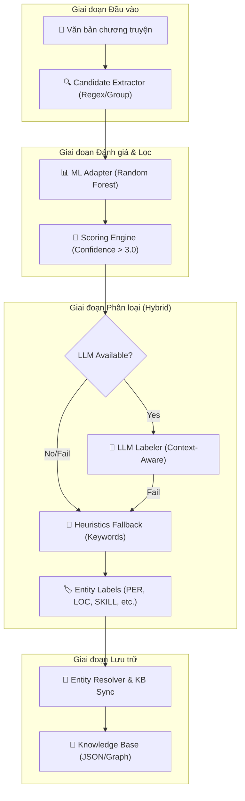

# AI Story Co-Pilot Service - Novel Sharing Platform

Dịch vụ AI thế hệ mới, tích hợp LLM (Large Language Models) để hỗ trợ tác giả xây dựng thế giới truyện nhất quán, thông minh và có chiều sâu thông qua đồ thị tri thức (Knowledge Graph).

## 🚀 Tính năng chính

- **Hybrid NER Pipeline**: Nhận diện thực thể (Nhân vật, Địa điểm, Tổ chức, Kỹ năng, Vật phẩm) sử dụng sự kết hợp giữa **Candidate Extraction**, **ML Scoring**, **LLM Labeling** và **Heuristics Fallback**.
- **Context-Aware Classification**: Sử dụng ngữ cảnh câu văn để phân loại chính xác các thực thể đặc thù của thể loại tiên hiệp/kiếm hiệp (SKILL, ITEM) mà các mô hình NER truyền thống thường bỏ sót.
- **KB-Anchored Entity Resolution**: Tự động chuẩn hóa tên gọi bằng so khớp mờ (Fuzzy Matching) và đối soát trực tiếp với Knowledge Base (KB).
- **LLM-Powered Event Extraction**: Sử dụng sức mạnh suy luận của LLM (Gemini 2.0 Flash / Llama 3) để trích xuất các tương tác phức tạp.
- **Robust Fallback Mechanism**: Tự động chuyển sang bộ quy tắc Heuristics khi LLM gặp lỗi quota (429), đảm bảo dịch vụ luôn khả dụng.
- **Lightweight Architecture**: Loại bỏ các mô hình Deep Learning nặng (PhoBERT), giúp dịch vụ khởi động tức thì và tiết kiệm RAM (>400MB).
- **Human-in-the-Loop**: Quy trình xác nhận 2 bước giúp tác giả giữ quyền kiểm soát tuyệt đối.

## 🏗️ Kiến trúc hệ thống (Hybrid Pipeline)



## 🛠️ Công nghệ sử dụng

- **Backend Framework**: FastAPI (Python 3.10+)
- **Frontend Framework**: React + Vite + TailwindCSS
- **ML/NLP**: Scikit-learn (Random Forest), joblib, RapidFuzz
- **LLM Providers**: Google Gemini 2.0 Flash (Ưu tiên), OpenAI, Groq Cloud
- **Storage**: JSON-based Graph Storage (Sẵn sàng cho Neo4j)

## ⚙️ Cấu hình hệ thống (.env)

Hệ thống yêu cầu các API Key để hoạt động tốt nhất. Copy file mẫu và điền thông tin:

```bash
# Trong thư mục ai-service
LLM_PROVIDER=gemini
LLM_MODEL=gemini-2.0-flash
GEMINI_API_KEY=AIza_your_key_here
```

## 🏁 Hướng dẫn khởi động

### 1. Khởi động AI Service (Backend)
Yêu cầu Python 3.10+

```bash
cd ai-service
# Cài đặt thư viện
pip install -r requirements.txt

# Chạy server (mặc định tại port 8000)
uvicorn main:app --reload
```

### 2. Khởi động Web UI (Frontend)
Yêu cầu Node.js 18+

```bash
cd web-ui
# Cài đặt dependencies
npm install

# Chạy ở chế độ phát triển (mặc định tại port 5173)
npm run dev
```
Sau khi khởi động cả hai, truy cập `http://localhost:5173` để bắt đầu trải nghiệm.

## 📊 Trạng thái & Lộ trình (Roadmap)

### ✅ Đã hoàn thành (Stable)
- [x] Chuyển đổi sang **Hybrid NER Pipeline** (Loại bỏ PhoBERT nặng).
- [x] Tích hợp **Heuristics Fallback** cho SKILL/ITEM.
- [x] Hỗ trợ ngữ cảnh (Sentence Context) trong LLM Labeling.
- [x] Tối ưu hóa hiệu năng và dung lượng (Khởi động tức thì).
- [x] UX/UI Sidebar AI Assistant ổn định.

### 🚧 Đang triển khai
- [ ] **Vector Search (RAG)**: Hỗ trợ bối cảnh truyện dài hàng trăm chương.
- [ ] **Advanced Graph Visualization**: Trực quan hóa mối quan hệ nhân vật dưới dạng đồ thị động.

---
© 2026 Novel Sharing Platform Team.
