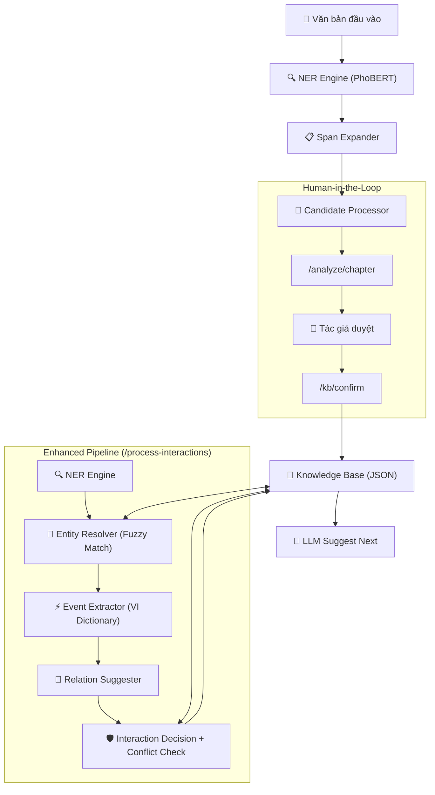

# AI Service - Novel Sharing Platform

Dịch vụ AI cung cấp các tính năng xử lý ngôn ngữ tự nhiên (NLP) như trích xuất thực thể (NER), kiểm tra tính nhất quán và gợi ý nội dung tiếp theo cho nền tảng viết truyện.

## Tính năng chính

- **NER Extraction**: Tự động nhận diện Nhân vật, Địa điểm, Vật phẩm từ văn bản (sử dụng PhoBERT).
- **Candidate Processing**: Chuẩn hóa và lọc các thực thể trước khi đưa vào Knowledge Base.
- **Entity Resolution**: So khớp mờ (fuzzy matching) giữa thực thể NER và KB để chuẩn hóa tên gọi.
- **Event Extraction**: Nhận diện sự kiện tương tác từ văn bản bằng từ điển hành động tiếng Việt.
- **Relation Suggestion**: Tự động gợi ý mối quan hệ (ALLY_OF, ENEMY_OF) dựa trên sự kiện.
- **Conflict Detection**: Phát hiện mâu thuẫn với quan hệ đã bị khóa bởi tác giả.
- **Human-in-the-Loop**: Cho phép người dùng xác nhận các thực thể đã trích xuất qua endpoint `/kb/confirm`.
- **LLM Suggestion**: Gợi ý tình tiết tiếp theo dựa trên bối cảnh từ đồ thị tri thức (Knowledge Graph).

## Kiến trúc hệ thống



### Luồng xử lý chính

| Bước | Module | Mô tả |
|------|--------|-------|
| 1 | `ner_engine.py` | Trích xuất thực thể thô từ văn bản |
| 1.5 | `entity_resolver.py` | So khớp tên NER với tên chuẩn trong KB |
| 2 | `event_service.py` | Nhận diện hành động (tấn công, giúp đỡ...) bằng từ điển tiếng Việt |
| 3 | `relation_service.py` | Gợi ý quan hệ mới (ENEMY_OF, ALLY_OF, KNOWS) |
| 4 | `interaction_service.py` | Quyết định: tự động áp dụng / gợi ý / bỏ qua (nếu xung đột) |

## Yêu cầu hệ thống

- Python 3.10+
- PyTorch & Transformers (cho mô hình NER)
- Neo4j (cho Knowledge Graph)

## Hướng dẫn cài đặt

1. **Tạo môi trường ảo (Virtual Environment):**
   ```bash
   python -m venv venv
   source venv/bin/activate  # Trên Windows: venv\Scripts\activate
   ```

2. **Cài đặt thư viện:**
   ```bash
   pip install -r requirements.txt
   ```

3. **Cấu hình biến môi trường:**
   Tạo file `.env` trong thư mục `ai-service/` với các nội dung:
   ```env
   PHOBERT_MODEL_DIR=./models/phobert_ner_tienhiep
   LLM_PROVIDER=gemini
   LLM_MODEL=gemini-2.5-flash-lite
   NEO4J_URI=bolt://localhost:7687
   NEO4J_USER=neo4j
   NEO4J_PASSWORD=your_password
   ```

## Hướng dẫn khởi động

Bạn **bắt buộc** phải di chuyển vào thư mục `ai-service` trước khi chạy lệnh khởi động để đảm bảo các đường dẫn module chính xác.

Từ thư mục gốc của project, chạy lệnh sau:

```powershell
cd ai-service; uvicorn main:app --host 0.0.0.0 --port 8000 --reload
```

Hoặc nếu bạn đã ở trong thư mục `ai-service`:

```powershell
uvicorn main:app --host 0.0.0.0 --port 8000 --reload
```

Để dừng service, nhấn `Ctrl + C` trong terminal.

Sau khi khởi động, bạn có thể truy cập:
- API Documentation (Swagger UI): `http://localhost:8000/docs`
- Health Check: `http://localhost:8000/health`

## Tài liệu API chi tiết

Dưới đây là thông số chi tiết để test bằng Postman hoặc cURL.

### 1. Analyze Chapter (HITL Bước 1)
Phân tích văn bản và trả về các "ứng viên" thực thể để người dùng duyệt.
- **Endpoint**: `POST /v1/ai/analyze/chapter`
- **Request Body**:
```json
{
  "story_id": "story-001",
  "text": "Tiêu Viêm đi tới Ô Thản Thành, gặp được Huân Nhi."
}
```
- **Response**: Trả về danh sách `candidates` với `id` định danh.

### 2. Confirm Knowledge Base (HITL Bước 2)
Lưu các ứng viên đã được người dùng phê duyệt vào cơ sở dữ liệu.
- **Endpoint**: `POST /v1/ai/kb/confirm`
- **Request Body**:
```json
{
  "story_id": "story-001",
  "approved_candidates": [
    {
      "id": "uuid-v4-string",
      "raw_name": "Tiêu Viêm",
      "normalized_name": "Tiêu Viêm",
      "type": "PER",
      "confidence": 0.98,
      "status": "approved",
      "action": "suggest_add"
    }
  ]
}
```

### 3. Suggest Next Content
Gợi ý tình tiết tiếp theo dựa trên nhân vật và bối cảnh hiện tại.
- **Endpoint**: `POST /v1/ai/suggest-next`
- **Request Body**:
```json
{
  "character_name": "Tiêu Viêm",
  "current_text": "Tiêu Viêm đang đứng trước cổng thành,",
  "max_regenerations": 2
}
```
- **Response**: Trả về danh sách các `suggestions` và kết quả kiểm tra tính nhất quán (`validations`).

### 4. Extract Entities (Legacy)
Trích xuất thực thể thô trực tiếp từ văn bản (không qua bước duyệt).
- **Endpoint**: `POST /v1/ai/extract-entities`
- **Request Body**:
```json
{
  "text": "Tiêu Viêm cầm theo Huyền Trọng Thước."
}
```

### 5. Enhanced Pipeline
Quy trình AI cải tiến bao gồm trích xuất thực thể, nhận diện sự kiện, gợi ý quan hệ và quyết định tương tác tự động.
- **Endpoint**: `POST /v1/enhanced/process-interactions`
- **Request Body**:
```json
{
  "story_id": "story-001",
  "text": "Tiêu Viêm tấn công bóng đen bằng thanh kiếm của mình.",
  "use_existing_entities": true
}
```
- **Response**: Trả về số lượng thực thể, sự kiện, các quan hệ được áp dụng, gợi ý hoặc bỏ qua.

### 6. Override Relation
Cho phép người viết ghi đè và khóa một mối quan hệ trong Knowledge Base, ngăn AI thay đổi sau này.
- **Endpoint**: `POST /v1/enhanced/relation/override`
- **Request Body**:
```json
{
  "story_id": "story-001",
  "subject": "Tiêu Viêm",
  "relation": "ENEMY_OF",
  "object": "Hồn Điện"
}
```

---

## Vấn đề đã biết (Known Issues)

Dựa trên kết quả test tự động (automated test script) chạy trên toàn bộ pipeline, hệ thống hiện tại đã được xác nhận có **3 vấn đề kỹ thuật cốt lõi**:

### Vấn đề 1: Entity Mismatch — NER trả về thực thể không khớp với KB

| Hạng mục | Chi tiết |
|---|---|
| **Module liên quan** | `event_service.py`, `ner_engine.py` |
| **Mô tả** | NER trả về tên thực thể bị cắt xén hoặc sai (ví dụ: `"Ô Thản"` thay vì `"Ô Thản Thành"`, `"Tiêu"` thay vì `"Tiêu Viêm"`). Khi pipeline `process-interactions` sử dụng kết quả NER này để tạo Event/Relation, nó sinh ra các quan hệ nối tới thực thể không tồn tại trong KB. |
| **Hệ quả** | Dữ liệu rác trong KB (`"Tiêu Viêm" -KNOWS-> "nhập"`), đồ thị tri thức bị phân mảnh, endpoint `suggest-next` không tìm thấy bối cảnh quan hệ. |

### Vấn đề 2: Heuristic Event Extraction chỉ nhận diện từ khóa tiếng Anh

| Hạng mục | Chi tiết |
|---|---|
| **Module liên quan** | `event_service.py` |
| **Mô tả** | Bộ trích xuất sự kiện hiện tại chỉ nhận diện các từ khóa tiếng Anh (`"attack"`, `"help"`, `"kill"`). Với văn bản tiếng Việt (ví dụ: `"tấn công"`, `"giúp đỡ"`, `"gia nhập"`), hệ thống mặc định trả về action `"interacted_with"` và relation `"KNOWS"` cho mọi trường hợp. |
| **Hệ quả** | Không phân biệt được bạn/thù, mọi tương tác đều bị gán nhãn `KNOWS` — làm mất ý nghĩa của hệ thống Event-Driven. |

### Vấn đề 3: Context Retrieval Gap — `suggest-next` không đọc được quan hệ từ KB

| Hạng mục | Chi tiết |
|---|---|
| **Module liên quan** | `story_kb_manager.py`, `api/routes.py` (suggest-next) |
| **Mô tả** | Dù KB đã lưu quan hệ (ví dụ: `Tiêu Viêm -KNOWS-> Huân Nhi`), endpoint `suggest-next` vẫn báo `"has no relationship context in graph"`. Nguyên nhân: thuật toán tra cứu bối cảnh (context lookup) đang truy vấn Neo4j hoặc sử dụng key lookup không khớp với cách lưu trữ trong file JSON. |
| **Hệ quả** | LLM sinh nội dung gợi ý mà không có thông tin về mối quan hệ nhân vật, dẫn đến gợi ý thiếu chính xác và không nhất quán với cốt truyện. |

---

## Đề xuất giải pháp

### Giải pháp A: Entity Resolution Layer (Fuzzy Matching)

**Mô tả**: Thêm một bước "Entity Resolution" ngay sau khi NER trả về kết quả trong pipeline `process-interactions`. Bước này sẽ so khớp mờ (fuzzy match) các thực thể NER với danh sách thực thể đã có trong KB, nếu tìm thấy tên gần giống (ví dụ `"Ô Thản"` ≈ `"Ô Thản Thành"`) thì tự động chuẩn hóa về tên chuẩn trong KB.

| Tiêu chí | Đánh giá |
|---|---|
| **Độ phức tạp** | 🟡 Trung bình — cần thêm 1 module mới + thuật toán fuzzy (Levenshtein / token overlap) |
| **Hiệu quả** | 🟢 Cao — giải quyết trực tiếp Vấn đề 1 và gián tiếp Vấn đề 3 (vì quan hệ sẽ nối đúng thực thể) |
| **Rủi ro** | 🟡 Trung bình — fuzzy match có thể nhầm lẫn giữa các tên gần giống (ví dụ: `"Vân Lam"` vs `"Vân Lam Tông"`) |
| **Ưu tiên** | ⭐⭐⭐ Nên triển khai đầu tiên |

### Giải pháp B: Vietnamese Keyword Dictionary cho Event Service

**Mô tả**: Mở rộng bộ từ khóa nhận diện hành động trong `event_service.py` bằng cách thay thế danh sách từ khóa tiếng Anh bằng một dictionary tiếng Việt phân loại theo nhóm ngữ nghĩa (hostile, supportive, neutral). Ví dụ: `{"tấn công", "đánh", "giết", "phá hủy"}` → `action: "attacked"`.

| Tiêu chí | Đánh giá |
|---|---|
| **Độ phức tạp** | 🟢 Thấp — chỉ cần mở rộng dictionary, không thay đổi kiến trúc |
| **Hiệu quả** | 🟡 Trung bình — giải quyết Vấn đề 2 nhưng vẫn bị giới hạn bởi heuristic (không hiểu ngữ cảnh) |
| **Rủi ro** | 🟢 Thấp — không ảnh hưởng các module khác, dễ mở rộng và bảo trì |
| **Ưu tiên** | ⭐⭐⭐ Nên triển khai đầu tiên (song song với Giải pháp A) |

### Giải pháp C: LLM-Powered Event & Relation Extraction

**Mô tả**: Thay thế toàn bộ logic heuristic trong `event_service.py` và `relation_service.py` bằng LLM call (ví dụ Gemini). Gửi đoạn văn bản kèm danh sách thực thể từ KB, yêu cầu LLM trả về JSON cấu trúc chứa danh sách Event và Relation đã phân loại.

| Tiêu chí | Đánh giá |
|---|---|
| **Độ phức tạp** | 🔴 Cao — cần thiết kế prompt engineering, xử lý rate limit, fallback, và chi phí API |
| **Hiệu quả** | 🟢 Rất cao — giải quyết đồng thời cả 3 vấn đề (LLM hiểu ngữ cảnh, tự chuẩn hóa tên, phân loại quan hệ chính xác) |
| **Rủi ro** | 🔴 Cao — phụ thuộc API bên ngoài, tăng latency (2-5s mỗi request), chi phí vận hành, và khó kiểm soát output format |
| **Ưu tiên** | ⭐ Nên cân nhắc sau khi Giải pháp A+B đã ổn định |

### Tóm tắt lộ trình đề xuất

```
Phase 1 (Ngắn hạn):  Giải pháp A + B  →  Sửa lỗi entity mismatch + nhận diện tiếng Việt
Phase 2 (Trung hạn): Giải pháp C        →  Thay thế heuristic bằng LLM khi hạ tầng sẵn sàng
```
