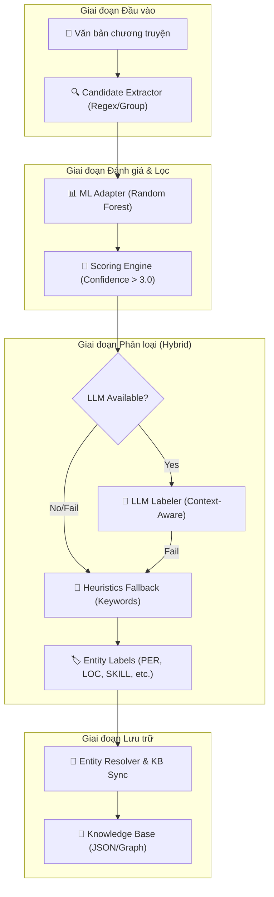

# AI Story Co-Pilot Service — Ephurin Novel Platform

Dịch vụ AI thế hệ mới, tích hợp LLM (Large Language Models) để hỗ trợ tác giả xây dựng thế giới truyện nhất quán, thông minh và có chiều sâu thông qua đồ thị tri thức (Knowledge Graph).

---

## 🚀 Tính năng chính

- **Hybrid NER Pipeline**: Nhận diện thực thể (Nhân vật, Địa điểm, Tổ chức, Kỹ năng, Vật phẩm) sử dụng sự kết hợp giữa **Candidate Extraction**, **ML Scoring**, **LLM Labeling** và **Heuristics Fallback**.
- **Context-Aware Classification**: Sử dụng ngữ cảnh câu văn để phân loại chính xác các thực thể đặc thù của thể loại tiên hiệp/kiếm hiệp (SKILL, ITEM) mà các mô hình NER truyền thống thường bỏ sót.
- **KB-Anchored Entity Resolution**: Tự động chuẩn hóa tên gọi bằng so khớp mờ (Fuzzy Matching) và đối soát trực tiếp với Knowledge Base (KB).
- **LLM-Powered Event Extraction**: Sử dụng sức mạnh suy luận của LLM (Gemini 2.0 Flash / Llama 3) để trích xuất các tương tác phức tạp.
- **Robust Fallback Mechanism**: Tự động chuyển sang bộ quy tắc Heuristics khi LLM gặp lỗi quota (429), đảm bảo dịch vụ luôn khả dụng.
- **Lightweight Architecture**: Loại bỏ các mô hình Deep Learning nặng (PhoBERT), giúp dịch vụ khởi động tức thì và tiết kiệm RAM (>400MB).
- **Human-in-the-Loop**: Quy trình xác nhận 2 bước giúp tác giả giữ quyền kiểm soát tuyệt đối.

---

## 🏗️ Kiến trúc hệ thống (Hybrid Pipeline)



---

## 📂 Cấu trúc thư mục

```
ai-service/
│
├── main.py                     # ⚡ Entry point — Khởi tạo FastAPI app, middleware,
│                                #    exception handlers, và đăng ký các router.
│
├── requirements.txt            # 📦 Danh sách dependencies Python (pip install -r)
├── .env                        # 🔑 Biến môi trường (API keys, LLM config) — KHÔNG commit
├── check_startup.py            # 🩺 Script kiểm tra hệ thống khi khởi động
│
├── api/                        # 🌐 API Layer — Định nghĩa HTTP endpoints
│   ├── __init__.py             #    Package marker
│   ├── schemas.py              #    📋 Tất cả Pydantic request/response models
│   │                           #       (ExtractEntitiesRequest, SyncStoryResponse, ...)
│   ├── deps.py                 #    💉 Dependency Injection helpers (FastAPI Depends)
│   │                           #       (get_entity_pipeline, get_story_kb, ...)
│   ├── routes.py               #    🛣️ Router chính /v1/ai — 6 endpoints:
│   │                           #       extract-entities, suggest-next, sync-story,
│   │                           #       analyze/chapter, kb/confirm, graph/related, llm/generate
│   └── interactions.py         #    🤝 Router nâng cao /v1/enhanced — 3 endpoints:
│                               #       process-interactions, kb/{story_id}, relation/override
│
├── core/                       # 🧠 Core Logic — Các module xử lý trung tâm
│   ├── __init__.py             #    Package marker
│   ├── exceptions.py           #    ❌ Custom exceptions tập trung
│   │                           #       (AIServiceError, EntityExtractionError, KBWriteError)
│   ├── llm_client.py           #    🤖 Client kết nối trực tiếp với LLM providers
│   │                           #       (Gemini, OpenAI, Groq) — Low-level API wrapper
│   ├── llm_service.py          #    🧩 High-level LLM orchestration — Tạo suggestion,
│   │                           #       trích xuất events/relations bằng prompt engineering
│   ├── consistency.py          #    ✅ ConsistencyChecker: Kiểm tra entity hợp lệ
│   │                           #       ConsistencyEngine: Validate suggestion vs graph data
│   ├── story_kb_manager.py     #    💾 Quản lý Knowledge Base — CRUD entities, relations,
│   │                           #       events, states. Load/save JSON graph storage
│   ├── entity_resolver.py      #    🔗 Fuzzy matching + chuẩn hóa tên thực thể
│   │                           #       với dữ liệu đã có trong KB
│   ├── candidate_processor.py  #    📊 Xử lý NER output → Candidates cho HITL review
│   │                           #       (normalize, score, detect duplicates)
│   └── span_expander.py        #    📏 Mở rộng biên thực thể khi NER cắt thiếu
│                               #       (VD: "Tiêu" → "Tiêu Viêm")
│
├── services/                   # ⚙️ Service Layer — Các dịch vụ nghiệp vụ
│   ├── entity_helpers.py       #    🔄 Shared helper functions: chuyển đổi pipeline output
│   │                           #       sang các format khác nhau (entity_out, sync, interaction)
│   ├── interaction_service.py  #    🤝 Quyết định auto-apply/suggest/ignore cho relations
│   ├── relation_service.py     #    🕸️ Xử lý quan hệ giữa các thực thể
│   ├── event_service.py        #    📅 Xử lý sự kiện trong truyện
│   ├── state_extraction.py     #    📊 Trích xuất trạng thái entity (HP, vị trí, vật phẩm)
│   ├── style_service.py        #    ✍️ Phân tích phong cách viết của tác giả
│   │
│   └── entity_pipeline/        #    🔬 Hybrid NER Pipeline (module chính)
│       ├── pipeline.py         #       Orchestrator: extract → score → ML → label → filter
│       ├── candidate_extractor.py #    Trích xuất cụm từ viết hoa (regex + grouping)
│       ├── scoring_engine.py   #       Tính điểm confidence bằng rule-based
│       └── ml_adapter.py       #       Load ML model (Random Forest) từ .pkl
│
├── models/                     # 📝 Data Models — Pydantic schemas cho internal data
│   ├── entity_state.py         #    Trạng thái thực thể (health, location, inventory)
│   └── event.py                #    Sự kiện trong truyện (subject, action, object)
│
├── ml/                         # 🤖 Machine Learning — Model training & artifacts
│   ├── Colab_Training_Guide.md #    📖 Hướng dẫn train model trên Google Colab
│   ├── train_script.py         #    🏋️ Script training Random Forest classifier
│   └── models/                 #    📦 Exported model artifacts
│       └── entity_classifier.pkl #   Model đã train (load bởi ml_adapter.py)
│
├── data/                       # 💿 Runtime Data — Dữ liệu phiên làm việc
│   ├── kb/                     #    📚 Knowledge Base files (JSON per story)
│   └── writing_session_*.json  #    📝 Session data của từng phiên viết
│
├── scratch/                    # 🧪 Test & Debug Scripts
│   ├── debug_extract_entities.py
│   ├── debug_ner.py
│   ├── test_api_pipeline.py
│   ├── test_chapters.py
│   ├── test_integrated_api.py
│   ├── test_new_pipeline.py
│   └── test_data/              #    Dữ liệu mẫu cho testing
│
└── docs/                       # 📖 Tài liệu dự án
    ├── API_DOC.md              #    📡 API Reference — Mô tả tất cả endpoints
    ├── DESIGN.md               #    🎨 UX/UI Design Spec — Layout, interaction rules
    └── PIPELINE_DESIGN.md      #    🔬 NER Pipeline Architecture — Chi tiết kỹ thuật
```

### Giải thích các tầng kiến trúc

| Tầng | Thư mục | Trách nhiệm |
|------|---------|-------------|
| **API Layer** | `api/` | Nhận HTTP request, validate input, gọi service, trả response. Không chứa logic nghiệp vụ. |
| **Core Layer** | `core/` | Logic xử lý trung tâm: LLM clients, consistency checking, KB management. Không biết về HTTP. |
| **Service Layer** | `services/` | Phối hợp (orchestration) giữa các core modules. NER pipeline, event extraction, state management. |
| **Data Models** | `models/` | Định nghĩa cấu trúc dữ liệu nội bộ (Pydantic). Không chứa logic. |
| **ML Layer** | `ml/` | Training scripts và model artifacts. Được load bởi `services/entity_pipeline/ml_adapter.py`. |
| **Docs** | `docs/` | Tài liệu thiết kế, API reference, và kiến trúc pipeline. |

---

## 🛠️ Công nghệ sử dụng

- **Backend Framework**: FastAPI (Python 3.10+)
- **ML/NLP**: Scikit-learn (Random Forest), joblib, RapidFuzz
- **LLM Providers**: Google Gemini 2.0 Flash (Ưu tiên), OpenAI, Groq Cloud
- **Storage**: JSON-based Graph Storage (Sẵn sàng cho Neo4j)

---

## ⚙️ Cấu hình hệ thống (.env)

Hệ thống yêu cầu các API Key để hoạt động tốt nhất. Copy file mẫu và điền thông tin:

```bash
# Trong thư mục ai-service
LLM_PROVIDER=gemini
LLM_MODEL=gemini-2.0-flash
GEMINI_API_KEY=AIza_your_key_here
```

> ⚠️ **QUAN TRỌNG:** Không bao giờ commit file `.env` hoặc để lộ API key trong source code.

---

## 🏁 Hướng dẫn khởi động

### 1. Khởi động AI Service (Backend)
Yêu cầu Python 3.10+

```bash
cd ai-service

# Cài đặt thư viện (nếu chưa có)
pip install -r requirements.txt

# Chạy server (mặc định tại cổng 8000)
uvicorn main:app --reload --port 8000
```

> [!TIP]
> Nếu gặp lỗi `WinError 10013` (Access Denied), có thể cổng 8000 đang bị chiếm bởi tiến trình khác. Bạn có thể đổi sang cổng khác bằng tham số `--port 8001` và cập nhật `BASE_URL` trong frontend.

### 2. Cấu trúc dữ liệu runtime
Dữ liệu phiên viết và Knowledge Base được lưu tại:
- `data/*.json`: Danh sách thực thể và đồ thị tri thức của từng truyện.
- `data/kb/`: (Dự kiến) Thư mục chứa các bản sao lưu KB.


### 3. Kiểm tra sức khỏe hệ thống

```bash
curl http://localhost:8000/health
# Expected: {"status": "ok"}
```

---

## 📖 Tài liệu chi tiết

| Tài liệu | Mô tả |
|-----------|--------|
| [`docs/API_DOC.md`](docs/API_DOC.md) | Mô tả chi tiết tất cả API endpoints |
| [`docs/DESIGN.md`](docs/DESIGN.md) | Thiết kế UX/UI cho Co-Pilot Writing Environment |
| [`docs/PIPELINE_DESIGN.md`](docs/PIPELINE_DESIGN.md) | Kiến trúc chi tiết Hybrid NER Pipeline |
| [`ml/Colab_Training_Guide.md`](ml/Colab_Training_Guide.md) | Hướng dẫn train ML model trên Google Colab |

---

## 📊 Trạng thái & Lộ trình (Roadmap)

### ✅ Đã hoàn thành (Stable)
- [x] Chuyển đổi sang **Hybrid NER Pipeline** (Loại bỏ PhoBERT nặng).
- [x] Tích hợp **Heuristics Fallback** cho SKILL/ITEM.
- [x] Hỗ trợ ngữ cảnh (Sentence Context) trong LLM Labeling.
- [x] Tối ưu hóa hiệu năng và dung lượng (Khởi động tức thì).
- [x] Refactor codebase: Tách schemas, DI, custom exceptions, shared helpers.

### 🚧 Đang triển khai
- [ ] **Vector Search (RAG)**: Hỗ trợ bối cảnh truyện dài hàng trăm chương.
- [ ] **Advanced Graph Visualization**: Trực quan hóa mối quan hệ nhân vật dưới dạng đồ thị động.
- [ ] **Pydantic Settings**: Quản lý cấu hình tập trung bằng `BaseSettings`.

---

© 2026 Novel Sharing Platform Team.
