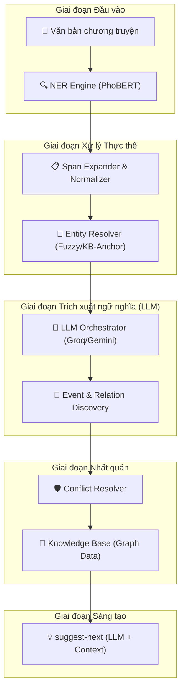

# AI Story Co-Pilot Service - Novel Sharing Platform

Dịch vụ AI thế hệ mới, tích hợp LLM (Large Language Models) để hỗ trợ tác giả xây dựng thế giới truyện nhất quán, thông minh và có chiều sâu thông qua đồ thị tri thức (Knowledge Graph).

## 🚀 Tính năng chính

- **High-Fidelity NER**: Nhận diện thực thể (Nhân vật, Địa điểm, Tổ chức) sử dụng PhoBERT kết hợp với cơ chế **Span Expansion**.
- **KB-Anchored Entity Resolution**: Tự động chuẩn hóa tên gọi bằng so khớp mờ (Fuzzy Matching) và đối soát trực tiếp với Knowledge Base (KB) để tránh phân mảnh thực thể.
- **LLM-Powered Event Extraction**: Sử dụng sức mạnh suy luận của LLM (Llama 3.3/Gemini) để trích xuất các tương tác phức tạp từ văn bản, không bị giới hạn bởi các quy tắc cứng nhắc.
- **Semantic Relation Suggestion**: Tự động phân tích sắc thái hành động để gợi ý các mối quan hệ động (ALLY_OF, ENEMY_OF, LOVES, BELONGS_TO).
- **Intelligent Conflict Resolver**: Phát hiện mâu thuẫn giữa tình tiết mới và các thiết lập đã có trong Knowledge Base.
- **Multi-Provider Support**: Tích hợp linh hoạt các nhà cung cấp AI hàng đầu: **Groq (siêu nhanh)**, **Gemini (context lớn)**, OpenAI và Ollama (chạy local).
- **Human-in-the-Loop**: Quy trình xác nhận 2 bước giúp tác giả giữ quyền kiểm soát tuyệt đối đối với dữ liệu của mình.

## 🏗️ Kiến trúc hệ thống (LLM-Orchestrated)



## 🛠️ Công nghệ sử dụng

- **Framework**: FastAPI (Python 3.10+)
- **NLP**: PhoBERT (VinAI), Transformers, RapidFuzz
- **LLM Providers**: Groq Cloud (Llama 3.3), Google Gemini 1.5, OpenAI
- **Storage**: JSON-based Graph Storage (Dễ dàng migrate sang Neo4j)

## ⚙️ Cấu hình hệ thống (.env)

Hệ thống hỗ trợ cơ chế chuyển đổi nhà cung cấp linh hoạt. Khuyến nghị sử dụng **Groq** để đạt tốc độ và quota tốt nhất.

```bash
# Lựa chọn: groq | gemini | openai | none
LLM_PROVIDER=groq
LLM_MODEL=llama-3.3-70b-versatile
GROQ_API_KEY=gsk_your_key_here

# Cấu hình dự phòng (Fallback)
LLM_FALLBACK_PROVIDER=gemini
GEMINI_API_KEY=AIza_your_key_here
```

## 📊 Trạng thái & Lộ trình (Roadmap)

### ✅ Đã hoàn thành (Phase 1 & 2)
- [x] Tích hợp PhoBERT NER & Span Expansion.
- [x] Triển khai Entity Resolution & KB-Anchoring.
- [x] **Solution C**: Chuyển đổi sang LLM-Powered Event Extraction.
- [x] Hỗ trợ đa nền tảng API (Multi-provider service).

### 🚧 Đang triển khai (Phase 3)
- [ ] **Coreference Resolution**: Cải thiện khả năng hiểu đại từ (hắn, lão già, nàng) qua LLM.
- [ ] **Long-term Context**: Sử dụng Vector DB (RAG) để lưu trữ bối cảnh hàng trăm chương truyện.
- [ ] **Object Interaction**: Trích xuất quan hệ sở hữu vật phẩm (thần binh, linh dược).

## 🧪 Kiểm thử (Testing)

Sử dụng bộ kịch bản **Adversarial Test** để đánh giá độ thông minh của LLM:
```bash
python scratch/adversarial_test.py
```
*Ghi chú: Bộ test này sẽ giả lập các tình huống "phá hoại" như tương tác thực thể rác, câu văn gây nhiễu để kiểm tra độ nhạy của AI.*

---
© 2025 Novel Sharing Platform Team.
