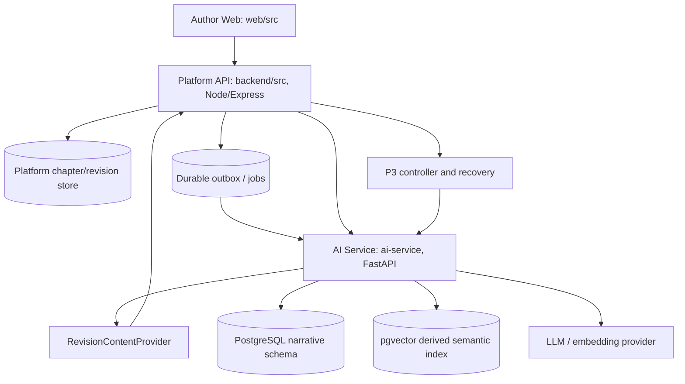
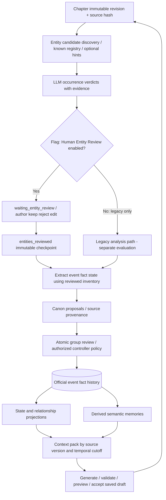

# Architecture — AI Writing Copilot (current source map)

**Document revision:** 2026-10-21; **reviewed source baseline:** `c01c83d3b3db234da17beeb91841bbcadae4f72b` on `codex/ai-copilot-pipeline-test`.  
**Status:** architecture description derived from source and accepted ADRs; **NOT live E2E acceptance**. Later commits (including Wave 1D) must be reconciled before claiming current implementation coverage.  
**Behavioral source of truth:** [WORKFLOW_CONTRACT.md v1.4](../../Pipeline_test/WORKFLOW_CONTRACT.md).  
**Earlier prototype:** [ARCHITECTURE_PROTOTYPE_LEGACY.md](ARCHITECTURE_PROTOTYPE_LEGACY.md).  
**Feature-by-feature source/evidence snapshot:** [Pipeline map](../../Pipeline_test/architecture/AI_PIPELINE_MAP.md) — **historical 2026-10-20 snapshot, not refreshed by this document**.

## 1. System boundaries — Platform-first implementation

- **Novel Platform** owns authenticated author operations, novels/chapters, source drafts, immutable revision IDs/content hashes and publication/moderation state. `web/src` uses the Node gateway for the author workflow; legacy `web-ui/` or direct FastAPI demos are **not** the default integrated product.
- **Narrative AI service** owns analysis jobs, proposals, reviewed entities, confirmed event/fact history, state/relationship projections, retrieval artifacts, findings and prompt/model usage metadata. It must not directly replace Platform canonical manuscripts.
- **Storage/communication:** accepted MVP decision is a shared PostgreSQL cluster with isolated `narrative` schema, logical ownership and repository adapters; pgvector is derived. Platform also maintains draft storage paths (MongoDB in current code). Immutable revision content is obtained via provider adapter and verified with hashes before AI analysis.
- **Async side effects:** save/accept revision → durable outbox → worker → AI analysis. A queue delivery/outbox `COMPLETED` is NOT proof that extraction/author review/canon activation finished. Async provider execution must never be interpreted as a database transaction.
- **Security:** Platform JWT/role/novel ownership and internal service token boundaries are required; debug/test credentials must never be equated to production authorization.

**Relevant source at reviewed baseline:** `backend/src/app.ts`, `backend/src/modules/ai/ai-gateway.routes.ts`, `backend/src/modules/novels/chapter-revisions.service.ts`, `backend/src/jobs/outbox-processor.ts`, `ai-service/api/narrative_routes.py`, `ai-service/application/revision_analysis_service.py`, `ai-service/infrastructure/postgres_narrative_repository.py`, `ai-service/infrastructure/embedding_providers.py`.

## 2. Narrative memory lifecycle (canonical invariants)

**Five distinct data categories must never collapse:**

1. **Optional entity hints** guide recall; not an occurrence, identity proof or canon.
2. **Author-declared identity** may be proposed without a source mention (`source_type=author_declaration`), but may not gain fabricated quotes/events; canonicalization requires explicit review.
3. **Machine entity candidates/verdicts** have source offsets/context; not official memory merely because the LLM returned a valid JSON decision.
4. **`entities_reviewed` checkpoint** freezes a validated identity inventory for downstream extraction; it **does not itself approve official canon**.
5. **Approved event/fact/state + author-locked rules** drive structured canon and projections. Story plan objectives are future intent, not historical events; semantic chunks and context snippets are derived and cannot override canon.

For flag ON, the job must stop `waiting_entity_review` before event/fact. On continue, verify tenant/novel/revision/hash/guidance/policy/review version and no missing decisions. New unknown identities or changed source return to review; no silent merge, fabricated evidence, or partial approved group. `NARRATIVE_MEMORY_AUDIT.md` tests pre-human raw decisions separately from post-human official memory and actual packed context.

**Status at baseline:** Human-review feature has opt-in code and offline test evidence, but real-provider S02 failed at prior SHA and only received a later **offline prompt/validator repair**; P1 S01–S11 not live accepted. See [Wave 1D independent findings](../../Pipeline_test/reviews/2026-10-21-p1-wave-1d/INDEPENDENT_FINDINGS.md).

## 3. P1, P2, P3 product workflows

| Case | Input | Main gates | Accepted claim |
|---|---|---|---|
| **P1** | Author's existing manuscript/current revision | Import 5 source chapters through actual browser UI; explicit bootstrap; entity HITL → downstream canon → M0; ordinary save triggers new revision extraction → M-FIRST; S01–S11 | Working author-in-loop editing flow **only when real UI and provider evidence exist** |
| **P2** | Explicit setup/idea and author constraints | `mode=extract` only supplied characters/locations; separate `mode=blueprint` may propose creativity with `model_proposed/author_accepted` provenance; first saved prose chapter, M0/M-FIRST | Idea/bootstrap flow, no future-outline leakage |
| **P3 functional** | Reviewed P1/P2 baseline, with or without plan | Durable controller objective → context → generation validation → accept **draft** → analysis → HITL gate flag ON → canon → objective progress; bounded retry/restart/stop | Functional orchestration on observed objective test |
| **P3 terminal** | Separate long-form test dataset and run | All functional gates plus complete ending, saved+readback **100.000–105.000 words**, full narrative memory/literary evaluation | Mandatory `P3_HITL_CONTROLLER_100K` artifact, with measured human reviews |

With `ENTITY_CANDIDATE_VERIFICATION_ENABLED=true`, P3 uses `waiting_for_entity_review` at the **controller level** (distinct from analysis `waiting_entity_review`). Human review is a **required intervention**, so this mode is not fully unattended. `P3_UNATTENDED_AUTONOMOUS_100K` is a different future policy/experiment, not a reinterpretation of the HITL run. The controller cannot publish chapters.

## 4. Retrieval, time, embedding and context budget

- **Canonical truth:** confirmed facts/events, locked rules and versioned state projections, with tenant/source/temporal filters.
- **Derived retrieval:** [ADR-012](ADR-012-EMBEDDING-MODEL.md) accepted `gemini-embedding-2`, dimension 768 and model/versioned reindex policy; P7-03 exact semantic retrieval, P7-04 deterministic `hybrid-v1` rerank with entity/temporal/importance/relationship signals. Embeddings are not chunked prose facts/canon.
- **Prompt/context packing:** P7-05 `context-budget-v1` packs selected whole artifacts after hybrid retrieval, deduplicating semantically linked canonical events and protecting locked facts/rules/constraints. The default `12000` is an **estimated context JSON budget**, not a total LLM prompt/context-window guarantee. Source version and actual generation-context trace are required for retrieval claims.
- When semantic provider is disabled/fails, the deterministic structured context fallback must be reported. `build_embeddings=false` is NOT semantic E2E coverage.

Sources: `docs/development/P7-03-SEMANTIC-RETRIEVER/query-contract.md`, `P7-04-HYBRID-RANKER/ranking-contract.md`, `P7-05-CONTEXT-COMPRESSION-TOKEN-BUDGET/packing-contract.md`.

## 5. Provider, test harness and experimental evidence are separate layers

`Pipeline_test/tools/budget_gateway.py`, `Pipeline_test/tools/browser_author_driver.py` and isolated Compose files are **test harness**, not a mandatory production subsystem proven successful by their existence. At reviewed 2026-10-21 baseline Wave 1C, source review found **Gemini Native bypass/misrouting, untrusted budget tickets, synthetic browser evidence and incomplete embedding/cost liability coverage**. Wave 1D is assigned to repair those **offline** using fake upstream and actual browser; it is not evidence of a completed live test.

| Evidence class | Allowed claim |
|---|---|
| `SOURCE_CODE` | The particular implementation path exists at exact SHA |
| `AUTOMATED_TEST` | The exact deterministic/mock integration suite exercised its asserted scope |
| `LIVE_API` | Provider-backed application API action was observed; not browser author coverage |
| `LIVE_UI` | A real browser author action with trace/artifacts and persisted readback at exact run |
| `INDEPENDENT_REVIEW` | A reviewer checked stated source/evidence scope; not equivalent to rerunning test |

Budget hard caps must be **pre-dispatch**, global across enabled containers/provider paths, with durable accounting and real limits for calls/cost/deadline; failure to enforce is `BLOCKED`. Never use an expired owner authorization to make a new external call. No test harness should generate artificial screenshots and call them UI success.

## 6. Current limitations and separate design history

- **P1 live remains blocked** pending Wave 1D integration repair; S01 was API-driven, not certified UI, and S02 required an offline prompt fix after live failure. P2/P3 long work NOT_RUN in current staged series.
- **Event/fact full-chapter extraction:** entity discovery chunks with overlap/offsets are implemented opt-in; event/fact per-chunk extraction, merge and coverage audit are still design proposals in the historical pipeline map. Do not overclaim recall.
- **Other unverified paths:** exact live embedding route, asynchronous outbox recovery under multiple workers, semantic retrieval on long prose, full P3 generation-to-final quality. Check runtime and evidence before status changes.
- **Prototype limitations** (JSON KB, local story ID, direct legacy frontend→FastAPI, no revision/jobs) are archived in [ARCHITECTURE_PROTOTYPE_LEGACY.md](ARCHITECTURE_PROTOTYPE_LEGACY.md). They must not appear under present-tense “Hiện trạng” for the integrated product.

## 7. Navigation and ADRs

- [Workflow v1.4](../../Pipeline_test/WORKFLOW_CONTRACT.md): accepted behavior and P3 mandatory gate.
- [API implementation mapping](CURRENT_API_IMPLEMENTATION_MATRIX.md): route/status ownership by code at snapshot SHA.
- [PIPELINE.md](PIPELINE.md): historical diagrams clearly labeled + current HITL overlay.
- [ADRS.md](ADRS.md): bounded-context, event-sourcing, proposal-first and revision/outbox decisions.
- [STATE_PROJECTION.md](STATE_PROJECTION.md): deterministic correction/reprojection invariants.
- [P3 evaluation protocol](../../Pipeline_test/P3_100K_EVALUATION_PROTOCOL.md): acceptance, comparison and blind literary evaluation.

**Docs describe decisions and checked source; only recorded functional evidence at matching SHA/provider/config can establish acceptance.**
