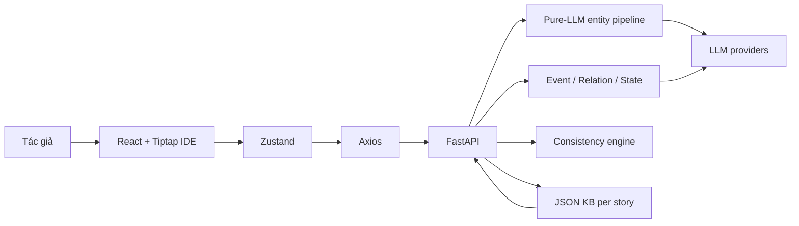
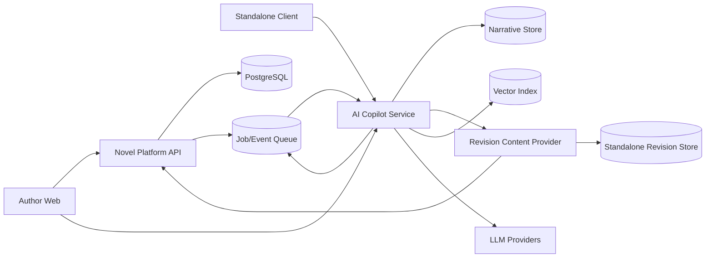

> **Archived design reference (before current Platform/Narrative integration).** Kept verbatim for audit/academic history. Statements under "Hiện trạng" refer to the early prototype; they do **not** describe runtime on branch `codex/ai-copilot-pipeline-test` at 2026-10-21. Current document: [ARCHITECTURE.md](ARCHITECTURE.md). Contract: [WORKFLOW_CONTRACT.md v1.4](../../Pipeline_test/WORKFLOW_CONTRACT.md).

# Architecture — AI Writing Copilot

## Hiện trạng



### Frontend

- `web-ui/` dùng React, Vite, Tiptap, Zustand và React Flow.
- UI gồm toolbar, activity bar, story sidebar, editor, AI panel và status bar.
- State hiện chỉ tồn tại trong phiên; `storyId` được sinh cục bộ và chapter tree còn mock.
- Frontend gọi trực tiếp FastAPI; cấu hình production và platform identity chưa được tích hợp.

### AI service

- `ai-service/main.py` khởi tạo FastAPI và các dependency dùng chung.
- `api/routes.py` cung cấp entity extraction, suggestion, sync, chapter analysis và KB confirmation.
- `api/interactions.py` điều phối entity, event, relation, state và human-in-the-loop.
- `services/entity_pipeline/pipeline.py` hiện là pure-LLM extraction; cờ ML chỉ còn để tương thích.
- `core/llm_service.py` điều phối provider và fallback.
- `core/consistency.py` mới kiểm tra một số constraint cơ bản như trạng thái chết và location.

## Narrative memory model

### Entity layer

Entity là identity ổn định: character, location, organization, item và skill. Alias phải được resolve về canonical entity; không nhồi diễn tiến truyện vào entity.

### Event history

Event history là append-only source of truth cho diễn tiến. Mỗi event cần provenance, chapter/scene/revision, participants, location, summary, consequence, importance và extractor version.

### Current world state

World state là projection/cache được tái dựng từ event history. Nó phục vụ query nhanh và deterministic consistency checks, không thay thế lịch sử.

### Relationship

Relationship là derived projection từ event và author facts. Relation do tác giả xác nhận hoặc khóa luôn có độ ưu tiên cao hơn inference của AI.

### Semantic memory

Vector index lưu event summary, important scene summary và metadata có provenance. Không retrieve raw novel text mặc định; retrieval phải kết hợp semantic similarity, entity filter, temporal relevance và relationship relevance.

## Pipeline chuẩn

```text
Chapter Revision
  → Entity Extraction
  → Entity Normalization / Resolution / Validation
  → Event Extraction
  → Interaction Decision
  → Append Event History
  → Rebuild/Update World-State Projection
  → Consistency Checks
  → Semantic Indexing
```

Luồng generation:

```text
Current Text
  → Relevant Entity Detection
  → Current State Lookup
  → Event/Memory Retrieval
  → Structured Context Builder
  → LLM Generation
  → Consistency Validation
  → Author Preview / Accept / Reject
```

## Quyền sở hữu dữ liệu

| Owner | Dữ liệu |
|---|---|
| Novel Platform | User, role, novel, chapter, revision, publishing, moderation, interaction, payment |
| Copilot | Analysis job, canonical mapping, event history, state projection, embeddings, findings, suggestions, prompt/model metadata |

## Kiến trúc đích



Giai đoạn gần dùng cùng PostgreSQL database với schema `narrative` riêng, kết hợp Novel Platform modular monolith và AI worker/service độc lập. Không tách database hoặc thêm microservice chỉ để khớp sơ đồ lý thuyết.

MVP vận hành hybrid: query, author mutation và proposal decision là synchronous transaction ngắn; import, analysis, generation, embedding, projection rebuild và impact analysis là asynchronous job. Writing generation có thể stream provisional token qua SSE nhưng chỉ final validated draft mới được accept.

Platform-first và standalone dùng chung application workflow. Composition root chọn `PlatformRevisionContentProvider` hoặc `StandaloneRevisionContentProvider`; domain không gọi trực tiếp route hoặc bảng nội bộ của Platform.

## Integration contract

- Input bắt buộc: `tenant_id`, `author_id`, `novel_id`, `chapter_id`, `revision_id`, `content_hash`, locale và operation.
- Output: `job_id`, status, schema version, pipeline/model/prompt version, findings, artifacts, latency và usage.
- Event: `ChapterRevisionSaved`, `AnalysisRequested`, `AnalysisCompleted`, `SuggestionAccepted`, `SuggestionRejected`.
- Idempotency key: `chapter_id + revision_id + operation + pipeline_version`.
- AI không trực tiếp mutate dữ liệu gốc của platform.
- Standalone mode dùng local workspace ID làm `tenant_id` và local revision repository làm system of record; contract nghiệp vụ còn lại không đổi.

## Hạn chế hiện tại

- JSON read-modify-write không transaction, lock hoặc atomic replace.
- LLM call đồng bộ trong HTTP request và có trường hợp lỗi bị chuyển thành kết quả rỗng.
- Chưa có auth, tenant ownership, chapter revision hay idempotency.
- Chưa có vector retrieval thực, queue, audit bền vững và test suite chính thức.
- Config frontend/CORS vẫn hướng local development.
