# Data Model — Narrative Memory PostgreSQL

> Status: Accepted design baseline. Tài liệu mô tả mô hình đích đã review; migration chưa được triển khai.

## Các quyết định đã chấp nhận

1. Dùng schema PostgreSQL riêng tên `narrative` trong cùng database với Novel Platform ở giai đoạn đầu.
2. Novel Platform sở hữu user, novel, chapter và revision; Narrative Memory chỉ lưu canonical ID tham chiếu.
3. `events` đã được xác nhận là nguồn sự thật của diễn tiến truyện.
4. Current state và relationship là projection có thể rebuild.
5. AI chỉ tạo proposal; author decision hoặc policy an toàn mới materialize dữ liệu canonical.
6. Dùng PostgreSQL + `pgvector` trước khi cân nhắc graph/vector database riêng.
7. Không sao chép toàn bộ raw chapter vào Narrative Memory.
8. Dùng UUID v7 nếu application stack hỗ trợ thống nhất; fallback UUID v4 không làm thay đổi contract.
9. Chỉ auto-materialize artifact derived hoặc proposed; event, state, relationship và world rule canonical cần author acceptance.
10. `narrative_order` dùng spaced `BIGINT` để hỗ trợ chèn event thường xuyên trong MVP.
11. Rejected proposal giữ 90 ngày; raw prompt/response không lưu mặc định.
12. Planning object và full planning suite được hoãn khỏi MVP; author phải review World Bible trước khi kích hoạt baseline.

## Mục tiêu

- Cung cấp context có cấu trúc cho LLM.
- Theo dõi provenance tới chapter revision và source span.
- Hỗ trợ replay để dựng lại current world state.
- Phân biệt canonical, derived và proposed data.
- Không để retry hoặc phân tích lại tạo dữ liệu trùng.
- Hỗ trợ multi-user, optimistic concurrency và audit.

## Ranh giới dữ liệu

### Novel Platform sở hữu

```text
users
novels
chapters
chapter_revisions
publishing_status
permissions
```

### Narrative Memory sở hữu

```text
story_brains
entities / aliases / mentions
facts / world rules
events / participants
state transitions / current states
relationship projections
analysis runs
proposals / decisions
consistency findings
semantic memory
```

Nếu hai module dùng database khác nhau, `tenant_id`, `novel_id`, `chapter_id`, `revision_id` là external IDs và không dùng cross-database foreign key.

## Invariants

1. Mọi dữ liệu trích từ manuscript phải có `revision_id`, `content_hash` và evidence span.
2. Một analysis operation chỉ chạy một lần cho cùng idempotency key.
3. Proposed data không được xem là canonical fact.
4. Author-confirmed hoặc locked data không bị AI override.
5. Historical event không bị sửa nội dung tại chỗ; correction tạo event/fact mới và liên kết `supersedes_id`.
6. Current state phải có thể rebuild từ initial facts và accepted state transitions.
7. Relationship do AI suy ra phải truy ngược được event/fact nguồn.
8. Mọi write thay đổi aggregate version phải dùng optimistic locking.

## ERD tổng quan

ERD hiển thị khóa và trường nghiệp vụ cốt lõi; DDL ở các phần sau là nguồn chi tiết. `novel_id`, `chapter_id` và `revision_id` là logical reference tới Novel Platform, không mặc định là cross-schema foreign key.

```mermaid
erDiagram
    STORY_BRAINS {
        UUID id PK
        UUID tenant_id
        UUID novel_id UK
        VARCHAR status
        BIGINT brain_version
        INTEGER schema_version
    }
    ENTITIES {
        UUID id PK
        UUID story_brain_id FK
        UUID tenant_id
        UUID novel_id
        VARCHAR entity_type
        VARCHAR canonical_name
        JSONB static_attributes
        VARCHAR confirmation_status
        BOOLEAN is_locked
    }
    ENTITY_ALIASES {
        UUID id PK
        UUID entity_id FK
        VARCHAR alias
        VARCHAR normalized_alias
        VARCHAR confirmation_status
    }
    ENTITY_MENTIONS {
        UUID id PK
        UUID story_brain_id FK
        UUID entity_id FK
        UUID chapter_id
        UUID revision_id
        INTEGER source_start
        INTEGER source_end
        VARCHAR source_text_hash
    }
    FACTS {
        UUID id PK
        UUID story_brain_id FK
        UUID subject_entity_id FK
        VARCHAR fact_type
        VARCHAR fact_key
        JSONB fact_value
        VARCHAR confirmation_status
        BOOLEAN is_locked
        UUID supersedes_id FK
    }
    EVENTS {
        UUID id PK
        UUID story_brain_id FK
        UUID chapter_id
        UUID revision_id
        BIGINT narrative_order
        VARCHAR event_type
        TEXT summary
        UUID location_entity_id FK
        VARCHAR confirmation_status
        UUID supersedes_id FK
    }
    EVENT_PARTICIPANTS {
        UUID event_id PK, FK
        UUID entity_id PK, FK
        VARCHAR participant_role
        TEXT intent
        VARCHAR emotion
    }
    STATE_TRANSITIONS {
        UUID id PK
        UUID story_brain_id FK
        UUID event_id FK
        UUID fact_id FK
        UUID entity_id FK
        VARCHAR attribute_key
        JSONB previous_value
        JSONB new_value
        VARCHAR confirmation_status
    }
    CURRENT_ENTITY_STATES {
        UUID story_brain_id PK, FK
        UUID entity_id PK, FK
        UUID tenant_id
        UUID novel_id
        VARCHAR status
        UUID location_entity_id FK
        JSONB additional_state
        UUID projected_through_event_id FK
        BIGINT row_version
    }
    RELATIONSHIPS {
        UUID id PK
        UUID story_brain_id FK
        UUID subject_entity_id FK
        VARCHAR relation_type
        UUID object_entity_id FK
        VARCHAR status
        NUMERIC strength
        VARCHAR confirmation_status
        UUID derived_from_event_id FK
        BIGINT row_version
    }
    ANALYSIS_RUNS {
        UUID id PK
        UUID story_brain_id FK
        UUID revision_id
        VARCHAR operation
        VARCHAR status
        VARCHAR idempotency_key UK
        VARCHAR pipeline_version
        VARCHAR model_name
        INTEGER input_tokens
        INTEGER output_tokens
    }
    PROPOSALS {
        UUID id PK
        UUID analysis_run_id FK
        UUID story_brain_id FK
        UUID dependency_group_id
        INTEGER materialization_order
        VARCHAR proposal_type
        JSONB payload
        JSONB evidence
        VARCHAR status
        BIGINT expected_brain_version
    }
    PROPOSAL_DECISIONS {
        UUID id PK
        UUID proposal_id FK
        UUID actor_id
        VARCHAR decision
        JSONB edited_payload
        TEXT reason
    }
    FINDINGS {
        UUID id PK
        UUID analysis_run_id FK
        UUID story_brain_id FK
        UUID revision_id
        VARCHAR finding_type
        VARCHAR severity
        JSONB evidence
        VARCHAR status
    }
    MEMORY_CHUNKS {
        UUID id PK
        UUID story_brain_id FK
        UUID revision_id
        UUID event_id FK
        UUID entity_id FK
        VARCHAR memory_type
        TEXT content
        VECTOR embedding
        NUMERIC importance_score
        VARCHAR embedding_version
    }

    STORY_BRAINS ||--o{ ENTITIES : contains
    STORY_BRAINS ||--o{ FACTS : defines
    STORY_BRAINS ||--o{ EVENTS : records
    STORY_BRAINS ||--o{ STATE_TRANSITIONS : tracks
    STORY_BRAINS ||--o{ CURRENT_ENTITY_STATES : projects
    STORY_BRAINS ||--o{ RELATIONSHIPS : maps
    STORY_BRAINS ||--o{ ANALYSIS_RUNS : processes
    STORY_BRAINS ||--o{ PROPOSALS : reviews
    STORY_BRAINS ||--o{ FINDINGS : detects
    STORY_BRAINS ||--o{ MEMORY_CHUNKS : indexes

    ENTITIES ||--o{ ENTITY_ALIASES : has
    ENTITIES ||--o{ ENTITY_MENTIONS : appears_as
    EVENTS ||--o{ EVENT_PARTICIPANTS : involves
    ENTITIES ||--o{ EVENT_PARTICIPANTS : participates
    FACTS o|--o{ STATE_TRANSITIONS : initializes
    EVENTS o|--o{ STATE_TRANSITIONS : causes
    ENTITIES ||--o{ STATE_TRANSITIONS : changes
    ENTITIES ||--o| CURRENT_ENTITY_STATES : projects
    ENTITIES ||--o{ RELATIONSHIPS : subject
    ENTITIES ||--o{ RELATIONSHIPS : object
    EVENTS o|--o{ MEMORY_CHUNKS : summarized_as
    ENTITIES o|--o{ MEMORY_CHUNKS : indexed_as

    ANALYSIS_RUNS ||--o{ PROPOSALS : produces
    ANALYSIS_RUNS ||--o{ FINDINGS : produces
    PROPOSALS ||--o{ PROPOSAL_DECISIONS : receives
```



## Quy ước chung

### Kiểu ID

- Ưu tiên UUID v7 ở application khi thư viện/hạ tầng hỗ trợ thống nhất; fallback UUID v4 không thay đổi API contract.
- Không dùng tên entity làm khóa.
- Mọi bảng theo novel phải có `tenant_id` và `novel_id` để lọc quyền và index.

### Trạng thái

Không dùng PostgreSQL enum trong MVP để migration dễ hơn. Dùng `VARCHAR` kết hợp `CHECK` constraint.

```text
proposal_status: pending | accepted | rejected | superseded | expired
confirmation_status: proposed | confirmed | rejected | superseded
source_type: author | ai | import | system
run_status: queued | running | waiting_review | completed | failed | cancelled
finding_status: open | accepted | dismissed | resolved | obsolete
```

### Provenance fields

Artifact do AI hoặc import tạo nên có:

```sql
source_type        VARCHAR(20) NOT NULL,
source_revision_id UUID,
source_start       INTEGER,
source_end         INTEGER,
source_text_hash   VARCHAR(64),
confidence         NUMERIC(5,4),
pipeline_version   VARCHAR(50),
model_name         VARCHAR(100),
prompt_version     VARCHAR(50)
```

`source_start` và `source_end` sử dụng Unicode code-point offsets. API và frontend phải dùng cùng một quy ước.

## Platform prerequisite — Chapter revisions

Narrative Memory yêu cầu Platform cung cấp revision bất biến:

```sql
CREATE TABLE chapter_revisions (
    id UUID PRIMARY KEY,
    chapter_id UUID NOT NULL,
    revision_number INTEGER NOT NULL,
    content TEXT NOT NULL,
    content_hash VARCHAR(64) NOT NULL,
    created_by UUID NOT NULL,
    created_at TIMESTAMPTZ NOT NULL DEFAULT now(),
    UNIQUE (chapter_id, revision_number),
    UNIQUE (chapter_id, content_hash)
);
```

Narrative service không cần lưu lại `content`, chỉ đọc revision qua Platform API hoặc event payload có quyền truy cập phù hợp.

## `narrative.story_brains`

Aggregate root cho một novel.

| Cột | Kiểu | Ý nghĩa |
|---|---|---|
| `id` | UUID PK | Story Brain ID |
| `tenant_id` | UUID | Tenant/workspace |
| `novel_id` | UUID UNIQUE | Canonical Novel ID |
| `status` | VARCHAR(20) | initializing, active, archived, rebuilding |
| `baseline_revision_id` | UUID NULL | Revision cuối dùng tạo baseline |
| `brain_version` | BIGINT | Optimistic concurrency version |
| `schema_version` | INTEGER | Phiên bản schema logic |
| `created_at` | TIMESTAMPTZ | Thời điểm tạo |
| `updated_at` | TIMESTAMPTZ | Thời điểm cập nhật |

```sql
CREATE TABLE narrative.story_brains (
    id UUID PRIMARY KEY,
    tenant_id UUID NOT NULL,
    novel_id UUID NOT NULL UNIQUE,
    status VARCHAR(20) NOT NULL DEFAULT 'initializing',
    baseline_revision_id UUID,
    brain_version BIGINT NOT NULL DEFAULT 1,
    schema_version INTEGER NOT NULL DEFAULT 1,
    created_at TIMESTAMPTZ NOT NULL DEFAULT now(),
    updated_at TIMESTAMPTZ NOT NULL DEFAULT now()
);
```

## `narrative.entities`

Lưu identity ổn định, không lưu state thay đổi theo diễn tiến.

| Cột | Kiểu | Ý nghĩa |
|---|---|---|
| `entity_type` | VARCHAR(30) | character, location, organization, item, skill |
| `canonical_name` | VARCHAR(255) | Tên hiển thị chuẩn |
| `normalized_name` | VARCHAR(255) | Tên dùng dedup/search |
| `description` | TEXT | Mô tả ổn định |
| `static_attributes` | JSONB | Thuộc tính không đổi hoặc ít đổi |
| `confirmation_status` | VARCHAR(20) | Trạng thái xác nhận |
| `is_locked` | BOOLEAN | AI không được override |
| `created_by` | UUID NULL | Author/user xác nhận |

```sql
CREATE TABLE narrative.entities (
    id UUID PRIMARY KEY,
    story_brain_id UUID NOT NULL REFERENCES narrative.story_brains(id),
    tenant_id UUID NOT NULL,
    novel_id UUID NOT NULL,
    entity_type VARCHAR(30) NOT NULL,
    canonical_name VARCHAR(255) NOT NULL,
    normalized_name VARCHAR(255) NOT NULL,
    description TEXT,
    static_attributes JSONB NOT NULL DEFAULT '{}',
    source_type VARCHAR(20) NOT NULL,
    confirmation_status VARCHAR(20) NOT NULL DEFAULT 'proposed',
    confidence NUMERIC(5,4),
    is_locked BOOLEAN NOT NULL DEFAULT false,
    created_by UUID,
    created_at TIMESTAMPTZ NOT NULL DEFAULT now(),
    updated_at TIMESTAMPTZ NOT NULL DEFAULT now(),
    UNIQUE (story_brain_id, id)
);
```

Không đặt unique tuyệt đối trên `normalized_name`: hai nhân vật có thể trùng tên. Deduplication là workflow có evidence, không chỉ là constraint.

## `narrative.entity_aliases`

```sql
CREATE TABLE narrative.entity_aliases (
    id UUID PRIMARY KEY,
    entity_id UUID NOT NULL REFERENCES narrative.entities(id),
    alias VARCHAR(255) NOT NULL,
    normalized_alias VARCHAR(255) NOT NULL,
    source_type VARCHAR(20) NOT NULL,
    confirmation_status VARCHAR(20) NOT NULL DEFAULT 'proposed',
    confidence NUMERIC(5,4),
    created_at TIMESTAMPTZ NOT NULL DEFAULT now(),
    UNIQUE (entity_id, normalized_alias)
);
```

## `narrative.entity_mentions`

Liên kết entity với evidence trong một immutable revision.

```sql
CREATE TABLE narrative.entity_mentions (
    id UUID PRIMARY KEY,
    story_brain_id UUID NOT NULL REFERENCES narrative.story_brains(id),
    entity_id UUID NOT NULL REFERENCES narrative.entities(id),
    tenant_id UUID NOT NULL,
    novel_id UUID NOT NULL,
    chapter_id UUID NOT NULL,
    revision_id UUID NOT NULL,
    surface_text VARCHAR(255) NOT NULL,
    source_start INTEGER NOT NULL,
    source_end INTEGER NOT NULL,
    source_text_hash VARCHAR(64) NOT NULL,
    confidence NUMERIC(5,4),
    extractor_version VARCHAR(50),
    created_at TIMESTAMPTZ NOT NULL DEFAULT now(),
    CHECK (source_start >= 0),
    CHECK (source_end > source_start),
    UNIQUE (revision_id, entity_id, source_start, source_end, extractor_version)
);
```

## `narrative.facts`

Lưu author facts, world rules và initial state facts.

```sql
CREATE TABLE narrative.facts (
    id UUID PRIMARY KEY,
    story_brain_id UUID NOT NULL REFERENCES narrative.story_brains(id),
    tenant_id UUID NOT NULL,
    novel_id UUID NOT NULL,
    subject_entity_id UUID REFERENCES narrative.entities(id),
    fact_type VARCHAR(40) NOT NULL,
    fact_key VARCHAR(100) NOT NULL,
    fact_value JSONB NOT NULL,
    source_type VARCHAR(20) NOT NULL,
    confirmation_status VARCHAR(20) NOT NULL,
    confidence NUMERIC(5,4),
    priority INTEGER NOT NULL DEFAULT 0,
    is_locked BOOLEAN NOT NULL DEFAULT false,
    valid_from_event_id UUID,
    valid_until_event_id UUID,
    source_revision_id UUID,
    source_start INTEGER,
    source_end INTEGER,
    supersedes_id UUID REFERENCES narrative.facts(id),
    created_by UUID,
    created_at TIMESTAMPTZ NOT NULL DEFAULT now()
);
```

Ví dụ `fact_type`: `world_rule`, `character_trait`, `initial_state`, `author_instruction`.

## `narrative.events`

Event history là append-only narrative source of truth.

```sql
CREATE TABLE narrative.events (
    id UUID PRIMARY KEY,
    story_brain_id UUID NOT NULL REFERENCES narrative.story_brains(id),
    tenant_id UUID NOT NULL,
    novel_id UUID NOT NULL,
    chapter_id UUID,
    revision_id UUID,
    scene_ref VARCHAR(100),
    narrative_order BIGINT NOT NULL,
    event_type VARCHAR(50) NOT NULL,
    summary TEXT NOT NULL,
    location_entity_id UUID REFERENCES narrative.entities(id),
    story_time JSONB,
    emotion_tags TEXT[] NOT NULL DEFAULT '{}',
    consequences JSONB NOT NULL DEFAULT '[]',
    importance_score NUMERIC(5,4) NOT NULL DEFAULT 0.5,
    source_type VARCHAR(20) NOT NULL,
    confirmation_status VARCHAR(20) NOT NULL,
    confidence NUMERIC(5,4),
    source_start INTEGER,
    source_end INTEGER,
    source_text_hash VARCHAR(64),
    pipeline_version VARCHAR(50),
    model_name VARCHAR(100),
    prompt_version VARCHAR(50),
    supersedes_id UUID REFERENCES narrative.events(id),
    created_at TIMESTAMPTZ NOT NULL DEFAULT now(),
    UNIQUE (story_brain_id, narrative_order)
);
```

`narrative_order` được application service cấp theo bước 1024 (`1024`, `2048`, `3072`, ...). Event chèn giữa hai vị trí lấy midpoint; khi một khoảng không còn giá trị trống, service rebalance bounded segment trong transaction. Retcon tạo event mới với `supersedes_id`, không sửa historical event tại chỗ, rồi enqueue impact analysis để tạo finding cho revision/source span bị ảnh hưởng.

## `narrative.event_participants`

```sql
CREATE TABLE narrative.event_participants (
    event_id UUID NOT NULL REFERENCES narrative.events(id),
    entity_id UUID NOT NULL REFERENCES narrative.entities(id),
    participant_role VARCHAR(40) NOT NULL,
    intent TEXT,
    emotion VARCHAR(100),
    metadata JSONB NOT NULL DEFAULT '{}',
    PRIMARY KEY (event_id, entity_id, participant_role)
);
```

Role ban đầu: `actor`, `target`, `witness`, `beneficiary`, `victim`.

## `narrative.state_transitions`

Mỗi thay đổi state phải liên kết tới event hoặc author fact.

```sql
CREATE TABLE narrative.state_transitions (
    id UUID PRIMARY KEY,
    story_brain_id UUID NOT NULL REFERENCES narrative.story_brains(id),
    novel_id UUID NOT NULL,
    event_id UUID REFERENCES narrative.events(id),
    fact_id UUID REFERENCES narrative.facts(id),
    entity_id UUID NOT NULL REFERENCES narrative.entities(id),
    attribute_key VARCHAR(100) NOT NULL,
    previous_value JSONB,
    new_value JSONB NOT NULL,
    source_type VARCHAR(20) NOT NULL,
    confirmation_status VARCHAR(20) NOT NULL,
    confidence NUMERIC(5,4),
    created_at TIMESTAMPTZ NOT NULL DEFAULT now(),
    CHECK (event_id IS NOT NULL OR fact_id IS NOT NULL)
);
```

Ví dụ `attribute_key`: `status`, `health`, `location_id`, `inventory`, `realm`, `current_goal`, `emotional_state`.

## `narrative.current_entity_states`

Projection phục vụ query nhanh. Typed columns dành cho constraint thường dùng; `additional_state` chứa thuộc tính mở rộng.

```sql
CREATE TABLE narrative.current_entity_states (
    story_brain_id UUID NOT NULL REFERENCES narrative.story_brains(id),
    entity_id UUID NOT NULL REFERENCES narrative.entities(id),
    tenant_id UUID NOT NULL,
    novel_id UUID NOT NULL,
    status VARCHAR(50),
    location_entity_id UUID REFERENCES narrative.entities(id),
    health NUMERIC,
    current_goal TEXT,
    emotional_state VARCHAR(100),
    inventory JSONB NOT NULL DEFAULT '[]',
    additional_state JSONB NOT NULL DEFAULT '{}',
    projected_through_event_id UUID REFERENCES narrative.events(id),
    projection_version INTEGER NOT NULL DEFAULT 1,
    row_version BIGINT NOT NULL DEFAULT 1,
    updated_at TIMESTAMPTZ NOT NULL DEFAULT now(),
    PRIMARY KEY (story_brain_id, entity_id)
);
```

Projection update dùng:

```sql
UPDATE narrative.current_entity_states
SET additional_state = :state,
    row_version = row_version + 1,
    updated_at = now()
WHERE story_brain_id = :brain_id
  AND entity_id = :entity_id
  AND row_version = :expected_version;
```

Nếu không có row được cập nhật, worker phải reload hoặc retry bounded.

## `narrative.relationships`

Relationship là projection, không phải event gốc.

```sql
CREATE TABLE narrative.relationships (
    id UUID PRIMARY KEY,
    story_brain_id UUID NOT NULL REFERENCES narrative.story_brains(id),
    novel_id UUID NOT NULL,
    subject_entity_id UUID NOT NULL REFERENCES narrative.entities(id),
    relation_type VARCHAR(80) NOT NULL,
    object_entity_id UUID NOT NULL REFERENCES narrative.entities(id),
    status VARCHAR(20) NOT NULL DEFAULT 'active',
    strength NUMERIC(5,4),
    confidence NUMERIC(5,4),
    source_type VARCHAR(20) NOT NULL,
    confirmation_status VARCHAR(20) NOT NULL,
    is_locked BOOLEAN NOT NULL DEFAULT false,
    derived_from_event_id UUID REFERENCES narrative.events(id),
    valid_from_event_id UUID REFERENCES narrative.events(id),
    valid_until_event_id UUID REFERENCES narrative.events(id),
    metadata JSONB NOT NULL DEFAULT '{}',
    row_version BIGINT NOT NULL DEFAULT 1,
    created_at TIMESTAMPTZ NOT NULL DEFAULT now(),
    updated_at TIMESTAMPTZ NOT NULL DEFAULT now()
);
```

Không đặt unique chỉ trên subject/type/object vì quan hệ có thể có nhiều khoảng hiệu lực. Application kiểm soát chỉ một projection `active` cho cùng tuple nếu domain yêu cầu.

## `narrative.analysis_runs`

Theo dõi mọi pipeline operation.

```sql
CREATE TABLE narrative.analysis_runs (
    id UUID PRIMARY KEY,
    story_brain_id UUID NOT NULL REFERENCES narrative.story_brains(id),
    tenant_id UUID NOT NULL,
    novel_id UUID NOT NULL,
    chapter_id UUID,
    revision_id UUID,
    operation VARCHAR(50) NOT NULL,
    status VARCHAR(30) NOT NULL,
    idempotency_key VARCHAR(255) NOT NULL UNIQUE,
    input_hash VARCHAR(64) NOT NULL,
    pipeline_version VARCHAR(50) NOT NULL,
    model_name VARCHAR(100),
    prompt_version VARCHAR(50),
    started_at TIMESTAMPTZ,
    completed_at TIMESTAMPTZ,
    latency_ms INTEGER,
    input_tokens INTEGER,
    output_tokens INTEGER,
    estimated_cost NUMERIC(12,6),
    error_code VARCHAR(50),
    error_detail JSONB,
    created_at TIMESTAMPTZ NOT NULL DEFAULT now()
);
```

Idempotency key chuẩn:

```text
{tenant_id}:{chapter_id}:{revision_id}:{operation}:{pipeline_version}
```

## `narrative.proposals`

Một proposal là một thay đổi nguyên tử để tác giả có thể accept/reject độc lập.

```sql
CREATE TABLE narrative.proposals (
    id UUID PRIMARY KEY,
    analysis_run_id UUID NOT NULL REFERENCES narrative.analysis_runs(id),
    story_brain_id UUID NOT NULL REFERENCES narrative.story_brains(id),
    tenant_id UUID NOT NULL,
    novel_id UUID NOT NULL,
    chapter_id UUID,
    revision_id UUID,
    dependency_group_id UUID NOT NULL,
    materialization_order INTEGER NOT NULL DEFAULT 0,
    proposal_type VARCHAR(50) NOT NULL,
    payload JSONB NOT NULL,
    evidence JSONB NOT NULL DEFAULT '[]',
    confidence NUMERIC(5,4),
    status VARCHAR(20) NOT NULL DEFAULT 'pending',
    expected_brain_version BIGINT NOT NULL,
    expires_at TIMESTAMPTZ,
    created_at TIMESTAMPTZ NOT NULL DEFAULT now(),
    updated_at TIMESTAMPTZ NOT NULL DEFAULT now()
);
```

`proposal_type`: `entity`, `alias`, `fact`, `event`, `state_transition`, `relationship`, `text_patch`.

Proposal là đơn vị review nguyên tử; `dependency_group_id` là đơn vị accept atomic. Các proposal trong group được materialize theo `materialization_order`, cho phép entity được tạo trước event/participant/state transition phụ thuộc. Full planning suite và `planning_object` được hoãn khỏi MVP.

### Auto-materialization policy

| Artifact | Chính sách MVP |
|---|---|
| Entity mention | Tự động; derived và có thể rebuild |
| Memory chunk/embedding | Tự động; derived và có thể rebuild |
| Entity/alias do AI phát hiện | Tự động tạo ở trạng thái `proposed`; author có thể confirm, merge, sửa hoặc reject |
| Event/event summary | Bắt buộc author accept trước khi canonical |
| State transition | Bắt buộc author accept trước khi canonical |
| Relationship | Bắt buộc author accept trước khi canonical |
| World rule/fact do AI suy ra | Bắt buộc author accept trước khi canonical |
| Dữ liệu author tự thêm/sửa | Canonical ngay, có audit và impact analysis |

## `narrative.proposal_decisions`

```sql
CREATE TABLE narrative.proposal_decisions (
    id UUID PRIMARY KEY,
    proposal_id UUID NOT NULL REFERENCES narrative.proposals(id),
    actor_id UUID NOT NULL,
    decision VARCHAR(20) NOT NULL,
    edited_payload JSONB,
    reason TEXT,
    decided_at TIMESTAMPTZ NOT NULL DEFAULT now(),
    CHECK (decision IN ('accept', 'reject', 'edit_accept'))
);
```

Materialization và decision phải nằm trong cùng transaction để tránh accepted proposal chưa được commit.

## `narrative.findings`

```sql
CREATE TABLE narrative.findings (
    id UUID PRIMARY KEY,
    analysis_run_id UUID NOT NULL REFERENCES narrative.analysis_runs(id),
    story_brain_id UUID NOT NULL REFERENCES narrative.story_brains(id),
    tenant_id UUID NOT NULL,
    novel_id UUID NOT NULL,
    chapter_id UUID,
    revision_id UUID,
    finding_type VARCHAR(80) NOT NULL,
    severity VARCHAR(20) NOT NULL,
    message TEXT NOT NULL,
    evidence JSONB NOT NULL DEFAULT '[]',
    suggested_action JSONB,
    status VARCHAR(20) NOT NULL DEFAULT 'open',
    resolved_by UUID,
    resolved_at TIMESTAMPTZ,
    created_at TIMESTAMPTZ NOT NULL DEFAULT now()
);
```

## `narrative.memory_chunks` và `narrative.memory_embeddings`

Semantic memory là derived/rebuildable index, không phải source of truth. P7-02 tách lifecycle của memory content khỏi vector representation:

```text
canonical Story Brain
        ↓
memory_chunks          # derived narrative content + provenance
        ↓
memory_embeddings      # provider/model/version-specific representation
```

Xóa/rebuild `memory_embeddings` không được làm thay đổi `memory_chunks` hoặc canonical event/fact/state. Đổi embedding model không yêu cầu re-extract Story Brain; chỉ representation layer được re-embed.

```sql
CREATE EXTENSION IF NOT EXISTS vector;

CREATE TABLE narrative.memory_chunks (
    id UUID PRIMARY KEY,
    story_brain_id UUID NOT NULL REFERENCES narrative.story_brains(id) ON DELETE CASCADE,
    tenant_id UUID NOT NULL,
    novel_id UUID NOT NULL,
    chapter_id UUID,
    revision_id UUID,
    event_id UUID REFERENCES narrative.events(id) ON DELETE CASCADE,
    entity_id UUID REFERENCES narrative.entities(id) ON DELETE SET NULL,
    source_key VARCHAR(255) NOT NULL,
    memory_type VARCHAR(40) NOT NULL,
    content TEXT NOT NULL,
    content_hash VARCHAR(64) NOT NULL,
    importance_score NUMERIC(5,4) NOT NULL DEFAULT 0.5,
    narrative_order BIGINT,
    entity_ids JSONB NOT NULL DEFAULT '[]',
    metadata JSONB NOT NULL DEFAULT '{}',
    created_at TIMESTAMPTZ NOT NULL DEFAULT now(),
    updated_at TIMESTAMPTZ NOT NULL DEFAULT now(),
    UNIQUE (story_brain_id, memory_type, source_key)
);

CREATE TABLE narrative.memory_embeddings (
    id UUID PRIMARY KEY,
    memory_chunk_id UUID NOT NULL REFERENCES narrative.memory_chunks(id) ON DELETE CASCADE,
    story_brain_id UUID NOT NULL REFERENCES narrative.story_brains(id) ON DELETE CASCADE,
    tenant_id UUID NOT NULL,
    novel_id UUID NOT NULL,
    embedding_model VARCHAR(100) NOT NULL,
    embedding_version VARCHAR(100) NOT NULL,
    embedding_dimension INTEGER NOT NULL CHECK (embedding_dimension = 768),
    normalization VARCHAR(32) NOT NULL CHECK (normalization = 'l2'),
    content_hash VARCHAR(64) NOT NULL,
    embedding VECTOR(768) NOT NULL,
    created_at TIMESTAMPTZ NOT NULL DEFAULT now(),
    UNIQUE (memory_chunk_id, embedding_version)
);
```

`memory_chunks.content_hash` là SHA-256 của derived content **trước** embedding instruction prefix. `memory_embeddings.content_hash` là snapshot hash của content đã embed; nếu hai hash khác nhau thì representation đó stale và phải rebuild.

P7-02 chỉ materialize `event_summary` từ confirmed/non-superseded canonical events. Các loại `scene_summary`, `chapter_summary`, `character_memory`, `arc_summary`, `world_rule` là future scope và không được LLM-generate trong batch này.

Vector v1 được chốt bởi ADR-012: `gemini-embedding-2 @ 768`, explicit L2 normalization và cosine distance. `VECTOR(768)` là physical representation của embedding generation v1, không phải cam kết mọi model tương lai luôn 768 chiều. Nếu model tương lai đổi dimension, cần forward migration/new physical vector storage cho representation mới; `memory_chunks` và canonical Story Brain không cần rebuild.

## Index tối thiểu

```sql
CREATE INDEX idx_entities_novel_type
    ON narrative.entities (tenant_id, novel_id, entity_type);

CREATE INDEX idx_entity_alias_search
    ON narrative.entity_aliases (normalized_alias);

CREATE INDEX idx_mentions_revision
    ON narrative.entity_mentions (revision_id, source_start);

CREATE INDEX idx_events_timeline
    ON narrative.events (story_brain_id, narrative_order);

CREATE INDEX idx_events_chapter
    ON narrative.events (story_brain_id, chapter_id, narrative_order);

CREATE INDEX idx_event_participants_entity
    ON narrative.event_participants (entity_id, event_id);

CREATE INDEX idx_state_transitions_entity
    ON narrative.state_transitions (story_brain_id, entity_id, created_at);

CREATE INDEX idx_current_states_tenant
    ON narrative.current_entity_states (tenant_id, novel_id, entity_id);

CREATE INDEX idx_relationships_subject
    ON narrative.relationships (story_brain_id, subject_entity_id, status);

CREATE INDEX idx_relationships_object
    ON narrative.relationships (story_brain_id, object_entity_id, status);

CREATE INDEX idx_proposals_review_queue
    ON narrative.proposals (tenant_id, novel_id, status, created_at);

CREATE INDEX idx_proposals_dependency_group
    ON narrative.proposals (story_brain_id, dependency_group_id, materialization_order);

CREATE INDEX idx_findings_review_queue
    ON narrative.findings (tenant_id, novel_id, status, severity);

CREATE INDEX ix_memory_chunks_story_order
    ON narrative.memory_chunks (story_brain_id, narrative_order);

CREATE INDEX ix_memory_chunks_story_hash
    ON narrative.memory_chunks (story_brain_id, content_hash);

CREATE INDEX ix_memory_embeddings_story_version
    ON narrative.memory_embeddings (story_brain_id, embedding_version);
```

P7-02 không tạo HNSW/IVFFlat. Exact cosine search được dùng để kiểm chứng semantics trước. Nếu production-scale profiling sau này justify HNSW thì index phải nằm trên `memory_embeddings.embedding` và dùng `vector_cosine_ops`:

```sql
CREATE INDEX idx_memory_embedding_hnsw
    ON narrative.memory_embeddings
    USING hnsw (embedding vector_cosine_ops);
```

## Transaction boundaries

### Accept dependency group

Trong một transaction:

1. Lock Story Brain và toàn bộ proposal trong `dependency_group_id`.
2. Kiểm tra mọi proposal còn `pending`, cùng tenant/brain và cùng `expected_brain_version`.
3. Validate payload, temporary reference và thứ tự dependency.
4. Materialize canonical records theo `materialization_order`.
5. Ghi decision và cập nhật projection cần thiết.
6. Tăng `brain_version` đúng một lần.
7. Đánh dấu toàn bộ group `accepted` rồi commit; bất kỳ lỗi nào rollback cả group.

### Process revision

1. Insert hoặc lấy `analysis_run` theo idempotency key.
2. Chạy extraction ngoài transaction dài.
3. Ghi proposals/findings trong transaction ngắn.
4. Chuyển run sang `waiting_review` hoặc `completed`.

### Author canonical mutation

Trong một transaction ngắn: lock Story Brain, validate author permission và locked data, ghi canonical mutation/audit, tăng `brain_version`, ghi outbox event rồi commit. Impact analysis chạy bằng job sau commit và chỉ tạo warning; không tự sửa manuscript.

### Projection rebuild

Rebuild vào projection version mới ngoài transaction dài. Transaction cuối chỉ lock Story Brain, kiểm tra source version, chuyển active projection version và commit để reader không thấy projection dở dang.

Không giữ database transaction trong lúc gọi LLM, embedding provider hoặc Platform API. Đồng bộ Platform/Copilot dùng immutable revision, idempotency key và outbox/event thay vì distributed transaction.

## Retention và deletion

- Canonical event/fact giữ theo vòng đời novel.
- `proposal_decisions` và audit metadata giữ theo vòng đời novel.
- Rejected proposal payload giữ 90 ngày để chống đề xuất lặp và phục vụ evaluation, sau đó purge hoặc anonymize theo policy.
- Raw prompt/response không lưu mặc định; debug trace phải opt-in, giới hạn 7–30 ngày và không lưu chain-of-thought.
- Embedding version cũ chỉ xóa sau khi re-index version mới hoàn tất và retrieval đã chuyển thành công.
- Derived projections có thể xóa/rebuild.
- Khi platform hard-delete novel, phát sự kiện `NovelDeleted`; Narrative service xóa theo tenant/novel trong background job có audit.

## Migration từ JSON KB

Ánh xạ tạm thời:

| JSON hiện tại | PostgreSQL đích |
|---|---|
| `entities` | `entities`, `entity_aliases` |
| `relations` | `relationships` |
| `events`, `enhanced_events` | `events`, `event_participants` |
| `entity_states` | `state_transitions` |
| `event_history` | `events` |
| `current_world_state` | rebuild thành `current_entity_states` |

Migration không import mù quáng:

1. Backup JSON.
2. Validate schema.
3. Import thành `source_type='import'`.
4. Deduplicate event/entity.
5. Tạo review queue cho ambiguity.
6. Rebuild projections.
7. So sánh snapshot trước/sau.
8. Giữ JSON repository ở read-only mode một release trước khi loại bỏ.

## Không nên làm

Không thêm trực tiếp vào `chapters`:

```text
entities JSONB
relations JSONB
current_state JSONB
embedding VECTOR
ai_result JSONB
```

Các cột tích hợp tối đa ở Platform có thể là:

```text
latest_revision_id
analysis_status
last_analyzed_revision_id
last_analysis_run_id
```

## Quyết định theo phase

- Queue implementation được chọn trước Phase 3; domain chỉ phụ thuộc queue interface nên không block Phase 0–2.
- Embedding model và vector dimension được benchmark rồi chốt trước Phase 7; P7-02 khóa `memory_embeddings.embedding` ở `VECTOR(768)` cho generation v1 và giữ `memory_chunks` độc lập với embedding lifecycle.
