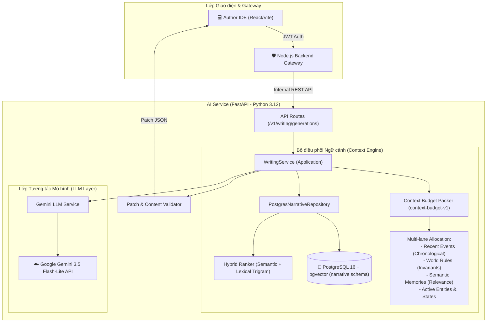

# Sổ tay Chuyển giao & Bộ câu hỏi Vấn đáp Bảo vệ Tốt nghiệp (Defense Q&A Cheat-sheet)
## AI Story Co-Pilot & Context Retrieval Engine (`ai-service`)

> **Mục đích tài liệu:** Tài liệu này đóng gói toàn bộ kiến trúc lõi, lý do lựa chọn công nghệ (Design Decisions), quy trình vận hành và các kịch bản trả lời vấn đáp kỹ thuật phục vụ Hội đồng Bảo vệ Tốt nghiệp (Graduation Defense) và bàn giao hệ thống (Handover).

---

## 📌 PHẦN 1: TÓM TẮT KIẾN TRÚC HỆ THỐNG (EXECUTIVE ARCHITECTURE)

Dịch vụ `ai-service` là hệ thống trợ lý biên tập thông minh (AI Story Co-Pilot) thế hệ mới dành cho tác giả tiểu thuyết dài kỳ, giải quyết triệt để 3 bài toán lớn nhất của việc sáng tác với LLM:
1. **Ảo giác và Mất nhất quán (Hallucination & Inconsistency):** LLM thường quên bối cảnh cũ hoặc tự bịa đặt chi tiết mâu thuẫn với các chương trước.
2. **Tràn ngữ cảnh (Context Window Overflow) & Chi phí/Độ trễ:** Tiểu thuyết hàng trăm chương không thể nhồi toàn bộ vào prompt.
3. **Rò rỉ tương lai (Future-Information Leakage):** Khi viết chương N, AI không được phép biết trước hoặc tiết lộ các sự kiện ở chương N+1 trở đi.



---

## 🎯 PHẦN 2: BỘ CÂU HỎI VẤN ĐÁP BẢO VỆ THEN CHỐT (DEFENSE Q&A)

### Câu 1: Tại sao hệ thống lại chọn mô hình `gemini-3.5-flash-lite` thay vì `gemini-3.8-flash` hay OpenAI GPT-4o?
* **Bối cảnh thực tế:** Trong quá trình thử nghiệm thực tế (canary testing), `gemini-3.8-flash` bị áp mức hạn mức (quota) rất ngặt nghèo trên gói miễn phí/thử nghiệm (chỉ ~20 requests/ngày - RPD), đồng thời từng ghi nhận tỷ lệ lỗi `503 Service Unavailable` cao khi chịu tải.
* **Lý do kỹ thuật & Demo thực chiến:**
  1. **Khả thi cho buổi Demo tương tác (Operational Feasibility):** `gemini-3.5-flash-lite` cung cấp hạn mức gọi API dồi dào, đảm bảo hệ thống có thể thực hiện liên tục nhiều vòng sinh văn bản mà không bị cạn quota giữa chừng.
  2. **Độ trễ phản hồi cực thấp (Latency):** Kết quả đo đạc thực tế trên hệ thống cho thấy Flash-Lite đạt thời gian phản hồi trung bình **~2.1 – 2.5 giây** cho mỗi lượt sinh bản thảo, phù hợp với trải nghiệm viết tương tác (interactive authoring).
  3. **Không đánh đổi vô căn cứ:** Hệ thống ghi nhận rõ ràng quyết định chọn Flash-Lite là vì **năng lực hạn mức và tính ổn định vận hành**, chứ không đưa ra tuyên bố thiếu căn cứ rằng mô hình nhỏ hơn có chất lượng văn học cao hơn.
  4. **Cơ chế chống fallback ngầm:** Hệ thống cấu hình chặn tuyệt đối việc tự động rớt về `gemini-3.8-flash` khi dùng Flash-Lite để không làm tiêu hao bất ngờ hạn mức 3.8 còn lại.

---

### Câu 2: Cơ chế "Context Budget Packer" hoạt động như thế nào và giải quyết bài toán gì?
* **Vấn đề cần giải quyết:** Không thể nạp toàn bộ 100 chương truyện vào LLM. Nếu nhồi nhét bừa bãi sẽ vượt ngưỡng ngân sách token, gây tốn kém, tăng độ trễ và khiến LLM bị "mất tập trung" (Lost in the Middle).
* **Giải pháp kiến trúc:** Context Budget Packer (`context-budget-v1`) hoạt động theo nguyên lý **phân bổ ngân sách token đa làn (Multi-lane Budgeting)**:
  - **Làn 1 - Recent Events (Sự kiện gần nhất):** Lưu giữ các sự kiện theo đúng thứ tự thời gian xảy ra ngay trước chương hiện tại để duy trì dòng chảy mạch truyện liền mạch.
  - **Làn 2 - World Rules (Quy tắc thế giới / Lore):** Các định luật ma thuật, cấp bậc tu vi, quy tắc địa lý bắt buộc phải tuân thủ (invariants).
  - **Làn 3 - Semantic Memories (Ký ức ngữ nghĩa):** Các tình tiết trong quá khứ liên quan trực tiếp đến phân cảnh đang viết, được truy xuất thông qua tìm kiếm lai (Hybrid Retrieval).
  - **Làn 4 - Active Entities & States (Thực thể & Trạng thái):** Danh sách các nhân vật tham gia phân cảnh cùng trạng thái mới nhất (HP, cảnh giới, trang bị, vị trí).
* **Cơ chế chống suy diễn tương lai (Chapter Cutoff Invariant):**
  - Mọi câu truy vấn dữ liệu từ repository đều bị giới hạn bởi `cutoff_chapter <= current_chapter`.
  - Không một thực thể, sự kiện hay sự thay đổi trạng thái nào xuất hiện ở chương tương lai được phép lọt vào context prompt.

---

### Câu 3: Tại sao lại chuyển đổi từ lưu trữ JSON sang PostgreSQL 16 + `pgvector`? Kiến trúc Hybrid Retrieval hoạt động ra sao?
* **Hạn chế của JSON storage cũ:** Không có tính toàn vẹn dữ liệu (ACID), không hỗ trợ chỉ mục vector, không có khả năng cô lập đa khách thuê (multi-tenant isolation) và dễ bị lỗi xung đột ghi đè dữ liệu (concurrency conflict).
* **Ưu thế của PostgreSQL + pgvector:**
  1. **Schema `narrative` chuẩn hóa:** Lưu trữ có cấu trúc các bảng `narrative_entities`, `narrative_events`, `narrative_states`, `memory_chunks`, và `memory_embeddings`.
  2. **Truy vấn Vector 768 chiều:** Sử dụng mô hình `gemini-embedding-2` (chuẩn contract `gemini-embedding-2-768-v1`) với khoảng cách L2 / Cosine để tìm các đoạn ký ức tương đồng về mặt ngữ nghĩa.
  3. **Truy vấn lai (Hybrid Retrieval = Dense Semantic + Sparse Lexical):**
     - **Semantic Search:** Dùng `pgvector` để hiểu ý nghĩa (ví dụ: tìm kiếm "vũ khí sắc bén" vẫn ra "thanh kiếm rỉ sét").
     - **Lexical Search (Trigram/BM25 style):** Dùng PostgreSQL `pg_trgm` để tìm chính xác danh từ riêng, tên nhân vật, chiêu thức (tránh hiện tượng vector search bị nhầm tên người).
     - **Hybrid Ranker:** Kết hợp điểm số của cả hai phương pháp bằng thuật toán xếp hạng chuẩn hóa (Reciprocal Rank Fusion / Weighted Scoring) để lấy ra Top-K ký ức chất lượng nhất.

---

### Câu 4: Triết lý "Human-in-the-Loop" và "Proposal-First Workflow" là gì?
* **Quan điểm thiết kế:** AI không thay thế tác giả và không tự ý chỉnh sửa thẳng vào bản thảo chính thức. AI đóng vai trò người cộng sự gợi ý (co-pilot).
* **Cơ chế vận hành:**
  1. **Tạo bản chụp (Chapter Snapshot):** Trước khi gọi sinh, hệ thống ghi nhận `revisionId` và `contentHash` của phiên bản hiện tại.
  2. **Tính toán vị trí chính xác theo Unicode Code-Point:** Khác với việc đếm byte hay UTF-16 code units (dễ bị lỗi chia cắt ký tự tiếng Việt có dấu hoặc emoji), hệ thống chuẩn hóa vị trí con trỏ và vùng bôi đen theo Unicode code point offsets.
  3. **Trả về Patch / Diff:** AI sinh ra bản thảo dưới dạng `patch` (bao gồm `start`, `end`, `replacement`).
  4. **Kiểm duyệt & Phê duyệt:** Tác giả xem trước phần chênh lệch (diff review) trên giao diện IDE. Tác giả có toàn quyền: Chấp nhận (Apply), Sửa lại rồi chấp nhận, hoặc Từ chối (Discard).

---

### Câu 5: Hệ thống xử lý thế nào để chống lỗi ghi đè, trùng lặp và bảo vệ tính sẵn sàng khi demo?
* **Idempotency Key (Khóa bất biến):**
  - Mọi yêu cầu sinh viết gửi từ giao diện đều kèm `idempotencyKey` ngẫu nhiên duy nhất (UUID).
  - Bảng ghi nhận công việc áp đặt ràng buộc `uq_writing_gen_tenant_idempotency` trên PostgreSQL, đảm bảo dù tác giả có click đúp chuột hay mạng chập chờn cũng không bao giờ sinh ra 2 tác vụ trùng nhau.
* **Transactional Outbox & Optimistic Locking:**
  - Sử dụng trường `version` trên các thực thể để kiểm soát xung đột đồng thời (Optimistic Concurrency Control).
  - Outbox pattern đảm bảo tính nhất quán cuối cùng (eventual consistency) giữa PostgreSQL và các dịch vụ lắng nghe sự kiện mà không bị lỗi ghi hai nguồn (dual-write).
* **Kịch bản phục hồi khi Demo (Recovery Ladder):**
  - Nếu gặp lỗi kết nối tới AI: Hệ thống hiển thị thông báo lỗi rõ ràng, cho phép retry tác vụ.
  - Nếu gặp sự cố container: Kịch bản `defense-demo-runbook.md` cung cấp lệnh khởi động lại nhanh từng container chỉ mất dưới 10 giây với seed dữ liệu mẫu định danh `reader03`.

---

## 🛠️ PHẦN 3: CHEAT-SHEET CÁC LỆNH KHỞI ĐỘNG & KIỂM TRA

### 1. Khởi động môi trường demo chuẩn:
```powershell
# Chạy từ thư mục gốc dự án
docker compose --env-file .env.demo -f docker-compose.yml -f docker-compose.flash-lite-demo.yml up -d --build
```

### 2. Kiểm tra tính sẵn sàng của 2 dịch vụ:
```powershell
# Kiểm tra model của AI Service (Python):
docker compose --env-file .env.demo -f docker-compose.yml -f docker-compose.flash-lite-demo.yml exec -T ai-service python -c "import main; s=main.settings; print('AI Model:', s.llm_model, '| Routing:', s.context_routing_policy)"
# Kết quả mong đợi: AI Model: gemini-3.5-flash-lite | Routing: legacy-v1

# Kiểm tra sức khỏe kết nối LLM của Backend (Node.js):
curl http://localhost:8080/api/v1/ai/health
# Kết quả mong đợi: {"success":true,"data":{"ready":true,"configuredModel":"gemini-3.5-flash-lite",...}}
```

### 3. Kiểm tra tính toàn vẹn hợp đồng Demo (Contract Drift Guard):
```powershell
python scripts/check_defense_demo_manifest.py
# Kết quả mong đợi: Defense demo contract: PASS
```

### 4. Dừng hệ thống sau buổi bảo vệ:
```powershell
docker compose --env-file .env.demo -f docker-compose.yml -f docker-compose.flash-lite-demo.yml down
```

---

## 📋 PHẦN 4: THÔNG TIN DỮ LIỆU SEED CHUẨN ĐỂ DEMO
* **Tài khoản tác giả:** `reader03@example.com` / `StrongPassword123!` (Role: `AUTHOR`)
* **Truyện mẫu:** Ashenhold - Sample Story (ID: `81b923d7-5507-48ea-9a84-5303fd1de5f4`)
* **Chương mẫu mở đầu:** Chương 1: Tàn Tro Của Ashenhold (ID: `c660bede-0493-4a46-97f2-6d01c8ddd3db`)
* **URL trực tiếp vào Author IDE:**
  `http://localhost:8080/author/ide?novelId=81b923d7-5507-48ea-9a84-5303fd1de5f4&chapterId=c660bede-0493-4a46-97f2-6d01c8ddd3db`
