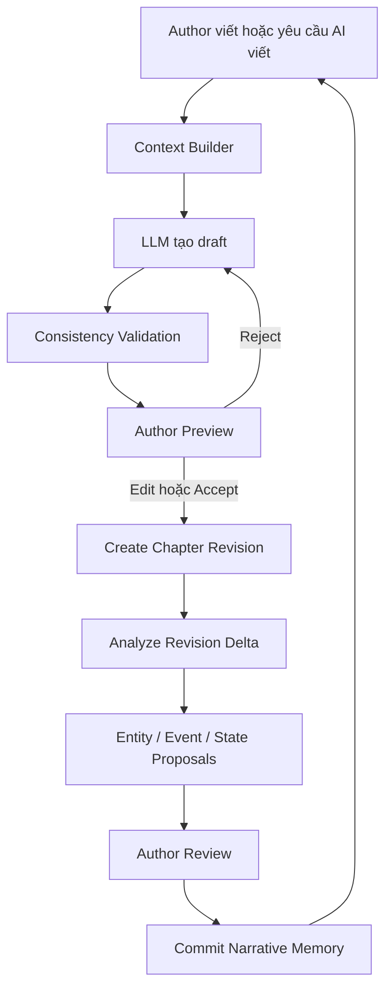

# Use Cases — Story Brain Lifecycle

> **Cập nhật 2026-10-21 — nguồn chuẩn:** [WORKFLOW_CONTRACT.md revision1.4](../../Pipeline_test/WORKFLOW_CONTRACT.md).
> Ba use case hiện tại: **P1 bản thảo có sẵn; P2 ý tưởng/thiết lập; P3 controller tự động**.
> Cả P1/P3 và chapter revisions của P2 dùng optional hints → tác giả duyệt entity → event/fact khi bật human-review mode.
> P2 setup vẫn extract entities explicit rồi review. P3 phải chờ human entity review; **P3_HITL_CONTROLLER_100K là gate cuối bắt buộc 100.000–105.000 từ**, không được báo fully unattended. Policy P3 không can thiệp là claim/đề án riêng.
> Phần dưới là **thiết kế lịch sử, không phải contract runtime hoặc bằng chứng triển khai**; UC-01/02/03 cũ không ánh xạ lần lượt với P1/P2/P3.
> Các mô tả blueprint mặc định, planning còn hoãn, changed-spans-only và review sau toàn bộ extraction không được dùng để ghi đè contract mới.


## Tổng quan

Sản phẩm có hai điểm khởi tạo Story Brain, nhưng chỉ có một vòng đời sáng tác trung tâm:

```text
Entry A: Ý tưởng mới ───────────┐
                               ├→ Story Brain Baseline
Entry B: Import truyện có sẵn ─┘
                                      ↓
                           Continuous Writing Loop
                                      ↓
                 Viết → Analyze → Review → Update Brain
```

Hai entry flow chỉ khác cách tạo baseline. Sau khi tác giả xác nhận baseline, cả hai cùng sử dụng chung writing, consistency và memory-update pipeline. Full planning suite được hoãn khỏi MVP.

## UC-01 — Tạo Story Brain từ ý tưởng

### Mục tiêu

Giúp tác giả chuyển một ý tưởng ban đầu thành Story Brain có cấu trúc để bắt đầu lập kế hoạch và viết.

### Actor

- Tác giả.
- AI Copilot.

### Luồng chính

```text
Ý tưởng tác giả
    ↓
AI đặt câu hỏi làm rõ
    ↓
AI tạo Story Blueprint Proposal
    ↓
Tác giả Accept / Edit / Reject / Lock
    ↓
Story Brain Baseline v1
    ↓
Mở Writing IDE
```

### Story Blueprint Proposal

AI có thể đề xuất:

- Premise, genre, tone và themes.
- World rules và giới hạn của thế giới.
- Character seeds, goals và initial states.
- Initial relationships.
- Open questions cần tác giả quyết định.

MVP yêu cầu tác giả review kỹ World Bible trước khi kích hoạt baseline. Plot/act/chapter/scene planning và dynamic replanning được hoãn sang phase sau.

### Quy tắc dữ liệu

LLM không được ghi các sự kiện chưa xảy ra vào `event_history`. MVP không materialize planning object; ý tưởng tương lai chỉ nằm trong open question hoặc draft chưa canonical cho tới khi planning phase được triển khai.

Mỗi thành phần được tạo với một trạng thái rõ ràng:

```text
proposed
confirmed
rejected
locked
```

Chỉ dữ liệu `confirmed` hoặc `locked` mới trở thành canonical Story Brain.

### Kết quả

```json
{
  "story_brain_version": 1,
  "premise": {},
  "world_rules": [],
  "characters": [],
  "initial_states": [],
  "author_facts": [],
  "open_questions": []
}
```

## UC-02 — Tạo Story Brain từ truyện có sẵn

### Mục tiêu

Phân tích manuscript hiện có để tạo Story Brain có provenance, giúp tác giả tiếp tục viết mà không phải khai báo lại toàn bộ thế giới truyện.

### Actor

- Tác giả.
- AI Copilot.

### Luồng chính

```text
Tác giả import manuscript
    ↓
Tách chapter và scene
    ↓
Entity / Event / Fact / State extraction
    ↓
Entity resolution và deduplication
    ↓
Tạo Story Brain Proposal
    ↓
Tác giả review conflict và ambiguity
    ↓
Accept / Merge / Edit / Reject / Lock
    ↓
Story Brain Baseline
    ↓
Mở Writing IDE
```

### Pipeline import

```text
Raw Manuscript
    ↓
Chapter/Scene Segmentation
    ↓
Entity Extraction
    ↓
Entity Normalization + Resolution
    ↓
Event Extraction
    ↓
State Transitions
    ↓
Relationship Projection
    ↓
World Rule / Author Fact Detection
    ↓
Conflict Detection
    ↓
Review Queue
```

### Phân loại thông tin

| Loại | Ví dụ | Cách xử lý |
|---|---|---|
| Explicit | “A đã chết trong chương 10” | Đề xuất với evidence và confidence cao |
| Inferred | A có thể đang thù B | Giữ trạng thái `proposed` |
| Unknown | Không rõ A còn giữ thanh kiếm | Đưa vào ambiguity/review queue |

### Review ưu tiên

Không yêu cầu tác giả review mọi extraction cùng lúc. UI ưu tiên:

1. Conflict có severity cao.
2. Duplicate hoặc ambiguous entity.
3. World rule và author fact.
4. Current character state.
5. Low-confidence event và relationship.

## UC-03 — Continuous Writing Loop

Đây là use case trung tâm của sản phẩm sau khi Story Brain baseline được xác nhận.



### Writing operations

Tác giả có thể:

- Tự viết.
- Continue scene.
- Expand outline.
- Rewrite selection.
- Generate dialogue.
- Brainstorm direction.

### Preview và Apply

Nội dung do AI tạo bên trong IDE sử dụng luồng:

```text
Generate → Preview Diff → Accept/Edit/Reject → Apply → Create Revision
```

Không gọi thao tác này là `import`. `Import` chỉ dùng cho nội dung được đưa vào từ nguồn bên ngoài như DOCX, TXT, Markdown hoặc nền tảng khác.

### Incremental analysis

Sau khi tác giả apply hoặc tự chỉnh sửa, hệ thống phân tích thay đổi giữa hai revision:

```text
Old Revision
+ New Revision
    ↓
Changed Spans
    ↓
Incremental Analysis
```

Kết quả có thể gồm:

- Entity hoặc alias mới.
- Event mới hoặc bị thay thế.
- State transition.
- Relationship change.
- Consistency finding.

### Memory update

LLM không ghi trực tiếp canonical memory:

```text
Analysis
→ Proposal
→ Validation
→ Author Decision hoặc Safe Policy
→ Commit
```

Ví dụ proposal:

```json
{
  "proposal_type": "state_transition",
  "entity_id": "char_a",
  "attribute": "health",
  "previous_value": 100,
  "new_value": 20,
  "evidence": {
    "revision_id": "rev_18",
    "start": 520,
    "end": 603
  },
  "confidence": 0.94,
  "status": "proposed"
}
```

## Ba lớp Story Brain

### Canonical Brain

Dữ liệu đã được tác giả xác nhận hoặc khóa:

- Author facts.
- Confirmed entities.
- Confirmed events.
- Locked world rules.

### Derived Brain

Dữ liệu có thể rebuild từ canonical memory:

- Current world state.
- Relationship projection.
- Character summaries.
- Timeline indexes.

### Proposed Brain

Dữ liệu chưa được xác nhận:

- AI-extracted entities.
- Inferred relationships.
- Proposed events.
- Suggested state transitions.

Proposed data không được đưa vào context như một sự thật chắc chắn. Context Builder phải kèm trạng thái và confidence khi buộc phải sử dụng nó.

## Màn hình onboarding

### Create from Idea

```text
1. Enter idea
2. AI asks clarification questions
3. Review premise and themes
4. Review characters and world rules
5. Review outline
6. Confirm Story Brain
7. Open Writing IDE
```

Không tạo toàn bộ novel chỉ bằng một nút bấm. Tác giả phải có checkpoint để chỉnh premise, character, world rule và outline.

### Import Existing Story

```text
1. Upload/select manuscript
2. Detect chapters and scenes
3. Run background analysis
4. Merge duplicate entities
5. Review important facts and events
6. Resolve detected conflicts
7. Confirm Story Brain
8. Open Writing IDE
```

## API định hướng

```text
POST /v1/story-brains/bootstrap/from-idea
POST /v1/story-brains/bootstrap/from-manuscript
GET  /v1/jobs/{job_id}

GET  /v1/proposals
POST /v1/proposals/{id}/accept
POST /v1/proposals/{id}/reject
POST /v1/proposals/{id}/edit
POST /v1/facts/{id}/lock

POST /v1/writing/generate
POST /v1/revisions/{revision_id}/analyze
GET  /v1/stories/{story_id}/context
```

Các endpoint trên là contract định hướng, chưa phải API đã được triển khai.

## Thứ tự MVP

1. Import truyện có sẵn và tạo Story Brain proposal.
2. Author review, merge, confirm và lock.
3. Continue writing từ Story Brain.
4. Analyze revision delta và cập nhật memory.
5. Create Story Brain from Idea.

Import-first kiểm chứng trực tiếp điểm khác biệt của sản phẩm: khả năng nhớ truyện dài, theo dõi state, retrieve context, phát hiện plot-hole và viết tiếp nhất quán.

Planning và editing nâng cao thuộc roadmap sau MVP.

## Acceptance criteria cấp sản phẩm

- Hai entry flow tạo cùng một cấu trúc Story Brain baseline.
- Không có event tương lai bị ghi nhầm vào historical event history.
- Mọi extracted fact/event đều có revision và evidence.
- AI không tự ghi đè dữ liệu tác giả đã xác nhận hoặc khóa.
- Apply suggestion luôn tạo revision mới và có thể undo.
- Phân tích lại cùng revision không tạo dữ liệu trùng.
- Story Brain được cập nhật liên tục sau mỗi revision được chấp nhận.
