# CHƯƠNG 3. PHÂN TÍCH VÀ THIẾT KẾ HỆ THỐNG

> **Đề tài:** Xây dựng nền tảng chia sẻ và sáng tác tiểu thuyết trực tuyến tích hợp trí tuệ nhân tạo – Ephurin.  
> **Nguồn kiểm chứng tính năng:** mã nguồn nhánh `main`, commit `18182745efcfe99842c4d29b0dd413ade214c42b`, khảo sát ngày 18/11/2026.  
> **Vị trí lưu tài liệu:** nhánh `backup-remote-mixed`; nhánh lưu trữ **không** được sử dụng làm căn cứ kết luận về các tính năng đã triển khai.  
> **Quy ước:** Sơ đồ được viết bằng Mermaid để có thể xem ngay trên GitHub hoặc xuất SVG/PNG. Các biểu đồ lớp và ERD thể hiện **mô hình phân tích đã giản lược**, không sao chép tất cả trường dữ liệu. Phân hệ AI chỉ được mô tả theo những thành phần/API kiểm tra được trong `main`. Những liên kết chức năng thể hiện quan hệ nghiệp vụ, không mặc nhiên là khóa ngoại vật lý.

## 3.1. Kiến trúc tổng thể hệ thống

### 3.1.1. Phạm vi phân tích và nguyên tắc thiết kế

Ephurin là nền tảng kết hợp sáng tác, công bố và đọc tiểu thuyết trực tuyến. Hệ thống được chia theo những nhóm chức năng tương ứng với hoạt động của **khách truy cập (Guest)**, **độc giả (Reader)**, **tác giả (Author)** và **quản trị viên (Admin)**. Trong phạm vi đồ án, các nghiệp vụ quản lý tài khoản, tác phẩm, chương truyện, tương tác, đọc truyện, ví Coin mô phỏng và quản trị được xử lý bởi ứng dụng backend. Dịch vụ AI hỗ trợ tác giả quản lý thông tin truyện và đưa ra đề xuất liên quan đến nội dung sáng tác.

Từ mã nguồn nhánh `main`, hệ thống có ba lớp ứng dụng chính:

1. **Lớp trình bày:** ứng dụng web React/Vite dành cho tác giả, quản trị và những giao diện web được triển khai; ứng dụng di động React Native/Expo phục vụ đọc truyện.
2. **Lớp xử lý nghiệp vụ:** backend Node.js/TypeScript/Express được tổ chức theo mô hình *Modular Monolith*. Các module có trách nhiệm riêng nhưng cùng thuộc một ứng dụng backend. Phân hệ AI chuyên sâu chạy bằng Python/FastAPI và được tích hợp qua API.
3. **Lớp dữ liệu:** PostgreSQL cho dữ liệu nghiệp vụ quan hệ và dữ liệu narrative, MongoDB cho một số loại dữ liệu document; PostgreSQL có phần mở rộng pgvector phục vụ bộ nhớ ngữ nghĩa của AI.

Không mô tả Ephurin như một hệ thống gồm nhiều microservice nghiệp vụ độc lập: ở `main`, các module `auth`, `novels`, `reading`, `wallet`, `admin`, `content-control`… cùng được đăng ký trong `backend/src/app.ts`. Dịch vụ AI là một tiến trình triển khai riêng [M1], [M2].

### 3.1.2. Sơ đồ kiến trúc tổng thể

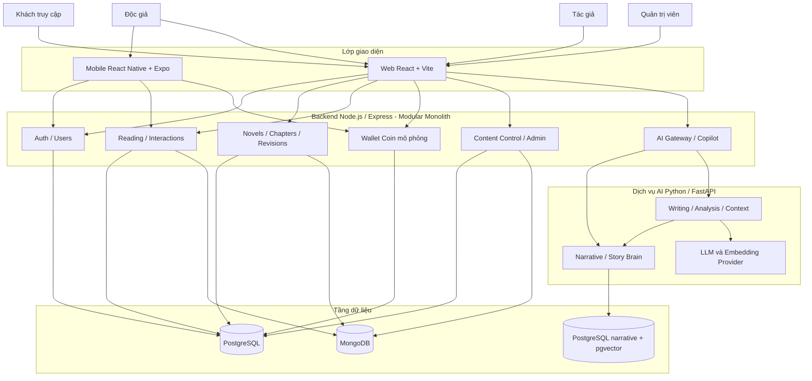

*Hình 3.1. Kiến trúc tổng thể của nền tảng Ephurin (tổng hợp từ [M1], [M2], [M3]).*

Hệ thống nhận yêu cầu của người dùng qua các giao diện phù hợp với chức năng và vai trò. Backend kiểm tra đầu vào, xác thực, phân quyền và điều phối tới module xử lý. Những nghiệp vụ thuần dữ liệu trả kết quả từ kho lưu trữ tương ứng. Các yêu cầu cần AI được chuyển tới AI Gateway, sau đó đến dịch vụ FastAPI để xử lý ngữ cảnh hoặc sinh kết quả. Kết quả AI mang tính đề xuất, không tự ý ghi đè dữ liệu chính thức đã được tác giả xác nhận.

### 3.1.3. Tổ chức module backend

Mã nguồn backend chia thành các nhóm module: `auth`, `users`, `novels`, `reading`, `interactions`, `wallet`, `content-control`, `admin`, `story-context`, `ai-copilot` và `ai`. Bên cạnh đó, hệ thống có module `media` phục vụ tài nguyên nội dung. Chức năng `ai` chứa lớp gateway và các cơ chế phối hợp với dịch vụ AI chuyên biệt; `ai-copilot` cung cấp một số thao tác hỗ trợ viết và gọi mô hình.

Ở cấp module, luồng xử lý phổ biến là: **Route → Middleware xác thực/kiểm tra dữ liệu → Controller → Service → Repository → Database**. Việc tách lớp hạn chế việc controller trực tiếp thực hiện thao tác dữ liệu và giúp cô lập các quy tắc nghiệp vụ. Trong `main`, có thể đối chiếu nguyên tắc này qua các thư mục `backend/src/modules/novels`, `backend/src/modules/wallet` và các module khác.

## 3.2. Xây dựng biểu đồ Use Case và các kịch bản

### 3.2.1. Xác định tác nhân chính

| Tác nhân | Mô tả | Nhóm chức năng tiêu biểu |
|---|---|---|
| Guest | Người chưa đăng nhập | Tìm kiếm, xem thông tin truyện và đọc nội dung công khai |
| Reader | Người dùng tập trung vào việc đọc | Đọc truyện, lưu lịch sử và dấu trang, bình luận, theo dõi, quản lý ví Coin |
| Author | Người sáng tác và quản lý truyện | Quản lý tác phẩm, bản thảo, chương, phiên bản, ngữ cảnh truyện và công cụ AI |
| Admin | Người quản lý vận hành | Quản lý tài khoản, danh mục, xử lý báo cáo và kiểm duyệt |
| Dịch vụ LLM | Hệ thống ngoài tham gia sinh/phân tích văn bản | Được AI Service gọi, không phải tác nhân sở hữu tác phẩm |

**Lưu ý về cách thể hiện:** Mermaid không có cú pháp Use Case UML chính thức như các công cụ UML chuyên dụng. Các hình 3.2–3.6 dùng `flowchart` với nút bo tròn để **biểu diễn nội dung Use Case**, không phải chứng nhận tuân thủ toàn bộ ký pháp UML. Khi nộp báo cáo theo quy chuẩn UML nghiêm ngặt, có thể dựng lại bằng PlantUML/Visual Paradigm từ chính danh sách ca sử dụng này.

### 3.2.2. Biểu đồ Use Case tổng quát

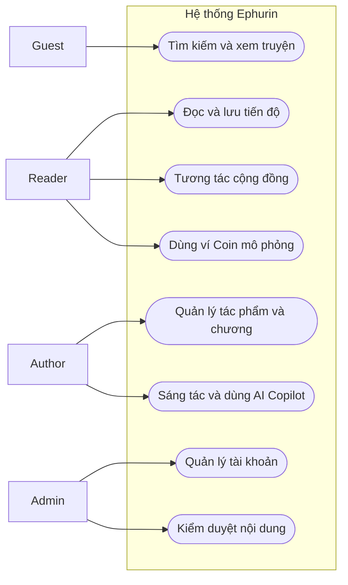

*Hình 3.2. Biểu đồ ca sử dụng tổng quát.*

Biểu đồ tổng quát xác định ranh giới chức năng mà các nhóm người dùng trực tiếp thao tác. Quyền truy cập cụ thể được kiểm tra bởi middleware và service tương ứng; không nên suy luận chỉ từ hình tổng quát rằng tất cả chức năng đều mở cho mọi tài khoản.

### 3.2.3. Use Case của độc giả

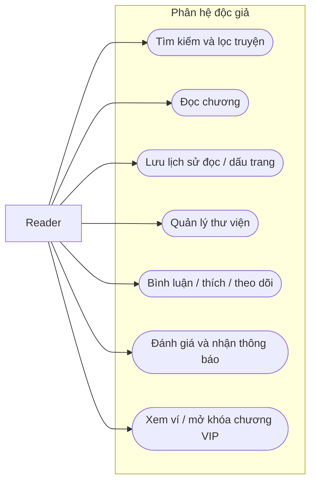

*Hình 3.3. Ca sử dụng của độc giả.*

Chức năng truy cập và lưu tiến độ đọc được đối chiếu với các route `/reading/search`, `/reading/chapters/:chapterId`, `/reading/history/me`, `/reading/library/me` và nhóm route dấu trang. Bình luận, theo dõi và đánh giá nằm trong các module tương tác. Riêng việc đọc chương VIP phải thỏa điều kiện quyền truy cập nội dung.

### 3.2.4. Use Case của tác giả

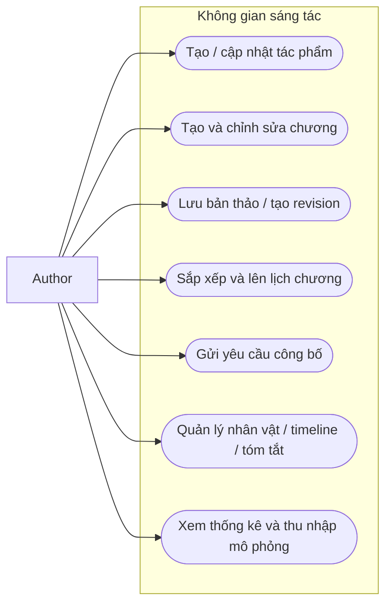

*Hình 3.4. Ca sử dụng của tác giả.*

Tác giả được kiểm tra quyền sở hữu truyện trước khi sửa hoặc công bố. Quá trình viết không đồng nhất với quá trình xuất bản: bản nháp, revision và nội dung đã công bố có trách nhiệm lưu trữ và trạng thái riêng.

### 3.2.5. Use Case hỗ trợ sáng tác bằng AI

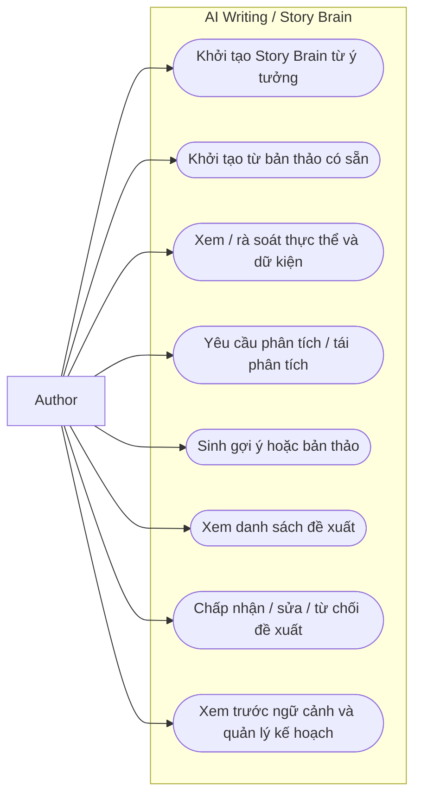

*Hình 3.5. Ca sử dụng của tác giả đối với phân hệ AI.*

Trên `main` có các route gateway tương ứng cho khởi tạo Story Brain, review thực thể, truy vấn context preview, tạo writing generation, duyệt hoặc từ chối proposal và quản lý story plan. Các use case thể hiện **giao diện chức năng được mã nguồn hỗ trợ**; khả năng đáp ứng mọi kích thước đầu vào, độ chính xác trích xuất hay chất lượng sinh văn bản không thể suy ra từ sự tồn tại của route.

### 3.2.6. Use Case của quản trị viên

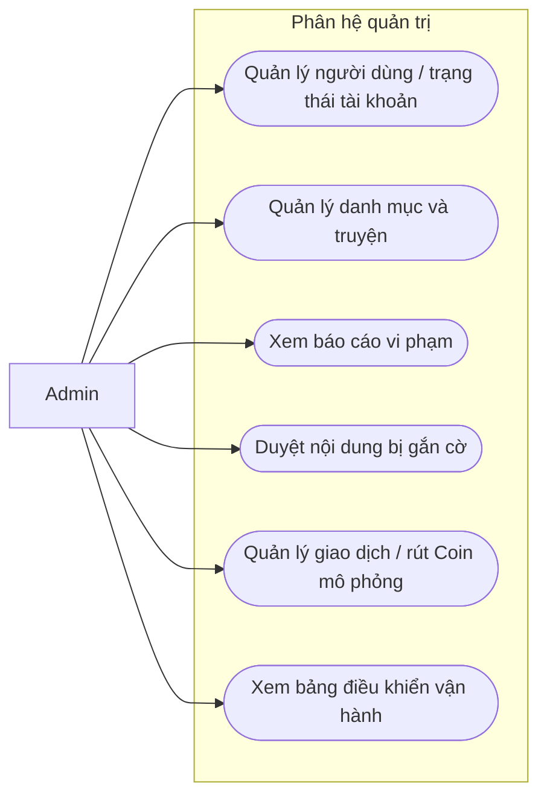

*Hình 3.6. Ca sử dụng của quản trị viên.*

Chức năng kiểm duyệt không sử dụng LLM như một nguồn tự động ra quyết định cuối cùng. Module `content-control` thực hiện kiểm tra quy tắc/từ khóa và tổ chức yêu cầu review; Admin quyết định duyệt hoặc từ chối theo quyền được cấp.

### 3.2.7. Mô tả kịch bản các ca sử dụng chính

#### UC-01. Đăng nhập

| Thuộc tính | Nội dung |
|---|---|
| Tác nhân | Người dùng có tài khoản |
| Mục đích | Xác thực và thiết lập phiên làm việc |
| Điều kiện trước | Tài khoản đã tồn tại, người dùng cung cấp thông tin đăng nhập |
| Kích hoạt | Gửi yêu cầu đăng nhập |
| Luồng chính | (1) Nhập định danh và mật khẩu; (2) API kiểm tra dữ liệu; (3) Auth Service tìm tài khoản; (4) so khớp mật khẩu và trạng thái; (5) phát hành access token và refresh token; (6) trả thông tin phiên |
| Luồng ngoại lệ | Sai thông tin, tài khoản không được phép hoạt động, yêu cầu không hợp lệ |
| Điều kiện sau | Người dùng có phiên hợp lệ; refresh token được quản lý để phục vụ làm mới hoặc thu hồi |

#### UC-02. Gửi công bố chương truyện

| Thuộc tính | Nội dung |
|---|---|
| Tác nhân | Author |
| Mục đích | Chuyển chương đã biên tập sang trạng thái xuất bản thích hợp |
| Điều kiện trước | Người dùng đăng nhập, có quyền sở hữu truyện; chương có nội dung |
| Kích hoạt | Chọn gửi công bố chương |
| Luồng chính | (1) Kiểm tra quyền và trạng thái chương; (2) lấy bản thảo cần công bố; (3) chạy kiểm tra nội dung theo quy tắc; (4a) nếu không cần review thì cập nhật chương công bố; (4b) nếu cần review thì chuyển sang chờ kiểm duyệt |
| Luồng ngoại lệ | Chương không tồn tại, không có quyền, nội dung trống, trạng thái không hợp lệ |
| Điều kiện sau | Chương được công bố hoặc được đưa vào hàng đợi kiểm duyệt |

#### UC-03. Sinh bản thảo bằng AI và xem xét kết quả

| Thuộc tính | Nội dung |
|---|---|
| Tác nhân | Author |
| Mục đích | Nhận kết quả hỗ trợ viết từ dịch vụ AI dựa trên thông tin truyện |
| Điều kiện trước | Tác giả có quyền thao tác với truyện/chương và yêu cầu hợp lệ |
| Kích hoạt | Yêu cầu tạo bản thảo hoặc gợi ý nội dung |
| Luồng chính | (1) Gateway xác thực phạm vi; (2) AI Service xây dựng ngữ cảnh; (3) gọi mô hình được cấu hình; (4) nhận và kiểm tra kết quả; (5) trả bản thảo/đề xuất; (6) tác giả xem và quyết định áp dụng hoặc bỏ qua |
| Luồng ngoại lệ | Provider không khả dụng, vượt giới hạn, job lỗi, phiên bản chương thay đổi, đề xuất bị từ chối |
| Điều kiện sau | Kết quả được ghi nhận theo vòng đời tương ứng; chỉ hành động chấp nhận hợp lệ mới cập nhật dữ liệu bản thảo/chính thức |

#### UC-04. Mở khóa chương VIP bằng Coin

| Thuộc tính | Nội dung |
|---|---|
| Tác nhân | Reader |
| Mục đích | Được phép đọc một chương yêu cầu Coin |
| Điều kiện trước | Người dùng đã đăng nhập; chương tồn tại, có yêu cầu mở khóa |
| Kích hoạt | Chọn mở khóa chương |
| Luồng chính | (1) Gửi yêu cầu; (2) kiểm tra quyền và tình trạng đã mở khóa; (3) xác định giá Coin; (4) kiểm tra số dư; (5) thực hiện transaction ghi giảm/tăng số dư theo nghiệp vụ và ghi ledger/mở khóa; (6) trả kết quả |
| Luồng ngoại lệ | Không đủ Coin, chương không hợp lệ, giao dịch thất bại, yêu cầu lặp |
| Điều kiện sau | Quyền truy cập được ghi nhận và giao dịch nhất quán, hoặc không phát sinh thay đổi khi thất bại |

#### UC-05. Xử lý yêu cầu kiểm duyệt

| Thuộc tính | Nội dung |
|---|---|
| Tác nhân | Admin |
| Mục đích | Đưa ra quyết định đối với nội dung cần kiểm duyệt |
| Điều kiện trước | Đăng nhập với vai trò quản trị; có yêu cầu review hợp lệ |
| Kích hoạt | Mở danh sách kiểm duyệt và chọn một mục |
| Luồng chính | (1) Xem nội dung và bằng chứng; (2) lựa chọn quyết định; (3) backend kiểm tra quyền, trạng thái và ghi quyết định; (4) cập nhật trạng thái nội dung liên quan; (5) trả kết quả |
| Luồng ngoại lệ | Review đã xử lý, thiếu quyền hoặc trạng thái không hợp lệ |
| Điều kiện sau | Yêu cầu kiểm duyệt và đối tượng liên quan phản ánh quyết định mới |

## 3.3. Biểu đồ lớp thực thể

Biểu đồ lớp trong phần này tập trung vào **lớp miền nghiệp vụ**, không phải biểu diễn trực tiếp mọi controller, DTO hoặc file của hệ thống. Tên lớp và quan hệ được tổng hợp từ mã nguồn, migration và các đối tượng API ở `main`. Cần phân biệt quan hệ lớp với khóa ngoại vật lý trên cơ sở dữ liệu.

### 3.3.1. Biểu đồ lớp tài khoản và tác phẩm

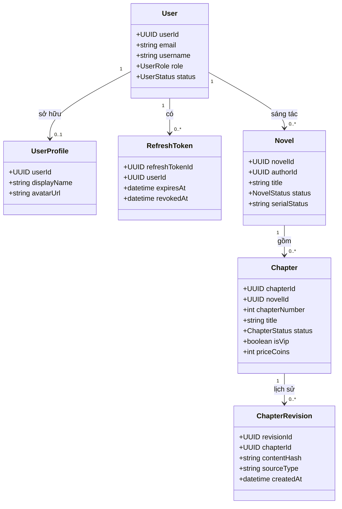

*Hình 3.7. Biểu đồ lớp tài khoản, tác phẩm và phiên bản chương.*

`User` xác định danh tính và vai trò. `UserProfile` lưu thông tin hồ sơ tách biệt với thông tin đăng nhập. Một tác giả có thể sở hữu nhiều tác phẩm; mỗi tác phẩm có nhiều chương. `ChapterRevision` cho phép lưu bản nội dung bất biến theo `revisionId` và `contentHash`, phục vụ kiểm soát thay đổi và phân tích AI. Nội dung bản thảo đang biên tập có thể được lưu theo mô hình document, không đồng nhất với revision đã chốt.

### 3.3.2. Biểu đồ lớp đọc truyện, tương tác và ví

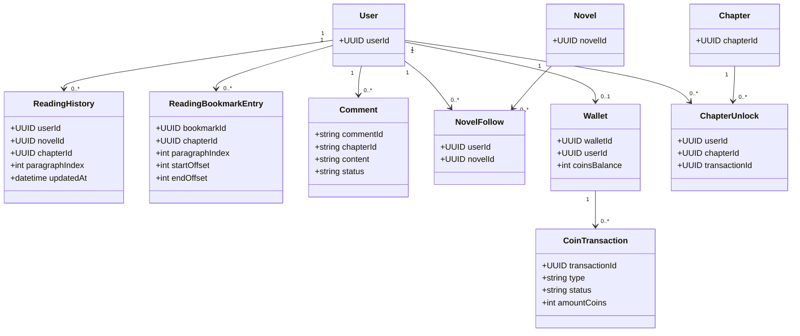

*Hình 3.8. Biểu đồ lớp đọc truyện, tương tác và giao dịch Coin.*

Điểm đáng chú ý là dữ liệu giao dịch được xử lý theo quy tắc toàn vẹn và cần giao dịch cơ sở dữ liệu khi thay đổi số dư/quyền mở khóa. Hệ thống Coin là **mô phỏng**, chưa được coi là tích hợp thanh toán thương mại thực.

### 3.3.3. Biểu đồ lớp quản lý ngữ cảnh và AI

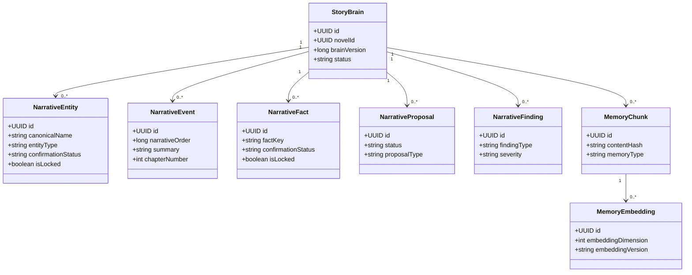

*Hình 3.9. Biểu đồ lớp miền ngữ cảnh truyện và AI.*

Mô hình tách biệt thông tin đã xác nhận, thông tin suy diễn và đề xuất đang chờ quyết định. `StoryBrain` là tập hợp thông tin truyện phục vụ tra cứu ngữ cảnh. `NarrativeEntity` đại diện danh tính nhân vật, địa điểm, tổ chức hoặc vật phẩm; `NarrativeEvent` lưu diễn biến; `NarrativeFact` lưu dữ kiện hoặc quy tắc. `NarrativeProposal` không tương đương dữ liệu đã được phê duyệt. `MemoryChunk` và `MemoryEmbedding` phục vụ truy xuất ngữ nghĩa. Mô hình được đối chiếu với các lớp ORM và migration AI trên `main`, không chỉ dựa trên file mô tả thiết kế [M4].

## 3.4. Thiết kế cơ sở dữ liệu

### 3.4.1. Phân chia kho dữ liệu

Ephurin tổ chức dữ liệu theo yêu cầu toàn vẹn và đặc tính lưu trữ:

| Kho dữ liệu | Nội dung chính | Cơ sở lựa chọn |
|---|---|---|
| PostgreSQL, schema nghiệp vụ | Tài khoản, truyện, chương, phiên bản, thư viện, lịch sử đọc, giao dịch và kiểm duyệt | Quan hệ rõ ràng, khóa ngoại và transaction |
| MongoDB | Bản thảo đang biên tập, bình luận, thông báo và các document liên quan | Cấu trúc document linh hoạt |
| PostgreSQL, schema `narrative` | Story Brain, thực thể, sự kiện, dữ kiện, đề xuất, bộ nhớ ngữ nghĩa | Cần ràng buộc, truy xuất theo phiên bản, và tích hợp pgvector |

Mỗi bảng dữ liệu được đặt dưới quyền xử lý của module tương ứng. AI Service không được tự ý thay đổi tài khoản hoặc trạng thái xuất bản của Novel Platform. Các tham chiếu `novelId`/`chapterId`/`revisionId` của Narrative Memory là định danh nghiệp vụ do Platform quản lý; không mặc định là foreign key vật lý xuyên schema.

### 3.4.2. ERD nhóm tài khoản và xuất bản

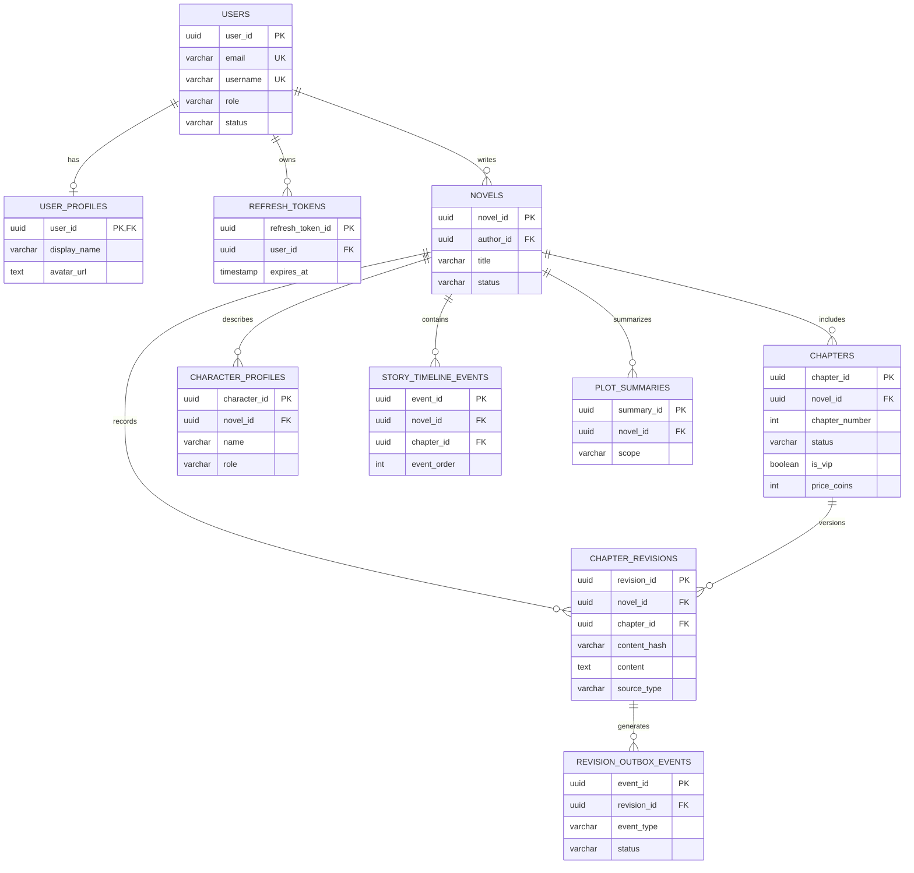

*Hình 3.10. ERD nhóm tài khoản, truyện, chương và ngữ cảnh do tác giả quản lý.*

Từ migrations trên `main` có thể xác định: `users.user_id` là khóa chính người dùng; `novels.author_id` tham chiếu tác giả; `chapters.novel_id` tham chiếu truyện; `chapter_revisions.chapter_id` tham chiếu chương và lưu `content_hash`. Bảng `revision_outbox_events` ghi dấu các sự kiện revision, có trạng thái và trường phục vụ retry. Các bảng `character_profiles`, `story_timeline_events` và `plot_summaries` là dữ liệu ngữ cảnh chính thức do backend quản lý. ERD đã bỏ một số trường phụ để giữ khả năng đọc.

### 3.4.3. ERD đọc truyện, tương tác và ví Coin

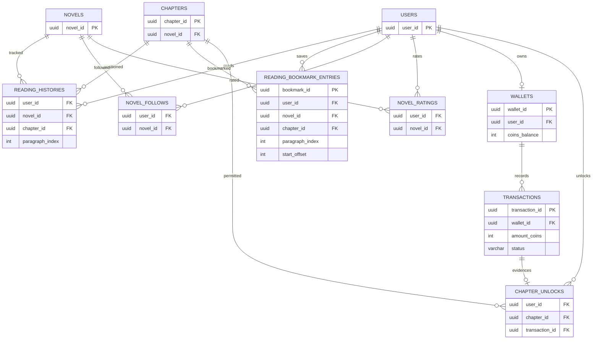

*Hình 3.11. ERD nhóm đọc truyện, theo dõi, đánh giá và ví Coin.*

Độc giả có thể lưu tiến độ đọc và nhiều dấu trang tại vị trí cụ thể trong chương. Các bảng follow/rating liên kết người dùng với tác phẩm. Ví Coin lưu số dư; bảng giao dịch phản ánh thay đổi; `chapter_unlocks` lưu quyền mở khóa tương ứng. Mọi số tiền trong phần này là **Coin nội bộ của hệ thống mô phỏng**.

### 3.4.4. ERD dữ liệu Narrative Memory

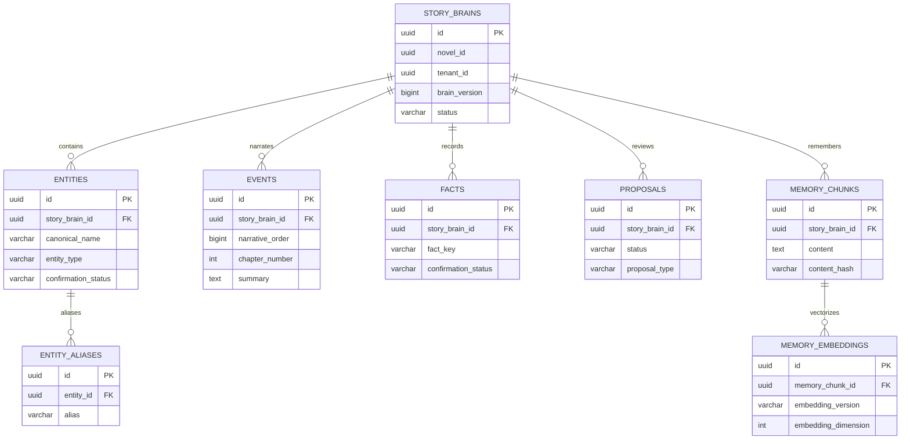

*Hình 3.12. ERD tổng quan của schema Narrative Memory.*

Mô hình Narrative Memory được biểu diễn ở mức nhóm bảng quan trọng, dựa trên `ai-service/infrastructure/orm_models.py` cùng thư mục migration Alembic của `main`. Các trường `confirmation_status`, `is_locked`, `revision_id`, `content_hash`, `brain_version` và `embedding_version` giúp hệ thống phân biệt thông tin đã xác nhận với thông tin chưa duyệt, truy vết nguồn và kiểm tra tính hợp lệ khi xử lý.

Không nên hiểu bảng `events` chỉ bao gồm sự kiện hiện tại: các sự kiện có thứ tự nội dung và được sử dụng để dựng lại trạng thái hoặc truy xuất ngữ cảnh theo diễn biến. Một đoạn truyện mới được phân tích chưa mặc nhiên trở thành dữ kiện chính thức chỉ vì mô hình AI đã trích xuất nó.

### 3.4.5. Đối tượng dữ liệu MongoDB

Ngoài các ERD của dữ liệu quan hệ, hệ thống sử dụng những nhóm document như `draft_chapters`, `comments`, `notifications` và `moderation_evidence`. Do MongoDB không dựa trên khóa ngoại theo cùng cơ chế với PostgreSQL, các quan hệ của chúng được thể hiện ở mức tham chiếu logic.

| Collection | Nhóm thuộc tính điển hình | Vai trò |
|---|---|---|
| `draft_chapters` | `chapterId`, `novelId`, `authorId`, `content`, `version`, `autosave` | Bản thảo đang biên tập |
| `comments` | `commentId`, `chapterId`, `novelId`, `userId`, `content`, `status` | Bình luận chương/đoạn |
| `notifications` | `userId`, `type`, `status`, `payload` | Thông báo người dùng |
| `moderation_evidence` | `targetType`, `targetId`, `matchedRules`, `riskLevel` | Bằng chứng phục vụ kiểm duyệt |

Danh sách trên được rút từ thiết kế dữ liệu và những repository tương ứng ở `main`; tùy đường xử lý thực tế, không phải mọi trường trong mô tả tài liệu đều bắt buộc hiện diện ở mọi document.

## 3.5. Sơ đồ tuần tự một số chức năng chính

### 3.5.1. Đăng nhập

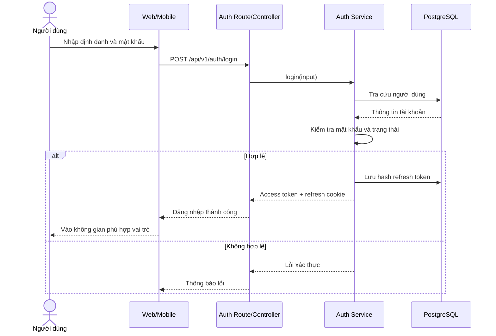

*Hình 3.13. Sơ đồ tuần tự đăng nhập.*

Backend sử dụng access token có thời hạn và lưu hash của refresh token để quản lý vòng đời phiên đăng nhập. Truy vấn quyền và trạng thái người dùng được thực hiện ở lớp nghiệp vụ.

### 3.5.2. Tạo, lưu và gửi công bố chương

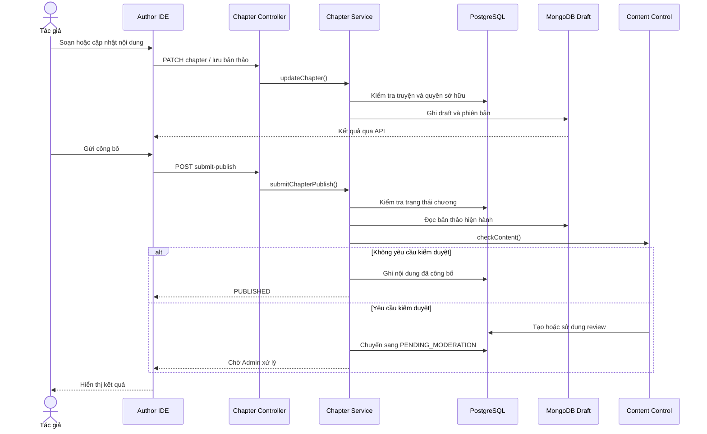

*Hình 3.14. Sơ đồ tuần tự lưu bản thảo và gửi công bố chương.*

Mã nguồn phân biệt việc cập nhật bản thảo và nộp công bố. Khi kiểm tra nội dung không phát hiện yêu cầu review, chương có thể được công bố theo quy tắc của backend; nếu cần review, nội dung được đưa vào trạng thái chờ quản trị viên. Trình tự được xây dựng từ `chapters.service.ts` và `content-control.service.ts` trên `main`.

### 3.5.3. AI sinh gợi ý và tác giả phê duyệt

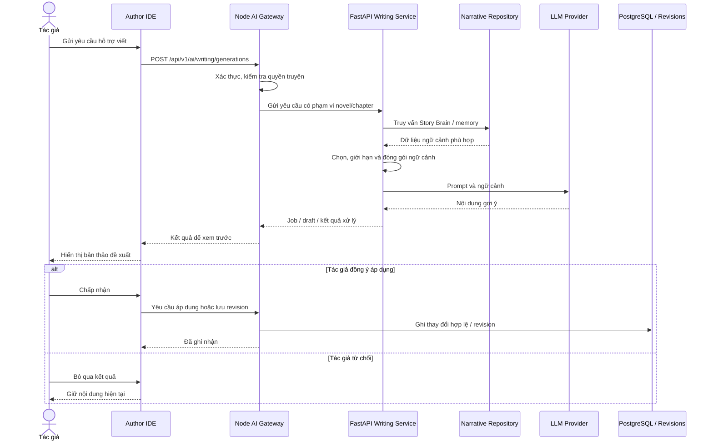

*Hình 3.15. Sơ đồ tuần tự AI hỗ trợ sáng tác.*

Sơ đồ mô tả **tương tác nghiệp vụ tổng quát** được hình thành từ các route viết, gateway và lớp application AI. Một số yêu cầu sử dụng job, truy vấn trạng thái hoặc phát luồng sự kiện; thời điểm phản hồi chính xác phụ thuộc operation. Nhánh “áp dụng” thể hiện hành động của tác giả thông qua chức năng lưu/nhận bản thảo hợp lệ; **không** có nghĩa mọi kết quả LLM đều được backend tự động ghi thẳng vào bản nháp.

### 3.5.4. Mở khóa chương VIP

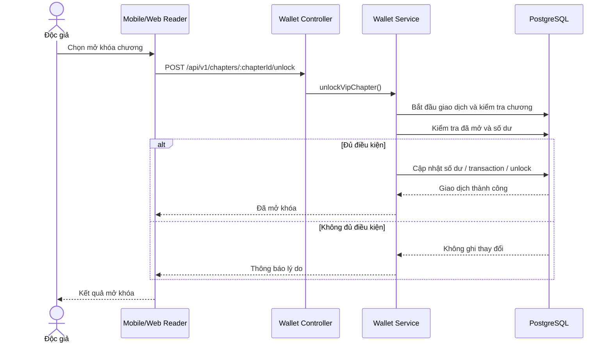

*Hình 3.16. Sơ đồ tuần tự mở khóa chương bằng Coin mô phỏng.*

Các thao tác thay đổi quyền đọc và số dư phải được xử lý nhất quán. Sơ đồ không thể hiện kết nối ngân hàng hoặc cổng thanh toán thực do không thuộc ý nghĩa của chức năng Coin mô phỏng trong phạm vi đồ án.

### 3.5.5. Quản trị viên xử lý kiểm duyệt

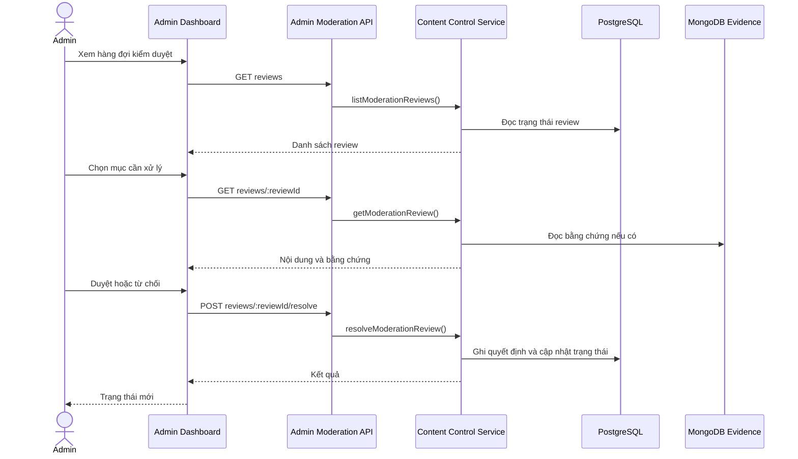

*Hình 3.17. Sơ đồ tuần tự xử lý kiểm duyệt nội dung.*

Quy trình kiểm duyệt sử dụng kết quả quét từ khóa/quy tắc và thông tin báo cáo để hỗ trợ quyết định của Admin. Không gộp pipeline kiểm duyệt với pipeline sinh văn bản của AI Copilot.

## 3.6. Mô hình hoạt động và trạng thái

### 3.6.1. Quy trình AI phân tích bản thảo và quản lý đề xuất

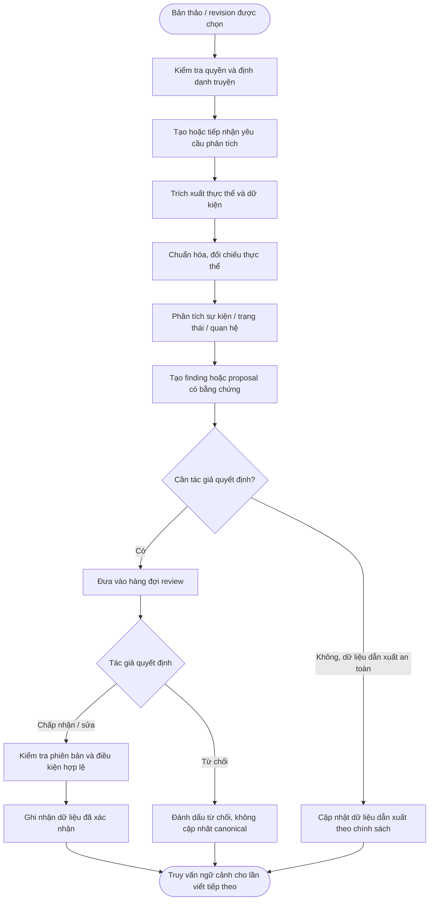

*Hình 3.18. Activity Diagram của quy trình phân tích và phê duyệt ngữ cảnh AI.*

Quy trình kết hợp việc trích xuất dữ liệu và vai trò quyết định của tác giả. Hệ thống cần phân biệt **proposed**, **confirmed/locked** và dữ liệu **derived** có thể tính lại. Các kiểm tra version, quyền sở hữu và tính idempotent giúp hạn chế việc cùng một yêu cầu tạo ra thay đổi trùng lặp. Khả năng này được thể hiện qua các API proposal, logic repository và mã xử lý trên `main`; hiệu quả đo đạc được trình bày riêng ở Chương 4.

### 3.6.2. Vòng đời chương truyện

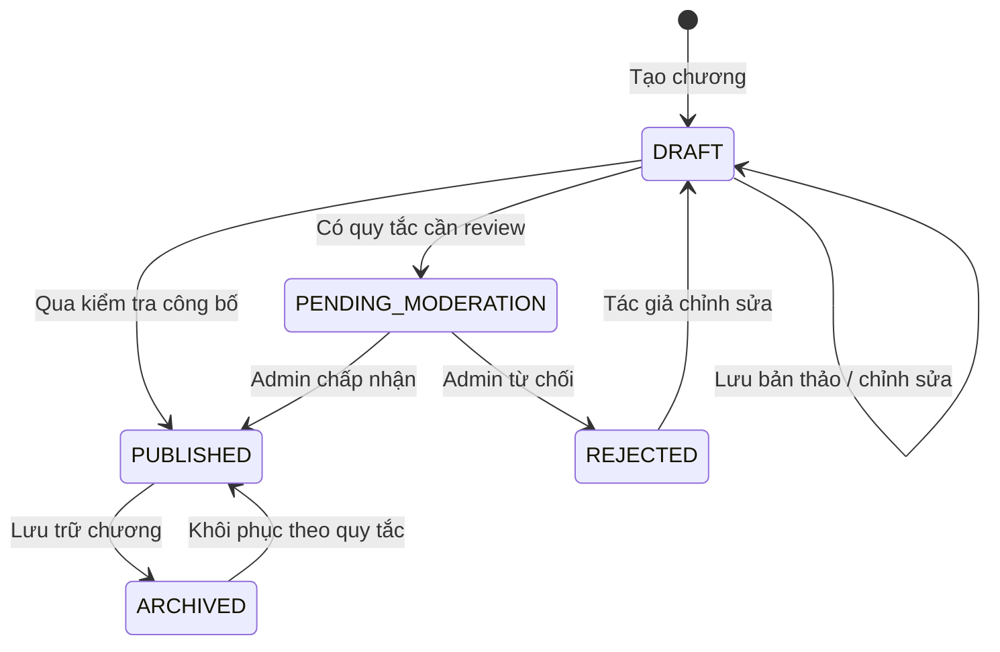

*Hình 3.19. State Machine thể hiện các trạng thái chính của chương truyện.*

Các trạng thái `DRAFT`, `PENDING_MODERATION`, `PUBLISHED`, `REJECTED` và `ARCHIVED` xuất hiện trong migration của backend. Mũi tên là **luồng nghiệp vụ tổng hợp** phục vụ thuyết minh; các chuyển tiếp thực tế phải qua ràng buộc service và có thể thay đổi tùy thao tác/điều kiện. Không được xem hình này là bảng chuyển trạng thái được phép tuyệt đối cho mọi API.

### 3.6.3. Mô hình triển khai ứng dụng

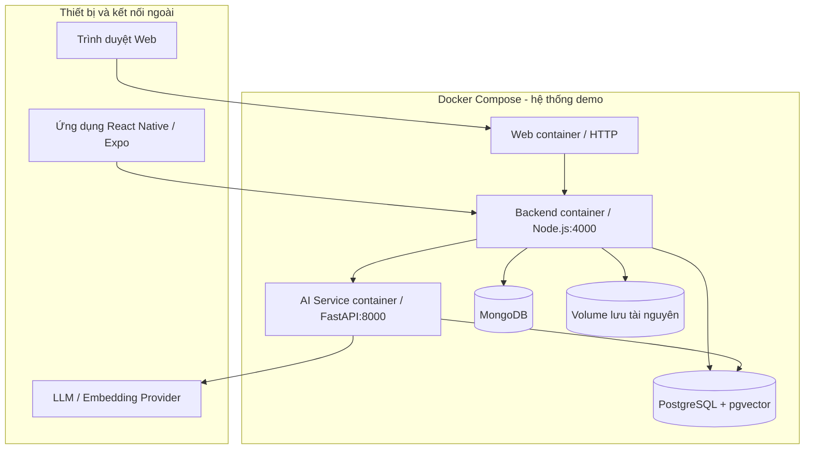

*Hình 3.20. Sơ đồ triển khai hệ thống theo Docker Compose trên nhánh `main`.*

Ứng dụng web, backend và AI Service được đóng gói thành các thành phần chạy trong Docker Compose cùng PostgreSQL/MongoDB. Ứng dụng di động chạy trên thiết bị hoặc môi trường phát triển, không phải container giao diện web. Bản vẽ nhằm thể hiện thành phần và kết nối; các cổng, biến môi trường và điều kiện health-check chi tiết được kiểm tra trong tệp `docker-compose.yml`.

## 3.7. Đánh giá phương án thiết kế và phạm vi hiện thực

### 3.7.1. Điểm phù hợp

**Thứ nhất, phân chia nghiệp vụ theo module.** Các chức năng xác thực, truyện, chương, đọc, tương tác, Coin và quản trị được triển khai thành các module rõ trách nhiệm. Cách tổ chức này giúp phân tích Use Case, nhận diện dữ liệu sở hữu và xây dựng các lớp xử lý tương ứng.

**Thứ hai, tách nguồn dữ liệu theo mục đích.** Dữ liệu giao dịch và quan hệ được quản lý trong PostgreSQL; một số dữ liệu có cấu trúc document đặt trong MongoDB; bộ nhớ truyện phục vụ AI sử dụng schema `narrative` và dữ liệu embedding. Phương án này hỗ trợ yêu cầu khác nhau của nghiệp vụ nhưng đồng thời đòi hỏi kiểm soát tính nhất quán khi trao đổi giữa các kho dữ liệu.

**Thứ ba, duy trì quyền quyết định của tác giả.** Kết quả phân tích hoặc sinh nội dung AI được đưa về dưới dạng đề xuất hoặc bản thảo. Việc thay đổi dữ liệu đã xác nhận phải tuân thủ cơ chế phê duyệt và xác thực phạm vi.

**Thứ tư, truy vết dữ liệu theo phiên bản.** `chapter_revisions`, `content_hash`, nguồn thay đổi và outbox event cung cấp nền tảng cho việc phân tích nội dung theo từng revision và theo dõi quá trình xử lý.

### 3.7.2. Giới hạn và điều kiện cần kiểm thử

Sự tồn tại của route, bảng dữ liệu và lớp xử lý là bằng chứng về **cấu trúc mã nguồn**, nhưng không tự chứng minh rằng tất cả luồng end-to-end đều hoạt động trong mọi điều kiện. Một số tính năng AI cần cấu hình provider, cơ sở dữ liệu, embedding hoặc chính sách runtime phù hợp. Các tiêu chí như độ trễ, độ chính xác trích xuất, mức độ liên quan của ngữ cảnh và độ tin cậy của hệ thống cần được kiểm tra bằng test case và số liệu thực tế.

Ngoài ra, các sơ đồ ở chương này được giản lược có chủ đích. Không đưa mọi lớp hạ tầng, cột dữ liệu, endpoint hoặc điều kiện ngoại lệ vào cùng một hình để tránh làm mất khả năng đọc. Khi mô tả lớp dữ liệu cụ thể, tên bảng và khóa phải đối chiếu với migration của `main` chứ không lấy từ SRS cũ.

### 3.7.3. Ma trận truy vết sơ đồ – mã nguồn

| Nhóm hình | Thành phần mã nguồn chính để đối chiếu |
|---|---|
| Kiến trúc tổng thể | `backend/src/app.ts`; `docker-compose.yml`; `ai-service/main.py` |
| Use Case độc giả | `backend/src/modules/reading`; `interactions`; `wallet` |
| Use Case tác giả | `backend/src/modules/novels`; `story-context`; `web/src/features/author-ide` |
| Use Case AI | `backend/src/modules/ai`; `ai-service/api`; `ai-service/application` |
| Use Case quản trị | `backend/src/modules/admin`; `content-control` |
| Class/ERD tác phẩm | `backend/src/core/database/migrations/001–010` và các migration bổ sung |
| Class/ERD độc giả | `backend/src/core/database/migrations/006`, `007`, `012`, `021`, `026`, `027` |
| ERD Narrative Memory | `ai-service/infrastructure/orm_models.py`; `ai-service/migrations/versions` |
| Sequence công bố và kiểm duyệt | `chapters.service.ts`; `content-control.service.ts` |
| Sequence AI | `ai-gateway.routes.ts`; `writing_service.py`; `narrative_service.py` |
| Vòng đời chương | `003_chapters.sql`; `chapters.service.ts`; nhóm xử lý lifecycle |

## 3.8. Kết chương

Chương 3 đã trình bày kiến trúc tổng thể của Ephurin, phân tích tác nhân và ca sử dụng, xây dựng các biểu đồ lớp thực thể, thiết kế cơ sở dữ liệu và mô tả luồng tương tác của những chức năng nghiệp vụ tiêu biểu. Nội dung được đối chiếu với hiện trạng mã nguồn trên nhánh `main` nhằm hạn chế sai lệch giữa báo cáo và hệ thống thực tế.

Những biểu đồ cho thấy hệ thống được phát triển theo hướng backend Modular Monolith kết hợp dịch vụ AI chuyên biệt, có cơ chế lưu phiên bản nội dung, phân tách dữ liệu nghiệp vụ với dữ liệu ngữ cảnh AI và duy trì quyền phê duyệt của tác giả đối với những đề xuất sinh tự động. Chương tiếp theo sẽ trình bày giao diện triển khai, môi trường chạy thử, các ca kiểm thử và đánh giá kết quả vận hành để chứng minh mức độ đáp ứng các yêu cầu đã phân tích.

---

## TÀI LIỆU ĐỐI CHIẾU CHO CHƯƠNG 3

**Nguồn chính (mã nguồn nhánh main, commit cố định):**

- **[M1]** Ephurin, [`backend/src/app.ts`](https://github.com/Ephurin/Novel_sharing_platform/blob/18182745efcfe99842c4d29b0dd413ade214c42b/backend/src/app.ts), danh sách route và module backend.
- **[M2]** Ephurin, [`docker-compose.yml`](https://github.com/Ephurin/Novel_sharing_platform/blob/18182745efcfe99842c4d29b0dd413ade214c42b/docker-compose.yml), cấu hình triển khai.
- **[M3]** Ephurin, [`backend/src/core/database/migrations`](https://github.com/Ephurin/Novel_sharing_platform/tree/18182745efcfe99842c4d29b0dd413ade214c42b/backend/src/core/database/migrations), dữ liệu nghiệp vụ và ràng buộc.
- **[M4]** Ephurin, [`ai-service/infrastructure/orm_models.py`](https://github.com/Ephurin/Novel_sharing_platform/blob/18182745efcfe99842c4d29b0dd413ade214c42b/ai-service/infrastructure/orm_models.py) và [`ai-service/migrations/versions`](https://github.com/Ephurin/Novel_sharing_platform/tree/18182745efcfe99842c4d29b0dd413ade214c42b/ai-service/migrations/versions), mô hình Narrative Memory.
- **[M5]** Ephurin, [`backend/src/modules/novels`](https://github.com/Ephurin/Novel_sharing_platform/tree/18182745efcfe99842c4d29b0dd413ade214c42b/backend/src/modules/novels), xử lý truyện, chương và revision.
- **[M6]** Ephurin, [`backend/src/modules/reading`](https://github.com/Ephurin/Novel_sharing_platform/tree/18182745efcfe99842c4d29b0dd413ade214c42b/backend/src/modules/reading), chức năng đọc truyện.
- **[M7]** Ephurin, [`backend/src/modules/wallet`](https://github.com/Ephurin/Novel_sharing_platform/tree/18182745efcfe99842c4d29b0dd413ade214c42b/backend/src/modules/wallet) và [`content-control`](https://github.com/Ephurin/Novel_sharing_platform/tree/18182745efcfe99842c4d29b0dd413ade214c42b/backend/src/modules/content-control), Coin mô phỏng và kiểm duyệt.
- **[M8]** Ephurin, [`backend/src/modules/ai`](https://github.com/Ephurin/Novel_sharing_platform/tree/18182745efcfe99842c4d29b0dd413ade214c42b/backend/src/modules/ai) và [`ai-service/application`](https://github.com/Ephurin/Novel_sharing_platform/tree/18182745efcfe99842c4d29b0dd413ade214c42b/ai-service/application), luồng AI và xử lý ngữ cảnh.

**Nguồn bổ trợ về ký pháp và thuật ngữ:**

- **[T1]** Object Management Group, *OMG Unified Modeling Language (OMG UML), Version 2.5.1*. https://www.omg.org/spec/UML/2.5.1
- **[T2]** Mermaid, *Mermaid Diagram Syntax*. https://mermaid.js.org/intro/syntax-reference.html

> **Ghi chú biên tập:** Các mã [M1]–[M8], [T1]–[T2] là mã truy vết nội bộ khi soạn thảo, chưa phải số thứ tự của danh mục tài liệu tham khảo toàn báo cáo. Khi ghép với Chương 1 và 2, chuyển thành đánh số IEEE thống nhất; đồng thời kiểm tra bản render từng sơ đồ trước khi xuất sang Word/PDF.
