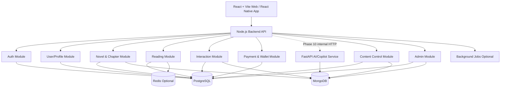

# Backend Architecture Overview

## Architecture Style

The SRS describes a microservices architecture, but the recommended MVP implementation is a **modular monolith with microservice-ready boundaries**.

This means:

- one Node.js backend application for easier development/demo;
- internal modules map to service domains;
- module boundaries should be respected;
- future extraction to microservices remains possible.

## Runtime Components



## Module Boundaries

| Module | Responsibility |
| :--- | :--- |
| `auth` | Register, login, token refresh, logout, password change, auth middleware. |
| `users` | Profile and user settings. |
| `novels` | Novel/chapter metadata, publishing, character/timeline/plot summaries, context proposals. |
| `reading` | Preferences, reading history, search, bookmarks/library. |
| `interactions` | Comments, likes, follows, notifications, device tokens. |
| `wallet` | Mock Coins, deposits, unlocks, donations, withdraw requests, transaction ledger. |
| `ai-gateway` | Node.js backend gateway/client for AI requests after Phase 9. Does not own AI execution logic. |
| `ai-service` | Future FastAPI service for LLM calls, embeddings, consistency checking, Copilot generation, and proposal creation. |
| `content-control` | Keyword/rule filtering, user reports, moderation queue, moderation evidence, Admin decisions. |
| `admin` | User lock/unlock, taxonomy, dashboard, withdraw review. |

## Dependency Direction

Recommended dependency direction:

```txt
controller -> service -> repository -> database
```

Rules:

- Controllers must not access database directly.
- Services contain business rules and transaction orchestration.
- Repositories contain ORM/MongoDB queries.
- Modules should not directly use another module's repository.
- Cross-module work should go through a module service or domain event.

## Data Access

| Storage | Access Strategy |
| :--- | :--- |
| PostgreSQL | ORM for normal CRUD and transactions. Raw SQL allowed for locking/complex analytics. |
| MongoDB | ODM/native driver repositories for documents/logs. |
| Redis | Cache/session/rate-limit only; never source of truth. |
| Vector DB | Future optional AI retrieval layer. |

## AI Service Boundary

AI/Copilot is intentionally deferred until after Phase 9.

When Phase 10 starts, AI should be implemented as a separate **FastAPI/Python service** instead of being embedded directly in the Node.js backend.

Recommended runtime boundary:

```txt
Web / Mobile
  -> Node.js Backend API
  -> internal HTTP ai-gateway client
  -> FastAPI AI/Copilot Service
  -> LLM Provider / Embeddings / Vector Retrieval
```

Rules:

- frontend clients must call the Node.js backend, not the FastAPI AI service directly;
- the Node.js backend remains responsible for auth, ownership checks, rate limits, and persistence decisions;
- the FastAPI service is responsible for prompt/context assembly helpers, model calls, embeddings, consistency checks, and generation logs;
- detailed AI API, database, and deployment docs should be updated after Phase 9 and before Phase 10 implementation.

## Transaction Strategy

Use ORM transactions for business operations that update multiple PostgreSQL tables.

Examples:

- unlock VIP chapter;
- donate Coins;
- create withdraw request;
- approve context proposal;
- resolve moderation review.

For wallet operations, use row locks or equivalent safe concurrency strategy to prevent negative balance.

## Approved Implementation Decisions

The following choices are approved for MVP implementation:

- Backend framework: **Express + TypeScript** with strict module conventions.
- Latest approved/published chapter content is stored in PostgreSQL `chapters.content`.
- Editable draft/autosave content is stored in MongoDB `draft_chapters`.
- Full draft version history is deferred; MVP keeps latest draft plus numeric `version`.
- MongoDB comments include UUID `commentId`; API/moderation use `commentId`.
- Moderation evidence and Copilot generation logs are retained for 90 days.
- Rejected context proposals are retained for 180 days, then archived/deleted.
- AI/Copilot implementation is deferred until Phase 10 and should be isolated in a FastAPI service.

Backend code should still isolate storage details behind repositories:

- `ChapterContentRepository`
- `DraftRepository`
- `CommentRepository`
- `ModerationReviewRepository`
- `ModerationEvidenceRepository`
- `CopilotLogRepository`
