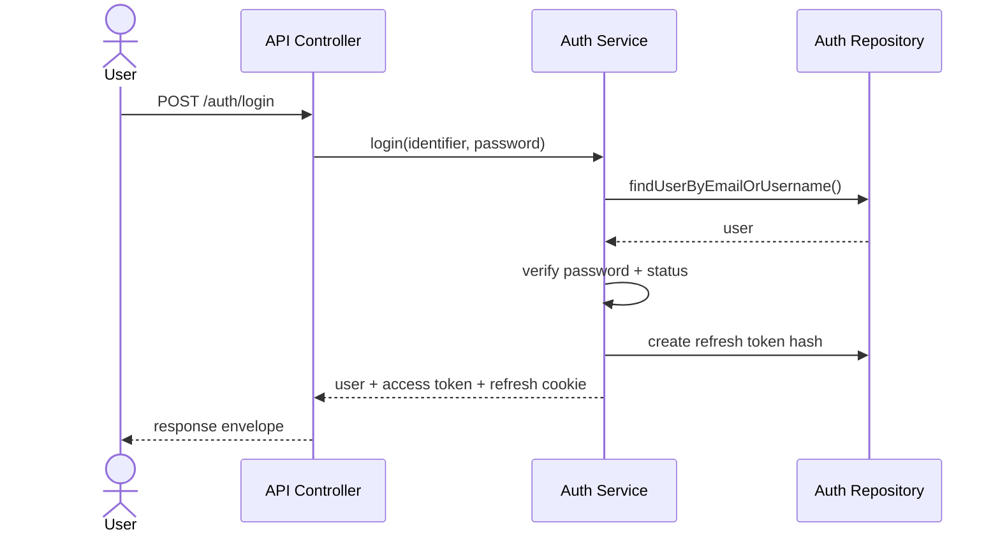
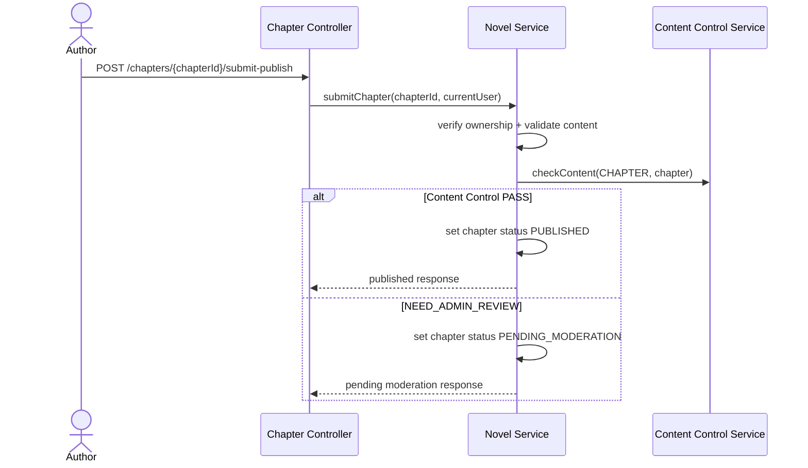
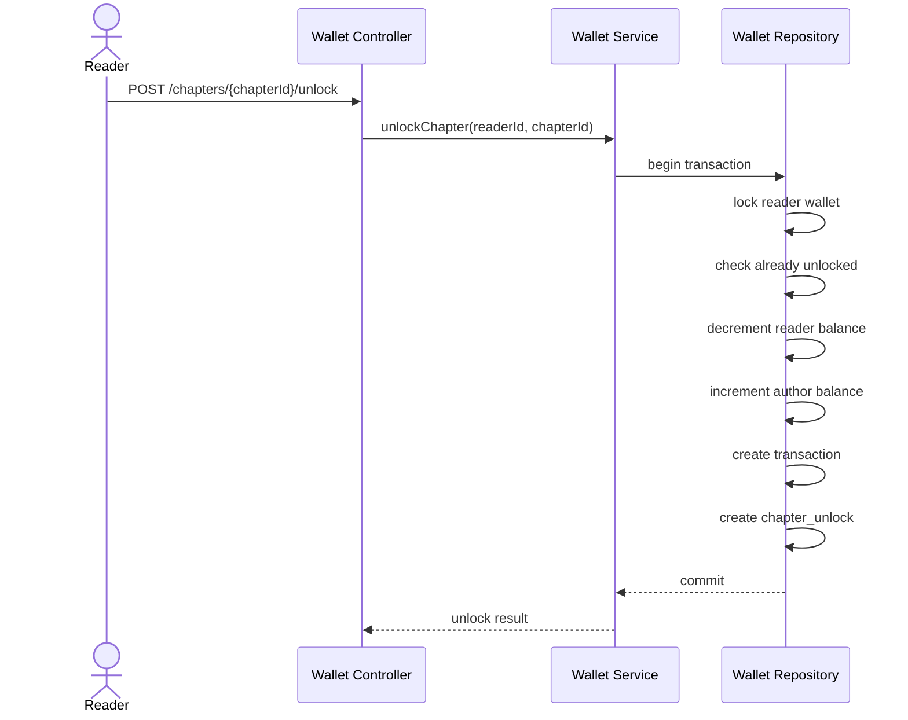
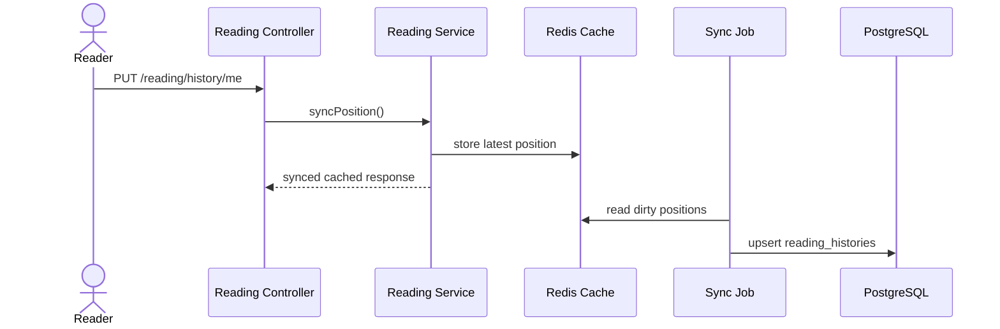
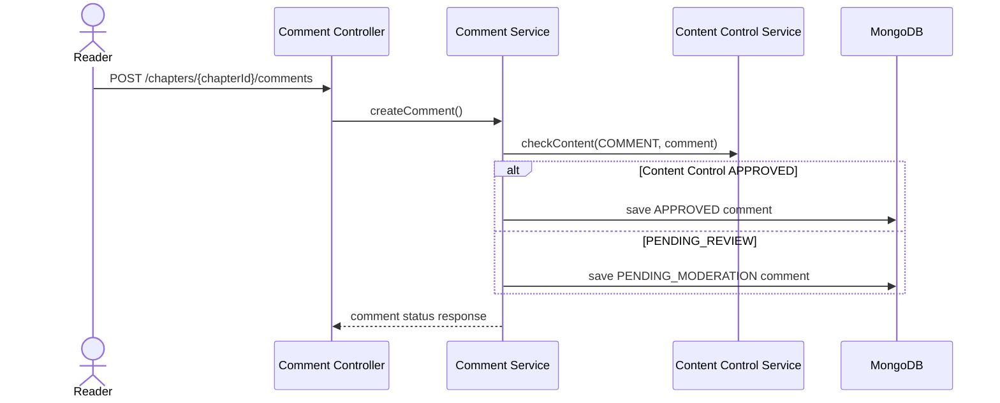
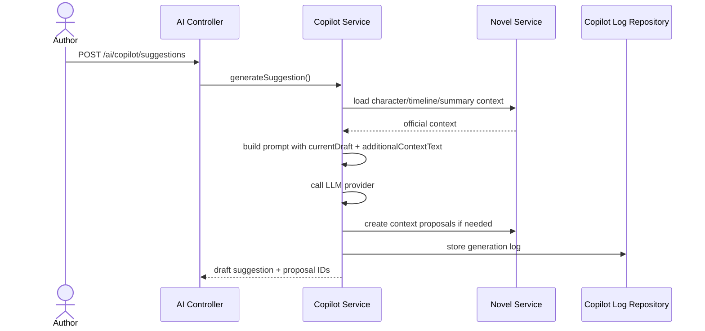
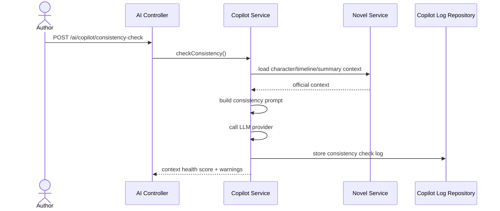
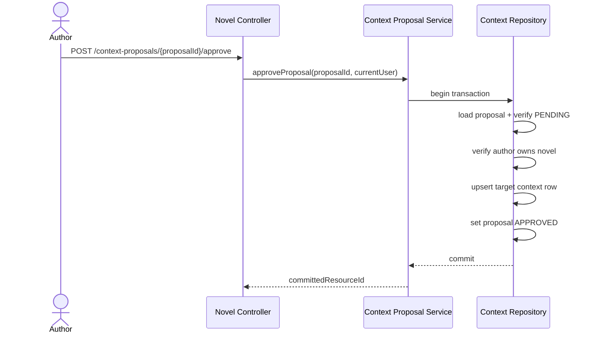
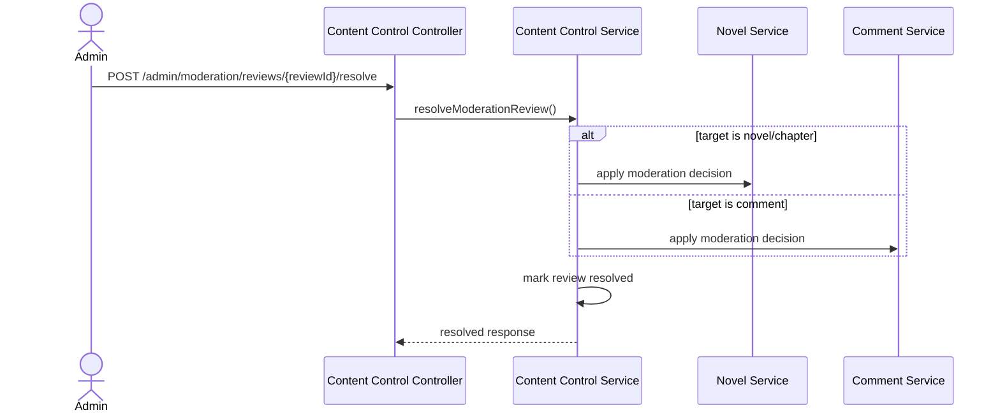
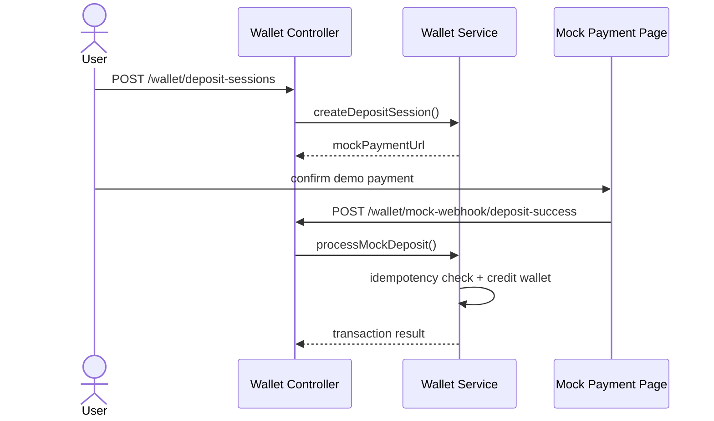

# Backend Service Flows

This document describes important backend workflows and their module interactions.

## 1. Login Flow

## 2. Publish Chapter Flow

## 3. Unlock VIP Chapter Flow

## 4. Reading History Sync Flow

## 5. Comment Moderation Flow

## 6. Writing Copilot Suggestion Flow

## 7. Approve Context Proposal Flow

## 8. Approve Context Proposal Flow

## 9. Admin Moderation Flow

## 10. Mock Deposit Flow

