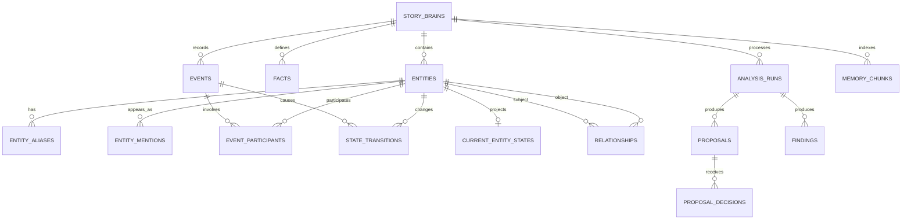

# Data Model — Narrative Memory PostgreSQL

> Status: Draft for review. Tài liệu này mô tả mô hình đích, chưa phải migration đã được triển khai.

## Các quyết định cần review

1. Dùng schema PostgreSQL riêng tên `narrative` trong cùng cluster ở giai đoạn đầu.
2. Novel Platform sở hữu user, novel, chapter và revision; Narrative Memory chỉ lưu canonical ID tham chiếu.
3. `events` đã được xác nhận là nguồn sự thật của diễn tiến truyện.
4. Current state và relationship là projection có thể rebuild.
5. AI chỉ tạo proposal; author decision hoặc policy an toàn mới materialize dữ liệu canonical.
6. Dùng PostgreSQL + `pgvector` trước khi cân nhắc graph/vector database riêng.
7. Không sao chép toàn bộ raw chapter vào Narrative Memory.

## Mục tiêu

- Cung cấp context có cấu trúc cho LLM.
- Theo dõi provenance tới chapter revision và source span.
- Hỗ trợ replay để dựng lại current world state.
- Phân biệt canonical, derived và proposed data.
- Không để retry hoặc phân tích lại tạo dữ liệu trùng.
- Hỗ trợ multi-user, optimistic concurrency và audit.

## Ranh giới dữ liệu

### Novel Platform sở hữu

```text
users
novels
chapters
chapter_revisions
publishing_status
permissions
```

### Narrative Memory sở hữu

```text
story_brains
entities / aliases / mentions
facts / world rules
events / participants
state transitions / current states
relationship projections
analysis runs
proposals / decisions
consistency findings
semantic memory
```

Nếu hai module dùng database khác nhau, `tenant_id`, `novel_id`, `chapter_id`, `revision_id` là external IDs và không dùng cross-database foreign key.

## Invariants

1. Mọi dữ liệu trích từ manuscript phải có `revision_id`, `content_hash` và evidence span.
2. Một analysis operation chỉ chạy một lần cho cùng idempotency key.
3. Proposed data không được xem là canonical fact.
4. Author-confirmed hoặc locked data không bị AI override.
5. Historical event không bị sửa nội dung tại chỗ; correction tạo event/fact mới và liên kết `supersedes_id`.
6. Current state phải có thể rebuild từ initial facts và accepted state transitions.
7. Relationship do AI suy ra phải truy ngược được event/fact nguồn.
8. Mọi write thay đổi aggregate version phải dùng optimistic locking.

## ERD tổng quan



## Quy ước chung

### Kiểu ID

- Dùng UUID v4 ở application hoặc UUID v7 nếu thư viện/hạ tầng thống nhất hỗ trợ.
- Không dùng tên entity làm khóa.
- Mọi bảng theo novel phải có `tenant_id` và `novel_id` để lọc quyền và index.

### Trạng thái

Không dùng PostgreSQL enum trong MVP để migration dễ hơn. Dùng `VARCHAR` kết hợp `CHECK` constraint.

```text
proposal_status: pending | accepted | rejected | superseded | expired
confirmation_status: proposed | confirmed | rejected | superseded
source_type: author | ai | import | system
run_status: queued | running | waiting_review | completed | failed | cancelled
finding_status: open | accepted | dismissed | resolved | obsolete
```

### Provenance fields

Artifact do AI hoặc import tạo nên có:

```sql
source_type        VARCHAR(20) NOT NULL,
source_revision_id UUID,
source_start       INTEGER,
source_end         INTEGER,
source_text_hash   VARCHAR(64),
confidence         NUMERIC(5,4),
pipeline_version   VARCHAR(50),
model_name         VARCHAR(100),
prompt_version     VARCHAR(50)
```

`source_start` và `source_end` sử dụng Unicode code-point offsets. API và frontend phải dùng cùng một quy ước.

## Platform prerequisite — Chapter revisions

Narrative Memory yêu cầu Platform cung cấp revision bất biến:

```sql
CREATE TABLE chapter_revisions (
    id UUID PRIMARY KEY,
    chapter_id UUID NOT NULL,
    revision_number INTEGER NOT NULL,
    content TEXT NOT NULL,
    content_hash VARCHAR(64) NOT NULL,
    created_by UUID NOT NULL,
    created_at TIMESTAMPTZ NOT NULL DEFAULT now(),
    UNIQUE (chapter_id, revision_number),
    UNIQUE (chapter_id, content_hash)
);
```

Narrative service không cần lưu lại `content`, chỉ đọc revision qua Platform API hoặc event payload có quyền truy cập phù hợp.

## `narrative.story_brains`

Aggregate root cho một novel.

| Cột | Kiểu | Ý nghĩa |
|---|---|---|
| `id` | UUID PK | Story Brain ID |
| `tenant_id` | UUID | Tenant/workspace |
| `novel_id` | UUID UNIQUE | Canonical Novel ID |
| `status` | VARCHAR(20) | initializing, active, archived, rebuilding |
| `baseline_revision_id` | UUID NULL | Revision cuối dùng tạo baseline |
| `brain_version` | BIGINT | Optimistic concurrency version |
| `schema_version` | INTEGER | Phiên bản schema logic |
| `created_at` | TIMESTAMPTZ | Thời điểm tạo |
| `updated_at` | TIMESTAMPTZ | Thời điểm cập nhật |

```sql
CREATE TABLE narrative.story_brains (
    id UUID PRIMARY KEY,
    tenant_id UUID NOT NULL,
    novel_id UUID NOT NULL UNIQUE,
    status VARCHAR(20) NOT NULL DEFAULT 'initializing',
    baseline_revision_id UUID,
    brain_version BIGINT NOT NULL DEFAULT 1,
    schema_version INTEGER NOT NULL DEFAULT 1,
    created_at TIMESTAMPTZ NOT NULL DEFAULT now(),
    updated_at TIMESTAMPTZ NOT NULL DEFAULT now()
);
```

## `narrative.entities`

Lưu identity ổn định, không lưu state thay đổi theo diễn tiến.

| Cột | Kiểu | Ý nghĩa |
|---|---|---|
| `entity_type` | VARCHAR(30) | character, location, organization, item, skill |
| `canonical_name` | VARCHAR(255) | Tên hiển thị chuẩn |
| `normalized_name` | VARCHAR(255) | Tên dùng dedup/search |
| `description` | TEXT | Mô tả ổn định |
| `static_attributes` | JSONB | Thuộc tính không đổi hoặc ít đổi |
| `confirmation_status` | VARCHAR(20) | Trạng thái xác nhận |
| `is_locked` | BOOLEAN | AI không được override |
| `created_by` | UUID NULL | Author/user xác nhận |

```sql
CREATE TABLE narrative.entities (
    id UUID PRIMARY KEY,
    story_brain_id UUID NOT NULL REFERENCES narrative.story_brains(id),
    tenant_id UUID NOT NULL,
    novel_id UUID NOT NULL,
    entity_type VARCHAR(30) NOT NULL,
    canonical_name VARCHAR(255) NOT NULL,
    normalized_name VARCHAR(255) NOT NULL,
    description TEXT,
    static_attributes JSONB NOT NULL DEFAULT '{}',
    source_type VARCHAR(20) NOT NULL,
    confirmation_status VARCHAR(20) NOT NULL DEFAULT 'proposed',
    confidence NUMERIC(5,4),
    is_locked BOOLEAN NOT NULL DEFAULT false,
    created_by UUID,
    created_at TIMESTAMPTZ NOT NULL DEFAULT now(),
    updated_at TIMESTAMPTZ NOT NULL DEFAULT now(),
    UNIQUE (story_brain_id, id)
);
```

Không đặt unique tuyệt đối trên `normalized_name`: hai nhân vật có thể trùng tên. Deduplication là workflow có evidence, không chỉ là constraint.

## `narrative.entity_aliases`

```sql
CREATE TABLE narrative.entity_aliases (
    id UUID PRIMARY KEY,
    entity_id UUID NOT NULL REFERENCES narrative.entities(id),
    alias VARCHAR(255) NOT NULL,
    normalized_alias VARCHAR(255) NOT NULL,
    source_type VARCHAR(20) NOT NULL,
    confirmation_status VARCHAR(20) NOT NULL DEFAULT 'proposed',
    confidence NUMERIC(5,4),
    created_at TIMESTAMPTZ NOT NULL DEFAULT now(),
    UNIQUE (entity_id, normalized_alias)
);
```

## `narrative.entity_mentions`

Liên kết entity với evidence trong một immutable revision.

```sql
CREATE TABLE narrative.entity_mentions (
    id UUID PRIMARY KEY,
    story_brain_id UUID NOT NULL REFERENCES narrative.story_brains(id),
    entity_id UUID NOT NULL REFERENCES narrative.entities(id),
    tenant_id UUID NOT NULL,
    novel_id UUID NOT NULL,
    chapter_id UUID NOT NULL,
    revision_id UUID NOT NULL,
    surface_text VARCHAR(255) NOT NULL,
    source_start INTEGER NOT NULL,
    source_end INTEGER NOT NULL,
    source_text_hash VARCHAR(64) NOT NULL,
    confidence NUMERIC(5,4),
    extractor_version VARCHAR(50),
    created_at TIMESTAMPTZ NOT NULL DEFAULT now(),
    CHECK (source_start >= 0),
    CHECK (source_end > source_start),
    UNIQUE (revision_id, entity_id, source_start, source_end, extractor_version)
);
```

## `narrative.facts`

Lưu author facts, world rules và initial state facts.

```sql
CREATE TABLE narrative.facts (
    id UUID PRIMARY KEY,
    story_brain_id UUID NOT NULL REFERENCES narrative.story_brains(id),
    tenant_id UUID NOT NULL,
    novel_id UUID NOT NULL,
    subject_entity_id UUID REFERENCES narrative.entities(id),
    fact_type VARCHAR(40) NOT NULL,
    fact_key VARCHAR(100) NOT NULL,
    fact_value JSONB NOT NULL,
    source_type VARCHAR(20) NOT NULL,
    confirmation_status VARCHAR(20) NOT NULL,
    confidence NUMERIC(5,4),
    priority INTEGER NOT NULL DEFAULT 0,
    is_locked BOOLEAN NOT NULL DEFAULT false,
    valid_from_event_id UUID,
    valid_until_event_id UUID,
    source_revision_id UUID,
    source_start INTEGER,
    source_end INTEGER,
    supersedes_id UUID REFERENCES narrative.facts(id),
    created_by UUID,
    created_at TIMESTAMPTZ NOT NULL DEFAULT now()
);
```

Ví dụ `fact_type`: `world_rule`, `character_trait`, `initial_state`, `author_instruction`.

## `narrative.events`

Event history là append-only narrative source of truth.

```sql
CREATE TABLE narrative.events (
    id UUID PRIMARY KEY,
    story_brain_id UUID NOT NULL REFERENCES narrative.story_brains(id),
    tenant_id UUID NOT NULL,
    novel_id UUID NOT NULL,
    chapter_id UUID,
    revision_id UUID,
    scene_ref VARCHAR(100),
    narrative_order BIGINT NOT NULL,
    event_type VARCHAR(50) NOT NULL,
    summary TEXT NOT NULL,
    location_entity_id UUID REFERENCES narrative.entities(id),
    story_time JSONB,
    emotion_tags TEXT[] NOT NULL DEFAULT '{}',
    consequences JSONB NOT NULL DEFAULT '[]',
    importance_score NUMERIC(5,4) NOT NULL DEFAULT 0.5,
    source_type VARCHAR(20) NOT NULL,
    confirmation_status VARCHAR(20) NOT NULL,
    confidence NUMERIC(5,4),
    source_start INTEGER,
    source_end INTEGER,
    source_text_hash VARCHAR(64),
    pipeline_version VARCHAR(50),
    model_name VARCHAR(100),
    prompt_version VARCHAR(50),
    supersedes_id UUID REFERENCES narrative.events(id),
    created_at TIMESTAMPTZ NOT NULL DEFAULT now(),
    UNIQUE (story_brain_id, narrative_order)
);
```

`narrative_order` được cấp bởi application service khi materialize proposal. Nếu cần chèn event giữa hai vị trí, thực hiện renumber trong transaction hoặc chuyển sang ordering key chuyên dụng ở phase sau.

## `narrative.event_participants`

```sql
CREATE TABLE narrative.event_participants (
    event_id UUID NOT NULL REFERENCES narrative.events(id),
    entity_id UUID NOT NULL REFERENCES narrative.entities(id),
    participant_role VARCHAR(40) NOT NULL,
    intent TEXT,
    emotion VARCHAR(100),
    metadata JSONB NOT NULL DEFAULT '{}',
    PRIMARY KEY (event_id, entity_id, participant_role)
);
```

Role ban đầu: `actor`, `target`, `witness`, `beneficiary`, `victim`.

## `narrative.state_transitions`

Mỗi thay đổi state phải liên kết tới event hoặc author fact.

```sql
CREATE TABLE narrative.state_transitions (
    id UUID PRIMARY KEY,
    story_brain_id UUID NOT NULL REFERENCES narrative.story_brains(id),
    novel_id UUID NOT NULL,
    event_id UUID REFERENCES narrative.events(id),
    fact_id UUID REFERENCES narrative.facts(id),
    entity_id UUID NOT NULL REFERENCES narrative.entities(id),
    attribute_key VARCHAR(100) NOT NULL,
    previous_value JSONB,
    new_value JSONB NOT NULL,
    source_type VARCHAR(20) NOT NULL,
    confirmation_status VARCHAR(20) NOT NULL,
    confidence NUMERIC(5,4),
    created_at TIMESTAMPTZ NOT NULL DEFAULT now(),
    CHECK (event_id IS NOT NULL OR fact_id IS NOT NULL)
);
```

Ví dụ `attribute_key`: `status`, `health`, `location_id`, `inventory`, `realm`, `current_goal`, `emotional_state`.

## `narrative.current_entity_states`

Projection phục vụ query nhanh. Typed columns dành cho constraint thường dùng; `additional_state` chứa thuộc tính mở rộng.

```sql
CREATE TABLE narrative.current_entity_states (
    story_brain_id UUID NOT NULL REFERENCES narrative.story_brains(id),
    entity_id UUID NOT NULL REFERENCES narrative.entities(id),
    novel_id UUID NOT NULL,
    status VARCHAR(50),
    location_entity_id UUID REFERENCES narrative.entities(id),
    health NUMERIC,
    current_goal TEXT,
    emotional_state VARCHAR(100),
    inventory JSONB NOT NULL DEFAULT '[]',
    additional_state JSONB NOT NULL DEFAULT '{}',
    projected_through_event_id UUID REFERENCES narrative.events(id),
    projection_version INTEGER NOT NULL DEFAULT 1,
    row_version BIGINT NOT NULL DEFAULT 1,
    updated_at TIMESTAMPTZ NOT NULL DEFAULT now(),
    PRIMARY KEY (story_brain_id, entity_id)
);
```

Projection update dùng:

```sql
UPDATE narrative.current_entity_states
SET additional_state = :state,
    row_version = row_version + 1,
    updated_at = now()
WHERE story_brain_id = :brain_id
  AND entity_id = :entity_id
  AND row_version = :expected_version;
```

Nếu không có row được cập nhật, worker phải reload hoặc retry bounded.

## `narrative.relationships`

Relationship là projection, không phải event gốc.

```sql
CREATE TABLE narrative.relationships (
    id UUID PRIMARY KEY,
    story_brain_id UUID NOT NULL REFERENCES narrative.story_brains(id),
    novel_id UUID NOT NULL,
    subject_entity_id UUID NOT NULL REFERENCES narrative.entities(id),
    relation_type VARCHAR(80) NOT NULL,
    object_entity_id UUID NOT NULL REFERENCES narrative.entities(id),
    status VARCHAR(20) NOT NULL DEFAULT 'active',
    strength NUMERIC(5,4),
    confidence NUMERIC(5,4),
    source_type VARCHAR(20) NOT NULL,
    confirmation_status VARCHAR(20) NOT NULL,
    is_locked BOOLEAN NOT NULL DEFAULT false,
    derived_from_event_id UUID REFERENCES narrative.events(id),
    valid_from_event_id UUID REFERENCES narrative.events(id),
    valid_until_event_id UUID REFERENCES narrative.events(id),
    metadata JSONB NOT NULL DEFAULT '{}',
    row_version BIGINT NOT NULL DEFAULT 1,
    created_at TIMESTAMPTZ NOT NULL DEFAULT now(),
    updated_at TIMESTAMPTZ NOT NULL DEFAULT now()
);
```

Không đặt unique chỉ trên subject/type/object vì quan hệ có thể có nhiều khoảng hiệu lực. Application kiểm soát chỉ một projection `active` cho cùng tuple nếu domain yêu cầu.

## `narrative.analysis_runs`

Theo dõi mọi pipeline operation.

```sql
CREATE TABLE narrative.analysis_runs (
    id UUID PRIMARY KEY,
    story_brain_id UUID NOT NULL REFERENCES narrative.story_brains(id),
    tenant_id UUID NOT NULL,
    novel_id UUID NOT NULL,
    chapter_id UUID,
    revision_id UUID,
    operation VARCHAR(50) NOT NULL,
    status VARCHAR(30) NOT NULL,
    idempotency_key VARCHAR(255) NOT NULL UNIQUE,
    input_hash VARCHAR(64) NOT NULL,
    pipeline_version VARCHAR(50) NOT NULL,
    model_name VARCHAR(100),
    prompt_version VARCHAR(50),
    started_at TIMESTAMPTZ,
    completed_at TIMESTAMPTZ,
    latency_ms INTEGER,
    input_tokens INTEGER,
    output_tokens INTEGER,
    estimated_cost NUMERIC(12,6),
    error_code VARCHAR(50),
    error_detail JSONB,
    created_at TIMESTAMPTZ NOT NULL DEFAULT now()
);
```

Idempotency key chuẩn:

```text
{tenant_id}:{chapter_id}:{revision_id}:{operation}:{pipeline_version}
```

## `narrative.proposals`

Một proposal là một thay đổi nguyên tử để tác giả có thể accept/reject độc lập.

```sql
CREATE TABLE narrative.proposals (
    id UUID PRIMARY KEY,
    analysis_run_id UUID NOT NULL REFERENCES narrative.analysis_runs(id),
    story_brain_id UUID NOT NULL REFERENCES narrative.story_brains(id),
    tenant_id UUID NOT NULL,
    novel_id UUID NOT NULL,
    chapter_id UUID,
    revision_id UUID,
    proposal_type VARCHAR(50) NOT NULL,
    payload JSONB NOT NULL,
    evidence JSONB NOT NULL DEFAULT '[]',
    confidence NUMERIC(5,4),
    status VARCHAR(20) NOT NULL DEFAULT 'pending',
    expected_brain_version BIGINT NOT NULL,
    expires_at TIMESTAMPTZ,
    created_at TIMESTAMPTZ NOT NULL DEFAULT now(),
    updated_at TIMESTAMPTZ NOT NULL DEFAULT now()
);
```

`proposal_type`: `entity`, `alias`, `fact`, `event`, `state_transition`, `relationship`, `planning_object`, `text_patch`.

## `narrative.proposal_decisions`

```sql
CREATE TABLE narrative.proposal_decisions (
    id UUID PRIMARY KEY,
    proposal_id UUID NOT NULL REFERENCES narrative.proposals(id),
    actor_id UUID NOT NULL,
    decision VARCHAR(20) NOT NULL,
    edited_payload JSONB,
    reason TEXT,
    decided_at TIMESTAMPTZ NOT NULL DEFAULT now(),
    CHECK (decision IN ('accept', 'reject', 'edit_accept'))
);
```

Materialization và decision phải nằm trong cùng transaction để tránh accepted proposal chưa được commit.

## `narrative.findings`

```sql
CREATE TABLE narrative.findings (
    id UUID PRIMARY KEY,
    analysis_run_id UUID NOT NULL REFERENCES narrative.analysis_runs(id),
    story_brain_id UUID NOT NULL REFERENCES narrative.story_brains(id),
    tenant_id UUID NOT NULL,
    novel_id UUID NOT NULL,
    chapter_id UUID,
    revision_id UUID,
    finding_type VARCHAR(80) NOT NULL,
    severity VARCHAR(20) NOT NULL,
    message TEXT NOT NULL,
    evidence JSONB NOT NULL DEFAULT '[]',
    suggested_action JSONB,
    status VARCHAR(20) NOT NULL DEFAULT 'open',
    resolved_by UUID,
    resolved_at TIMESTAMPTZ,
    created_at TIMESTAMPTZ NOT NULL DEFAULT now()
);
```

## `narrative.memory_chunks`

Semantic memory là index dẫn xuất, không phải source of truth.

```sql
CREATE EXTENSION IF NOT EXISTS vector;

CREATE TABLE narrative.memory_chunks (
    id UUID PRIMARY KEY,
    story_brain_id UUID NOT NULL REFERENCES narrative.story_brains(id),
    tenant_id UUID NOT NULL,
    novel_id UUID NOT NULL,
    chapter_id UUID,
    revision_id UUID,
    event_id UUID REFERENCES narrative.events(id),
    entity_id UUID REFERENCES narrative.entities(id),
    memory_type VARCHAR(40) NOT NULL,
    content TEXT NOT NULL,
    content_hash VARCHAR(64) NOT NULL,
    embedding VECTOR,
    importance_score NUMERIC(5,4) NOT NULL DEFAULT 0.5,
    narrative_order BIGINT,
    metadata JSONB NOT NULL DEFAULT '{}',
    embedding_model VARCHAR(100),
    embedding_version VARCHAR(50),
    created_at TIMESTAMPTZ NOT NULL DEFAULT now(),
    UNIQUE (story_brain_id, content_hash, embedding_version)
);
```

Kích thước vector phải được chốt theo embedding model trong migration thật; DDL trên cố ý chưa khóa dimension ở bản review.

`memory_type`: `event_summary`, `scene_summary`, `chapter_summary`, `character_memory`, `arc_summary`, `world_rule`.

## Index tối thiểu

```sql
CREATE INDEX idx_entities_novel_type
    ON narrative.entities (tenant_id, novel_id, entity_type);

CREATE INDEX idx_entity_alias_search
    ON narrative.entity_aliases (normalized_alias);

CREATE INDEX idx_mentions_revision
    ON narrative.entity_mentions (revision_id, source_start);

CREATE INDEX idx_events_timeline
    ON narrative.events (story_brain_id, narrative_order);

CREATE INDEX idx_event_participants_entity
    ON narrative.event_participants (entity_id, event_id);

CREATE INDEX idx_state_transitions_entity
    ON narrative.state_transitions (story_brain_id, entity_id, created_at);

CREATE INDEX idx_relationships_subject
    ON narrative.relationships (story_brain_id, subject_entity_id, status);

CREATE INDEX idx_relationships_object
    ON narrative.relationships (story_brain_id, object_entity_id, status);

CREATE INDEX idx_proposals_review_queue
    ON narrative.proposals (tenant_id, novel_id, status, created_at);

CREATE INDEX idx_findings_review_queue
    ON narrative.findings (tenant_id, novel_id, status, severity);

CREATE INDEX idx_memory_metadata
    ON narrative.memory_chunks USING GIN (metadata);
```

Vector index được thêm sau khi chốt dimension và dữ liệu đủ lớn:

```sql
CREATE INDEX idx_memory_embedding_hnsw
    ON narrative.memory_chunks
    USING hnsw (embedding vector_cosine_ops);
```

## Transaction boundaries

### Accept proposal

Trong một transaction:

1. Lock proposal.
2. Kiểm tra `pending` và `expected_brain_version`.
3. Ghi decision.
4. Materialize canonical record.
5. Cập nhật projection cần thiết.
6. Tăng `brain_version`.
7. Đánh dấu proposal `accepted`.
8. Commit.

### Process revision

1. Insert hoặc lấy `analysis_run` theo idempotency key.
2. Chạy extraction ngoài transaction dài.
3. Ghi proposals/findings trong transaction ngắn.
4. Chuyển run sang `waiting_review` hoặc `completed`.

Không giữ database transaction trong lúc gọi LLM.

## Retention và deletion

- Canonical event/fact giữ theo vòng đời novel.
- Proposal rejected có thể giữ để evaluation/audit theo retention policy.
- Raw prompts/responses không lưu mặc định; chỉ lưu hash, model và version.
- Embedding và derived projections có thể xóa/rebuild.
- Khi platform hard-delete novel, phát sự kiện `NovelDeleted`; Narrative service xóa theo tenant/novel trong background job có audit.

## Migration từ JSON KB

Ánh xạ tạm thời:

| JSON hiện tại | PostgreSQL đích |
|---|---|
| `entities` | `entities`, `entity_aliases` |
| `relations` | `relationships` |
| `events`, `enhanced_events` | `events`, `event_participants` |
| `entity_states` | `state_transitions` |
| `event_history` | `events` |
| `current_world_state` | rebuild thành `current_entity_states` |

Migration không import mù quáng:

1. Backup JSON.
2. Validate schema.
3. Import thành `source_type='import'`.
4. Deduplicate event/entity.
5. Tạo review queue cho ambiguity.
6. Rebuild projections.
7. So sánh snapshot trước/sau.
8. Giữ JSON repository ở read-only mode một release trước khi loại bỏ.

## Không nên làm

Không thêm trực tiếp vào `chapters`:

```text
entities JSONB
relations JSONB
current_state JSONB
embedding VECTOR
ai_result JSONB
```

Các cột tích hợp tối đa ở Platform có thể là:

```text
latest_revision_id
analysis_status
last_analyzed_revision_id
last_analysis_run_id
```

## Open questions

1. Platform và Narrative service dùng chung database hay chỉ chung cluster?
2. UUID v4 hay UUID v7?
3. Embedding model và vector dimension nào cho MVP?
4. Auto-accept loại proposal nào, hay MVP bắt buộc review tất cả?
5. Retention cho rejected proposal và model output là bao lâu?
6. `narrative_order` có cần hỗ trợ retcon/chèn event thường xuyên không?
