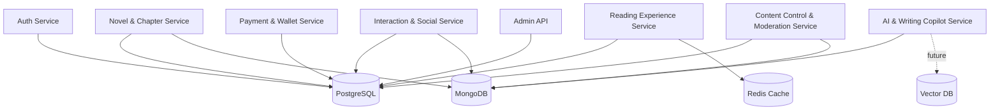
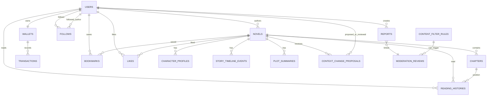

# Database Overview

## Goals

- Support API contracts in `docs/API`.
- Preserve clear ownership between services.
- Keep relational data consistent through foreign keys and transactions.
- Keep high-volume/flexible content in MongoDB where schema flexibility is useful.
- Keep AI-generated changes reviewable before they become official story context.

## Storage Architecture

## Data Ownership

| Domain | Source of Truth | Owner |
| :--- | :--- | :--- |
| Account identity, roles, auth status | PostgreSQL | Auth Service |
| User profile/settings | PostgreSQL | User/Profile APIs |
| Novel and chapter metadata | PostgreSQL | Novel & Chapter Service |
| Chapter draft content | MongoDB | Novel & Chapter Service |
| Official character/timeline/plot context | PostgreSQL | Novel & Chapter Service |
| Copilot context proposals | PostgreSQL | Novel & Chapter Service, proposed by AI |
| Comments | MongoDB | Interaction & Social Service |
| Likes/follows | PostgreSQL | Interaction & Social Service |
| Bookmarks/library | PostgreSQL | Reading Experience Service |
| Reading history/preferences | PostgreSQL + Redis cache | Reading Experience Service |
| Wallet and mock transactions | PostgreSQL | Payment & Wallet Service |
| Notifications | MongoDB | Interaction & Social Service |
| Content filter rules, moderation reviews, reports | PostgreSQL + MongoDB evidence | Content Control & Moderation Service |

## Core ERD

## AI/Copilot Context Rule

`CHARACTER_PROFILES`, `STORY_TIMELINE_EVENTS`, and `PLOT_SUMMARIES` are official context data owned by Novel & Chapter Service.

Writing Copilot may generate `CONTEXT_CHANGE_PROPOSALS`. These proposals do not mutate official context until the Author approves them. When approved, the official row should record:

- `source = AICOPILOT_SUGGESTION`
- `source_proposal_id`
- `updated_by`
- `updated_at`

## Redis Usage

Redis is used for:

- recent reading position cache;
- search/ranking cache;
- rate-limit counters;
- short-lived session/cache data.

Redis data must be recoverable from PostgreSQL/MongoDB and should not be the only source of truth.

## Future Vector DB

Vector DB may later store embeddings for:

- writing style comparison;
- Copilot retrieval over story context;
- semantic search.

Initial database design can proceed without selecting the vector DB product.
