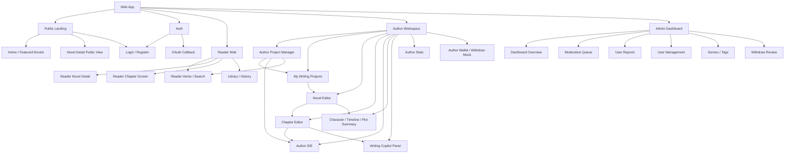
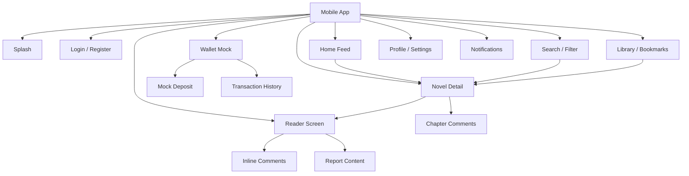

# Frontend Sitemap

## 1. Web Application - Author & Admin

## 2. Mobile Application - Reader

## 3. Main Navigation Groups

| Client | Navigation |
| :--- | :--- |
| Web Authenticated | Reader, Writing Projects, Wallet, Notifications, Profile |
| Web Author | Project Manager, My Writing Projects, Author IDE, Context, Wallet, Stats |
| Web Admin | Overview, Moderation, Reports, Users, Taxonomy, Withdraws |
| Mobile Reader | Home, Search, Library, Notifications, Profile |

## 4. MVP Screen Priority

| Priority | Screens |
| :--- | :--- |
| P0 | Login/Register, Reader Home, Novel Detail, Reader, Author Project Manager, My Writing Projects, Chapter Editor |
| P1 | Comments, Library, Wallet Mock, Writing Copilot, Moderation Queue |
| P2 | Author Stats, Taxonomy, Withdraw Review, Notifications |
