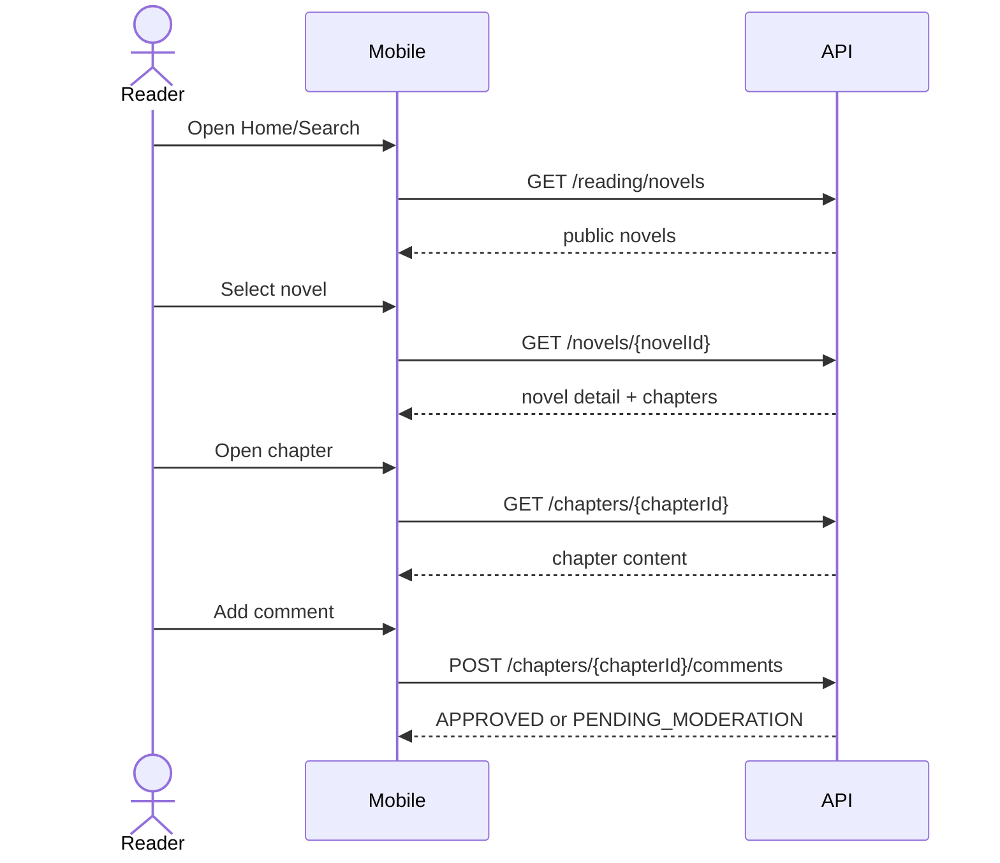
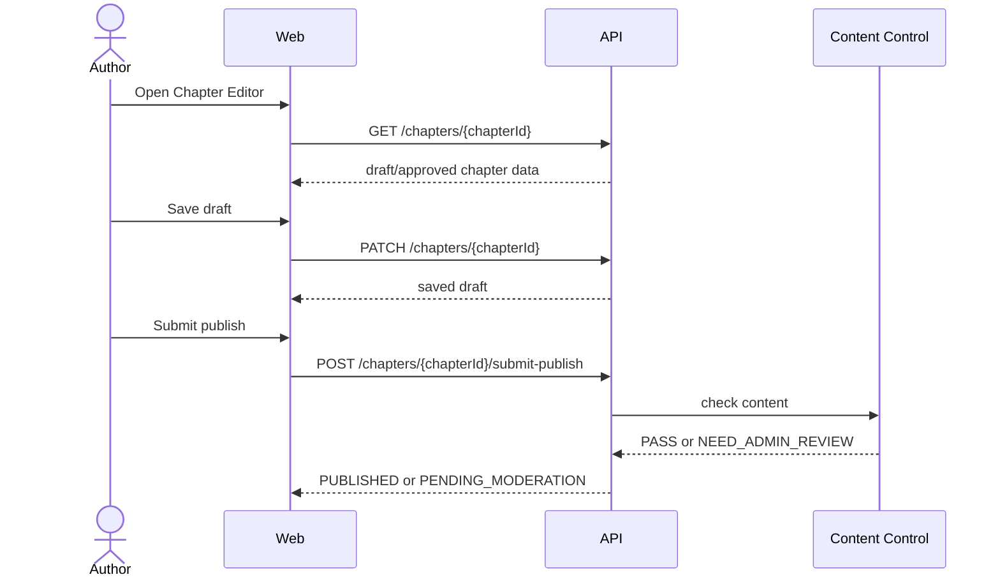
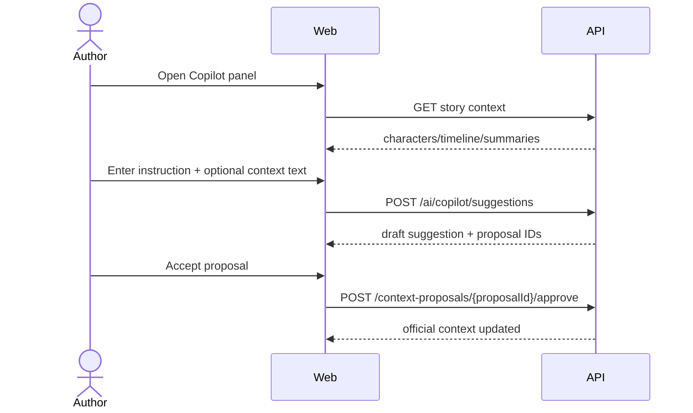
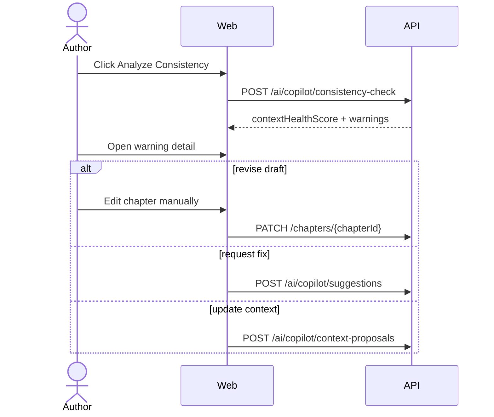
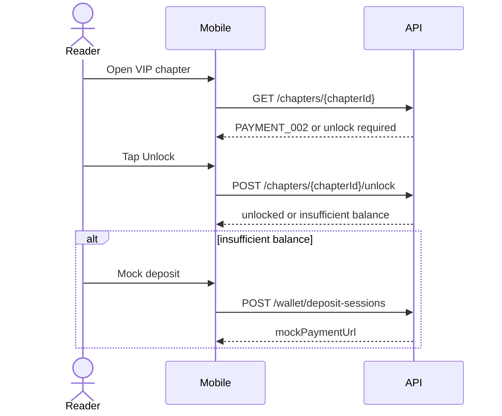
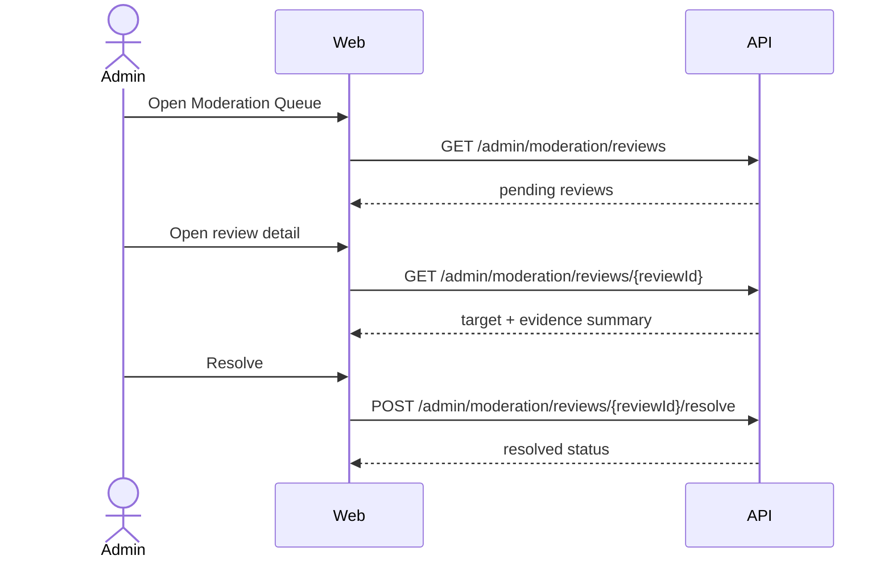

# Frontend User Flows

## 1. Reader Reads and Comments

## 2. Author Publishes Chapter

## 3. Writing Copilot Suggestion

## 4. Author Checks Plot Consistency

## 5. Reader Unlocks VIP Chapter

## 6. Admin Resolves Moderation Review

