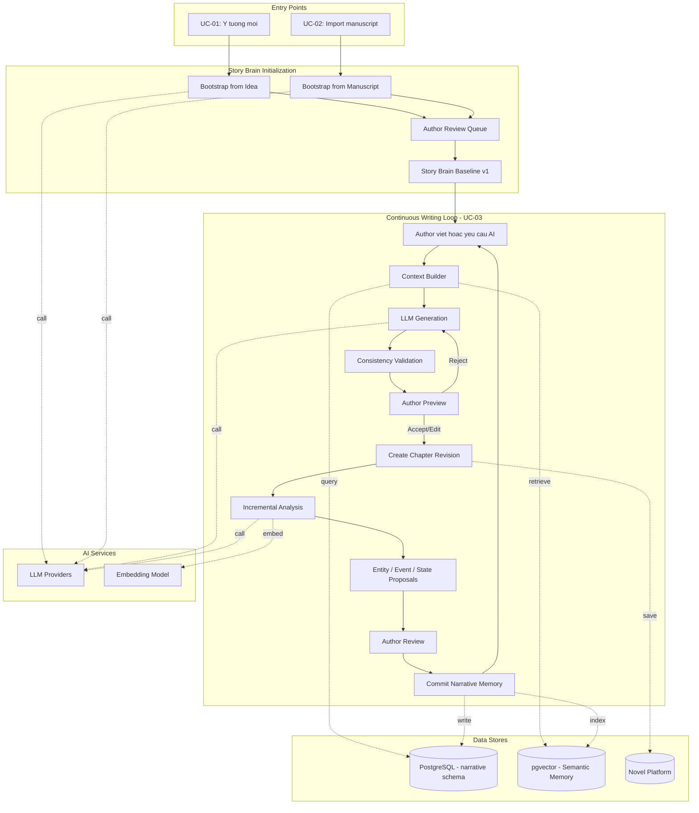
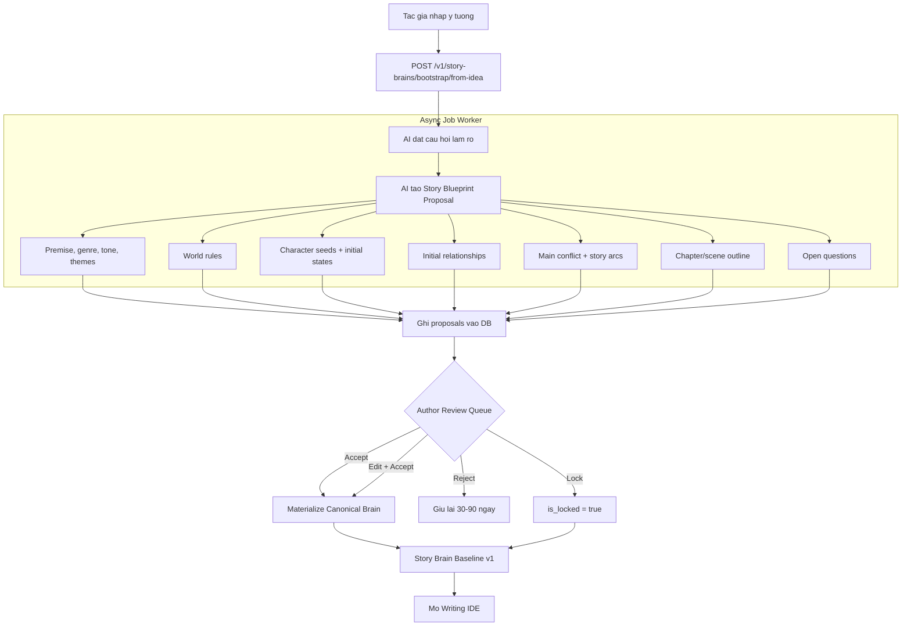
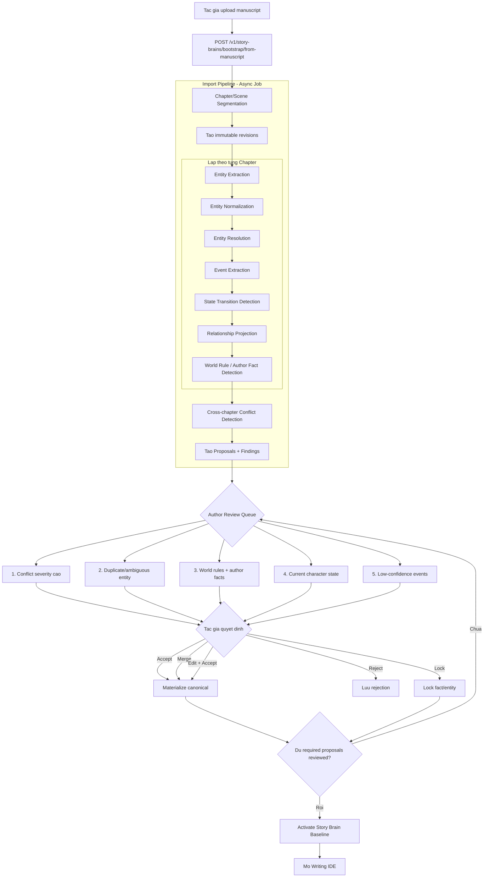
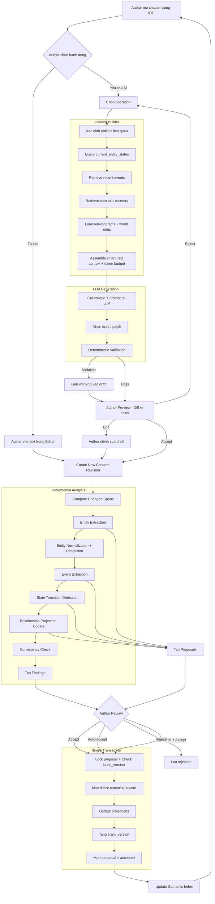
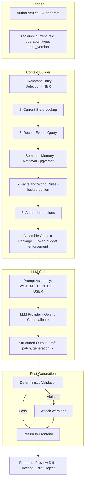
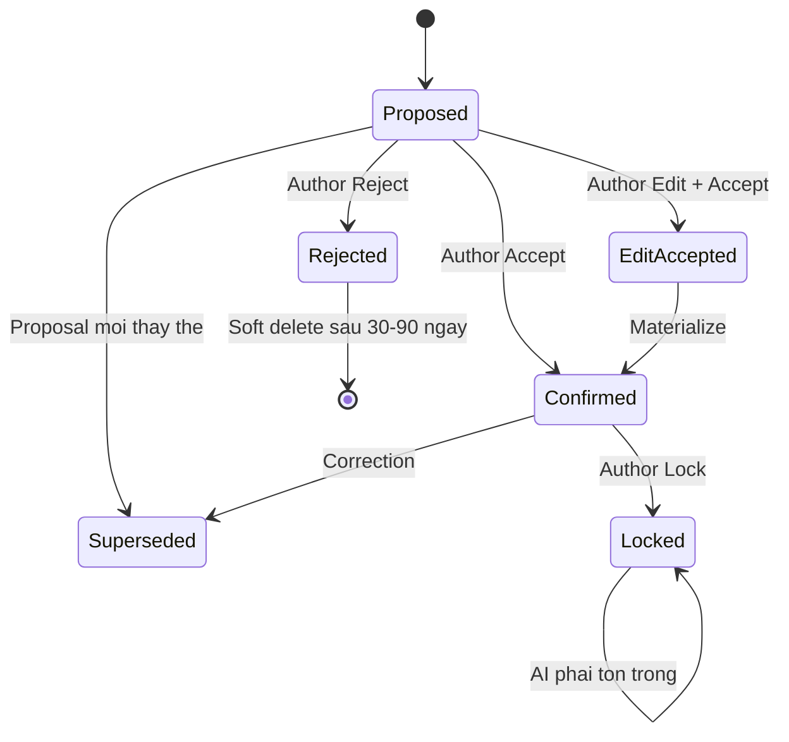
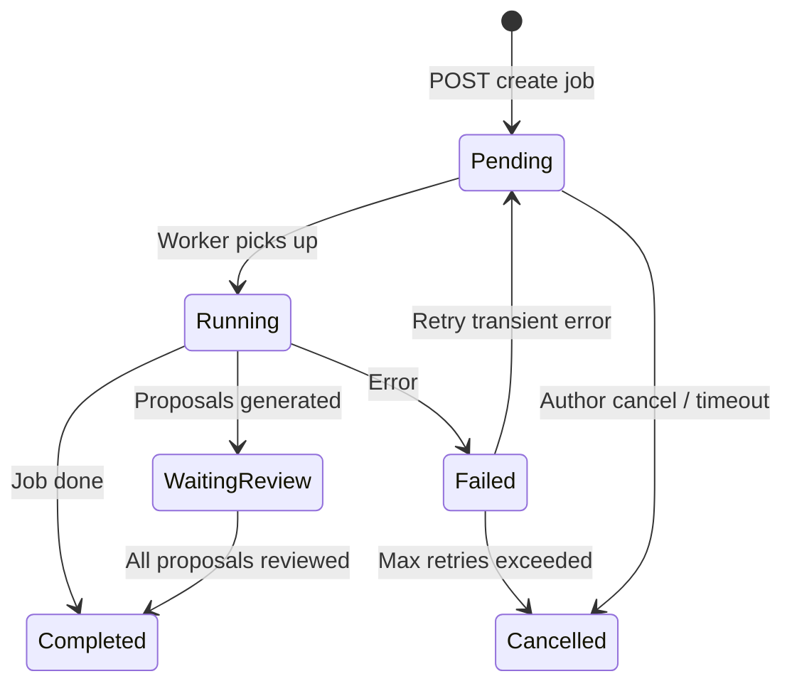

# Pipeline Diagrams — AI Writing Copilot

> Tài liệu trực quan hóa toàn bộ pipeline của hệ thống.
> Đọc kết hợp với [ARCHITECTURE.md](ARCHITECTURE.md) (kiến trúc) và [USE_CASES.md](USE_CASES.md) (luồng nghiệp vụ).

---

## 1. Tổng quan hệ thống — System Overview

Sơ đồ tổng thể cho thấy 3 luồng chính (Bootstrap Idea, Import Manuscript, Continuous Writing) và cách chúng tương tác với Story Brain, LLM, và các data store.

---

## 2. UC-01 — Bootstrap from Idea

Luồng chi tiết từ khi tác giả nhập ý tưởng đến khi có Story Brain baseline.

**Quy tắc dữ liệu quan trọng:**
- Nội dung tương lai (planned_event, required_event) **KHÔNG** được ghi vào `events` (event history).
- Chỉ dữ liệu `confirmed` hoặc `locked` mới trở thành canonical Story Brain.

---

## 3. UC-02 — Import Manuscript

Luồng chi tiết từ khi import truyện có sẵn đến khi có Story Brain baseline.

**Phân loại thông tin trong import:**

| Loại | Ví dụ | Xử lý |
|---|---|---|
| **Explicit** | "A đã chết ở chương 10" | Đề xuất, confidence cao |
| **Inferred** | A có thể đang thù B | Giữ `proposed` |
| **Unknown** | Không rõ A còn giữ thanh kiếm | Đưa vào review queue |

---

## 4. UC-03 — Continuous Writing Loop (Chi tiết)

Đây là **use case trung tâm** sau khi Story Brain baseline được xác nhận.

---

## 5. Analysis Pipeline — Chi tiết từng stage

Sơ đồ chi tiết bên trong Analysis Pipeline, hiển thị input/output và data flow.

```mermaid
flowchart LR
    subgraph Input["Input"]
        REV["Chapter Revision"]
    end

    subgraph Stage1["Stage 1: Entity Extraction"]
        E1["LLM: Trich xuat entities"]
        E1 --> E1O["canonical_name, entity_type, aliases, evidence, confidence"]
    end

    subgraph Stage2["Stage 2: Entity Resolution"]
        E2["So sanh voi entities da co"]
        E2 --> E2A{"Match found?"}
        E2A -->|Exact match| E2B["Link to existing entity"]
        E2A -->|Possible dup| E2C["Tao merge proposal"]
        E2A -->|New entity| E2D["Tao new entity proposal"]
    end

    subgraph Stage3["Stage 3: Event Extraction"]
        E3["LLM: Trich xuat events"]
        E3 --> E3O["event_type, summary, participants, location, consequences"]
    end

    subgraph Stage4["Stage 4: State Transition"]
        E4["So sanh event voi current states"]
        E4 --> E4O["entity_id, attribute_key, previous_value, new_value"]
    end

    subgraph Stage5["Stage 5: Consistency Check"]
        E5A["Deterministic Rules"]
        E5B["LLM Reasoning"]
        E5A --> E5OUT["Findings: type, severity, message, evidence"]
        E5B --> E5OUT
    end

    subgraph Stage6["Stage 6: Semantic Indexing"]
        E6["Tao memory_chunks"]
        E6 --> E6E["Embedding Model"]
        E6E --> E6O["Ghi vao pgvector"]
    end

    REV --> E1
    E1O --> E2
    E2B --> E3
    E2C --> E3
    E2D --> E3
    E3O --> E4
    E4O --> E5A
    E4O --> E5B
    E5OUT --> E6
    E3O --> E6
```

**Idempotency:** Mỗi stage được track bằng `analysis_runs` với idempotency key `{tenant_id}:{chapter_id}:{revision_id}:{operation}:{pipeline_version}`. Chạy lại cùng revision không tạo dữ liệu trùng.

---

## 6. Generation Pipeline — Chi tiết Context Builder

Sơ đồ chi tiết bên trong Generation Pipeline, cho thấy cách Context Builder tổng hợp thông tin trước khi gửi cho LLM.

**Nguyên tắc quan trọng:**
- AI service **không apply patch** — chỉ trả draft/patch cho frontend preview.
- Platform tạo revision mới sau khi tác giả accept.
- Mọi generation lưu IDs của context artifacts đã sử dụng (traceability).

---

## 7. Data Flow — Vòng đời dữ liệu qua các trạng thái

**Ghi chú:**
- **Proposed data** KHÔNG được đưa vào context như sự thật. Context Builder phải kèm trạng thái + confidence.
- **Locked** bao gồm: world rules, author facts, confirmed entities. Violation tạo consistency finding.

---

## 8. Job Lifecycle — Vòng đời async job

**Ghi chú:**
- Không giữ DB transaction trong lúc gọi LLM. LLM call nằm ngoài transaction boundary.
- Chỉ retry cho: network timeout, provider 429/5xx, temporary DB errors.
- Không retry tự động: invalid request, schema-invalid, authorization failure, brain version conflict.

---

## Mapping Pipeline ↔ Code hiện tại ↔ Code đích

| Pipeline Stage | Code hiện tại | Code đích (IMPLEMENTATION_PLAN) |
|---|---|---|
| Entity Extraction | `services/entity_pipeline/pipeline.py` | Extraction tool trong `application/` |
| Entity Resolution | `entity_resolver` (in pipeline) | Resolution service |
| Event Extraction | `event_summarizer` | Event proposal generator |
| Interaction / Policy | `api/interactions.py` | Proposal policy/validation |
| KB Write | `StoryKBManager.upsert_*` | Repository materializer (via proposal) |
| Author Confirm | `/kb/confirm` endpoint | Proposal decision adapter |
| Context Build | (chưa có — hardcoded prompt) | `application/build_context.py` |
| Generation | `/suggest-next` endpoint | `application/generate_writing.py` |
| Consistency | `core/consistency.py` (basic) | Deterministic engine + LLM validator |
| Semantic Retrieval | (chưa có) | pgvector + hybrid ranker (Phase 7) |
