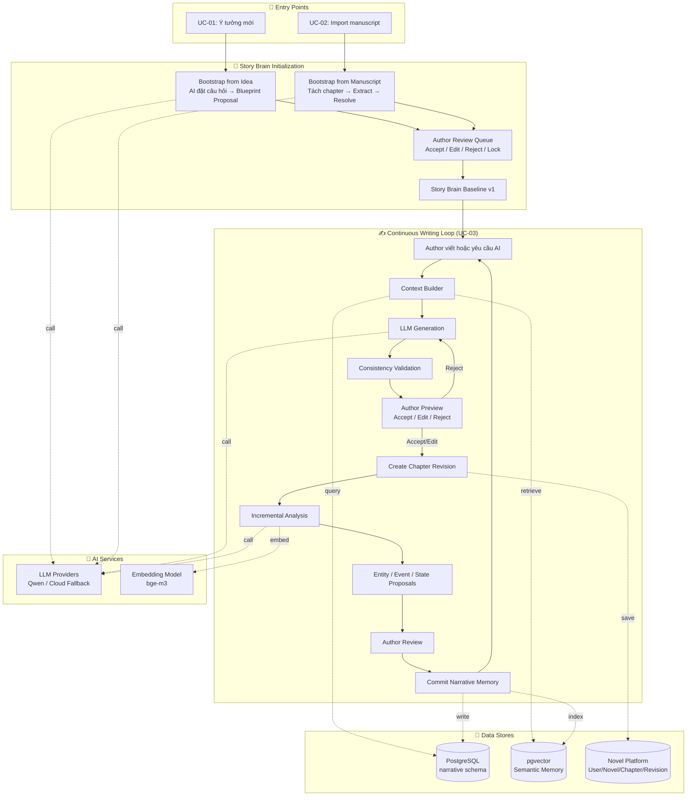
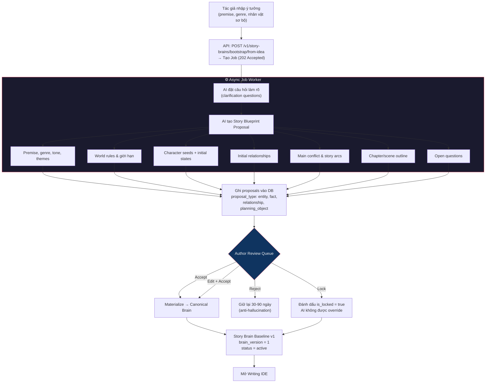
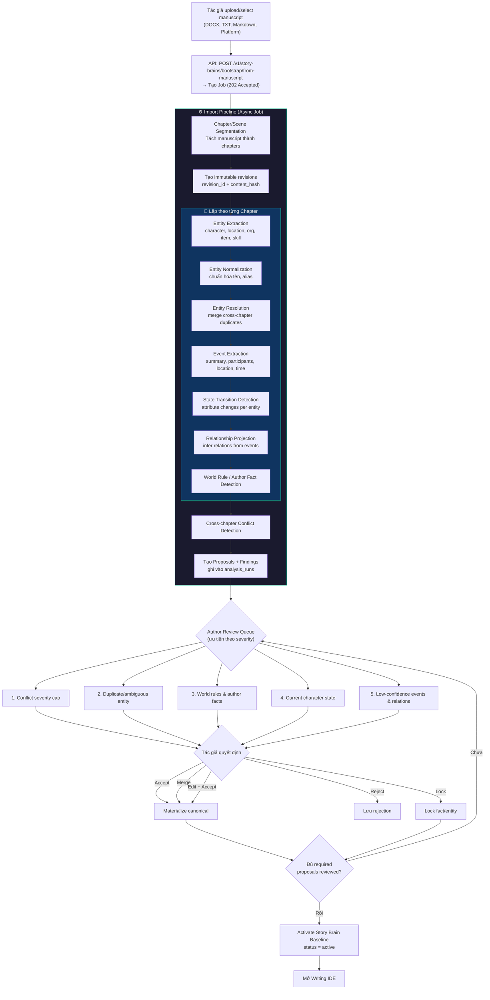
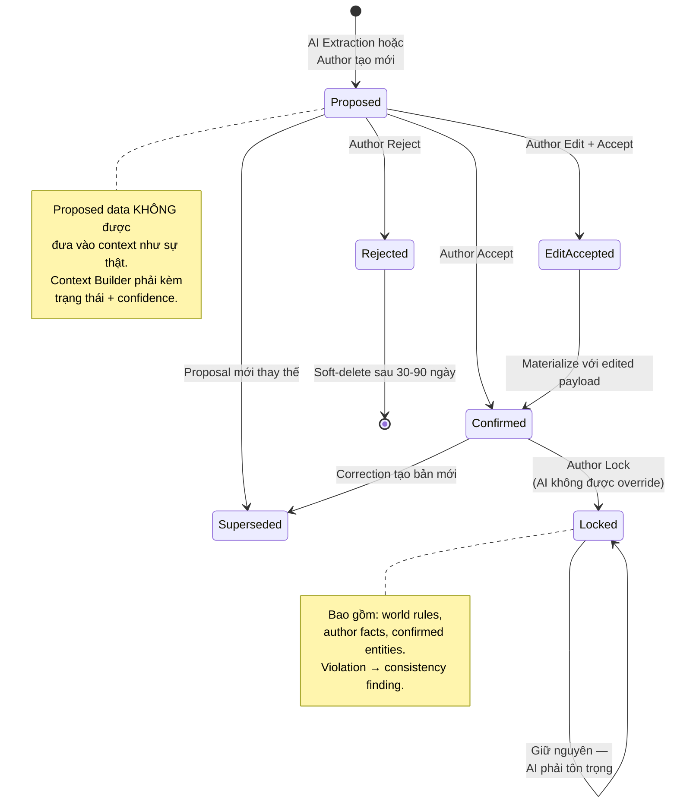
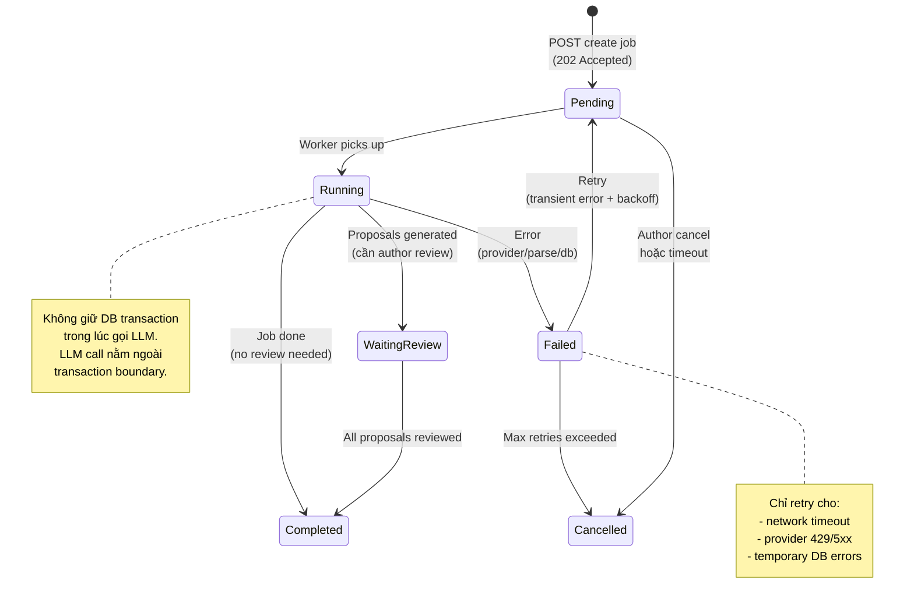

# Pipeline Diagrams — AI Writing Copilot

> Tài liệu trực quan hóa toàn bộ pipeline của hệ thống.
> Đọc kết hợp với [ARCHITECTURE.md](ARCHITECTURE.md) (kiến trúc) và [USE_CASES.md](USE_CASES.md) (luồng nghiệp vụ).

---

## 1. Tổng quan hệ thống — System Overview

Sơ đồ tổng thể cho thấy 3 luồng chính (Bootstrap Idea, Import Manuscript, Continuous Writing) và cách chúng tương tác với Story Brain, LLM, và các data store.



---

## 2. UC-01 — Bootstrap from Idea

Luồng chi tiết từ khi tác giả nhập ý tưởng đến khi có Story Brain baseline.



**Quy tắc dữ liệu quan trọng:**
- Nội dung tương lai (planned_event, required_event) **KHÔNG** được ghi vào `events` (event history).
- Chỉ dữ liệu `confirmed` hoặc `locked` mới trở thành canonical Story Brain.

---

## 3. UC-02 — Import Manuscript

Luồng chi tiết từ khi import truyện có sẵn đến khi có Story Brain baseline.



**Phân loại thông tin trong import:**

| Loại | Ví dụ | Xử lý |
|---|---|---|
| **Explicit** | "A đã chết ở chương 10" | Đề xuất, confidence cao |
| **Inferred** | A có thể đang thù B | Giữ `proposed` |
| **Unknown** | Không rõ A còn giữ thanh kiếm | Đưa vào review queue |

---

## 4. UC-03 — Continuous Writing Loop (Chi tiết)

Đây là **use case trung tâm** sau khi Story Brain baseline được xác nhận.

```mermaid
flowchart TD
    START["Author mở chapter trong IDE"]
    START --> A

    A{"Author chọn hành động"}
    A -->|Tự viết| B["Author viết text trong Editor"]
    A -->|Yêu cầu AI| C["Chọn operation:<br/>Continue / Expand / Rewrite<br/>Dialogue / Brainstorm / Scene"]

    C --> CTX

    subgraph ContextBuild["📦 Context Builder"]
        CTX["Xác định entities liên quan<br/>trong đoạn text hiện tại"]
        CTX --> CTX2["Query current_entity_states<br/>cho các entities đó"]
        CTX2 --> CTX3["Retrieve recent events<br/>(SQL filters + importance)"]
        CTX3 --> CTX4["Retrieve semantic memory<br/>(pgvector similarity search)"]
        CTX4 --> CTX5["Load relevant facts<br/>& world rules (locked ưu tiên)"]
        CTX5 --> CTX6["Assemble structured context<br/>+ token budget enforcement"]
    end

    CTX6 --> GEN

    subgraph Generation["🤖 LLM Generation"]
        GEN["Gửi context + prompt<br/>tới LLM Provider"]
        GEN --> GEN2["Nhận draft / patch"]
        GEN2 --> VAL["Deterministic Validation<br/>- Locked fact violation?<br/>- Dead character appears?<br/>- Location impossible?"]
    end

    VAL -->|Violation| VAL2["Gắn warning vào draft"]
    VAL -->|Pass| PREV
    VAL2 --> PREV

    PREV["Author Preview<br/>Hiển thị diff trong editor"]
    PREV -->|Reject| C
    PREV -->|Edit| EDIT["Author chỉnh sửa draft"]
    PREV -->|Accept| APPLY
    EDIT --> APPLY

    B --> APPLY
    APPLY["Create New Chapter Revision<br/>revision_id + content_hash"]

    APPLY --> DELTA

    subgraph Analysis["🔍 Incremental Analysis"]
        DELTA["Compute Changed Spans<br/>Old Revision vs New Revision"]
        DELTA --> EXT["Entity Extraction<br/>(chỉ trên changed spans)"]
        EXT --> NORM["Entity Normalization<br/>+ Resolution"]
        NORM --> EVT["Event Extraction"]
        EVT --> STATE["State Transition Detection"]
        STATE --> REL["Relationship Projection Update"]
        REL --> CONSIST["Consistency Check<br/>(deterministic + LLM reasoning)"]
        CONSIST --> FIND["Tạo Findings (nếu có)"]
    end

    EXT & EVT & STATE & REL --> PROP["Tạo Proposals<br/>(entity, event, state_transition,<br/>relationship)"]

    FIND --> REVIEW
    PROP --> REVIEW

    REVIEW{"Author Review"}
    REVIEW -->|Accept| COMMIT
    REVIEW -->|Auto-accept<br/>(safe policy)| COMMIT
    REVIEW -->|Reject| SAVE_REJ["Lưu rejection"]
    REVIEW -->|Edit + Accept| COMMIT

    subgraph CommitTx["🔒 Single Transaction"]
        COMMIT["Lock proposal<br/>Check expected_brain_version"]
        COMMIT --> MAT["Materialize canonical record<br/>(entity/event/state/relation)"]
        MAT --> PROJ["Update projections<br/>(current_entity_states, relationships)"]
        PROJ --> VER["Tăng brain_version"]
        VER --> MARK["Mark proposal = accepted"]
    end

    MARK --> IDX["Update Semantic Index<br/>(memory_chunks + embeddings)"]
    IDX --> START

    style ContextBuild fill:#1a1a2e,stroke:#f5a623,color:#eee
    style Generation fill:#1a1a2e,stroke:#7b68ee,color:#eee
    style Analysis fill:#1a1a2e,stroke:#16c79a,color:#eee
    style CommitTx fill:#1a1a2e,stroke:#e94560,color:#eee
```

---

## 5. Analysis Pipeline — Chi tiết từng stage

Sơ đồ chi tiết bên trong Analysis Pipeline, hiển thị input/output và data flow.

```mermaid
flowchart LR
    subgraph Input["📥 Input"]
        REV["Chapter Revision<br/>revision_id<br/>content_hash<br/>content text"]
    end

    subgraph Stage1["Stage 1: Entity Extraction"]
        E1["LLM: Trích xuất entities<br/>từ text"]
        E1 --> E1O["Output:<br/>- canonical_name<br/>- entity_type<br/>- aliases<br/>- description<br/>- evidence spans<br/>- confidence"]
    end

    subgraph Stage2["Stage 2: Entity Resolution"]
        E2["So sánh với entities đã có<br/>trong Story Brain"]
        E2 --> E2A{"Match found?"}
        E2A -->|Exact match| E2B["Link to existing entity"]
        E2A -->|Possible duplicate| E2C["Tạo merge proposal"]
        E2A -->|New entity| E2D["Tạo new entity proposal"]
    end

    subgraph Stage3["Stage 3: Event Extraction"]
        E3["LLM: Trích xuất events<br/>từ text"]
        E3 --> E3O["Output:<br/>- event_type<br/>- summary<br/>- participants + roles<br/>- location<br/>- consequences<br/>- story_time<br/>- importance_score<br/>- evidence spans"]
    end

    subgraph Stage4["Stage 4: State Transition"]
        E4["So sánh event<br/>với current_entity_states"]
        E4 --> E4O["Output:<br/>- entity_id<br/>- attribute_key<br/>- previous_value<br/>- new_value<br/>- source event_id"]
    end

    subgraph Stage5["Stage 5: Consistency Check"]
        E5A["Deterministic Rules:<br/>- Dead character appears<br/>- Location jump<br/>- Item not owned<br/>- Timeline conflict"]
        E5B["LLM Reasoning:<br/>- Personality consistency<br/>- Causality check<br/>- World rule violation"]
        E5A --> E5OUT["Findings:<br/>- finding_type<br/>- severity<br/>- message<br/>- evidence<br/>- suggested_action"]
        E5B --> E5OUT
    end

    subgraph Stage6["Stage 6: Semantic Indexing"]
        E6["Tạo memory_chunks<br/>- event_summary<br/>- scene_summary"]
        E6 --> E6E["Embedding Model<br/>text → vector"]
        E6E --> E6O["Ghi vào<br/>memory_chunks + pgvector"]
    end

    REV --> E1
    E1O --> E2
    E2B & E2C & E2D --> E3
    E3O --> E4
    E4O --> E5A & E5B
    E5OUT --> E6
    E3O --> E6

    style Stage1 fill:#0f3460,stroke:#f5a623,color:#eee
    style Stage2 fill:#0f3460,stroke:#f5a623,color:#eee
    style Stage3 fill:#0f3460,stroke:#16c79a,color:#eee
    style Stage4 fill:#0f3460,stroke:#16c79a,color:#eee
    style Stage5 fill:#0f3460,stroke:#e94560,color:#eee
    style Stage6 fill:#0f3460,stroke:#7b68ee,color:#eee
```



**Idempotency:** Mỗi stage được track bằng `analysis_runs` với idempotency key `{tenant_id}:{chapter_id}:{revision_id}:{operation}:{pipeline_version}`. Chạy lại cùng revision không tạo dữ liệu trùng.

---

## 6. Generation Pipeline — Chi tiết Context Builder

Sơ đồ chi tiết bên trong Generation Pipeline, cho thấy cách Context Builder tổng hợp thông tin trước khi gửi cho LLM.

```mermaid
flowchart TD
    subgraph Trigger["📝 Trigger"]
        T["Author yêu cầu AI:<br/>Continue / Expand / Rewrite<br/>Dialogue / Brainstorm / Scene"]
        T --> T2["Xác định:<br/>- current_text (selection/cursor)<br/>- operation_type<br/>- story_brain_id<br/>- brain_version"]
    end

    subgraph ContextBuilder["📦 Context Builder"]
        direction TB
        C1["1. Relevant Entity Detection<br/>NER trên current_text<br/>→ entity_ids"]

        C2["2. Current State Lookup<br/>SELECT FROM current_entity_states<br/>WHERE entity_id IN (...)"]

        C3["3. Recent Events<br/>SELECT FROM events<br/>WHERE story_brain_id = ...<br/>ORDER BY narrative_order DESC<br/>LIMIT by importance"]

        C4["4. Semantic Memory Retrieval<br/>SELECT FROM memory_chunks<br/>ORDER BY embedding <=> query_vec<br/>+ entity_overlap_score<br/>+ temporal_relevance"]

        C5["5. Facts & World Rules<br/>SELECT FROM facts<br/>WHERE is_locked = true<br/>OR confirmation_status = 'confirmed'"]

        C6["6. Author Instructions<br/>SELECT FROM facts<br/>WHERE fact_type = 'author_instruction'"]

        C1 --> C2 --> C3 --> C4 --> C5 --> C6

        C6 --> ASSEMBLE["Assemble Context Package:<br/>- scene_context (current text)<br/>- entity_states (JSON)<br/>- recent_events (summaries)<br/>- retrieved_memories (ranked)<br/>- world_rules (locked first)<br/>- author_instructions<br/>─────────────────────<br/>Token budget enforcement:<br/>trim lowest-relevance items"]
    end

    subgraph LLMCall["🤖 LLM Call"]
        PROMPT["Prompt Assembly:<br/>SYSTEM: policy + operation rules<br/>CONTEXT: structured package<br/>USER: operation request<br/>─────────────────────<br/>prompt_version tracked"]
        PROMPT --> LLM["LLM Provider<br/>(Qwen / Cloud fallback)"]
        LLM --> OUTPUT["Structured Output:<br/>- draft text<br/>- patch (start, end, replacement)<br/>- generation_id<br/>- base_revision_id<br/>- brain_version"]
    end

    subgraph PostGen["✅ Post-Generation"]
        CHECK["Deterministic Validation:<br/>- Locked fact violation?<br/>- Named dead character active?<br/>- output schema valid?"]
        CHECK -->|Pass| RESULT["Return to Frontend:<br/>- draft/patch<br/>- validations<br/>- context_summary<br/>  (entity_ids, event_ids,<br/>   fact_ids, memory_chunk_ids)<br/>- model metadata"]
        CHECK -->|Violation| WARN["Attach warnings<br/>to result"]
        WARN --> RESULT
    end

    T2 --> C1
    ASSEMBLE --> PROMPT
    OUTPUT --> CHECK

    RESULT --> FRONTEND["Frontend: Preview Diff<br/>Author Accept / Edit / Reject"]

    style ContextBuilder fill:#1a1a2e,stroke:#f5a623,color:#eee
    style LLMCall fill:#1a1a2e,stroke:#7b68ee,color:#eee
    style PostGen fill:#1a1a2e,stroke:#16c79a,color:#eee
```



**Nguyên tắc quan trọng:**
- AI service **không apply patch** — chỉ trả draft/patch cho frontend preview.
- Platform tạo revision mới sau khi tác giả accept.
- Mọi generation lưu IDs của context artifacts đã sử dụng (traceability).

---

## 7. Data Flow — Vòng đời dữ liệu qua các trạng thái



---

## 8. Job Lifecycle — Vòng đời async job



---

## Mapping Pipeline ↔ Code hiện tại ↔ Code đích

| Pipeline Stage | Code hiện tại | Code đích (IMPLEMENTATION_PLAN) |
|---|---|---|
| Entity Extraction | `services/entity_pipeline/pipeline.py` | Extraction tool trong `application/` |
| Entity Resolution | `entity_resolver` (in pipeline) | Resolution service |
| Event Extraction | `event_summarizer` | Event proposal generator |
| Interaction / Policy | `api/interactions.py` | Proposal policy/validation |
| KB Write | `StoryKBManager.upsert_*` | Repository materializer (via proposal) |
| Author Confirm | `/kb/confirm` endpoint | Proposal decision adapter |
| Context Build | (chưa có — hardcoded prompt) | `application/build_context.py` |
| Generation | `/suggest-next` endpoint | `application/generate_writing.py` |
| Consistency | `core/consistency.py` (basic) | Deterministic engine + LLM validator |
| Semantic Retrieval | (chưa có) | pgvector + hybrid ranker (Phase 7) |
