# ĐẶC TẢ YÊU CẦU PHẦN MỀM (SRS) - EPHURIN NOVEL PLATFORM

## CHƯƠNG I: GIỚI THIỆU CHUNG

### 1.1 Mục đích tài liệu
Tài liệu Đặc tả Yêu cầu Phần mềm (SRS) này nhằm mục đích mô tả chi tiết các yêu cầu chức năng, yêu cầu phi chức năng, các ràng buộc kỹ thuật và giao diện người dùng cho dự án "Ephurin Novel Platform". Tài liệu đóng vai trò là:
- **Căn cứ kỹ thuật**: Hướng dẫn cho đội ngũ phát triển (Frontend, Backend, AI Engineer) trong quá trình triển khai mã nguồn.
- **Bản cam kết**: Thống nhất phạm vi công việc và các tính năng giữa các bên liên quan (Stakeholders) và nhóm phát triển.
- **Tài liệu nền tảng**: Cung cấp cơ sở để xây dựng kịch bản kiểm thử (Test Cases) và tài liệu hướng dẫn sử dụng sau này.

### 1.2 Phạm vi dự án
Ephurin Novel Platform được thiết kế như một hệ sinh thái toàn diện hỗ trợ việc sáng tác, chia sẻ và thưởng thức tiểu thuyết trực tuyến. Dự án bao gồm các thành phần cốt lõi:
- **Hệ thống Web (Author & Admin Portal)**: 
    - Cung cấp trình soạn thảo chuyên nghiệp (Rich Text/Markdown), công cụ quản lý tác phẩm và dashboard phân tích dữ liệu cho Tác giả.
    - Cung cấp bảng điều khiển quản trị toàn diện cho Admin/Editor để kiểm duyệt nội dung, quản lý người dùng và giao dịch tài chính.
- **Hệ thống Mobile (Reader App)**: Tập trung vào trải nghiệm đọc cá nhân hóa (Personalization), hệ thống tương tác cộng đồng (Inline comment, Vote, Bookmark) và thông báo đẩy (Push Notification).
- **Dịch vụ AI (Intelligent Engine)**: 
    - Tự động phân loại thể loại và tag nội dung.
    - Kiểm duyệt tự động các vi phạm về ngôn từ và bản quyền.
    - Trợ lý sáng tác (Author Assistant) hỗ trợ gợi ý ý tưởng và kiểm tra tính nhất quán của cốt truyện.
- **Admin Dashboard**: Hỗ trợ quản trị viên kiểm duyệt nội dung, xử lý báo cáo vi phạm, quản lý người dùng và theo dõi các chỉ số vận hành.
- **Phạm vi loại trừ**: 
    - Xuất bản sách giấy.
    - Marketplace mua bán bản quyền phức tạp.
    - Hệ thống hợp đồng tác giả đầy đủ ở mức pháp lý thực tế.
    - Quy trình kế toán, quyết toán và thuế chi tiết như một hệ thống thương mại hoàn chỉnh.
    - Hệ thống không chịu trách nhiệm về nội dung bản quyền do người dùng tự ý đăng tải trái phép, nhưng cung cấp cơ chế báo cáo và xử lý (DMCA).

### 1.3 Đối tượng sử dụng tài liệu
Tài liệu SRS hướng đến các nhóm đối tượng sau:

| Đối tượng | Mục đích sử dụng |
| :--- | :--- |
| **Giảng viên hướng dẫn** | Đánh giá mức độ đầy đủ, logic và tính phù hợp của tài liệu phân tích yêu cầu. |
| **Nhóm phân tích yêu cầu** | Thống nhất phạm vi, tác nhân, chức năng và luồng nghiệp vụ của hệ thống. |
| **Nhóm thiết kế hệ thống** | Dựa vào yêu cầu để xây dựng kiến trúc, cơ sở dữ liệu và giao diện. |
| **Nhóm phát triển** | Hiểu rõ chức năng cần triển khai, điều kiện xử lý và quy tắc nghiệp vụ. |
| **Nhóm kiểm thử** | Xây dựng test case, acceptance criteria và kịch bản kiểm thử chức năng. |
| **Chủ dự án/Đơn vị vận hành** | Nắm được mục tiêu, giá trị và phạm vi vận hành của nền tảng. |

### 1.4 Thuật ngữ và Từ viết tắt
| Thuật ngữ/Viết tắt | Ý nghĩa |
| :--- | :--- |
| **SRS** | Software Requirements Specification - Đặc tả yêu cầu phần mềm. |
| **UI/UX** | User Interface / User Experience - Giao diện và Trải nghiệm người dùng. |
| **AI** | Artificial Intelligence - Trí tuệ nhân tạo. |
| **Guest** | Người dùng vãng lai, chưa đăng nhập hệ thống. |
| **Reader** | Độc giả, người dùng chính của Mobile App. |
| **Author** | Tác giả, người sáng tạo và quản lý truyện. |
| **Admin** | Quản trị viên, người quản lý hệ thống và kiểm duyệt nội dung. |
| **KYC** | Know Your Customer - Quy trình xác thực danh tính người dùng. |
| **SSO / OAuth 2.0** | Cơ chế đăng nhập một lần thông qua bên thứ ba (Google, Facebook). |
| **RBAC** | Role-Based Access Control - Kiểm soát truy cập dựa trên vai trò. |
| **JWT** | JSON Web Token - Phương thức xác thực người dùng qua chuỗi mã hóa. |
| **CDN** | Content Delivery Network - Mạng phân phối nội dung giúp tăng tốc độ tải tài nguyên. |
| **DMCA** | Digital Millennium Copyright Act - Đạo luật bản quyền kỹ thuật số. |
| **MVP** | Minimum Viable Product - Sản phẩm khả thi tối thiểu. |
| **Dashboard** | Bảng điều khiển hiển thị dữ liệu và thao tác quản trị. |
| **Coin** | Đơn vị tiền tệ nội bộ dùng để mở khóa chương hoặc tặng quà. |

### 1.5 Tài liệu tham khảo
1. **IEEE Std 830-1998**: Tiêu chuẩn quốc tế về thực hành đặc tả yêu cầu phần mềm.

### 1.6 Tổng quan (Benchmarking)
Để xây dựng một hệ thống vượt trội, Ephurin đã thực hiện phân tích các nền tảng hàng đầu hiện nay:
- **Wattpad**: Ưu điểm là tính cộng đồng cực cao và hệ thống Tag linh hoạt. Ephurin kế thừa khả năng tương tác "Inline Comment" (bình luận theo dòng) để tăng sự gắn kết.
- **Webnovel (Qidian)**: Xuất sắc trong việc thương mại hóa nội dung (Micro-transaction). Ephurin áp dụng mô hình nạp Coin và mở khóa chương nhưng tối ưu hóa quy trình thanh toán minh bạch hơn cho tác giả Việt.
- **Tapas/Radish**: Tập trung vào mô hình serial/episode ngắn, tối ưu cho thiết bị di động.
- **Waka/TruyenFull**: Các nền tảng nội địa mạnh về kho nội dung nhưng trải nghiệm công cụ hỗ trợ sáng tác cho tác giả còn hạn chế.
- **Netflix & Spotify**: Được dùng làm tham chiếu cho mô hình phân phối nội dung, cá nhân hóa trải nghiệm (Recommendation) và quản lý thư viện ở quy mô lớn.
- **Lợi thế cạnh tranh của Ephurin**: Việc tích hợp **AI như một người cộng sự** (không chỉ là bộ lọc) giúp giảm 70% khối lượng kiểm duyệt thủ công cho Admin và tăng hiệu suất sáng tác cho tác giả thông qua các gợi ý thông minh, điều mà các nền tảng hiện nay chưa thực hiện đồng bộ.

## CHƯƠNG II: TỔNG QUAN HỆ THỐNG

### 2.1 Kiến trúc hệ thống
Ephurin Novel Platform được xây dựng dựa trên kiến trúc **Microservices**, cho phép hệ thống hoạt động ổn định, dễ dàng bảo trì và mở rộng độc lập cho từng phân hệ (Web, Mobile, AI).

#### 2.1.1 Sơ đồ kiến trúc tổng quát
Dưới đây là sơ đồ mô tả luồng dữ liệu và sự tương tác giữa các thành phần chính trong hệ thống:

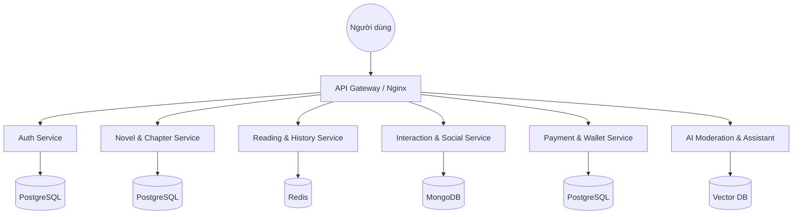

#### 2.1.2 Mô tả các thành phần cốt lõi
1.  **Frontend Clients (Giao diện người dùng)**:
    -   **Web Application (Next.js)**: Nền tảng chính cho Tác giả sáng tác và Admin quản trị. Sử dụng Server-Side Rendering (SSR) để tối ưu hóa SEO cho các tác phẩm.
    -   **Mobile Application (React Native)**: Ứng dụng dành riêng cho Độc giả, tập trung vào trải nghiệm đọc mượt mà và thông báo thời gian thực.
2.  **API Gateway**: Đóng vai trò là điểm tiếp nhận duy nhất cho mọi yêu cầu từ phía Client, thực hiện điều phối (routing) đến các microservices tương ứng, đồng thời xử lý bảo mật lớp ngoài (Rate limiting, SSL).
3.  **Backend Microservices**:
    -   **Auth Service**: Quản lý xác thực (JWT), phân quyền (RBAC) và thông tin tài khoản người dùng.
    -   **Novel & Chapter Service**: Xử lý logic nghiệp vụ liên quan đến việc tạo truyện, quản lý chương, phiên bản nháp và lịch đăng.
    -   **Interaction Service**: Quản lý hệ thống bình luận (inline/chapter), lượt thích, theo dõi và các tương tác xã hội.
    -   **Reader Service**: Tối ưu hóa việc truy xuất nội dung đọc, quản lý lịch sử đọc và đánh dấu trang (Bookmark).
    -   **Payment Service**: Xử lý ví tiền ảo (Coin), giao dịch mở khóa chương và quyết toán doanh thu.
4.  **AI Intelligence Service**: Phân hệ xử lý thông minh tách biệt, sử dụng Vector Database để lưu trữ kiến thức truyện, phục vụ tính năng trợ lý sáng tác và kiểm duyệt nội dung tự động dựa trên học máy.
5.  **Infrastructure Layers (Hạ tầng dữ liệu)**:
    -   **PostgreSQL**: Cơ sở dữ liệu quan hệ chính cho các dữ liệu cần tính nhất quán cao.
    -   **MongoDB**: Lưu trữ các dữ liệu phi cấu trúc như nhật ký hoạt động (logs) và các phiên bản nháp chương truyện.
    -   **Redis**: Bộ nhớ đệm (caching) giúp tăng tốc độ tải các thông tin truy cập thường xuyên như xếp hạng (Ranking) và phiên đăng nhập.

### 2.2 Sơ đồ phân rã chức năng (Functional Tree)
Below is the functional decomposition for the Novel Management module:

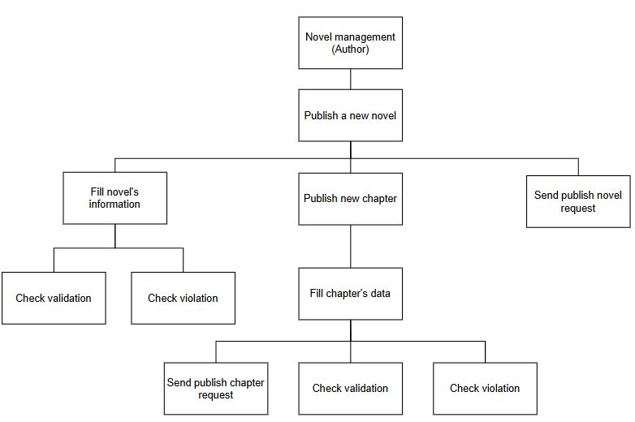

### 2.3 Biểu đồ Use Case tổng quát
*(Sẽ được bổ sung bởi thành viên phụ trách)*

### 2.4 Danh sách các tác nhân (Actors)
Hệ thống Ephurin bao gồm các nhóm tác nhân chính sau:
*   **Guest**: Người dùng vãng lai, có quyền xem danh sách truyện và đọc các chương miễn phí.
*   **Reader**: Độc giả đã đăng ký, tập trung trải nghiệm trên Mobile với các tính năng cá nhân hóa và tương tác.
*   **Author**: Tác giả, tập trung trên Web để sáng tác và quản lý tác phẩm.
*   **Admin/Editor**: Quản trị viên và Biên tập viên chịu trách nhiệm vận hành và kiểm duyệt.
*   **AI Service**: Tác nhân hệ thống hỗ trợ xử lý dữ liệu và trợ lý sáng tác.

### 2.5 Ma trận phân quyền (Permission Matrix)
*(Sẽ được bổ sung bởi thành viên phụ trách)*

## CHƯƠNG III: DATA REQUIREMENTS & WORKFLOWS

### 3.1 Entity Relationship Diagram (ERD)
The system utilizes a relational database (PostgreSQL) for structured data and MongoDB for non-structured data. Below is the ERD for the core components:

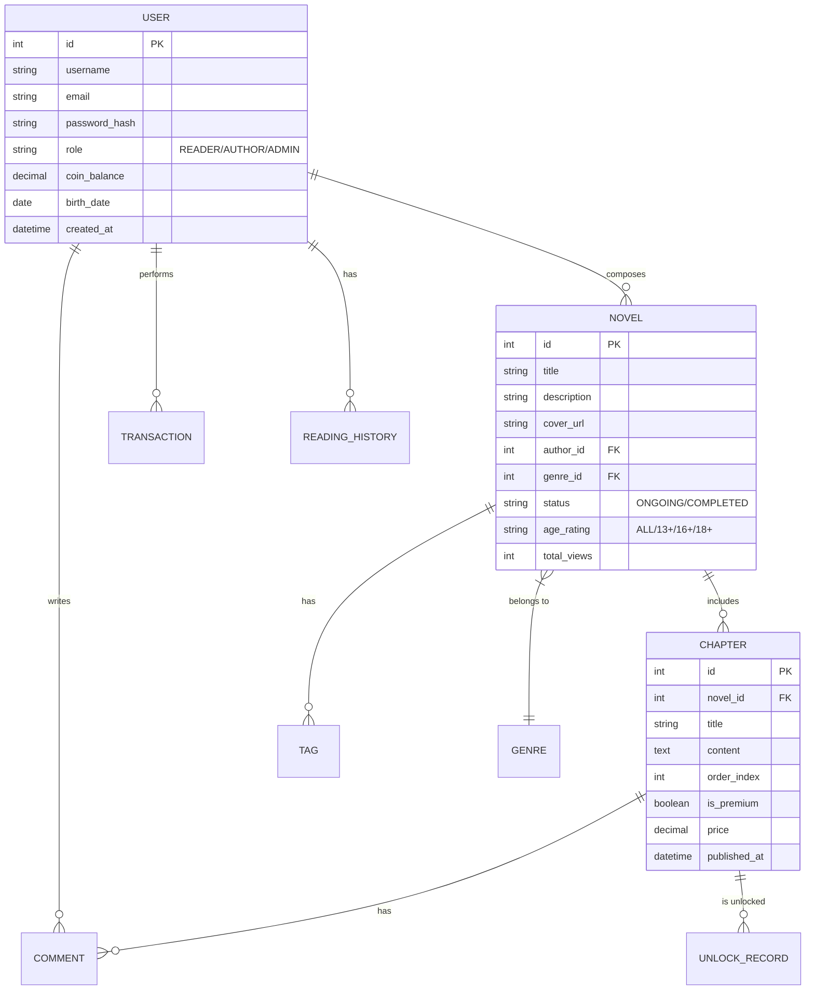

#### Data Dictionary Summary
- **USER**: Stores identification, roles, and wallet balance (Coin).
- **NOVEL**: Overview of the work, author, and moderation status.
- **CHAPTER**: Detailed content of chapters, supporting monetization settings (Premium).
- **TRANSACTION**: Logs of financial transactions (Deposit, Purchase, Donate).

### 3.2 Business Workflows

#### 3.2.1 Registration & Authentication (JWT)
*(To be added by the Account Module owner)*

#### 3.2.2 Quy trình Sáng tác & Xuất bản (Process of publish new novels)

**a. Publish a new novel**
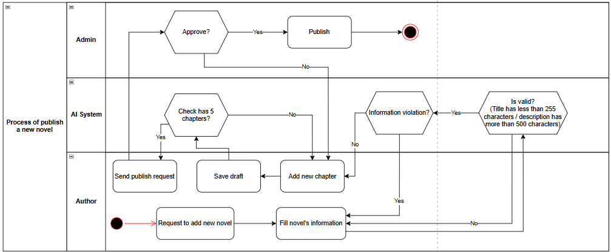
*Figure : Process of author request to publish a new novel*

**Detailed Specification:**
1.  **Initiation**: Author starts by requesting to add a new novel.
2.  **Information Entry**: Author fills in metadata (title, description, genre).
3.  **AI Validation**: 
    *   System checks format: Title must be < 255 chars, description > 500 chars.
    *   AI checks for content violations (sensitive topics, hate speech).
4.  **Chapter Creation**: Author must add and save chapters as drafts.
5.  **Requirement Check**: The AI system ensures the novel has at least 5 chapters before allowing a "Publish Request".
6.  **Human Review**: Once submitted, an Admin reviews the novel content.
7.  **Final Action**: If approved, the novel is published; otherwise, it is sent back for edits.

**b. Publish new chapter**
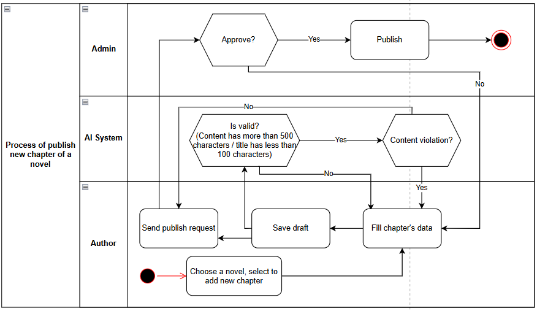
*Figure : Process of author request to publish a new chapter*

**Detailed Specification:**
1.  **Selection**: Author selects an existing novel to add a new chapter.
2.  **Drafting**: Author enters chapter title and content.
3.  **AI Guardrails**: AI validates content length (> 500 chars) and scans for policy violations.
4.  **Submission**: Author saves the draft and sends a publish request.
5.  **Moderation**: Admin verifies the chapter content. Upon approval, the chapter becomes visible to readers.

#### 3.2.3 AI-assisted Metadata Workflow
This is a unique feature of Ephurin, helping standardize content from the start:

1.  **Request Submission**: When the author finishes a chapter or story description, the text is sent to the AI Service.
2.  **Feature Extraction**: AI uses NLP models (PhoBERT/Transformer) to analyze keywords, context, and writing style.
3.  **Classification & Suggestion**:
    *   AI compares content with the existing Taxonomy (genres/tags) to provide the Top 5 most suitable suggestions.
    *   Detects sensitive topics to warn about mandatory Age Rating tags.
4.  **Feedback & Selection**: The author reviews the suggestions and selects which ones to apply. This improves search accuracy for readers.

**a. Publish a new novel**

*Figure : Process of author request to publish a new novel*

**Detailed Specification:**
1.  **Initiation**: Author starts by requesting to add a new novel.
2.  **Information Entry**: Author fills in metadata (title, description, genre).
3.  **AI Validation**: 
    *   System checks format: Title must be < 255 chars, description > 500 chars.
    *   AI checks for content violations (sensitive topics, hate speech).
4.  **Chapter Creation**: Author must add and save chapters as drafts.
5.  **Requirement Check**: The AI system ensures the novel has at least 5 chapters before allowing a "Publish Request".
6.  **Human Review**: Once submitted, an Admin reviews the novel content.
7.  **Final Action**: If approved, the novel is published; otherwise, it is sent back for edits.

**b. Publish new chapter**

*Figure : Process of author request to publish a new chapter*

**Detailed Specification:**
1.  **Selection**: Author selects an existing novel to add a new chapter.
2.  **Drafting**: Author enters chapter title and content.
3.  **AI Guardrails**: AI validates content length (> 500 chars) and scans for policy violations.
4.  **Submission**: Author saves the draft and sends a publish request.
5.  **Moderation**: Admin verifies the chapter content. Upon approval, the chapter becomes visible to readers.

#### 3.2.3 Quy trình AI hỗ trợ metadata (Gợi ý Tag/Thể loại)
Đây là quy trình đặc trưng của Ephurin, giúp chuẩn hóa nội dung ngay từ bước đầu:

1.  **Gửi yêu cầu**: Khi tác giả soạn thảo xong nội dung chương hoặc mô tả truyện, hệ thống gửi văn bản về AI Service.
2.  **Trích xuất đặc trưng**: AI sử dụng mô hình NLP (PhoBERT/Transformer) để phân tích từ khóa, ngữ cảnh và văn phong.
3.  **Phân loại & Gợi ý**:
    -   AI so sánh với bộ Taxonomy (thể loại/tag) hiện có để đưa ra Top 5 gợi ý phù hợp nhất.
    -   Phát hiện các chủ đề nhạy cảm để cảnh báo gắn tag độ tuổi (Age Rating).
4.  **Phản hồi & Lựa chọn**: Tác giả xem danh sách gợi ý và chọn áp dụng vào tác phẩm. Kết quả này giúp tăng độ chính xác khi độc giả tìm kiếm.

#### 3.2.4 Quy trình Kiểm duyệt nội dung (Admin Review)
*(Sẽ được bổ sung bởi thành viên phụ trách Module Quản trị)*

## CHƯƠNG IV: ĐẶC TẢ CHI TIẾT CÁC YÊU CẦU CHỨC NĂNG

### 4.1 Module 1: Quản lý Tài khoản & Hồ sơ (User Management)
*(Sẽ được bổ sung bởi thành viên phụ trách Module Tài khoản)*

### 4.2 Module 2: Quản lý Tác phẩm (Novel Management - Web)

#### 4.2.1. UC: Publish a new novel
**a. Activity diagram**
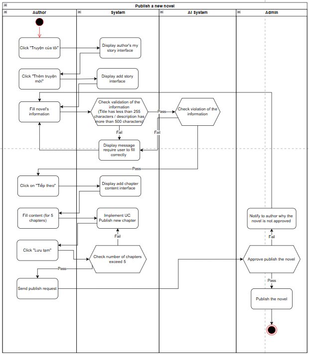

**b. Use case description**
| Objective | This function allows authors to publish a new novel on the platform |
| :--- | :--- |
| **Actor** | Author, System, AI System, Admin |
| **Trigger** | Author wants to publish a new novel |
| **Pre-condition** | Author has an account in the system and logged in successfully |
| **Post-condition** | - Novel is published on the platform |

| Step | Basic Flow | Exception Flow | Alternative Flow |
| :--- | :--- | :--- | :--- |
| 1 | Author clicks "Truyện của tôi" – System displays author's my story interface. Author clicks "Thêm truyện mới" – System displays add story interface |  |  |
| 2 | Author fills novel's information (title, description, genre, etc.) | 2a. System detects validation errors (Title ≥ 255 characters OR Description < 500 characters) 2a1. System displays message requiring user to fill correctly 2a2. Author re-fills the information |  |
| 3 | System validates information and passes to AI System to check for content violations | 3a. AI System detects violation of information 3a1. System notifies author of the violation 3a2. Author edits and re-submits the information |  |
| 4 | Author clicks "Tiếp theo" – System displays add chapter content interface |  |  |
| 5 | Author fills content for chapters – System implements UC Publish new chapter for each chapter | 5a. Chapter content fails UC Publish new chapter validation 5a1. Author re-edits the chapter content |  |
| 6 | Author clicks "Lưu tạm" – System checks if number of chapters meets requirement (≥ 5) | 6a. Number of chapters does not exceed 5 6a1. System notifies author to add more chapters 6a2. Author continues filling remaining chapters |  |
| 7 | Author sends publish request to Admin |  |  |
| 8 | Admin reviews and approves the novel – System publishes the novel | 8a. Admin does not approve the novel 8a1. System notifies author with the reason for rejection 8a2. Author edits novel and re-submits publish request |  |

#### 4.2.2. UC: Publish new chapter
**a. Activity diagram**
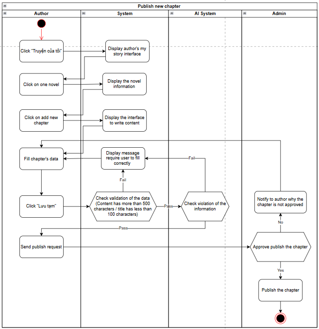

**b. Use case description**
| Objective | This function allows authors to publish a new chapter for an existing novel on the platform |
| :--- | :--- |
| **Actor** | Author, System, AI System, Admin |
| **Trigger** | Author wants to add and publish a new chapter to their novel |
| **Pre-condition** | Author has an account in the system, logged in successfully, and has at least one novel created in the system |
| **Post-condition** | - The new chapter is published on the platform - System records the successful chapter publication activity to database |

| Step | Basic Flow | Exception Flow | Alternative Flow |
| :--- | :--- | :--- | :--- |
| 1 | Author clicks "Truyện của tôi" – System displays author's my story interface |  |  |
| 2 | Author clicks on one novel – System displays the novel information |  |  |
| 3 | Author clicks on "Add new chapter" – System displays the interface to write content |  |  |
| 4 | Author fills chapter's data (title, content) |  |  |
| 5 | Author clicks "Lưu tạm" – System checks validation of the data (Content > 500 characters AND Title < 100 characters) | 5a. System detects validation errors 5a1. System displays message requiring user to fill correctly 5a2. Author re-fills chapter's data |  |
| 6 | System passes chapter to AI System to check for content violations | 6a. AI System detects violation of the information 6a1. System displays message requiring user to correct the content 6a2. Author edits and re-submits chapter's data |  |
| 7 | Author sends publish request to Admin |  |  |
| 8 | Admin reviews and approves the chapter – System publishes the chapter | 8a. Admin does not approve the chapter 8a1. System notifies author with the reason why the chapter is not approved 8a2. Author edits the chapter and re-sends the publish request |  |

### 4.3 Module 3: AI Intelligence (AI Story Assistant)
This module represents the core intelligence of Ephurin, supporting content optimization and automated moderation.

#### 4.3.1. UC: Automated Novel Classification
**a. Activity diagram**
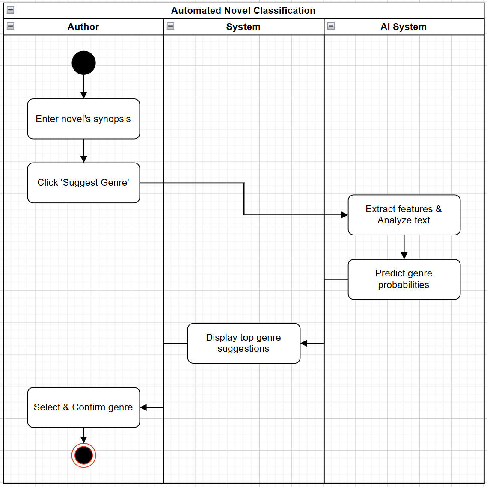

**b. Use case description**

| Attribute | Description |
| :--- | :--- |
| **Objective** | Use PhoBERT model to classify novel genres based on the synopsis |
| **Actor** | Author, AI System |
| **Trigger** | Author completes the synopsis and clicks "Suggest Genre" |
| **Pre-condition** | Author is in the story creation/editing interface and has entered a synopsis |
| **Post-condition** | System displays the most relevant genre suggestions |

| Step | Basic Flow | Exception Flow |
| :--- | :--- | :--- |
| 1 | Author enters or updates the novel's synopsis. | |
| 2 | Author requests genre suggestions. | |
| 3 | AI System processes text and extracts feature vectors. | 3a. Synopsis too short for analysis 3a1. System notifies author to provide more detail. |
| 4 | AI Model returns probability scores for various genres. | |
| 5 | System displays the top genre suggestions for the Author to select. | |

#### 4.3.2. UC: Suggest Tags and Title
**a. Activity diagram**
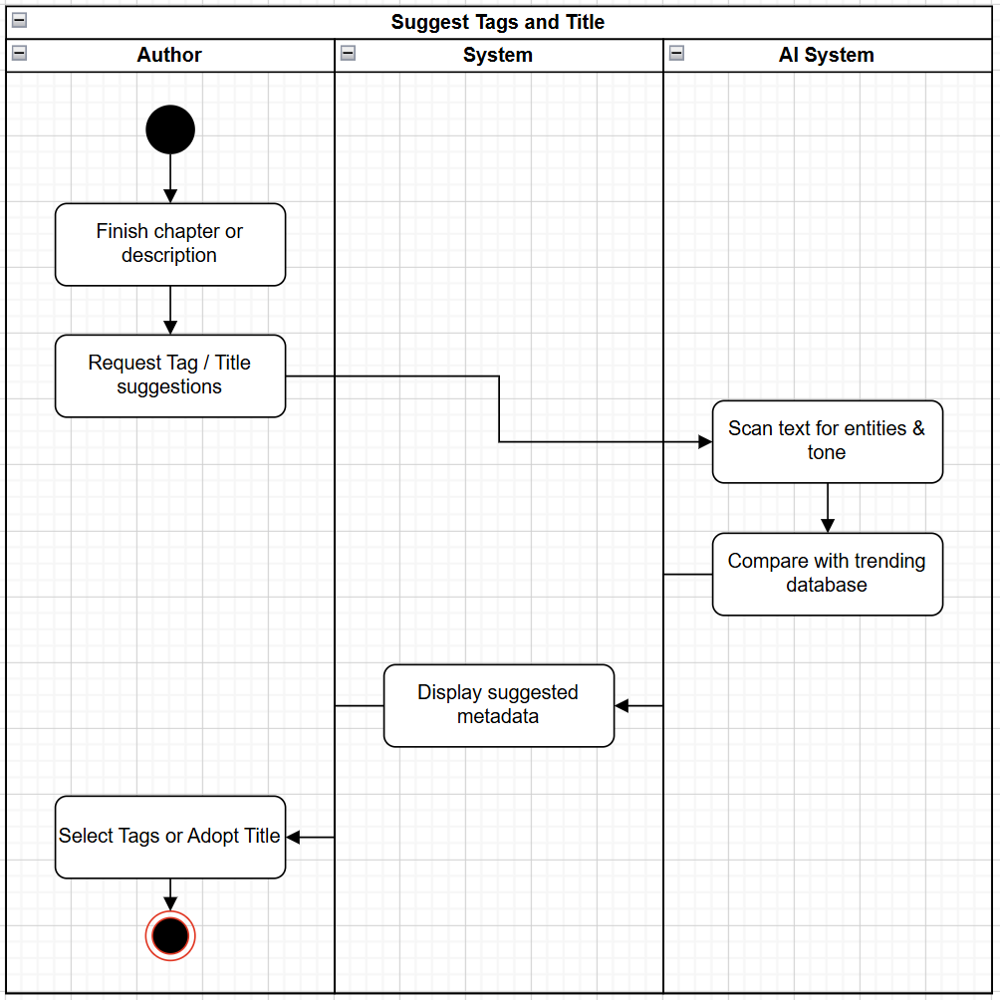

**b. Use case description**

| Attribute | Description |
| :--- | :--- |
| **Objective** | Extract prominent keywords (Tags) and suggest attractive titles based on content |
| **Actor** | Author, AI System |
| **Trigger** | Author completes a chapter or updates the story description |
| **Post-condition** | Author receives a list of suggested tags and titles |

| Step | Basic Flow | Exception Flow |
| :--- | :--- | :--- |
| 1 | Author finishes writing a chapter or updating story description. | |
| 2 | Author requests for Tag or Title suggestions. | |
| 3 | AI System scans the text for key entities, themes, and emotional tone. | 3a. Content is too short for meaningful analysis   3a1. System notifies author to add more content. |
| 4 | AI Model compares the analysis with trending metadata in the database. | |
| 5 | System displays a list of suggested Tags and potential Titles. | |
| 6 | Author selects desired Tags or adopts a suggested Title. | |

#### 4.3.3. UC: Analyze Writing Style and Length
**a. Activity diagram**
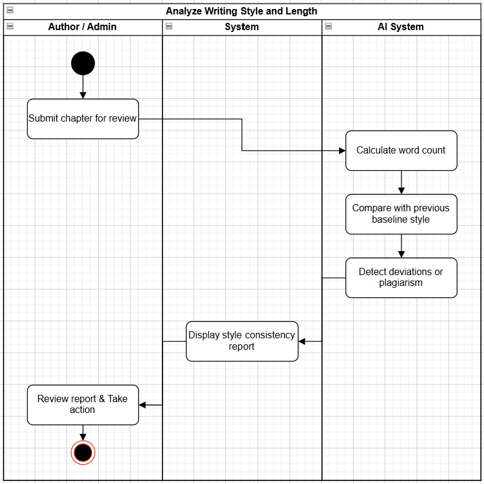

**b. Use case description**

| Attribute | Description |
| :--- | :--- |
| **Objective** | Detect sudden changes in writing style or insufficient chapter length |
| **Actor** | Author, Admin, AI System |
| **Trigger** | Author submits a new chapter for review |

| Step | Basic Flow | Exception Flow |
| :--- | :--- | :--- |
| 1 | Author submits a new chapter for review. | |
| 2 | AI System scans the chapter content and calculates word count. | 2a. Word count is below minimum requirement   2a1. System notifies author to expand the chapter. |
| 3 | AI System compares the writing style (vocabulary, sentence structure) with the author's previous baseline. | |
| 4 | AI System identifies any sudden deviations or potential plagiarism. | 4a. Significant style change detected   4a1. System flags the chapter for Admin manual review. |
| 5 | System displays a style consistency report and length validation. | |
| 6 | Author proceeds to publish or returns to edit based on the report. | |

### 4.4 Module 4: Trải nghiệm Đọc (Reading Features - Mobile)
Phân hệ này tập trung vào việc tối ưu hóa giao diện và tính năng hỗ trợ độc giả trong quá trình thưởng thức tác phẩm.

#### UC-RD-01: Cá nhân hóa giao diện đọc
**a. Activity diagram**
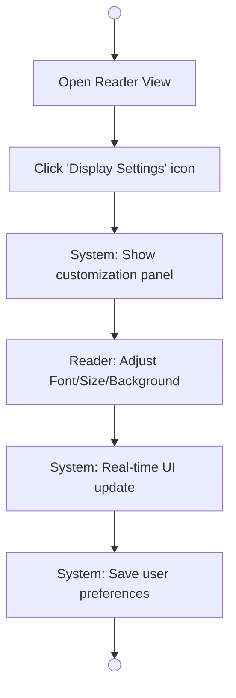

**b. Use case description**
- **Objective:** Độc giả có thể thay đổi font chữ, kích thước, màu nền (Dark/Light mode) để phù hợp với sở thích và môi trường.
- **Actor:** Reader
- **Trigger:** Nhấn vào biểu tượng "Cài đặt hiển thị" trong màn hình đọc.
- **Pre-condition:** Đang ở trong màn hình đọc truyện.
- **Post-condition:** Cài đặt được áp dụng ngay lập tức và lưu lại cho lần đọc sau.
- **Kịch bản chi tiết:**
  | Bước | Basic Flow | Exception Flow |
  | :--- | :--- | :--- |
  | 1 | Hệ thống hiển thị bảng tùy chỉnh (Font, Size, Background). | |
  | 2 | Người dùng kéo slider để chỉnh cỡ chữ hoặc chọn màu nền. | |
  | 3 | Hệ thống cập nhật CSS/Theme trực tiếp trên màn hình đọc. | |
  | 4 | Hệ thống lưu thông tin cấu hình. | Lỗi lưu trữ: Hiển thị thông báo không thể đồng bộ cài đặt. |

#### UC-RD-02: Tìm kiếm, Lọc truyện nâng cao
**a. Activity diagram**
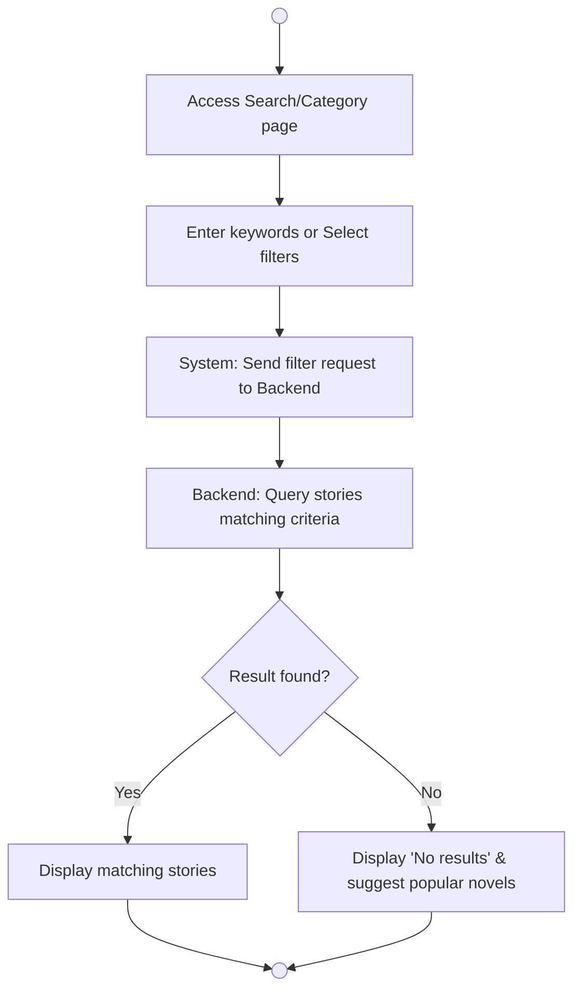

**b. Use case description**
- **Objective:** Cho phép tìm kiếm tác phẩm theo từ khóa, thể loại, tình trạng, và các bộ lọc kết hợp.
- **Actor:** Reader, Guest
- **Trigger:** Truy cập thanh tìm kiếm hoặc trang danh mục.
- **Post-condition:** Hiển thị danh sách truyện phù hợp, sắp xếp theo độ liên quan/lượt xem.
- **Kịch bản chi tiết:**
  | Bước | Basic Flow | Alternative Flow |
  | :--- | :--- | :--- |
  | 1 | Người dùng nhập từ khóa và chọn các tiêu chí lọc (Thể loại, Tình trạng). | |
  | 2 | Hệ thống gửi request lọc đến Backend. | Nếu không có từ khóa, chỉ lọc theo tiêu chí sẵn có. |
  | 3 | Backend trả về danh sách kết quả. | Nếu không tìm thấy: Báo "Không có kết quả" và gợi ý truyện phổ biến. |
  | 4 | Hệ thống hiển thị kết quả (dạng List/Grid). | |

### 4.5 Module 5: Tương tác & Cộng đồng
Phân hệ này xây dựng không gian tương tác giữa độc giả với nhau và giữa độc giả với tác giả.

#### UC-IN-01: Bình luận (theo chương/đoạn)
**a. Activity diagram**
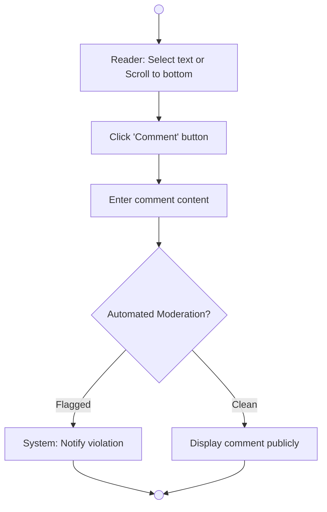

**b. Use case description**
- **Objective:** Cho phép độc giả để lại bình luận tại một chương hoặc một đoạn văn bản cụ thể (Inline comment).
- **Actor:** Reader
- **Trigger:** Bôi đen đoạn văn bản hoặc cuộn xuống cuối chương và chọn "Bình luận".
- **Pre-condition:** Đã đăng nhập.
- **Post-condition:** Bình luận được hiển thị công khai hoặc đưa vào diện chờ duyệt.

#### UC-IN-02: Like và Bookmark
- **Objective:** Đánh dấu lưu lại truyện (Bookmark) hoặc thích (Like) để tăng độ phổ biến.
- **Actor:** Reader
- **Trigger:** Nhấn nút "Thêm vào tủ sách" (Bookmark) hoặc "Thích" (Like).
- **Pre-condition:** Đã đăng nhập.
- **Post-condition:** Tác phẩm thêm vào Tủ sách cá nhân; lượt Like tăng.

#### UC-IN-03: Theo dõi tác giả & Thông báo đẩy
- **Objective:** Nhận thông báo khi tác giả yêu thích ra chương mới.
- **Actor:** Reader
- **Trigger:** Nhấn "Theo dõi" tại trang hồ sơ tác giả.
- **Post-condition:** Hệ thống tự động đẩy thông báo (Push Notification) đến thiết bị khi có update.

### 4.6 Module 6: Quản trị & Thống kê (Admin Dashboard)
*(Sẽ được bổ sung bởi thành viên phụ trách Module Quản trị)*

## CHƯƠNG V: THIẾT KẾ GIAO DIỆN (UI/UX)

### 5.1 Sơ đồ điều hướng (Sitemap & Screen Flow)
*(Sẽ được bổ sung bởi thành viên phụ trách Module Quản trị)*

### 5.2 Mockups giao diện Web (Author & Admin)
Below are the key interfaces for the Author module on the Web platform:

*   **Author “Truyện của tôi” page:** Displays the list of stories, statistics, and quick actions.
     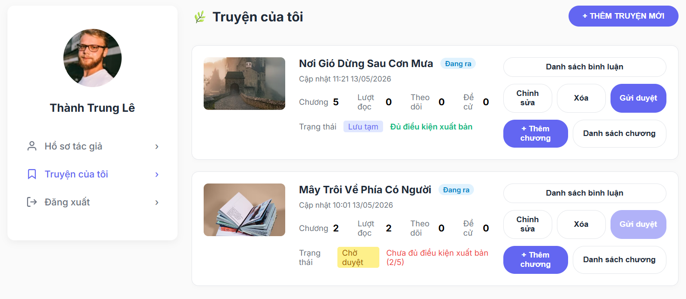
*   **Filling novel information page:** Form to input story metadata.
     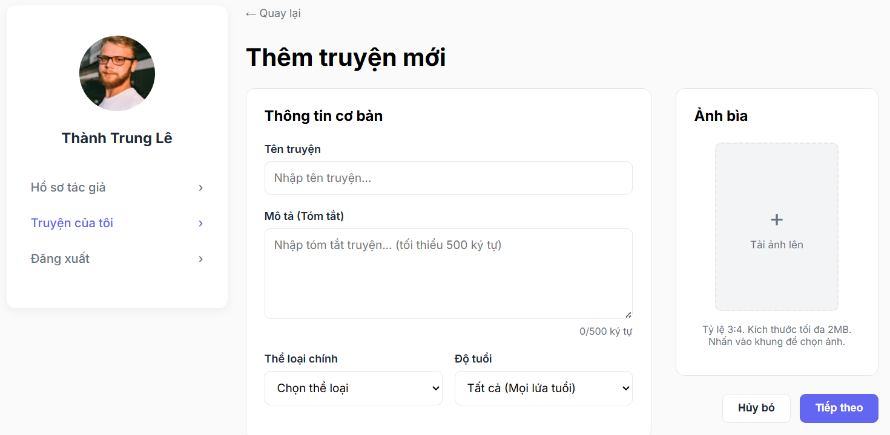
*   **Add new chapter page:** Writing interface for chapter content.
     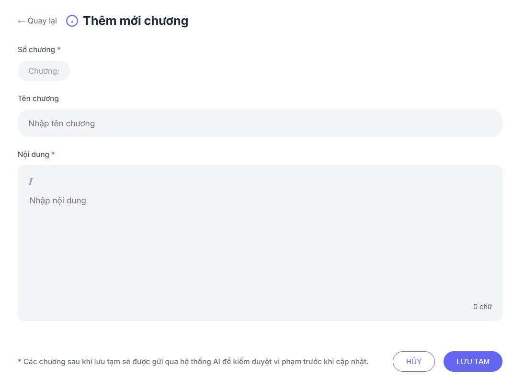
*   **Check information and send request page:** Final review before submission to Admin.
     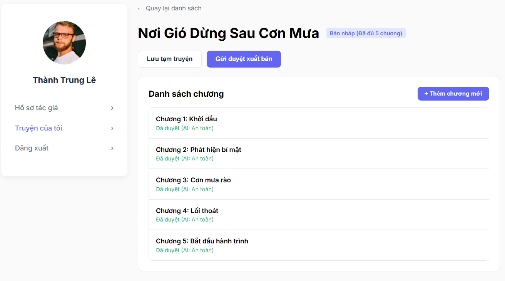

### 5.3 Mockups giao diện Mobile (Reader App)
Giao diện Mobile được thiết kế tối ưu cho trải nghiệm đọc lâu dài với các màn hình chính:

*   **Màn hình Home:** Hiển thị banner đề cử, các tác phẩm đang thịnh hành (top trending) và danh sách "Tiếp tục đọc" giúp người dùng quay lại nhanh chóng.
     
*   **Màn hình Khám phá & Lọc:** Cung cấp thanh tìm kiếm thông minh, danh mục thể loại phong phú và các bộ lọc nâng cao theo trạng thái/độ dài.
     
*   **Màn hình Chi tiết truyện:** Chứa thông tin tổng quan, tóm tắt nội dung, danh sách chương và các bài đánh giá từ cộng đồng.
     
*   **Màn hình Đọc truyện (Reader View):** Nội dung chương truyện với khả năng tùy chỉnh font, nền. Tích hợp tính năng bình luận theo dòng (inline comment).
     .png>)
*   **Màn hình Tủ sách (Thư viện):** Quản lý các truyện đã Bookmark và lịch sử đọc cá nhân.
     
*   **Màn hình Hồ sơ Tác giả:** Hiển thị thông tin tác giả, danh sách tác phẩm sáng tác và nút "Theo dõi" để nhận thông báo.
     

## CHƯƠNG VI: CÁC YÊU CẦU PHI CHỨC NĂNG

### 6.1 Hiệu năng (Performance)
- **Thời gian phản hồi**: Các tác vụ đọc truyện và tìm kiếm phải phản hồi dưới 2 giây.
- **Khả năng chịu tải**: Hệ thống đảm bảo phục vụ 10,000 người dùng đồng thời (Concurrent Users) thông qua cơ chế Auto-scaling.
- **Tối ưu hóa AI**: Các yêu cầu phân tích AI (NLP) không được treo quá 5 giây/request.

### 6.2 Bảo mật (Security)
- **Xác thực**: Sử dụng cơ chế JWT với thời gian hết hạn ngắn và Refresh Token để đảm bảo an toàn.
- **Mã hóa**: Toàn bộ mật khẩu người dùng phải được băm bằng thuật toán bcrypt. Dữ liệu giao dịch được mã hóa AES-256.
- **Phân quyền**: Áp dụng chặt chẽ mô hình RBAC để ngăn chặn truy cập trái phép vào trang quản trị.

### 6.3 Độ tin cậy (Reliability)
- **Sao lưu**: Tự động backup dữ liệu hàng ngày (Daily Backup) và lưu trữ đa vùng.
- **Uptime**: Cam kết thời gian hoạt động của hệ thống đạt 99.9%.

## PHỤ LỤC

### Phụ lục A: Danh mục mã lỗi hệ thống
*(Sẽ được bổ sung sau)*

### Phụ lục B: Dataset & Phương pháp huấn luyện AI

