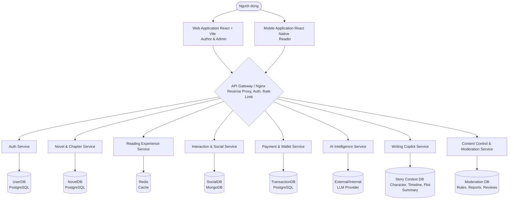

# SYSTEM OVERVIEW & GENERAL SPECIFICATIONS - EPHURIN NOVEL PLATFORM

## CHAPTER I: INTRODUCTION

### 1.1. Purpose of the Document
This Software Requirements Specification (SRS) describes the core requirements, actors, business flows, and operational scope of the **Ephurin Novel Platform**. It serves as a common foundation for analysts, designers, developers, testers, and supervisors to:
- Define goals, scope, and system boundaries.
- Describe key functions for Readers, Authors, Admins, and AI services.
- Clarify business workflows (Registration, Publishing, Moderation).
- Establish a basis for architectural design, UI design, and acceptance testing.

### 1.2. Project Scope
Ephurin is a platform for sharing and composing online novels, integrating Web, Mobile, and AI services.
- **Web Application:** For Authors (creation, stats) and Admins (management, moderation).
- **Mobile Application:** For Readers (search, read, interact).
- **Backend API:** Authentication, data management, and access control.
- **AI Service:** LLM-based metadata suggestion, classification, writing-style analysis, and Writing Copilot support.
- **Writing Copilot Context:** Character profiles, timeline events, and plot summaries are maintained as authoring context for an LLM-based writing assistant.
- **Content Control & Moderation Service:** Keyword/rule filtering, user reports, moderation queue, and Admin final decisions for novels, chapters, and comments.
- **Mock Payment Module:** Coin purchase, chapter unlock, donation, and withdraw workflows are implemented as an internal mock payment flow for graduation-project demonstration only.
- **Admin Dashboard:** Content review, report handling, and operational metrics.

### 1.2.1. Project Assumptions and Documentation Baseline
- `Final_SRS_v1.md` and `SRA_novel_platform_plan (1).md` are baseline reference documents used to derive and refine the fragmented SRS files in this folder.
- `techstack.md` is the current source of truth for implementation technology decisions.
- Detailed traceability from functional requirements to use cases, APIs, and test cases will be completed after the use cases are stabilized.
- Minor inconsistencies between service documents may exist because modules are drafted independently by different team members and will be normalized during SRS consolidation.

### 1.3. Terminology and Abbreviations
| Term | Meaning |
| :--- | :--- |
| SRS | Software Requirements Specification. |
| Actor | Entity interacting with the system. |
| Reader | Main user of the Mobile App (Reading, interacting). |
| Author | Creator and manager of stories (Web/Mobile). |
| Admin | System manager and content moderator. |
| AI Service | LLM-based service supporting classification, suggestions, style analysis, and Writing Copilot. |
| Writing Copilot | LLM-based assistant that uses character, timeline, and plot-summary context to support authors during writing. It may propose context updates, but official changes require Author confirmation. |
| Content Control Service | Service handling keyword/rule filtering, user reports, moderation queue, and Admin decisions. |
| JWT | JSON Web Token, session authentication mechanism. |
| OAuth 2.0 | Authentication standard for Google/Facebook login. |
| RBAC | Role-Based Access Control. |
| Coin | Internal mock currency for unlocking chapters or donations in the academic demo. |

### 1.4. Benchmarking and Market Analysis
| Criteria | Webnovel | Wattpad | Waka | Ephurin (Target) |
| :--- | :--- | :--- | :--- | :--- |
| **Publishing** | Contract model, exclusive content. | Open publishing model. | Conditional publishing (word count). | Authoring tools with AI-assisted metadata and scheduling. |
| **Reading** | Chapter-based, paid content. | Free/Paid with community focus. | Chapter-based, membership. | Mobile-first, UI customization, and synced history. |
| **Interaction** | Comments, reviews, gifts. | Inline comments, votes, follow. | Comments, bug reports. | Inline comments, follow, and transparent reporting. |
| **Moderation** | Keyword scan, manual review. | Community guidelines & reports. | Plagiarism check, manual review. | Keyword/rule filter, user reports, and Admin final decision. |

---

## CHAPTER II: SYSTEM ARCHITECTURE & GATEWAY

The Ephurin Novel Platform is built on a **Microservices** architecture, ensuring stability, ease of maintenance, and independent scalability for each module (Web, Mobile, AI).

### 2.1. General Architecture Diagram

### 2.2. Description of Core Components
1.  **Frontend Clients**:
    -   **Web Application (React + Vite)**: The primary platform for Authors to write and Admins to manage, following the current project tech stack.
    -   **Mobile Application (React Native)**: A dedicated app for Readers, focusing on a smooth reading experience.
2.  **API Gateway / Nginx**: Acts as the single entry point for all client requests, handling routing, SSL termination, and rate limiting.
3.  **Backend Microservices**:
    -   **Auth Service**: Manages authentication (JWT), authorization (RBAC), and user accounts.
    -   **Novel & Chapter Service**: Handles story creation, chapter management, drafts, and publishing.
    -   **Reading Experience Service**: Optimizes retrieval of reading content, histories, bookmarks, and personalization.
    -   **Interaction & Social Service**: Manages comments (inline/chapter), likes, follows, and push notifications.
    -   **Payment & Wallet Service**: Processes mock Coins, chapter unlocks, donations, and withdraw requests for academic demonstration.
    -   **AI Intelligence Service**: Supports LLM-based metadata categorization, title/tag suggestions, writing-style analysis, and Writing Copilot assistance.
    -   **Writing Copilot Service**: Uses Character, Timeline, and Plot Summary data as context for LLM-assisted writing support, and may submit author-approved context update proposals back to Novel & Chapter Service.
    -   **Content Control & Moderation Service**: Handles keyword/rule filtering, user reports, moderation review queues, and Admin decisions. It does not use LLM/AI for content judgement.

---

## CHAPTER III: USER ROLES & PERMISSIONS

### 3.1. List of Actors
*   **Guest**: Unauthenticated users who can browse story lists and read free chapters.
*   **Reader**: Registered users focused on the mobile experience with personalization and social features.
*   **Author**: Content creators focused on the Web platform for writing and work management.
*   **Admin/Editor**: Administrators responsible for operations, moderation, and user management.
*   **AI Service**: A system actor supporting data processing and author assistance.

### 3.2. Permission Matrix
The following matrix defines the level of access and actions (CRUD) each actor can perform on system resources.

| Resource | Guest | Reader | Author | Admin |
| :--- | :---: | :---: | :---: | :---: |
| **User Profile** | Create | R, U | R, U | R, U, D |
| **Novels (Own)** | - | - | C, R, U, D | R, U, D |
| **Novels (Others)** | R | R | R | R, U, D |
| **Chapters** | R (Free) | R | C, R, U, D | R, U, D |
| **Comments** | R | C, R, U, D | C, R, U, D | R, D |
| **Moderation** | - | - | - | C, R, U, D |
| **Statistics** | - | - | R (Own) | R (All) |

*Legend: C = Create, R = Read, U = Update, D = Delete*

---

## CHAPTER IV: GENERAL NON-FUNCTIONAL REQUIREMENTS

### 4.1. Performance & Scalability
- **Response Time**: General read and search tasks must respond in under 2 seconds.
- **Scalability**: The system ensures service for at least 10,000 concurrent users via Auto-scaling.
- **Concurrency**: Support at least 1,000 users active simultaneously.

### 4.2. Security
- **Authentication**: Secure token exchange (JWT) with short Access Token expiration and HTTP-only cookie Refresh Token storage.
- **Encryption**: Standard transport encryption (HTTPS/SSL). Passwords hashed using bcrypt/argon2id.
- **Authorization**: Strict Role-Based Access Control (RBAC) enforced on the API Gateway and service levels.

### 4.3. Reliability
- **Backup**: Daily automated backups stored across multiple cloud regions.
- **Uptime**: System availability commitment of 99.9%.
