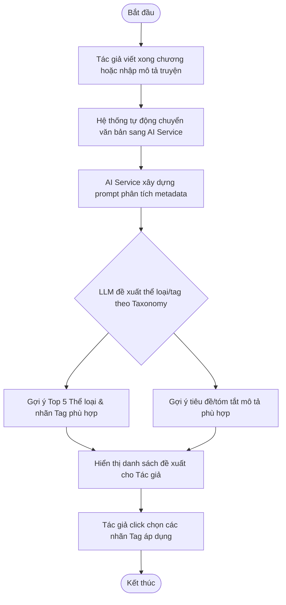
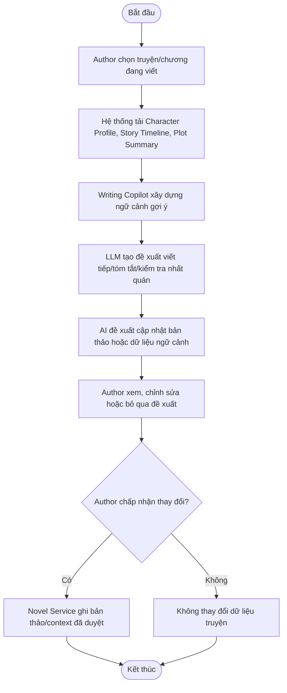
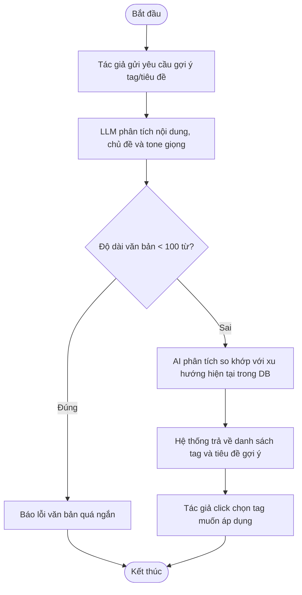
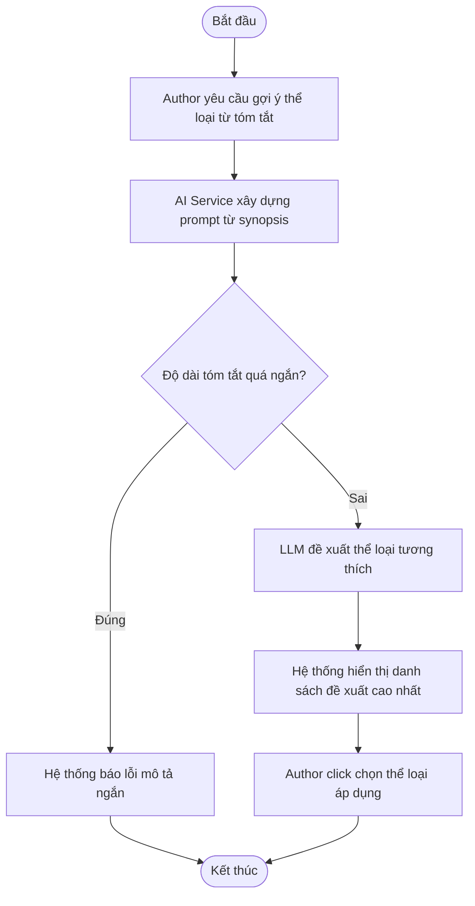
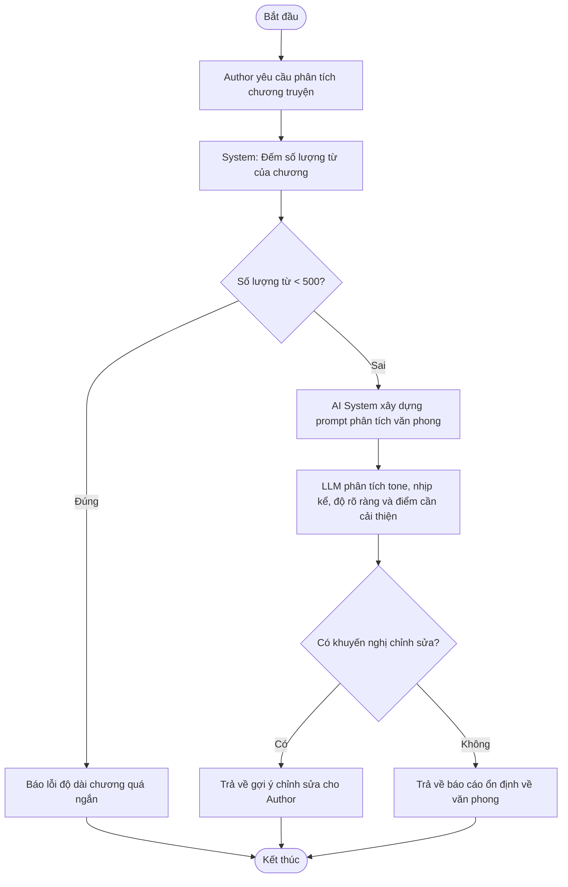
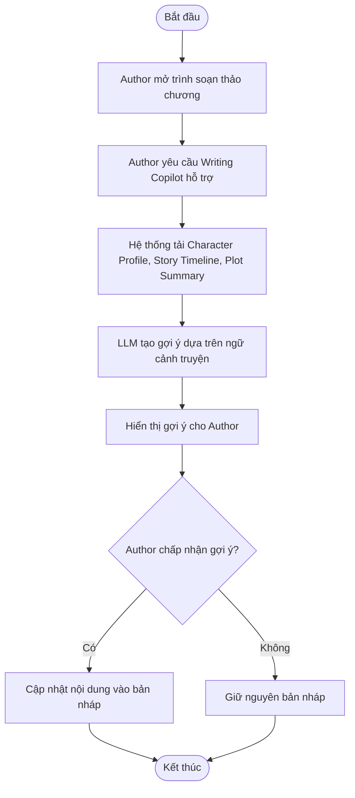
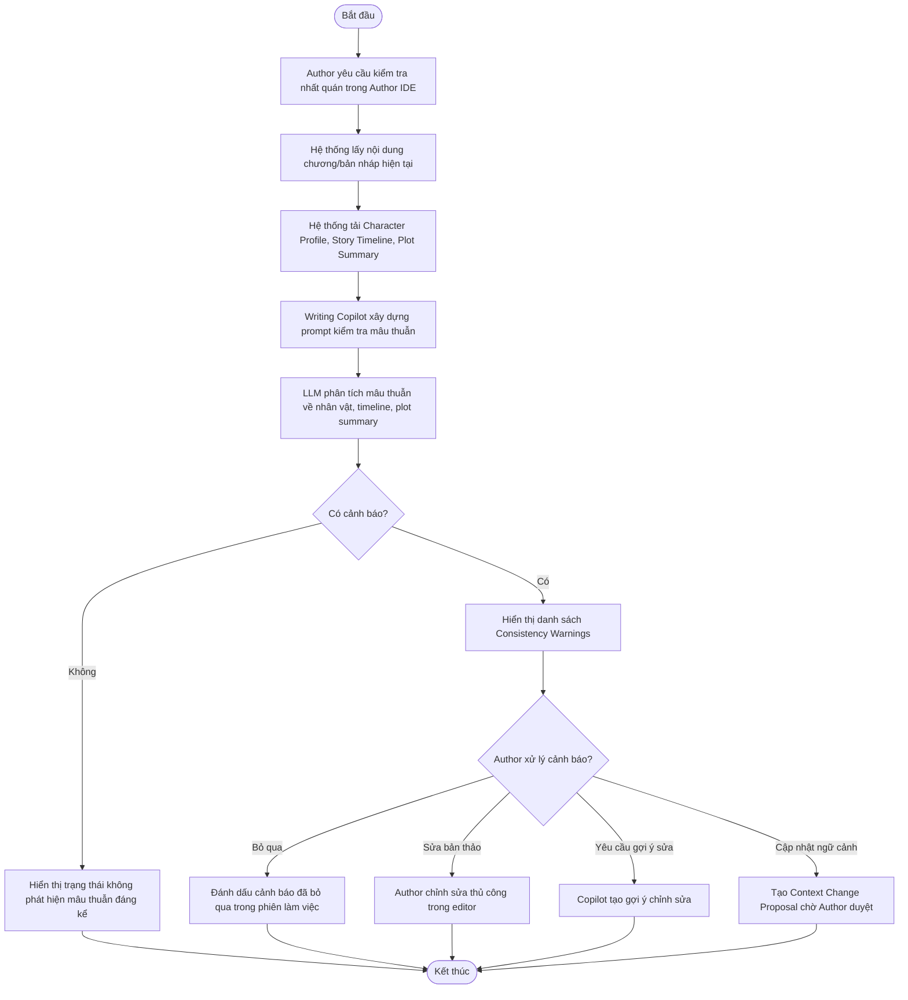

# AI INTELLIGENCE SERVICE - SPECIFICATION

## 1. OVERVIEW & BUSINESS RULES (Tổng quan & Quy tắc nghiệp vụ)

*   **Mission:** Cung cấp các chức năng AI thuần LLM phục vụ việc chuẩn hóa siêu dữ liệu tác phẩm (gợi ý tag, thể loại, tiêu đề), hỗ trợ phân tích văn phong cho tác giả và vận hành Writing Copilot dựa trên ngữ cảnh truyện.
*   **Core Entities:** 
    *   `LLM_PROVIDER`: Dịch vụ LLM dùng chung cho gợi ý metadata, phân tích văn phong và Writing Copilot.
    *   `TAXONOMY_MODEL`: Danh mục cấu trúc các thể loại, thẻ phân loại truyện (Genres, Tags).
    *   `CHARACTER_PROFILE`: Hồ sơ nhân vật do Novel & Chapter Service sở hữu; AI/Writing Copilot có thể đọc, tạo đề xuất bổ sung hoặc chỉnh sửa thông qua quy trình tác giả phê duyệt.
    *   `STORY_TIMELINE`: Chuỗi sự kiện/cột mốc chính do Novel & Chapter Service sở hữu; AI/Writing Copilot có thể đề xuất cập nhật timeline dựa trên nội dung chương mới hoặc yêu cầu của tác giả.
    *   `PLOT_SUMMARY`: Bản tóm tắt tình tiết theo truyện/chương/hồi do Novel & Chapter Service sở hữu; AI/Writing Copilot có thể tự động đề xuất bản tóm tắt mới sau khi tác giả lưu hoặc xuất bản chương.
    *   `CONSISTENCY_WARNING`: Cảnh báo mâu thuẫn do Writing Copilot tạo ra khi nội dung chương hiện tại không khớp với Character Profile, Story Timeline hoặc Plot Summary. Đây là dữ liệu hỗ trợ tác giả, không phải kiểm duyệt nội dung.
*   **Constraints & Security:**
    *   **LLM-only AI Model:** Phân hệ AI sử dụng LLM cho các tác vụ gợi ý metadata, phân tích văn phong và Writing Copilot; MVP không duy trì mô hình NLP riêng cho phân loại ngữ nghĩa.
    *   **Content Control Boundary:** AI Intelligence Service không thực hiện kiểm soát/kiểm duyệt nội dung. Toàn bộ lọc từ ngữ, user reports và Admin moderation thuộc `Content Control & Moderation Service`.
    *   **Timeout Threshold:** Tác vụ gọi LLM không được treo quá 5 giây mỗi lượt gọi để đảm bảo trải nghiệm lưu truyện/chương của tác giả không bị gián đoạn.
    *   **Fallback Mechanism:** Khi dịch vụ AI gặp sự cố (`AI_001`), hệ thống bỏ qua phần gợi ý AI và cho phép người dùng tiếp tục thao tác thủ công; không dùng lỗi AI để chặn xuất bản.
    *   **Writing Copilot Context Boundary:** LLM sử dụng Character Profile, Story Timeline, Plot Summary và nội dung tác giả cho phép làm ngữ cảnh gợi ý. Copilot được phép tạo đề xuất thay đổi dữ liệu ngữ cảnh, nhưng mọi thay đổi vào `CHARACTER_PROFILE`, `STORY_TIMELINE`, `PLOT_SUMMARY` hoặc bản thảo phải được tác giả xác nhận trước khi Novel & Chapter Service ghi nhận chính thức.
    *   **Consistency Checking Boundary:** Kiểm tra nhất quán chỉ đưa ra cảnh báo/gợi ý sửa cho Author. Hệ thống không tự động sửa bản thảo, không tự động cập nhật dữ liệu ngữ cảnh và không dùng kết quả này để chặn xuất bản.

---

## 2. SERVICE WORKFLOWS (Luồng hoạt động của dịch vụ)

### 2.1. AI-assisted Metadata Suggestions Workflow
Quy trình trích xuất từ khóa và gợi ý thể loại truyện tự động từ bản tóm tắt tác phẩm (Synopsis):

### 2.2. Writing Copilot Context Workflow
Quy trình chuẩn bị ngữ cảnh cho trợ lý viết truyện dựa trên LLM:

---

## 3. DETAILED USE CASES (Đặc tả chức năng chi tiết)

### 3.1. UC: Suggest Tags and Title

**a. Activity diagram**

**b. Use case description**
| Attribute | Description |
| :--- | :--- |
| **Objective** | Trích xuất các từ khóa nổi bật (Tags) và gợi ý tiêu đề hấp dẫn dựa trên nội dung tác phẩm |
| **Actor** | Author, AI System |
| **Trigger** | Author soạn thảo xong chương truyện hoặc chỉnh sửa tóm tắt truyện |
| **Post-condition** | Author nhận được danh sách các tag và tiêu đề gợi ý phù hợp |

| Step | Basic Flow | Exception Flow |
| :--- | :--- | :--- |
| 1 | Author hoàn thành soạn thảo và yêu cầu gợi ý. | |
| 2 | AI System gọi LLM phân tích văn bản, chủ đề và cảm xúc của câu truyện. | 2a. Nội dung văn bản quá ngắn (< 100 từ) không đủ phân tích.   2a1. Hệ thống báo lỗi và yêu cầu viết thêm nội dung. |
| 3 | AI đối chiếu chủ đề với xu hướng đọc truyện hiện tại trong database. | |
| 4 | Hệ thống trả về danh sách đề xuất các nhãn tag nổi bật và các tiêu đề mẫu. | |
| 5 | Author click chọn các nhãn tag muốn áp dụng lên tác phẩm của mình. | |

---

### 3.2. UC: Automated Novel Classification

**a. Activity diagram**

**b. Use case description**
| Attribute | Description |
| :--- | :--- |
| **Objective** | Sử dụng LLM để tự động phân tích synopsis và đề xuất thể loại truyện phù hợp dựa trên Taxonomy của hệ thống |
| **Actor** | Author, AI System |
| **Trigger** | Author click nút "Gợi ý thể loại" trong màn hình nhập mô tả truyện |
| **Pre-condition** | Đang trong giao diện chỉnh sửa tác phẩm và đã nhập phần mô tả (Synopsis) |
| **Post-condition** | Hệ thống hiển thị các thể loại tương thích nhất để tác giả tham khảo |

| Step | Basic Flow | Exception Flow |
| :--- | :--- | :--- |
| 1 | Author nhập thông tin tóm tắt bộ truyện. | |
| 2 | Author yêu cầu gợi ý thể loại. | |
| 3 | AI System xây dựng prompt phân tích synopsis và gọi LLM đề xuất thể loại phù hợp. | 3a. Phần tóm tắt quá ngắn.   3a1. Hệ thống yêu cầu Author viết chi tiết hơn. |
| 4 | AI System chuẩn hóa kết quả LLM theo danh sách Genre/Tag hợp lệ trong Taxonomy. | |
| 5 | Hệ thống hiển thị danh sách các thể loại có điểm số cao nhất cho Author lựa chọn. | |

---

### 3.3. UC: Analyze Writing Style and Length

**a. Activity diagram**

**b. Use case description**
| Attribute | Description |
| :--- | :--- |
| **Objective** | Hỗ trợ tác giả phân tích văn phong, độ dài, nhịp kể và điểm cần cải thiện trước khi tự chỉnh sửa hoặc xuất bản |
| **Actor** | Author, AI System |
| **Trigger** | Author yêu cầu phân tích chương truyện |

| Step | Basic Flow | Exception Flow |
| :--- | :--- | :--- |
| 1 | Author yêu cầu phân tích một chương truyện đang viết. | |
| 2 | System thực hiện đếm số từ của chương truyện và kiểm tra điều kiện tối thiểu. | 2a. Số từ không đạt tiêu chuẩn tối thiểu (ví dụ: < 500 từ).   2a1. Hệ thống báo lỗi độ dài và yêu cầu viết thêm. |
| 3 | AI System xây dựng prompt và gọi LLM phân tích tone, nhịp kể, độ rõ ràng và tính nhất quán văn phong. | |
| 4 | LLM tạo báo cáo gợi ý chỉnh sửa để tác giả tham khảo; kết quả này không dùng làm căn cứ kiểm duyệt hay tự động chặn xuất bản. | |
| 5 | Hệ thống trả về báo cáo phân tích văn phong cho Author. | |

---

### 3.4. UC: Generate Writing Copilot Suggestions

**a. Activity diagram**

**b. Use case description**
| Attribute | Description |
| :--- | :--- |
| **Objective** | Hỗ trợ tác giả viết tiếp, tóm tắt, kiểm tra mâu thuẫn và giữ nhất quán nội dung dựa trên dữ liệu nhân vật/timeline/tóm tắt tình tiết |
| **Actor** | Author, Writing Copilot, AI System |
| **Trigger** | Author nhấn nút yêu cầu gợi ý trong trình soạn thảo chương |
| **Pre-condition** | Author đã đăng nhập; truyện có dữ liệu bản thảo hoặc dữ liệu ngữ cảnh tối thiểu |
| **Post-condition** | Gợi ý được hiển thị cho Author; chỉ nội dung hoặc dữ liệu ngữ cảnh được Author chấp nhận mới được Novel & Chapter Service lưu chính thức |

| Step | Basic Flow | Exception Flow |
| :--- | :--- | :--- |
| 1 | Author mở trình soạn thảo và yêu cầu Writing Copilot hỗ trợ. | |
| 2 | Hệ thống tải hồ sơ nhân vật, timeline, tóm tắt tình tiết và nội dung chương hiện tại. | 2a. Thiếu dữ liệu ngữ cảnh: hệ thống vẫn cho gợi ý nhưng cảnh báo độ tin cậy thấp. |
| 3 | Writing Copilot xây dựng prompt nội bộ và gọi LLM tạo gợi ý viết tiếp hoặc đề xuất cập nhật Character/Timeline/Plot Summary. | 3a. AI timeout hoặc lỗi: trả về `AI_001` và không thay đổi dữ liệu. |
| 4 | Hệ thống hiển thị gợi ý để Author xem xét/chỉnh sửa. | |
| 5 | Author chấp nhận một phần hoặc toàn bộ gợi ý. | 5a. Author từ chối: hệ thống giữ nguyên bản thảo và dữ liệu ngữ cảnh. |
| 6 | Novel & Chapter Service lưu phần nội dung/context đã được Author chấp nhận vào Draft Chapter, Character Profile, Story Timeline hoặc Plot Summary tương ứng. | |

---

### 3.5. UC: Check Plot Consistency

**a. Activity diagram**

**b. Use case description**

| Attribute | Description |
| :--- | :--- |
| **Objective** | Hỗ trợ Author phát hiện mâu thuẫn giữa chương đang viết và dữ liệu ngữ cảnh truyện |
| **Actor** | Author, Writing Copilot, AI System |
| **Trigger** | Author nhấn "Analyze Consistency" trong Author IDE hoặc hệ thống chạy sau khi lưu nháp |
| **Pre-condition** | Author đã đăng nhập; có nội dung draft/chapter và ít nhất một phần dữ liệu ngữ cảnh truyện |
| **Post-condition** | Hệ thống hiển thị danh sách cảnh báo; không có thay đổi nào được ghi chính thức nếu Author chưa xác nhận |

| Step | Basic Flow | Exception Flow |
| :--- | :--- | :--- |
| 1 | Author yêu cầu kiểm tra nhất quán cho chương hiện tại. | |
| 2 | Hệ thống tải bản nháp/chương hiện tại cùng Character Profile, Story Timeline và Plot Summary liên quan. | 2a. Thiếu dữ liệu ngữ cảnh: hệ thống vẫn phân tích nhưng trả cảnh báo độ tin cậy thấp. |
| 3 | Writing Copilot gọi LLM phân tích các mâu thuẫn về nhân vật, quan hệ, timeline, sự kiện và tóm tắt tình tiết. | 3a. AI timeout hoặc lỗi: trả về `AI_001`, không thay đổi dữ liệu. |
| 4 | Hệ thống trả về danh sách `CONSISTENCY_WARNING` gồm mức độ, vị trí liên quan, lý do và gợi ý xử lý. | |
| 5 | Author chọn bỏ qua, chỉnh sửa bản thảo, yêu cầu Copilot gợi ý sửa hoặc tạo Context Change Proposal. | 5a. Author không chọn hành động: cảnh báo chỉ tồn tại như thông tin hỗ trợ trong phiên/nhật ký Copilot. |
