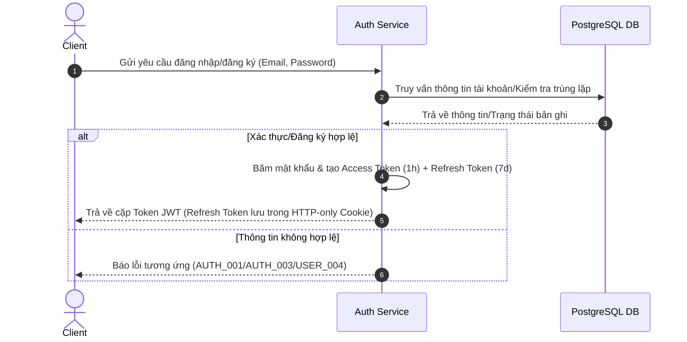
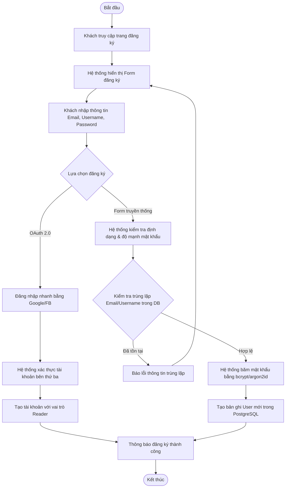
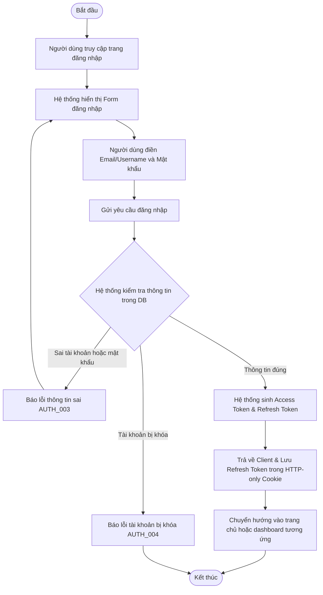

# AUTH SERVICE - SPECIFICATION

## 1. OVERVIEW & BUSINESS RULES (Tổng quan & Quy tắc nghiệp vụ)

*   **Mission:** Quản lý đăng ký, đăng nhập, bảo mật thông tin hồ sơ cá nhân và chịu trách nhiệm phân quyền toàn hệ thống (Authorization) bằng cơ chế RBAC (Role-Based Access Control).
*   **Core Entities:** 
    *   `USER`: Lưu trữ thông tin tài khoản (Email, Username, PasswordHash, Role). Số dư Coin thuộc phạm vi quản lý của Payment & Wallet Service.
    *   `ROLE` & `PERMISSION`: Định nghĩa danh sách vai trò (Guest, Reader, Author, Admin) và quyền hạn chi tiết (CRUD) đối với từng tài nguyên.
*   **Constraints & Security:**
    *   **Password Hashing:** Mật khẩu người dùng bắt buộc phải được mã hóa bằng thuật toán Argon2id hoặc bcrypt trước khi lưu trữ vào PostgreSQL.
    *   **Session Management (JWT):**
        *   **Access Token:** Thời hạn ngắn (1 giờ), đính kèm vào HTTP header `Authorization: Bearer <token>` cho mỗi yêu cầu API.
        *   **Refresh Token:** Thời hạn dài (7 ngày), lưu trữ an toàn trong HTTP-only cookie phía client để tự động gia hạn Access Token.
    *   **RBAC Enforcement:** Kiểm tra phân quyền truy cập chặt chẽ trên mọi Endpoint API nhạy cảm.

---

## 2. SERVICE WORKFLOWS (Luồng hoạt động của dịch vụ)

### 2.1. Registration & Authentication Flow
Quy trình trao đổi Token khi đăng ký và đăng nhập hệ thống:

---

## 3. DETAILED USE CASES (Đặc tả chức năng chi tiết)

### 3.1. UC: User Registration

**a. Activity diagram**

**b. Use case description**
| Attribute | Description |
| :--- | :--- |
| **Objective** | Tạo tài khoản mới để truy cập các tính năng của hệ thống |
| **Actor** | Guest |
| **Trigger** | Guest click nút "Đăng ký" |
| **Pre-condition** | Guest chưa đăng nhập; Email/Username là duy nhất trong hệ thống |
| **Post-condition** | Tài khoản mới được tạo với vai trò mặc định là "Reader" |

| Step | Basic Flow | Exception Flow |
| :--- | :--- | :--- |
| 1 | Guest truy cập màn hình đăng ký. | |
| 2 | Hệ thống hiển thị form nhập liệu (Email, Username, Password). | |
| 3 | Guest điền đầy đủ thông tin và gửi yêu cầu. | 3a. Guest chọn đăng nhập nhanh qua Google/FB (OAuth 2.0). |
| 4 | Hệ thống kiểm tra định dạng email và độ mạnh mật khẩu. | 4a. Trùng Email/Username: Hệ thống hiển thị thông báo lỗi và gợi ý Đăng nhập. |
| 5 | Hệ thống băm mật khẩu và tạo bản ghi User mới. | |
| 6 | Hệ thống hiển thị thông báo đăng ký thành công. | |

---

### 3.2. UC: User Login

**a. Activity diagram**

**b. Use case description**
| Attribute | Description |
| :--- | :--- |
| **Objective** | Xác thực danh tính người dùng và cấp quyền truy cập dựa trên vai trò |
| **Actor** | Reader, Author, Admin |
| **Pre-condition** | Người dùng đã có tài khoản hợp lệ |
| **Post-condition** | Người dùng nhận được cặp token JWT hợp lệ và được chuyển hướng về trang chủ/dashboard tương ứng |

| Step | Basic Flow | Exception Flow |
| :--- | :--- | :--- |
| 1 | Người dùng truy cập màn hình đăng nhập. | |
| 2 | Hệ thống hiển thị form nhập liệu (Email/Username, Password). | |
| 3 | Người dùng điền thông tin và xác nhận. | |
| 4 | Hệ thống so khớp thông tin đăng nhập trong DB. | 4a. Sai tài khoản/mật khẩu: Hệ thống thông báo lỗi `AUTH_003`.   4b. Tài khoản bị khóa: Thông báo lỗi `AUTH_004`. |
| 5 | Hệ thống tạo và trả về Access Token & Refresh Token. | |
| 6 | Người dùng được chuyển hướng vào trang chủ hoặc dashboard. | |
