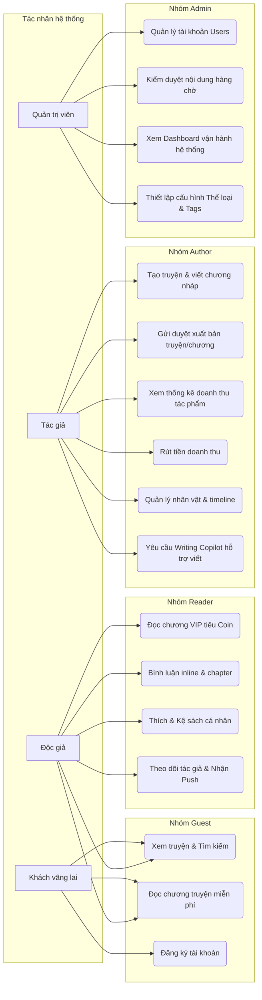
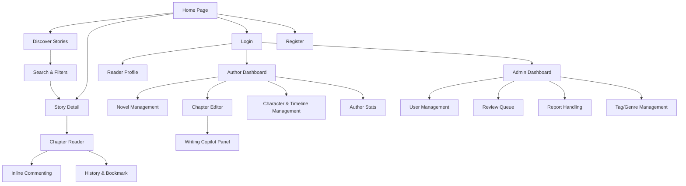

# CLIENT APPLICATIONS (FRONTEND Web & Mobile) - SPECIFICATION

This document outlines the user interface sitemap, functional trees, and visual layouts for the Frontend Client Applications:
1.  **Web Application (React + Vite)**: Optimized for Author composition and Admin operations, following the current project tech stack.
2.  **Mobile Application (React Native)**: Optimized for a premium Reader experience.

---

## 1. Functional Decomposition & General Use Case

### 1.1. Functional Decomposition Diagram (Functional Tree)
Sơ đồ phân rã chức năng (Functional Tree) các module nghiệp vụ của hệ thống:

```mermaid
flowchart TD
    %% Gốc
    Root[Ephurin Novel Platform]

    %% Các Module chính
    M1[Module 1: Quản lý Tài khoản]
    M2[Module 2: Quản lý Tác phẩm Web]
    M3[Module 3: Trợ lý Thông minh AI]
    M4[Module 4: Trải nghiệm Đọc Mobile]
    M5[Module 5: Tương tác & Cộng đồng]
    M6[Module 6: Quản trị & Thống kê]

    Root --> M1 & M2 & M3 & M4 & M5 & M6

    %% Chi tiết module 1
    M1 --> M1_1[Đăng ký/Đăng nhập JWT]
    M1 --> M1_2[Xác thực bên thứ ba OAuth 2.0]
    M1 --> M1_3[Quản lý Hồ sơ Profile]

    %% Chi tiết module 2
    M2 --> M2_1[Tạo & Quản lý Truyện]
    M2 --> M2_2[Soạn thảo & Đăng chương]
    M2 --> M2_3[Tự động lưu bản nháp Draft]
    M2 --> M2_4[Quản lý Nhân vật & Timeline]

    %% Chi tiết module 3
    M3 --> M3_1[Gợi ý thể loại bằng LLM]
    M3 --> M3_2[Gợi ý nhãn tag & tiêu đề]
    M3 --> M3_3[Phân tích văn phong bằng LLM]
    M3 --> M3_4[Writing Copilot dựa trên ngữ cảnh truyện]

    %% Chi tiết module 4
    M4 --> M4_1[Đọc truyện tùy biến giao diện]
    M4 --> M4_2[Tìm kiếm & Lọc nâng cao]
    M4 --> M4_3[Đồng bộ lịch sử đọc thời gian thực]

    %% Chi tiết module 5
    M5 --> M5_1[Bình luận inline/chapter]
    M5 --> M5_2[Likes & Bookmarks kệ sách]
    M5 --> M5_3[Theo dõi tác giả & Push FCM]

    %% Chi tiết module 6
    M6 --> M6_1[Duyệt truyện/chương hàng chờ]
    M6 --> M6_2[Quản lý User & Khóa tài khoản]
    M6 --> M6_3[Dashboard theo dõi traffic/growth]
    M6 --> M6_4[Quản lý report & rule/filter nội dung]
```

### 1.2. General Use Case Diagram
Sơ đồ tóm tắt nhóm chức năng theo từng tác nhân tương tác với hệ thống:

---

## 2. Screen Navigation Flow (Sitemap)

The navigation tree connects frontend client screens:

---

## 3. UI Design Artifacts

Detailed Web and Mobile mockups are deferred to the UI/UX design phase. This SRS file keeps only functional decomposition, general use cases, and navigation flow needed for use-case analysis.
