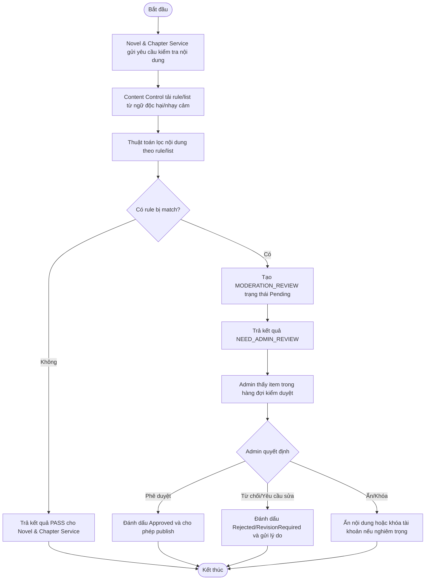
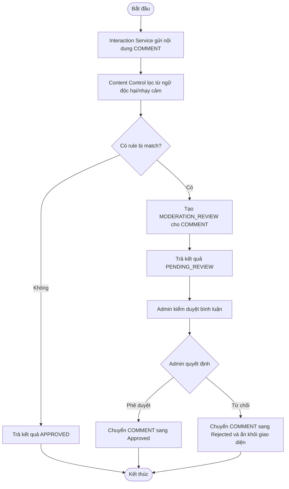
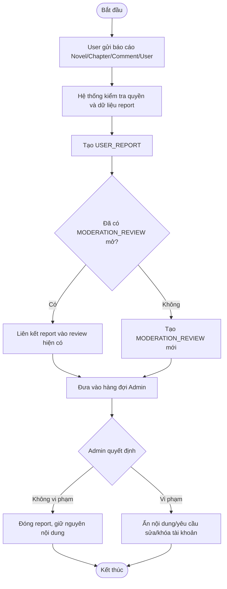

# CONTENT CONTROL & MODERATION SERVICE - SPECIFICATION

## 1. OVERVIEW & BUSINESS RULES (Tổng quan & Quy tắc nghiệp vụ)

*   **Mission:** Quản lý kiểm soát nội dung cho truyện, chương và bình luận bằng bộ lọc từ ngữ độc hại/nhạy cảm, báo cáo người dùng và hàng đợi kiểm duyệt thủ công của Admin.
*   **Core Entities:**
    *   `CONTENT_FILTER_RULE`: Danh sách rule/từ khóa/cụm từ dùng để phát hiện nội dung độc hại, nhạy cảm hoặc vi phạm chính sách nền tảng.
    *   `MODERATION_REVIEW`: Bản ghi hàng đợi kiểm duyệt cho Novel, Chapter hoặc Comment.
    *   `USER_REPORT`: Báo cáo vi phạm do Reader/Author gửi đối với Novel, Chapter, Comment hoặc User.
    *   `MODERATION_DECISION`: Kết quả Admin phê duyệt, từ chối, ẩn nội dung, yêu cầu sửa hoặc khóa tài khoản.
*   **Constraints & Security:**
    *   **No LLM Moderation:** Service này không sử dụng LLM/AI để đánh giá nội dung. LLM chỉ thuộc AI Intelligence/Writing Copilot cho các tác vụ gợi ý và hỗ trợ viết.
    *   **Two-layer Control:** Kiểm soát nội dung chỉ có 2 lớp: thuật toán lọc từ ngữ độc hại/nhạy cảm theo rule/list và người dùng báo cáo nội dung.
    *   **Admin Final Decision:** Mọi nội dung bị rule hit hoặc bị report đều do Admin quyết định cuối cùng.
    *   **Evidence Scope:** Bằng chứng kiểm duyệt chỉ gồm nội dung liên quan, rule/filter bị match, report reason và thông tin audit; không có bằng chứng từ AI/LLM.
    *   **Non-blocking Authoring:** Bộ lọc chỉ chạy ở thời điểm gửi xuất bản/gửi bình luận/report; không can thiệp vào quá trình soạn thảo nháp.

---

## 2. SERVICE WORKFLOWS (Luồng hoạt động của dịch vụ)

### 2.1. Filter Novel/Chapter Content Workflow

Quy trình kiểm soát nội dung khi Author gửi xuất bản truyện hoặc chương:

### 2.2. Filter Comment Content Workflow

Quy trình kiểm soát nội dung khi Reader gửi bình luận:

### 2.3. User Report Handling Workflow

Quy trình người dùng báo cáo nội dung vi phạm:

---

## 3. DETAILED USE CASES (Đặc tả chức năng chi tiết)

### 3.1. UC: Filter Novel or Chapter Before Publishing

| Attribute | Description |
| :--- | :--- |
| **Objective** | Kiểm tra nội dung truyện/chương bằng rule/list trước khi publish |
| **Actor** | Author, Novel & Chapter Service, Content Control Service, Admin |
| **Trigger** | Author gửi yêu cầu xuất bản truyện hoặc chương |
| **Pre-condition** | Nội dung đã đạt validation cơ bản của Novel & Chapter Service |
| **Post-condition** | Nội dung được publish nếu filter pass hoặc Admin phê duyệt; nếu không, nội dung bị từ chối/yêu cầu sửa |

| Step | Basic Flow | Exception / Alternative Flow |
| :--- | :--- | :--- |
| 1 | Novel & Chapter Service gửi nội dung cần kiểm tra sang Content Control Service. | |
| 2 | Content Control Service chạy bộ lọc từ ngữ độc hại/nhạy cảm theo rule/list. | |
| 3 | Không có rule bị match; hệ thống trả kết quả `PASS`. | 3a. Có rule bị match: tạo `MODERATION_REVIEW` trạng thái `Pending`. |
| 4 | Novel & Chapter Service chuyển nội dung sang `Published`. | 4a. Admin xem xét item pending và quyết định `Approved`, `Rejected`, hoặc `RevisionRequired`. |

### 3.2. UC: Filter Comment Before Display

| Attribute | Description |
| :--- | :--- |
| **Objective** | Kiểm tra bình luận bằng rule/list trước khi hiển thị công khai |
| **Actor** | Reader, Interaction Service, Content Control Service, Admin |
| **Trigger** | Reader gửi bình luận chapter/inline |
| **Pre-condition** | Reader đã đăng nhập và bình luận có nội dung hợp lệ |
| **Post-condition** | Bình luận được hiển thị nếu filter pass/Admin duyệt; nếu không sẽ bị ẩn hoặc từ chối |

| Step | Basic Flow | Exception / Alternative Flow |
| :--- | :--- | :--- |
| 1 | Interaction Service gửi nội dung bình luận sang Content Control Service. | |
| 2 | Content Control Service chạy bộ lọc từ ngữ độc hại/nhạy cảm. | |
| 3 | Không có rule bị match; hệ thống trả kết quả `APPROVED`. | 3a. Có rule bị match: bình luận được lưu trạng thái `Pending` và tạo `MODERATION_REVIEW`. |
| 4 | Interaction Service hiển thị bình luận công khai. | 4a. Admin phê duyệt thì bình luận hiển thị; Admin từ chối thì bình luận chuyển `Rejected`. |

### 3.3. UC: Handle User Report

| Attribute | Description |
| :--- | :--- |
| **Objective** | Cho phép người dùng báo cáo nội dung hoặc hành vi vi phạm để Admin xử lý |
| **Actor** | Reader, Author, Content Control Service, Admin |
| **Trigger** | Người dùng chọn báo cáo Novel, Chapter, Comment hoặc User |
| **Pre-condition** | Người dùng đã đăng nhập và cung cấp lý do report |
| **Post-condition** | Report được ghi nhận, liên kết với moderation review và có quyết định xử lý của Admin |

| Step | Basic Flow | Exception / Alternative Flow |
| :--- | :--- | :--- |
| 1 | User gửi report với target type, target ID và reason. | 1a. Report thiếu reason hoặc target không tồn tại: hệ thống trả lỗi validation. |
| 2 | Content Control Service tạo `USER_REPORT`. | |
| 3 | Hệ thống tạo mới hoặc liên kết report với `MODERATION_REVIEW` đang mở. | |
| 4 | Admin xem xét report và nội dung liên quan. | |
| 5 | Admin quyết định giữ nguyên, ẩn nội dung, yêu cầu sửa hoặc khóa tài khoản. | |

### 3.4. UC: Admin Review Moderation Queue

| Attribute | Description |
| :--- | :--- |
| **Objective** | Cho phép Admin xử lý các item bị filter/report trong một hàng đợi tập trung |
| **Actor** | Admin, Content Control Service |
| **Trigger** | Admin mở dashboard kiểm duyệt |
| **Pre-condition** | Có `MODERATION_REVIEW` trạng thái `Pending` |
| **Post-condition** | Review được chuyển sang trạng thái cuối và service sở hữu nội dung nhận kết quả xử lý |

| Step | Basic Flow | Exception / Alternative Flow |
| :--- | :--- | :--- |
| 1 | Admin lọc danh sách review theo target type, severity, status hoặc thời gian tạo. | |
| 2 | Admin xem nội dung, rule/filter match và danh sách user reports liên quan. | |
| 3 | Admin chọn quyết định xử lý. | 3a. Review đã được xử lý bởi Admin khác: hệ thống báo trạng thái đã thay đổi. |
| 4 | Content Control Service lưu `MODERATION_DECISION` và phát kết quả về service sở hữu nội dung. | |
| 5 | Novel/Interaction Service cập nhật trạng thái nội dung tương ứng. | |
