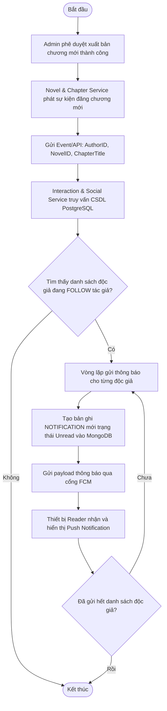
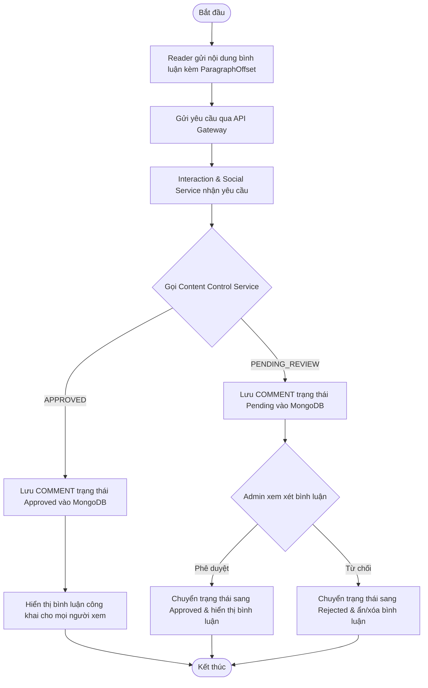
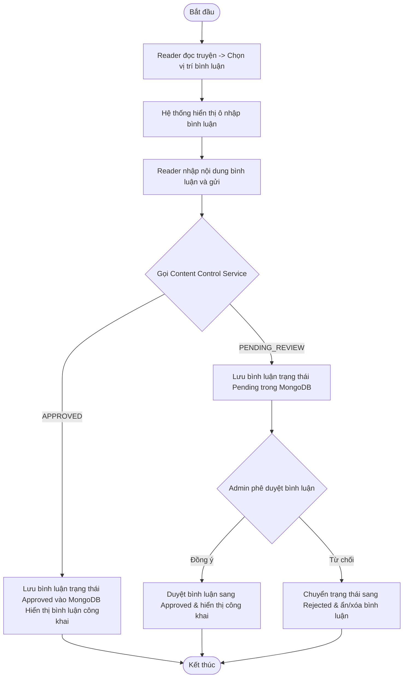
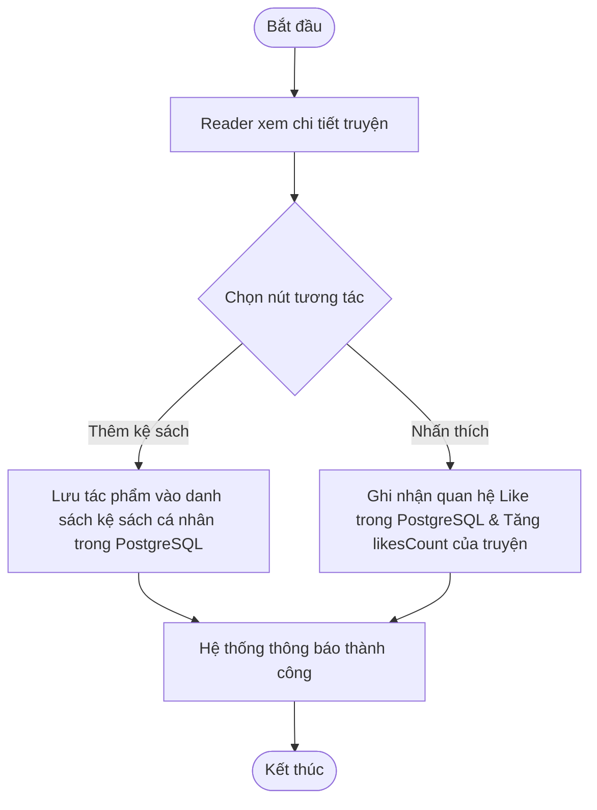
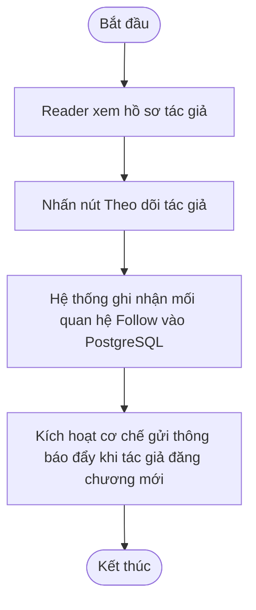
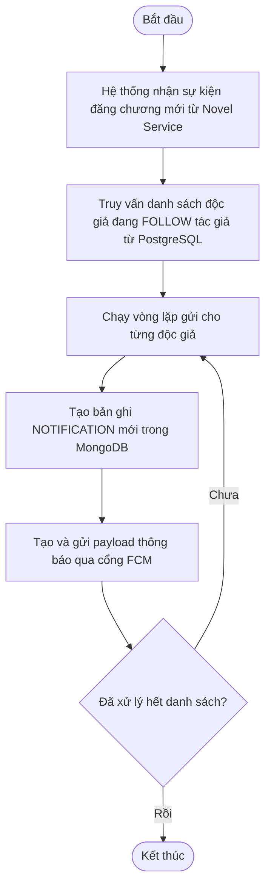

# INTERACTION & SOCIAL SERVICE - SPECIFICATION

## 1. OVERVIEW & BUSINESS RULES (Tổng quan & Quy tắc nghiệp vụ)

*   **Mission:** Xây dựng môi trường tương tác cộng đồng trong Ephurin, quản lý hệ thống bình luận (inline/chapter), lượt yêu thích (Likes), theo dõi tác giả (Follows), điều phối cơ chế thông báo (Notifications) và phối hợp với Content Control & Moderation Service khi bình luận cần kiểm tra trước khi hiển thị.
*   **Core Entities:** 
    *   **PostgreSQL (Relational Database):**
        *   `LIKE`: Bản ghi thể hiện mối liên kết yêu thích Nhiều-Nhiều giữa `USER` và tác phẩm `NOVEL`.
        *   `FOLLOW`: Lưu vết danh sách độc giả Nhiều-Nhiều theo dõi (`FOLLOW`) một tác giả cụ thể (UserID - AuthorID).
    *   **MongoDB (Document Database):**
        *   `COMMENT`: Lưu trữ bình luận, hỗ trợ định vị tọa độ đoạn văn bản đối với bình luận inline (UserID, ChapterID, ParagraphOffset, Content, Status [Approved, Pending, Rejected], Timestamp).
        *   `NOTIFICATION`: Lưu trữ thông báo hệ thống gửi tới người dùng (UserID, Content, Type, Status [Read, Unread], Timestamp).
*   **Constraints & Security:**
    *   **Referential Integrity (Tính toàn vẹn tham chiếu):** Các tương tác liên kết cứng như `LIKE` và `FOLLOW` được lưu trữ ở cơ sở dữ liệu quan hệ PostgreSQL để đảm bảo ràng buộc khóa ngoại (Foreign Keys). Nếu một User hoặc Novel bị xóa, các lượt Like/Follow liên quan sẽ tự động bị xóa (Cascade Delete).
    *   **Denormalized Likes Count:** Để tối ưu hóa hiệu năng, tổng số lượt thích (`likesCount`) của bộ truyện sẽ được lưu trữ trực tiếp dưới dạng một trường số nguyên trong bảng `NOVEL` của PostgreSQL, được cập nhật tự động khi bản ghi `LIKE` thay đổi.
    *   **Comment Storage Optimization:** Bình luận dạng phi cấu trúc và có lượng đọc/ghi cực lớn, do đó được lưu trữ tại MongoDB để tối ưu tốc độ.
    *   **Inline Comment Coordinates:** Hệ thống bắt buộc phải tính toán và lưu chính xác tọa độ vị trí đoạn văn (`ParagraphOffset`) để hiển thị bình luận đúng chỗ khi Reader cuộn qua đoạn đó.
    *   **Comment Content Control Delegation:** Interaction & Social Service không tự sở hữu logic lọc từ ngữ/report/Admin moderation. Khi Reader gửi bình luận, service này gọi `Content Control & Moderation Service` và cập nhật trạng thái COMMENT dựa trên kết quả trả về (`APPROVED`, `PENDING_REVIEW`, `REJECTED`).

---

## 2. SERVICE WORKFLOWS (Luồng hoạt động của dịch vụ)

### 2.1. Follower Notification Workflow
Quy trình gửi thông báo đẩy (Push Notification) tự động đến các độc giả theo dõi tác giả khi có chương mới xuất bản:

### 2.2. Commenting Workflow
Quy trình gửi bình luận và phối hợp với Content Control & Moderation Service:

---

## 3. DETAILED USE CASES (Đặc tả chức năng chi tiết)

### 3.1. UC: Commenting (Chapter/Paragraph)

**a. Activity diagram**

**b. Use case description**
- **Objective:** Cho phép độc giả viết bình luận tại cuối chương hoặc bình luận trực tiếp vào một dòng/đoạn văn cụ thể (Inline comment).
- **Actor:** Reader
- **Trigger:** Reader bôi đen một đoạn văn bản hoặc cuộn xuống cuối chương và chọn "Bình luận".
- **Pre-condition:** Reader đã đăng nhập tài khoản.
- **Post-condition:** Bình luận được hiển thị công khai nếu Content Control trả `APPROVED` hoặc Admin duyệt; bị ẩn/xóa nếu Admin từ chối.

| Step | Basic Flow (Content Control Approved) | Exception / Alternative Flow (Admin Review Needed) |
| :--- | :--- | :--- |
| 1 | Reader nhấn nút viết bình luận tại vị trí mong muốn. | |
| 2 | Hệ thống mở ô nhập dữ liệu. | |
| 3 | Reader nhập nội dung bình luận và gửi đi. | |
| 4 | Interaction Service gửi nội dung bình luận sang Content Control & Moderation Service. | |
| 5 | Content Control trả kết quả `APPROVED`. | **5a. Content Control trả `PENDING_REVIEW`:**   5a1. Hệ thống lưu bình luận vào MongoDB với trạng thái `Pending`.   5a2. Admin duyệt nội dung trong Content Control & Moderation Service.   - *Admin đồng ý:* Hệ thống chuyển trạng thái sang `Approved` và hiển thị công khai.   - *Admin từ chối:* Hệ thống chuyển sang `Rejected` và ẩn/xóa bình luận khỏi giao diện. |
| 6 | Hệ thống lưu bình luận vào MongoDB với trạng thái `Approved`. | |
| 7 | Hệ thống làm mới giao diện và hiển thị bình luận công khai. | |

---

### 3.2. UC: Like and Bookmark

**a. Activity diagram**

**b. Use case description**
- **Objective:** Lưu tác phẩm yêu thích vào thư viện cá nhân (Bookmark) hoặc Like truyện để tăng thứ hạng tác phẩm.
- **Actor:** Reader
- **Trigger:** Reader nhấn vào nút "Thêm vào kệ" (Bookmark) hoặc biểu tượng "Like" trên màn hình chi tiết truyện.
- **Pre-condition:** Reader đã đăng nhập.
- **Post-condition:** Tác phẩm được thêm vào Library (bảng BOOKMARK trong PostgreSQL); số lượng Likes của truyện tăng lên.

---

### 3.3. UC: Follow Author & Push Notifications

**a. Activity diagram**

**b. Use case description**
- **Objective:** Đăng ký nhận thông tin cập nhật tự động khi tác giả ra chương mới.
- **Actor:** Reader
- **Trigger:** Reader nhấn nút "Theo dõi" trên hồ sơ của tác giả.
- **Post-condition:** Hệ thống tự động ghi nhận mối liên kết Follow vào PostgreSQL và gửi thông báo khi có chương mới.

---

### 3.4. UC: Send Push Notification to Followers

**a. Activity diagram**

**b. Use case description**
- **Objective:** Tự động gửi thông báo đẩy và tạo bản ghi thông báo hệ thống cho tất cả người dùng đang theo dõi tác giả khi có chương mới.
- **Actor:** System
- **Trigger:** Novel & Chapter Service xuất bản chương truyện thành công.
- **Pre-condition:** Tác phẩm và chương đã được duyệt thành công.
- **Post-condition:** Tất cả followers nhận được thông báo đẩy trên thiết bị; danh sách thông báo hệ thống được cập nhật.

| Step | Basic Flow | Exception Flow |
| :--- | :--- | :--- |
| 1 | Hệ thống tiếp nhận thông tin sự kiện xuất bản chương mới. | |
| 2 | Truy vấn danh sách độc giả đang theo dõi tác giả trong database PostgreSQL. | 2a. Không có ai theo dõi tác giả: Kết thúc Use Case. |
| 3 | Duyệt qua danh sách độc giả, tạo bản ghi thông báo mới trong MongoDB với trạng thái chưa đọc (Unread). | |
| 4 | Gọi cổng Firebase Cloud Messaging (FCM) để gửi thông báo đẩy tới thiết bị đăng ký của người đọc. | 4a. Token thiết bị của người đọc hết hạn: Hệ thống ghi nhận thất bại nhưng vẫn giữ thông báo hệ thống trong MongoDB. |
