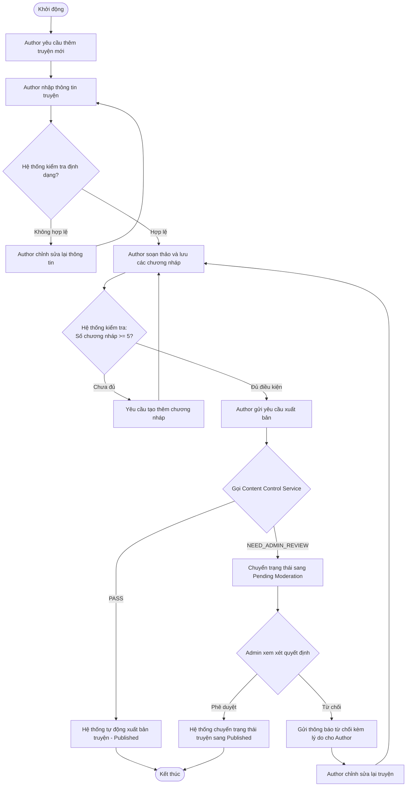
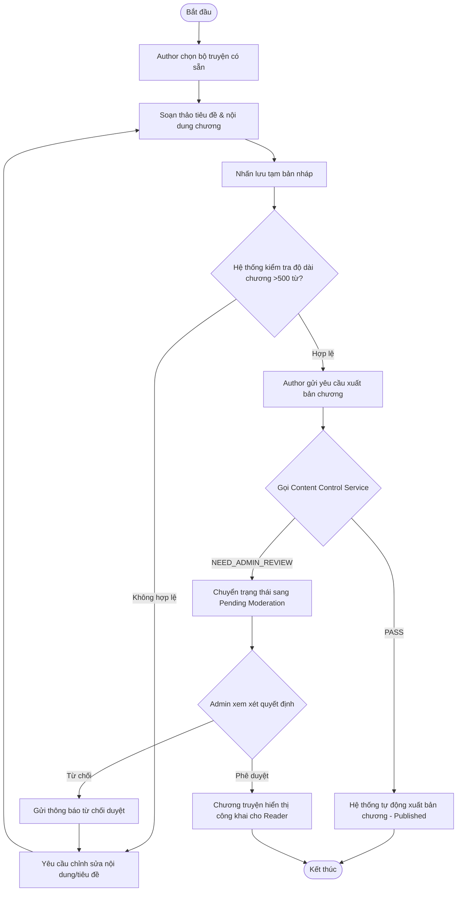
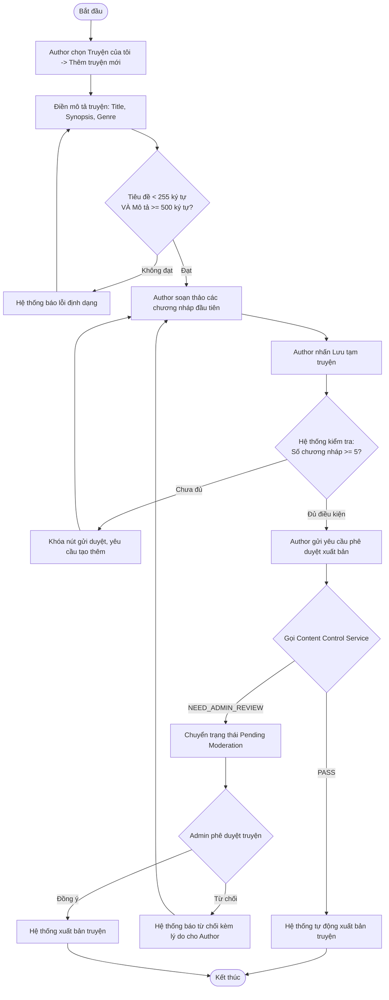
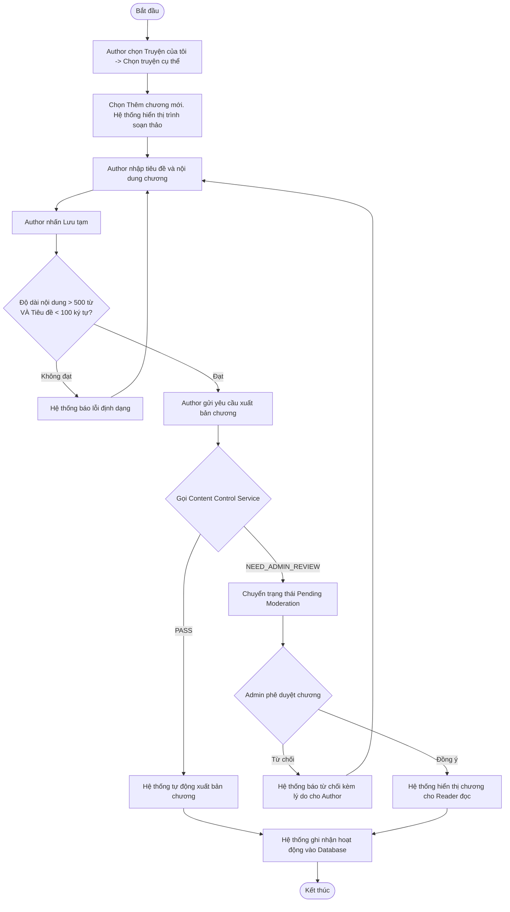
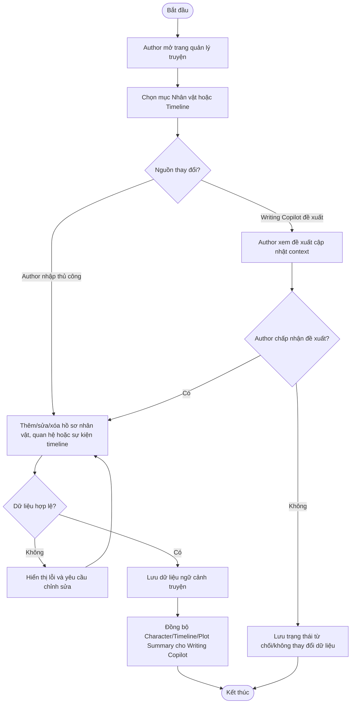

# NOVEL & CHAPTER SERVICE - SPECIFICATION

## 1. OVERVIEW & BUSINESS RULES (Tổng quan & Quy tắc nghiệp vụ)

*   **Mission:** Quản lý vòng đời sáng tác của các tác phẩm (Novels) và các chương truyện (Chapters), hỗ trợ viết nháp (Drafting), đặt lịch đăng và phối hợp với Content Control & Moderation Service khi nội dung cần kiểm tra trước khi xuất bản.
*   **Core Entities:** 
    *   `NOVEL`: Quản lý siêu dữ liệu của truyện (Title, Synopsis, CoverImage, Genre, Status, AuthorID).
    *   `CHAPTER`: Quản lý nội dung chi tiết chương truyện (Title, Content, ChapterNumber, VIPStatus, PricingCoins, NovelID).
    *   `DRAFT_CHAPTER` (MongoDB): Lưu trữ các bản nháp tự động sao lưu của tác giả.
    *   `CHARACTER_PROFILE`: Quản lý hồ sơ nhân vật, vai trò, tính cách, quan hệ và ghi chú phát triển nhân vật trong từng truyện. Dữ liệu có thể do Author nhập thủ công hoặc do Writing Copilot đề xuất và được Author xác nhận.
    *   `STORY_TIMELINE`: Quản lý các sự kiện/cột mốc theo thứ tự thời gian để hỗ trợ kiểm soát mạch truyện. Dữ liệu có thể được cập nhật thủ công hoặc từ đề xuất của Writing Copilot sau khi Author duyệt.
    *   `PLOT_SUMMARY`: Lưu tóm tắt tình tiết theo truyện/chương/hồi, đồng thời cung cấp ngữ cảnh cho Writing Copilot. Bản tóm tắt có thể do Author viết hoặc do AI đề xuất sau mỗi lần lưu/xuất bản chương.
    *   `CONTEXT_CHANGE_PROPOSAL`: Bản đề xuất thay đổi dữ liệu ngữ cảnh do Writing Copilot tạo ra, chờ Author chấp nhận/từ chối trước khi ghi vào `CHARACTER_PROFILE`, `STORY_TIMELINE` hoặc `PLOT_SUMMARY`.
*   **Constraints & Security:**
    *   **Novel Creation Constraints:** Tiêu đề truyện phải nhỏ hơn 255 ký tự; Phần mô tả tóm tắt (Synopsis) phải từ 500 ký tự trở lên.
    *   **Initial Publish Requirement:** Tác phẩm mới tạo phải chứa ít nhất 5 chương nháp hợp lệ (đáp ứng tiêu chuẩn độ dài) trước khi có thể gửi yêu cầu xuất bản (Publish Request).
    *   **Chapter Validation Constraints:** Tiêu đề chương phải dưới 100 ký tự; Nội dung chương phải đạt tối thiểu 500 ký tự.
    *   **Content Control Delegation Rule:** Novel & Chapter Service không tự sở hữu logic lọc từ ngữ/report/Admin moderation. Khi Author gửi publish, service này gọi `Content Control & Moderation Service` và cập nhật trạng thái nội dung dựa trên kết quả trả về (`PASS`, `NEED_ADMIN_REVIEW`, `APPROVED`, `REJECTED`, `REVISION_REQUIRED`).
    *   **AI-assisted Context Update Rule:** Writing Copilot có thể đề xuất thay đổi Character, Timeline hoặc Plot Summary, nhưng Novel & Chapter Service chỉ ghi nhận thay đổi khi Author xác nhận. Mỗi thay đổi được lưu kèm nguồn (`AuthorManual` hoặc `AICopilotSuggestion`) để phục vụ audit và hoàn tác.

---

## 2. SERVICE WORKFLOWS (Luồng hoạt động của dịch vụ)

### 2.1. Publish a New Novel Workflow
Quy trình kiểm duyệt và xuất bản một bộ truyện mới:

### 2.2. Publish New Chapter Workflow
Quy trình thêm và duyệt chương truyện mới trong một bộ truyện có sẵn:

---

## 3. DETAILED USE CASES (Đặc tả chức năng chi tiết)

### 3.1. UC: Publish a new novel

**a. Activity diagram**

**b. Use case description**
| Objective | Cho phép các tác giả tạo mới tác phẩm và gửi yêu cầu duyệt xuất bản |
| :--- | :--- |
| **Actor** | Author, System, Admin |
| **Trigger** | Author click nút "Thêm truyện mới" |
| **Pre-condition** | Author đã đăng nhập thành công |
| **Post-condition** | Tác phẩm được phê duyệt và hiển thị công khai trên hệ thống |

| Step | Basic Flow (Content Control Pass) | Exception / Alternative Flow (Admin Review Needed) |
| :--- | :--- | :--- |
| 1 | Author chọn "Truyện của tôi" -> "Thêm truyện mới". | |
| 2 | Author điền thông tin mô tả truyện (Title, Synopsis, Genre). | 2a. Lỗi định dạng (Tiêu đề ≥ 255 ký tự HOẶC Mô tả < 500 ký tự)   2a1. Hệ thống báo lỗi và yêu cầu chỉnh sửa lại. |
| 3 | Author soạn thảo và lưu nháp tối thiểu 5 chương đầu tiên. | |
| 4 | Author gửi yêu cầu phê duyệt xuất bản bộ truyện. | |
| 5 | Hệ thống gửi nội dung truyện/chương sang Content Control & Moderation Service. | |
| 6 | Content Control trả kết quả `PASS`. | **6a. Content Control trả `NEED_ADMIN_REVIEW`:**   6a1. Hệ thống chuyển trạng thái truyện sang "Pending Moderation".   6a2. Admin duyệt nội dung trong Content Control & Moderation Service.   - *Trường hợp Admin đồng ý:* Hệ thống chuyển trạng thái sang "Published".   - *Trường hợp Admin từ chối/yêu cầu sửa:* Hệ thống thông báo lý do. Author sửa lại truyện và gửi duyệt lại. |
| 7 | Hệ thống tự động chuyển trạng thái truyện sang "Published" và hiển thị công khai. | |

---

### 3.2. UC: Publish new chapter

**a. Activity diagram**

**b. Use case description**
| Objective | Cho phép tác giả thêm chương truyện mới vào tác phẩm hiện có |
| :--- | :--- |
| **Actor** | Author, System, Admin |
| **Trigger** | Author nhấn nút "Thêm chương mới" trong giao diện quản lý truyện |
| **Pre-condition** | Tác phẩm đã được tạo; Author đã đăng nhập |
| **Post-condition** | Chương truyện mới được duyệt và hiển thị cho người đọc |

| Step | Basic Flow (Content Control Pass) | Exception / Alternative Flow (Admin Review Needed) |
| :--- | :--- | :--- |
| 1 | Author chọn mục "Truyện của tôi" -> Chọn truyện cụ thể. | |
| 2 | Chọn "Thêm chương mới". Hệ thống hiển thị trình soạn thảo. | |
| 3 | Author nhập tiêu đề chương và viết nội dung. | |
| 4 | Author nhấn "Lưu tạm". Hệ thống kiểm tra độ dài dữ liệu (Content > 500 ký tự VÀ Title < 100 ký tự). | 4a. Lỗi định dạng độ dài   4a1. Hệ thống hiển thị thông báo lỗi và yêu cầu viết thêm/sửa tiêu đề. |
| 5 | Author gửi yêu cầu xuất bản chương truyện lên hệ thống. | |
| 6 | Hệ thống gửi nội dung chương sang Content Control & Moderation Service. | |
| 7 | Content Control trả kết quả `PASS`. | **7a. Content Control trả `NEED_ADMIN_REVIEW`:**   7a1. Hệ thống chuyển trạng thái chương truyện sang "Pending Moderation".   7a2. Admin duyệt chương trong Content Control & Moderation Service.   - *Trường hợp Admin đồng ý:* Hệ thống duyệt xuất bản chương.   - *Trường hợp Admin từ chối/yêu cầu sửa:* Hệ thống thông báo lý do. Author sửa lại chương và gửi duyệt lại. |
| 8 | Hệ thống tự động xuất bản chương và ghi nhận lịch sử vào CSDL. | |

---

### 3.3. UC: Manage Character Profiles and Story Timeline

**a. Activity diagram**

**b. Use case description**
| Attribute | Description |
| :--- | :--- |
| **Objective** | Cho phép Author quản lý nhân vật, quan hệ, timeline và tóm tắt tình tiết; đồng thời duyệt các đề xuất cập nhật ngữ cảnh do Writing Copilot tạo ra |
| **Actor** | Author, System |
| **Trigger** | Author chọn chức năng quản lý Nhân vật/Timeline hoặc mở đề xuất cập nhật ngữ cảnh từ Writing Copilot |
| **Pre-condition** | Author đã đăng nhập và sở hữu truyện cần chỉnh sửa |
| **Post-condition** | Dữ liệu Character Profile, Story Timeline hoặc Plot Summary được lưu sau khi Author xác nhận và sẵn sàng làm ngữ cảnh cho Writing Copilot |

| Step | Basic Flow | Exception Flow |
| :--- | :--- | :--- |
| 1 | Author mở trang quản lý truyện của mình. | |
| 2 | Author chọn tab Nhân vật, Timeline hoặc Tóm tắt tình tiết. | 2a. Author mở một đề xuất cập nhật context do Writing Copilot tạo ra. |
| 3 | Author thêm/sửa thủ công hoặc xem nội dung đề xuất của AI. | 3a. Author từ chối đề xuất AI: hệ thống không thay đổi dữ liệu ngữ cảnh và lưu trạng thái đề xuất là `Rejected`. |
| 4 | Author xác nhận dữ liệu cần lưu. | 4a. Dữ liệu thiếu tên nhân vật hoặc tiêu đề sự kiện: hệ thống báo lỗi bắt buộc nhập. |
| 5 | Hệ thống kiểm tra quyền sở hữu truyện và định dạng dữ liệu. | 5a. Author không sở hữu truyện: hệ thống từ chối thao tác với lỗi phân quyền. |
| 6 | Novel & Chapter Service lưu dữ liệu vào kho ngữ cảnh truyện, kèm nguồn thay đổi `AuthorManual` hoặc `AICopilotSuggestion`. | |
| 7 | Hệ thống đánh dấu dữ liệu đã sẵn sàng để Writing Copilot sử dụng trong lần gợi ý tiếp theo. | |
