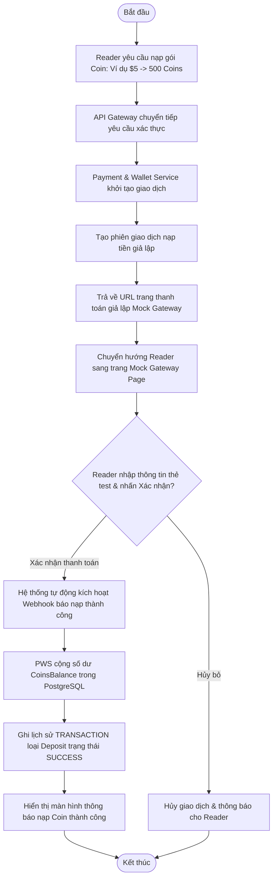
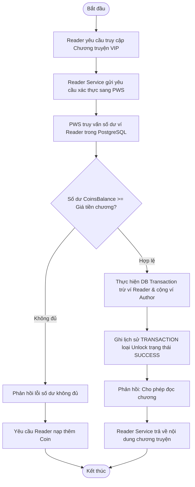
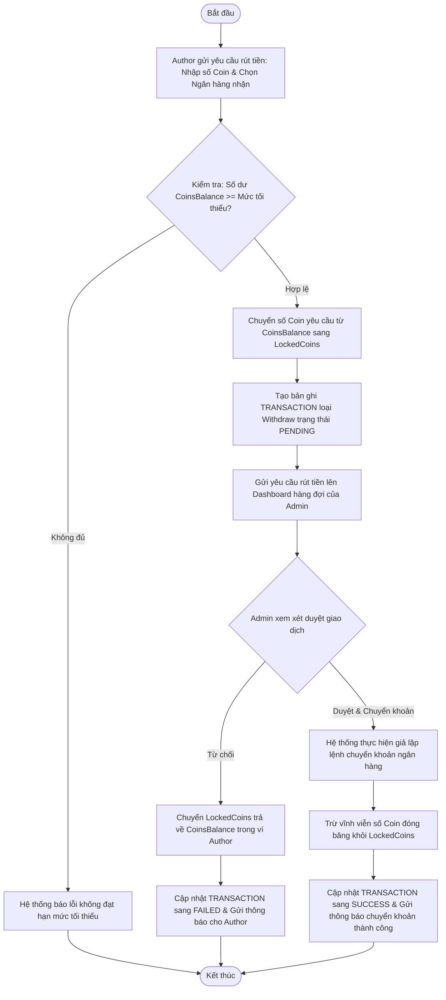
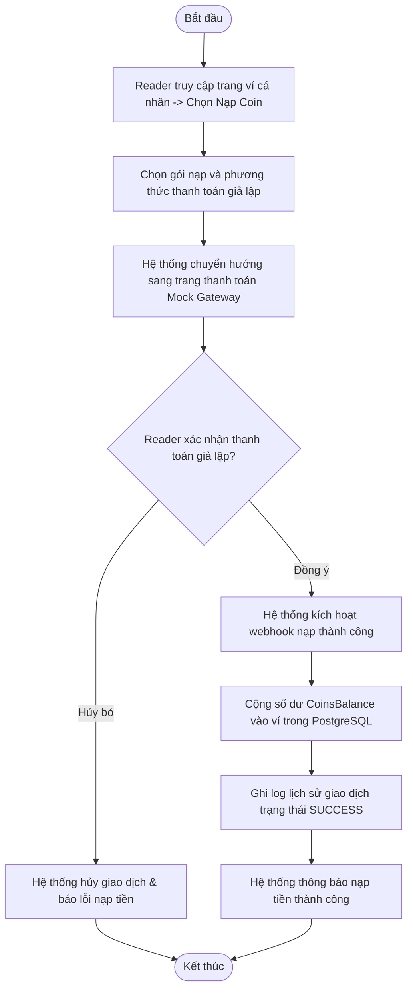
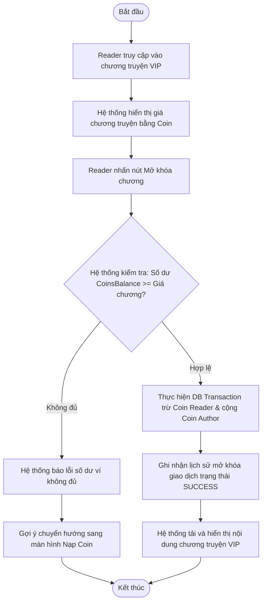
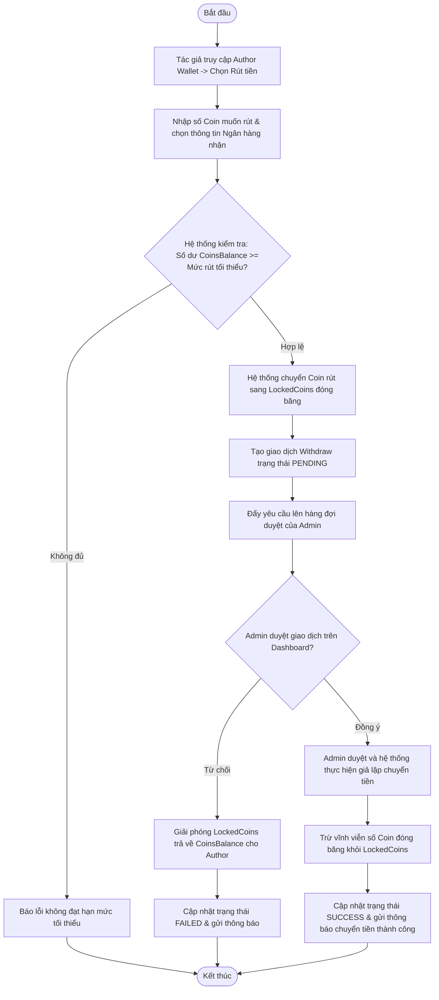
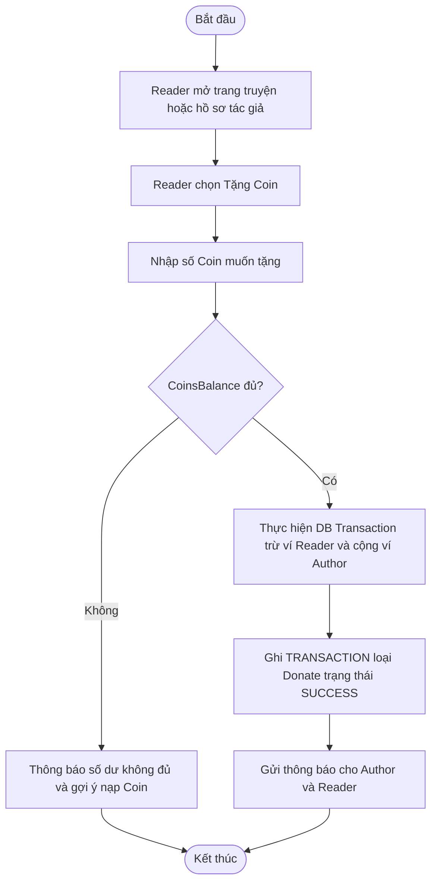

# PAYMENT & WALLET SERVICE - SPECIFICATION

## 1. OVERVIEW & BUSINESS RULES (Tổng quan & Quy tắc nghiệp vụ)

*   **Mission:** Quản lý số dư ví ảo (Coins), xử lý các giao dịch nạp tiền (Deposit) thông qua cổng thanh toán giả lập (Mock Gateway), thực hiện giao dịch mua quyền đọc chương VIP (Unlock Chapter), chuyển tặng tiền (Donation) từ độc giả tới tác giả, và quản lý yêu cầu rút doanh thu (Withdraw) giả lập phục vụ mục tiêu demo đồ án tốt nghiệp.
*   **Academic Demo Scope:** Module này không đại diện cho hệ thống thanh toán production. Tất cả giao dịch nạp/rút chỉ là mô phỏng nội bộ để phục vụ đồ án tốt nghiệp, không kết nối cổng thanh toán thật, không phát sinh nghĩa vụ tài chính thật và không xử lý dữ liệu thẻ/ngân hàng thật.
*   **Core Entities:** 
    *   **PostgreSQL (Relational Database):**
        *   `WALLET`: Quản lý số dư ví của người dùng.
            *   `UserID` (Khóa ngoại liên kết bảng USER).
            *   `CoinsBalance` (Số dư Coin hiện có dùng để tiêu dùng).
            *   `LockedCoins` (Số Coin bị đóng băng tạm thời khi thực hiện yêu cầu rút tiền).
        *   `TRANSACTION`: Sổ cái ghi chép chi tiết lịch sử giao dịch.
            *   `TransactionID` (Khóa chính).
            *   `WalletID` (Liên kết WALLET).
            *   `Type` (Thể loại: `Deposit`, `Withdraw`, `Unlock`, `Donate`).
            *   `Status` (Trạng thái giao dịch: `PENDING`, `SUCCESS`, `FAILED`).
            *   `AmountCoins` (Số lượng Coin giao dịch).
            *   `ReferenceID` (ID tham chiếu như ChapterID, AuthorID).
            *   `Timestamp` (Thời gian giao dịch).
*   **Constraints & Security:**
    *   **In-app Mock Payment System (Cơ chế ví nội bộ giả lập):** Để phục vụ mục tiêu demo và chạy thử nghiệm đồ án tốt nghiệp, hệ thống không kết nối với cổng thanh toán tiền thật. Mọi giao dịch nạp/rút sẽ được định tuyến thông qua **Cổng thanh toán giả lập nội bộ (Mock Gateway)** do hệ thống tự phát triển, đảm bảo an toàn, không phát sinh chi phí và mượt mà khi báo cáo.
    *   **Transaction Atomicity (ACID):** Mọi giao dịch chuyển Coin (Ví dụ: Unlock Chapter trừ Coin người đọc và cộng phần trăm Coin cho tác giả) phải được bọc trong một Database Transaction duy nhất. Nếu bất kỳ bước nào thất bại, toàn bộ giao dịch phải được rollback.
    *   **Locked Balance Rule (Quy tắc đóng băng số dư):** Khi tác giả gửi yêu cầu rút tiền, số Coin yêu cầu rút phải bị chuyển ngay từ `CoinsBalance` sang `LockedCoins`. Tác giả không thể tiêu dùng số Coin này trong thời gian chờ Admin phê duyệt.
    *   **Rate Limiting:** Áp dụng rate limiting nghiêm ngặt tại API Gateway đối với mọi API thanh toán để ngăn chặn tấn công spam hoặc lặp lại giao dịch (Replay attacks). *Bản demo (D4, 2026-11-09): giới hạn trong bộ nhớ một tiến trình, 30 lượt/phút/người cho API chuyển tiền và 5 lượt cho mỗi phiên nạp ở webhook giả lập. Đây không phải giới hạn phân tán, không xác thực webhook và không chống replay; chưa được mở thanh toán production hay chạy nhiều instance trước khi có gateway/Redis, xác thực callback, idempotency và kiểm thử bảo mật.*

---

## 2. SERVICE WORKFLOWS (Luồng hoạt động của dịch vụ)

### 2.1. Deposit (Nạp Coin) Workflow
Quy trình nạp Coin thông qua cổng thanh toán giả lập nội bộ (Mock Gateway):

### 2.2. Unlock Premium Chapter Workflow
Quy trình trừ Coin để mở khóa chương truyện VIP:

### 2.3. Author Withdraw (Rút doanh thu) Workflow
Quy trình tác giả rút tiền doanh thu (giả lập chuyển khoản qua Admin phê duyệt):

---

## 3. DETAILED USE CASES (Đặc tả chức năng chi tiết)

### 3.1. UC: Purchase Coins (Deposit)

**a. Activity diagram**

**b. Use case description**
| Attribute | Description |
| :--- | :--- |
| **Objective** | Độc giả thực hiện nạp tiền mặt để đổi lấy Coin ảo sử dụng trong hệ thống thông qua cổng giả lập |
| **Actor** | Reader, System |
| **Pre-condition** | Reader đã đăng nhập tài khoản |
| **Post-condition** | Số dư ví của Reader tăng lên tương ứng với gói nạp; giao dịch được lưu lại |

| Step | Basic Flow | Exception Flow |
| :--- | :--- | :--- |
| 1 | Reader truy cập trang ví cá nhân và chọn "Nạp Coin". | |
| 2 | Hệ thống hiển thị các gói nạp và phương thức thanh toán giả lập. | |
| 3 | Reader chọn một gói nạp và tiến hành thanh toán qua trang thanh toán giả lập (Mock Gateway). | |
| 4 | Reader nhập thông tin thẻ test và xác nhận thanh toán. | 4a. Reader nhấn Hủy giao dịch.   4a1. Hệ thống hủy phiên nạp và thông báo cho Reader. |
| 5 | Hệ thống tự động kích hoạt webhook giả lập, thực hiện cộng số dư Coin tương ứng và ghi nhận lịch sử giao dịch trạng thái `SUCCESS`. | |
| 6 | Hệ thống hiển thị thông báo nạp tiền thành công. | |

---

### 3.2. UC: Unlock Premium Chapter

**a. Activity diagram**

**b. Use case description**
| Attribute | Description |
| :--- | :--- |
| **Objective** | Độc giả chi trả Coin để mở khóa quyền truy cập chương truyện VIP |
| **Actor** | Reader, System |
| **Pre-condition** | Reader đã đăng nhập; chương truyện yêu cầu trả phí bằng Coin |
| **Post-condition** | Reader được cấp quyền đọc chương truyện vĩnh viễn; ví của Reader bị trừ Coin; ví của Author được cộng doanh thu |

| Step | Basic Flow | Exception Flow |
| :--- | :--- | :--- |
| 1 | Reader truy cập vào chương truyện VIP. | |
| 2 | Hệ thống hiển thị thông báo chương này yêu cầu trả phí (ví dụ: 5 Coins) để đọc. | |
| 3 | Reader nhấn "Mở khóa chương". | |
| 4 | Hệ thống kiểm tra số dư ví và thực hiện giao dịch trừ Coin người đọc, cộng Coin cho tác giả. | 4a. Số dư ví không đủ 5 Coins.   4a1. Hệ thống báo lỗi và hiển thị gợi ý chuyển hướng đến trang Nạp Coin. |
| 5 | Hệ thống ghi nhận lịch sử mở khóa thành công. | |
| 6 | Hệ thống tải và hiển thị nội dung chương truyện cho Reader đọc. | |

---

### 3.3. UC: Author Withdraw Revenue

**a. Activity diagram**

**b. Use case description**
| Attribute | Description |
| :--- | :--- |
| **Objective** | Cho phép tác giả rút số Coin tích lũy được từ doanh thu bán truyện/chương sang tiền mặt (giả lập) |
| **Actor** | Author, Admin, System |
| **Pre-condition** | Author đã đăng nhập; số dư ví đạt hạn mức rút tiền tối thiểu |
| **Post-condition** | Số Coin yêu cầu bị trừ vĩnh viễn; tác giả nhận được tiền mặt giả lập thành công |

| Step | Basic Flow (Admin Approved) | Exception Flow (Admin Rejected) |
| :--- | :--- | :--- |
| 1 | Tác giả truy cập vào trang Ví tác giả (Author Wallet) -> Chọn "Rút tiền". | |
| 2 | Tác giả nhập số lượng Coin muốn rút (ví dụ: 1000 Coins) và lựa chọn thông tin tài khoản ngân hàng nhận tiền. | 2a. Số Coin yêu cầu rút nhỏ hơn hạn mức tối thiểu (ví dụ: < 1000 Coins).   2a1. Hệ thống báo lỗi và không cho gửi yêu cầu. |
| 3 | Hệ thống kiểm tra số dư khả dụng (`CoinsBalance`). Nếu hợp lệ, hệ thống chuyển số Coin yêu cầu rút sang trạng thái đóng băng (`LockedCoins`). | |
| 4 | Hệ thống tạo bản ghi giao dịch rút tiền mới với trạng thái `PENDING` và đẩy yêu cầu lên hàng đợi duyệt của Admin. | |
| 5 | Admin kiểm duyệt yêu cầu trên Dashboard Admin và nhấn "Phê duyệt & Chuyển khoản". | **5a. Admin từ chối phê duyệt yêu cầu:**   5a1. Hệ thống giải phóng số Coin bị đóng băng trong `LockedCoins` trả về `CoinsBalance` cho tác giả.   5a2. Cập nhật giao dịch sang trạng thái `FAILED`.   5a3. Gửi thông báo từ chối kèm lý do lỗi cho tác giả. |
| 6 | Hệ thống thực hiện lệnh giả lập chuyển khoản, sau đó trừ vĩnh viễn số Coin đóng băng trong `LockedCoins`. | |
| 7 | Hệ thống cập nhật giao dịch sang trạng thái `SUCCESS` và gửi thông báo chuyển khoản thành công kèm biên lai rút tiền cho tác giả. | |

---

### 3.4. UC: Donate Coins to Author

**a. Activity diagram**

**b. Use case description**
| Attribute | Description |
| :--- | :--- |
| **Objective** | Cho phép Reader tặng Coin mock cho Author để ủng hộ tác phẩm trong phạm vi demo đồ án |
| **Actor** | Reader, Author, System |
| **Pre-condition** | Reader đã đăng nhập; Author nhận donation tồn tại; Reader có đủ Coin khả dụng |
| **Post-condition** | Ví Reader bị trừ Coin, ví Author được cộng Coin, giao dịch Donate được ghi nhận |

| Step | Basic Flow | Exception Flow |
| :--- | :--- | :--- |
| 1 | Reader mở trang truyện hoặc hồ sơ tác giả và chọn "Tặng Coin". | |
| 2 | Reader nhập số Coin muốn tặng và xác nhận. | 2a. Số Coin không hợp lệ hoặc nhỏ hơn mức tối thiểu: hệ thống báo lỗi. |
| 3 | Hệ thống kiểm tra số dư khả dụng của Reader. | 3a. Không đủ Coin: hệ thống báo lỗi và gợi ý nạp Coin. |
| 4 | Hệ thống thực hiện giao dịch nguyên tử trừ Coin Reader và cộng Coin Author. | 4a. Giao dịch thất bại: rollback toàn bộ thay đổi và ghi trạng thái `FAILED`. |
| 5 | Hệ thống ghi lịch sử giao dịch loại `Donate` trạng thái `SUCCESS`. | |
| 6 | Hệ thống gửi thông báo donation thành công cho Reader và Author. | |
