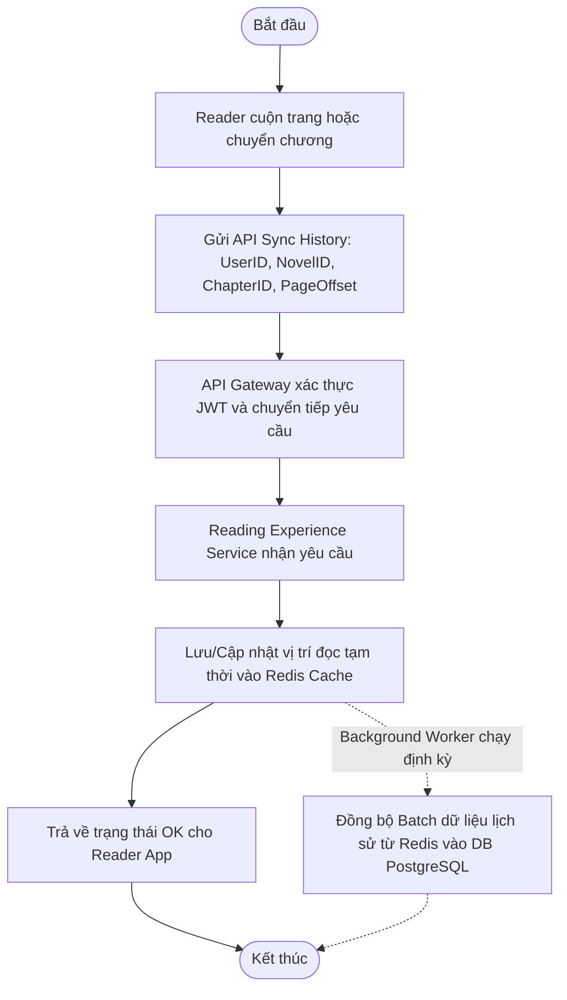
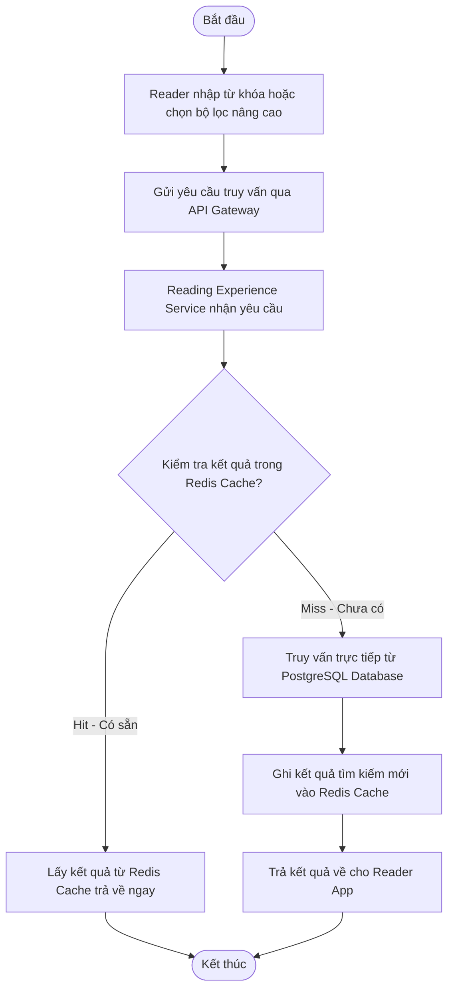
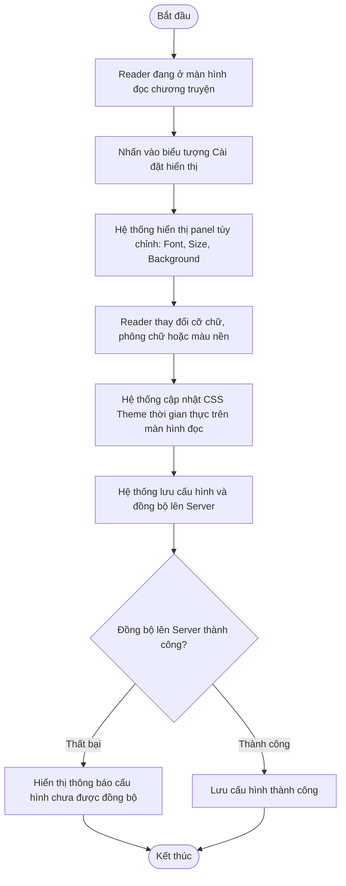
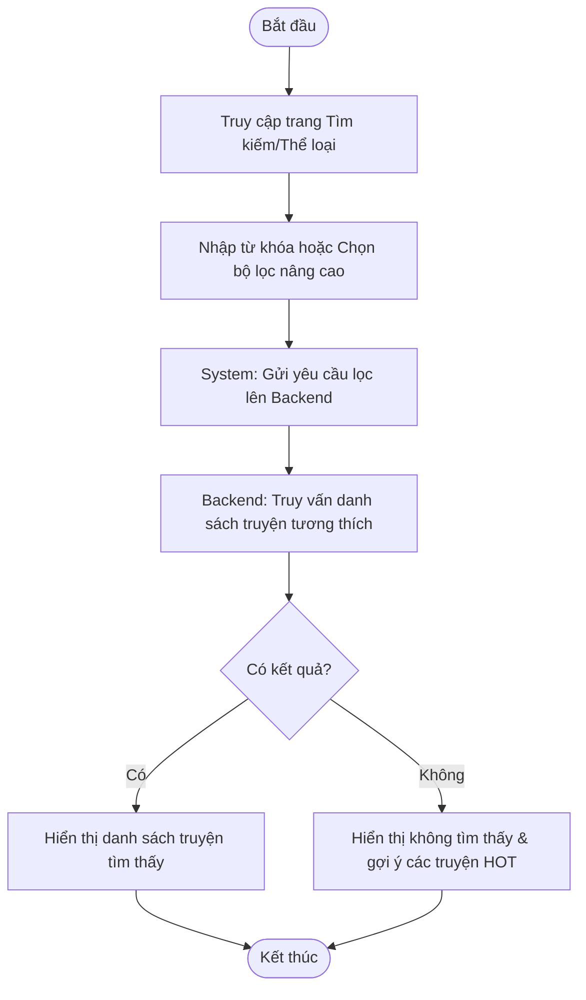
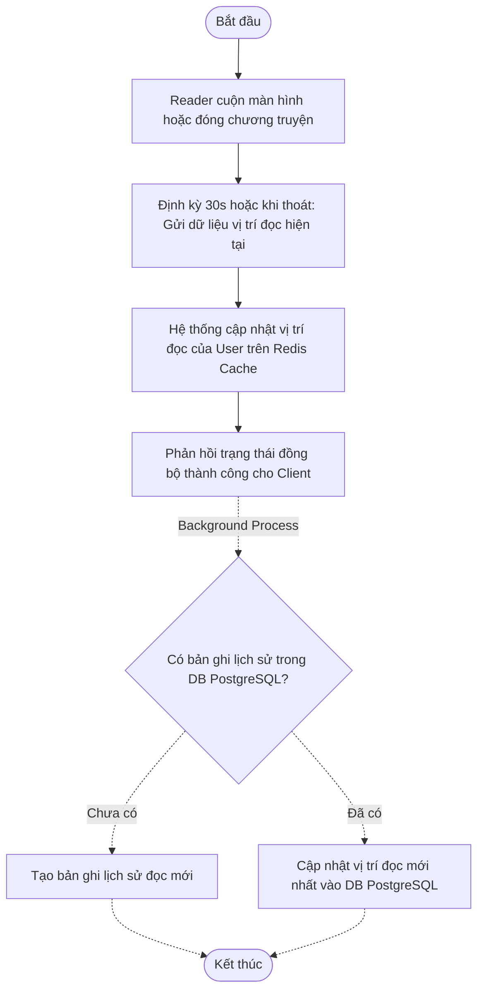

# READING EXPERIENCE SERVICE - SPECIFICATION

## 1. OVERVIEW & BUSINESS RULES (Tổng quan & Quy tắc nghiệp vụ)

*   **Mission:** Quản lý toàn bộ trải nghiệm đọc của người dùng bao gồm: tối ưu hóa hiển thị nội dung chương truyện, cung cấp công cụ cá nhân hóa giao diện đọc (phông chữ, cỡ chữ, màu nền), lưu trữ và đồng bộ hóa lịch sử đọc (Reading History) thời gian thực, và xử lý bộ lọc tìm kiếm nâng cao.
*   **Core Entities:** 
    *   **PostgreSQL (Relational Database):**
        *   `BOOKMARK` (Library): Mối liên kết Nhiều-Nhiều lưu danh sách các tác phẩm mà người đọc đã thêm vào kệ sách cá nhân.
        *   `READING_HISTORY`: Lưu vết vị trí đọc cuối cùng của người dùng (UserID, NovelID, ChapterID, ParagraphIndex, ReadTime).
    *   **Redis Cache:**
        *   `REDIS CACHE`: Lưu trữ bộ nhớ đệm lịch sử đọc gần nhất, phiên đọc hiện tại và các kết quả tìm kiếm/bảng xếp hạng phổ biến để tối ưu hiệu năng.
*   **Constraints & Security:**
    *   **Referential Integrity (Tính toàn vẹn tham chiếu):** Quan hệ kệ sách (`BOOKMARK`) được lưu trữ tại cơ sở dữ liệu quan hệ PostgreSQL để ràng buộc chặt chẽ khóa ngoại (Foreign Keys) với bảng `USER` và `NOVEL`. Nếu User hoặc Novel bị xóa, các bookmark liên quan sẽ tự động bị xóa (Cascade Delete).
    *   **Real-time Synchronization:** Lịch sử đọc của người dùng phải được tự động đồng bộ liên tục giữa các thiết bị di động (Reader App) thông qua Redis để đảm bảo trải nghiệm liền mạch.
    *   **Performance Requirement:** Tác vụ hiển thị trang đọc và trả về kết quả tìm kiếm nâng cao phải phản hồi trong thời gian dưới 2 giây.

---

## 2. SERVICE WORKFLOWS (Luồng hoạt động của dịch vụ)

### 2.1. Reading History Sync Workflow
Quy trình tự động ghi nhận và đồng bộ vị trí đọc tạm thời qua Redis trước khi đồng bộ bền vững vào Database:

### 2.2. Advanced Search & Filtering Workflow
Quy trình truy vấn tìm kiếm tác phẩm tối ưu hóa hiệu năng bằng bộ nhớ đệm:

---

## 3. DETAILED USE CASES (Đặc tả chức năng chi tiết)

### 3.1. UC: Personalize Reading Interface

**a. Activity diagram**

**b. Use case description**
- **Objective:** Độc giả có thể tùy chỉnh font chữ, cỡ chữ và màu nền (Dark/Light mode) để phù hợp với sở thích và môi trường đọc sách.
- **Actor:** Reader
- **Trigger:** Reader nhấn vào biểu tượng "Cài đặt hiển thị" (Display Settings) trên màn hình đọc.
- **Pre-condition:** Đang trong màn hình đọc nội dung chương truyện.
- **Post-condition:** Các thiết lập mới được áp dụng ngay lập tức và lưu lại cho các phiên đọc tiếp theo.

| Step | Basic Flow | Exception Flow |
| :--- | :--- | :--- |
| 1 | Hệ thống hiển thị bảng cài đặt (Font, Size, Background). | |
| 2 | Reader điều chỉnh cỡ chữ bằng thanh trượt hoặc chọn màu nền. | |
| 3 | Hệ thống cập nhật theme CSS trong thời gian thực trên màn hình đọc. | |
| 4 | Hệ thống lưu cấu hình tùy chọn vào bộ nhớ thiết bị và đồng bộ lên server. | 4a. Lỗi lưu trữ: Hệ thống báo lỗi và thông báo cấu hình tạm thời chưa được đồng bộ. |

---

### 3.2. UC: Advanced Search & Filtering

**a. Activity diagram**

**b. Use case description**
- **Objective:** Cho phép tìm kiếm tác phẩm theo từ khóa, thể loại, trạng thái hoàn thành và kết hợp các bộ lọc nâng cao.
- **Actor:** Reader, Guest
- **Trigger:** Truy cập thanh tìm kiếm hoặc trang danh mục truyện.
- **Post-condition:** Hiển thị danh sách truyện khớp với tiêu chí tìm kiếm, sắp xếp theo độ liên quan, lượt xem hoặc điểm đánh giá.

| Step | Basic Flow | Alternative Flow |
| :--- | :--- | :--- |
| 1 | Người dùng nhập từ khóa và chọn tiêu chí lọc (Thể loại, Trạng thái). | |
| 2 | Hệ thống gửi yêu cầu lọc thông tin lên backend. | Nếu không nhập từ khóa, hệ thống lọc hoàn toàn theo các tiêu chí đã chọn. |
| 3 | Backend truy vấn và trả về danh sách kết quả. | Nếu không tìm thấy: Hệ thống hiển thị thông báo trống và gợi ý các tác phẩm thịnh hành. |
| 4 | Hệ thống hiển thị kết quả lên giao diện Grid hoặc List. | |

---

### 3.3. UC: Sync Reading History

**a. Activity diagram**

**b. Use case description**
- **Objective:** Tự động ghi lại chương truyện và vị trí đọc cuối cùng của người dùng để họ có thể tiếp tục đọc trên bất kỳ thiết bị nào khác.
- **Actor:** Reader, System
- **Trigger:** Reader cuộn màn hình đọc truyện, chuyển chương hoặc thoát ứng dụng.
- **Pre-condition:** Reader đã đăng nhập.
- **Post-condition:** Vị trí đọc mới nhất được lưu lại thành công trên cả Redis và PostgreSQL Database.

| Step | Basic Flow | Exception Flow |
| :--- | :--- | :--- |
| 1 | Khi Reader đang đọc, hệ thống định kỳ (30s) hoặc khi đóng chương truyện sẽ tự động kích hoạt gửi tọa độ đọc (NovelID, ChapterID, ParagraphOffset). | |
| 2 | Hệ thống cập nhật nhanh vị trí đọc của người dùng vào Redis Cache. | |
| 3 | Hệ thống trả về trạng thái đồng bộ OK cho client. | |
| 4 | Background worker định kỳ quét và đồng bộ bền vững dữ liệu từ Redis vào PostgreSQL DB. | 4a. DB gặp sự cố: Dữ liệu vẫn được giữ ở Redis Cache để thử lại ở chu kỳ tiếp theo. |
