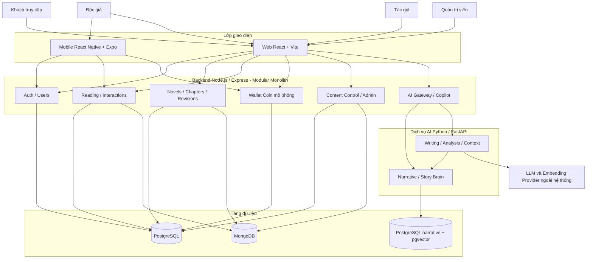
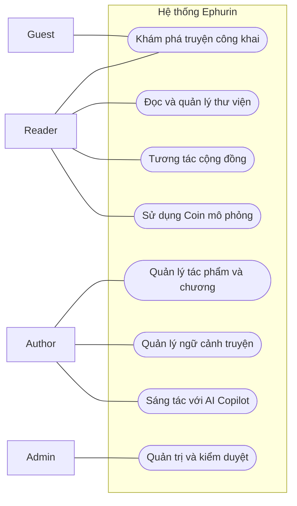

# Chương 3 – Kiến trúc và Use Case

> Nguồn kiểm chứng: mã nguồn `main`. Xem sơ đồ chi tiết từng nhóm để tránh lỗi hiển thị khi tải quá nhiều sơ đồ trên cùng một trang.

## 3.1.2. Sơ đồ kiến trúc tổng thể

*Hình 3.1. Kiến trúc tổng thể của nền tảng Ephurin (tổng hợp từ [M1], [M2], [M3]).*

### 3.2.2. Sơ đồ tổng quát

*Hình 3.2. Biểu đồ Use Case tổng quát Ephurin.*

Sơ đồ này định vị các nhóm chức năng, không cố chứa toàn bộ thao tác. Đăng nhập được mô tả là điều kiện tiên quyết của các ca sử dụng yêu cầu xác thực, không phải một mục tiêu mở rộng của mọi thao tác.

[Use Case độc giả](01a-usecase-doc-gia.md) · [Use Case tác giả](01b-usecase-tac-gia.md) · [Use Case AI](01c-usecase-ai.md) · [Use Case quản trị](01d-usecase-quan-tri.md)
