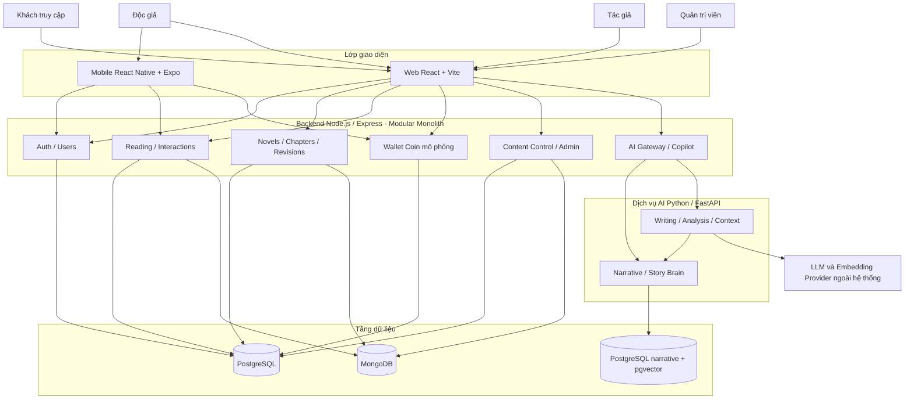
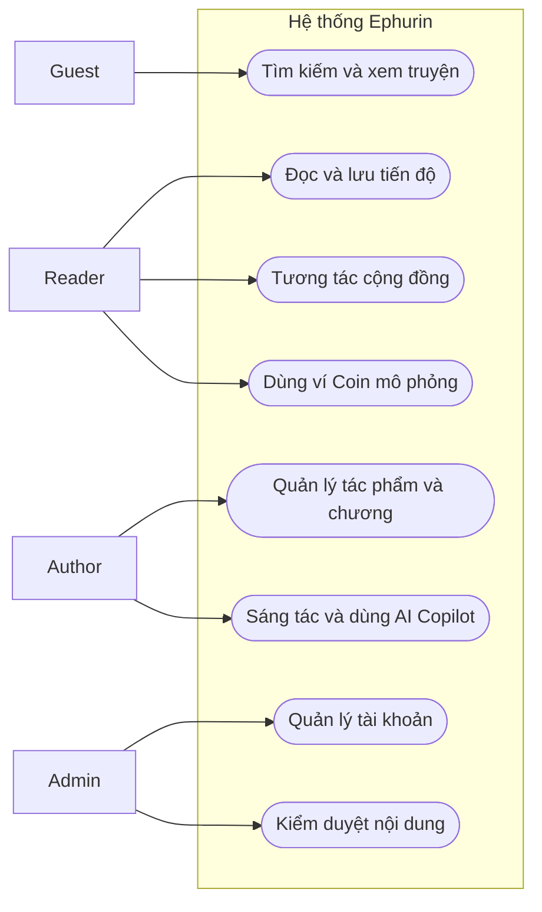
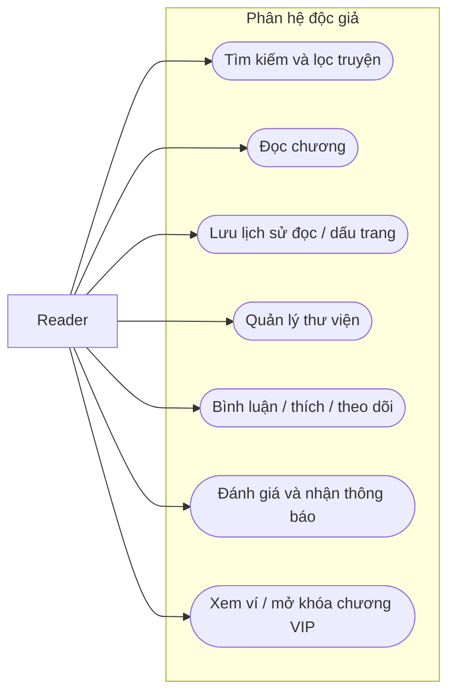
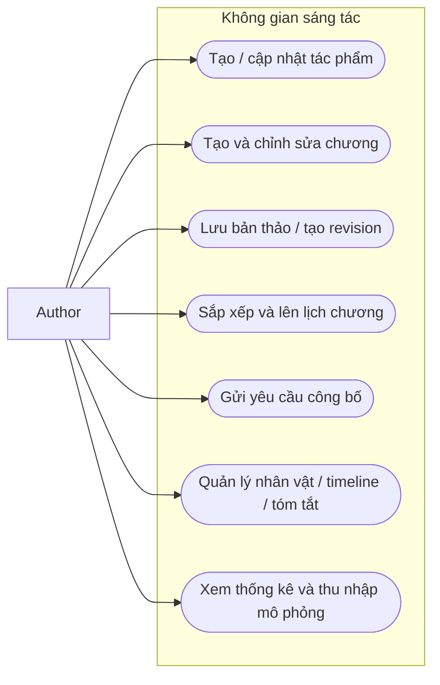
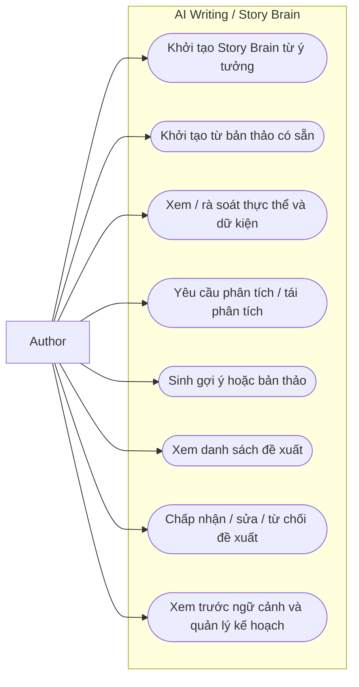
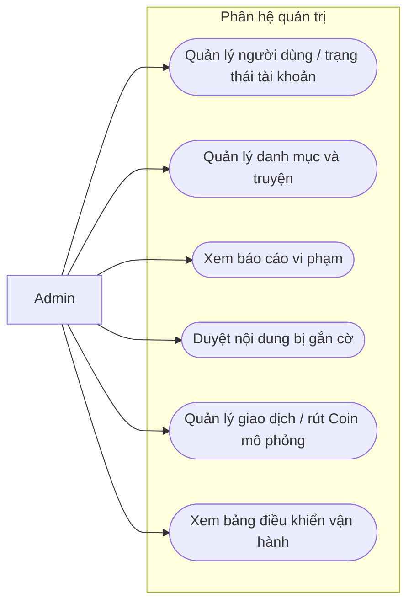

# Chương 3 – Kiến trúc và Use Case

> **Ghi chú kiểm tra:** Các sơ đồ được tách từ [Chương 3](../BAO_CAO_CHUONG_3.md) để xem Mermaid theo nhóm, giảm tải cho trình xem GitHub. Nguồn đối chiếu nghiệp vụ là mã nguồn nhánh `main`; vị trí lưu này chỉ là nhánh tài liệu.

## 3.1.2. Sơ đồ kiến trúc tổng thể

*Hình 3.1. Kiến trúc tổng thể của nền tảng Ephurin (tổng hợp từ [M1], [M2], [M3]).*

## 3.2.2. Biểu đồ Use Case tổng quát

*Hình 3.2. Biểu đồ ca sử dụng tổng quát.*

## 3.2.3. Use Case của độc giả

*Hình 3.3. Ca sử dụng của độc giả.*

## 3.2.4. Use Case của tác giả

*Hình 3.4. Ca sử dụng của tác giả.*

## 3.2.5. Use Case hỗ trợ sáng tác bằng AI

*Hình 3.5. Ca sử dụng của tác giả đối với phân hệ AI.*

## 3.2.6. Use Case của quản trị viên

*Hình 3.6. Ca sử dụng của quản trị viên.*

