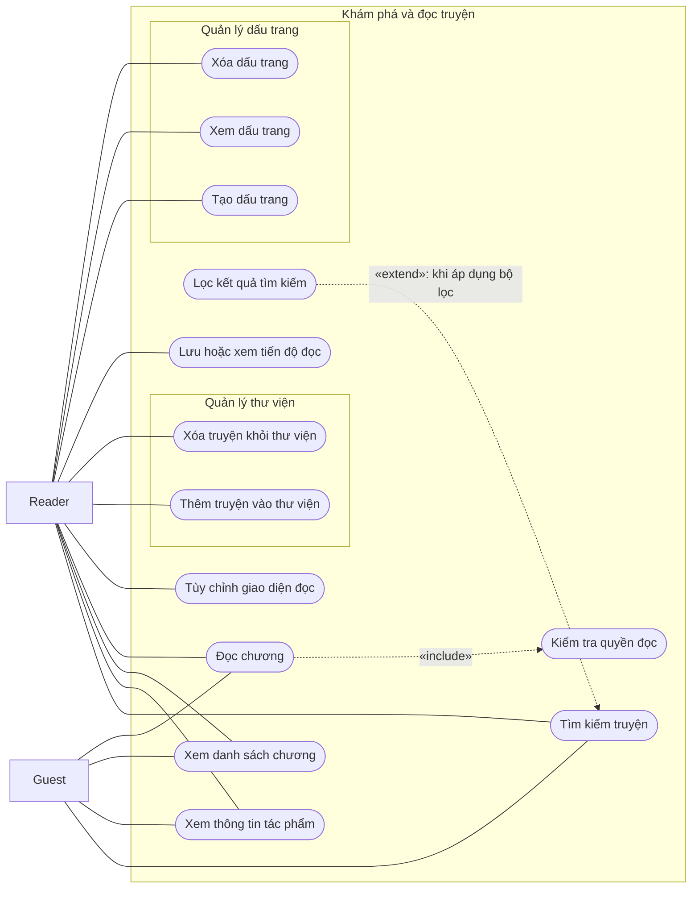
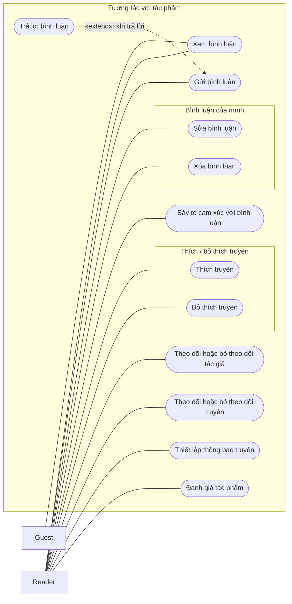
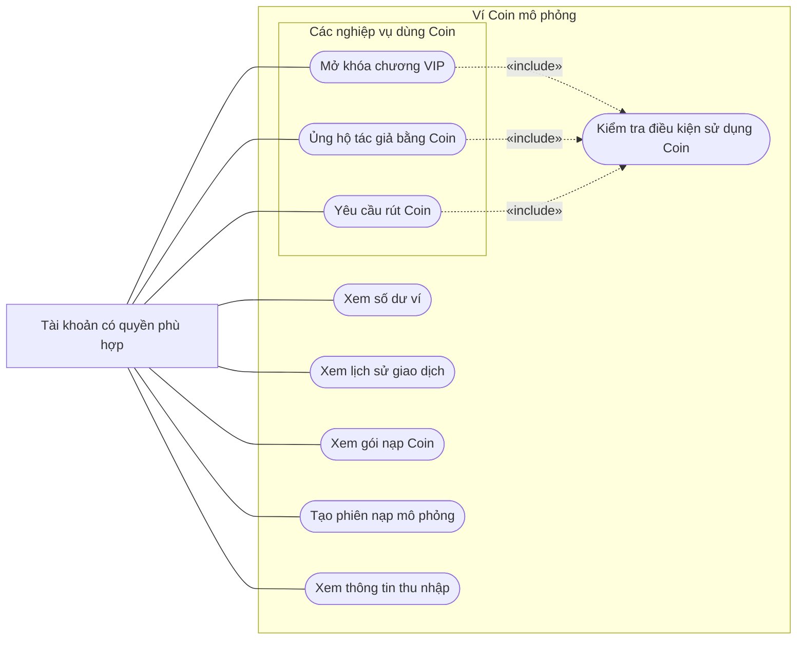

# Chương 3 – Use Case độc giả

> Trích từ [Chương 3](../BAO_CAO_CHUONG_3.md); nguồn đối chiếu: `main`. Chỉ dùng mũi tên «include» và «extend». Đường liền là liên kết tác nhân; khung là nhóm chức năng.

### 3.2.3. Use Case của độc giả

#### a) Khám phá, đọc và quản lý dữ liệu đọc

*Hình 3.3. Use Case tìm kiếm, đọc và quản lý thư viện/dấu trang.*

**«include»:** Khi đọc chương, backend phải kiểm tra quyền truy cập. **«extend»:** Việc lọc kết quả chỉ phát sinh khi người dùng áp dụng bộ lọc lúc tìm kiếm. Quản lý thư viện và dấu trang được chia thành các nhóm thao tác nhưng không có mũi tên giữa tạo/xem/xóa vì chúng không phải bước bắt buộc của nhau. Nguồn: `reading.routes.ts`, `reading.service.ts`.

#### b) Bình luận và tương tác cộng đồng

*Hình 3.4. Use Case bình luận, cảm xúc, theo dõi và đánh giá.*

**«extend»:** Trả lời bình luận là tình huống tùy chọn khi người dùng muốn phản hồi một bình luận có sẵn. Các thao tác sửa/xóa bình luận, thích/bỏ thích, theo dõi tác giả/truyện, đánh giá và cài đặt thông báo là các chức năng riêng; không giả định quan hệ «include» khi backend không yêu cầu thao tác này phải thực hiện thao tác kia. Nguồn: `comments.routes.ts`, `social.routes.ts`, `novel-engagement.service.ts`.

#### c) Ví Coin và quyền truy cập VIP

*Hình 3.5. Use Case ví Coin mô phỏng với các biến thể sử dụng số dư.*

**«include»:** Mở khóa, ủng hộ và gửi yêu cầu rút Coin đều phải kiểm tra điều kiện xử lý tương ứng. Với chương đã mở khóa, dịch vụ có thể trả quyền hiện có mà không tạo thêm giao dịch. Xem lịch sử giao dịch hoặc tạo phiên nạp không phải hành vi bắt buộc của mở khóa. Coin ở đây là mô phỏng. Nguồn: `wallet.service.ts`, `wallet.repository.ts`.

