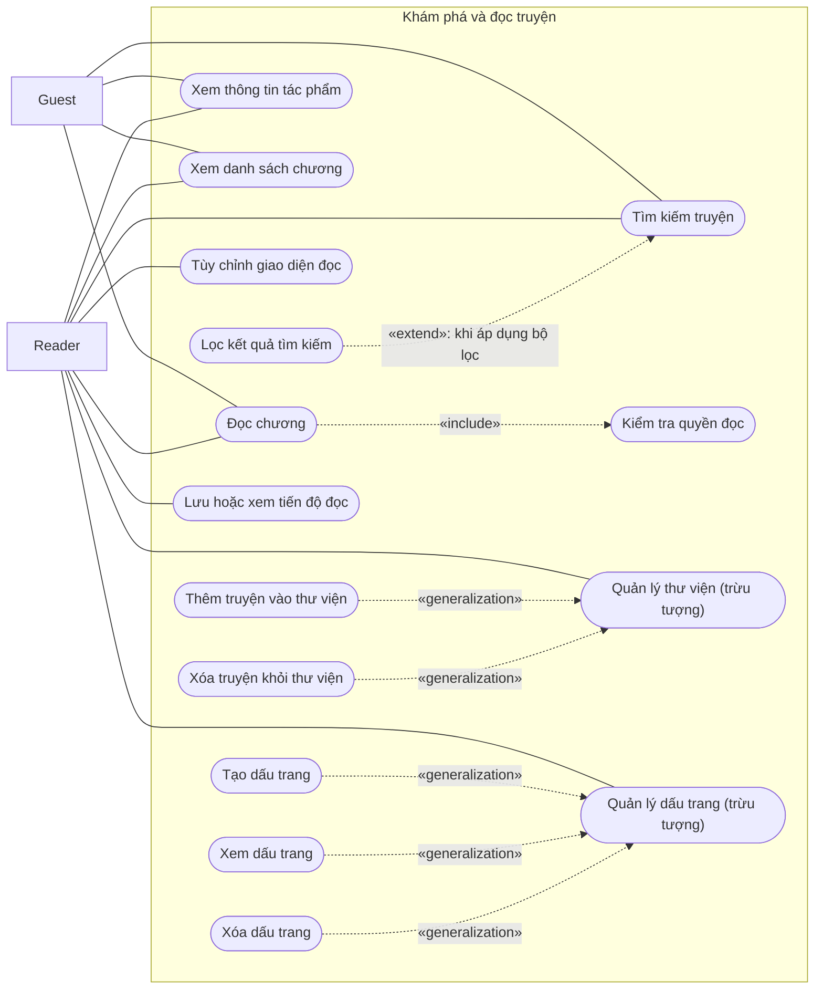
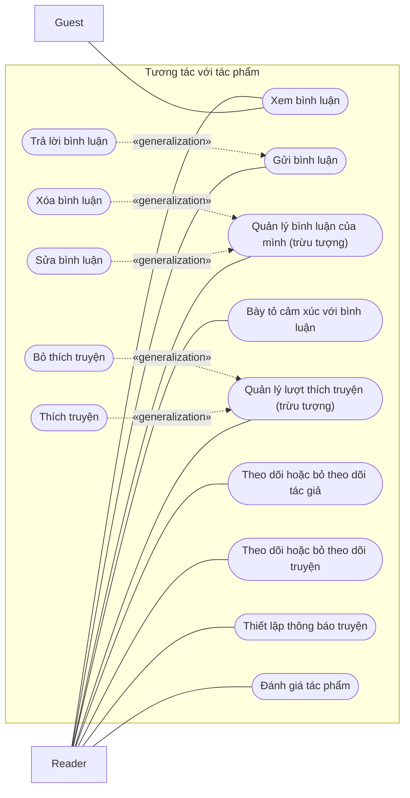
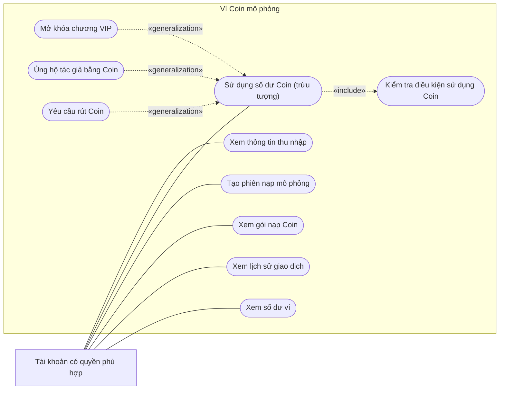

# Chương 3 – Use Case Độc giả

> Tách từ [bản báo cáo Chương 3](../BAO_CAO_CHUONG_3.md). Các quan hệ được xác định theo mã nguồn nhánh `main`; sơ đồ Mermaid là biểu diễn gần đúng ký pháp UML.

#### a) Khám phá, đọc và quản lý dữ liệu đọc

*Hình 3.3. Use Case tìm kiếm, đọc và quản lý thư viện/dấu trang.*

**Phân cấp:** Quản lý thư viện và Quản lý dấu trang là các ca sử dụng trừu tượng gom những biến thể trên cùng một tài nguyên; các thao tác thêm/xóa hoặc tạo/xem/xóa là chuyên biệt hóa. **Quan hệ bắt buộc:** Đọc chương luôn kiểm tra quyền truy cập theo trạng thái chương và quyền của người đọc. **Mở rộng:** Lọc chỉ phát sinh khi người dùng chọn bộ lọc trong quá trình tìm kiếm. Việc xem chi tiết truyện trước khi đọc chỉ là luồng điều hướng thông thường, không mặc nhiên là «include». Mã nguồn: `reading.routes.ts`, `reading.service.ts`.

#### b) Bình luận và tương tác cộng đồng

*Hình 3.4. Use Case bình luận, cảm xúc, theo dõi và đánh giá.*

**Phân cấp:** Trả lời là biến thể của gửi bình luận; sửa và xóa là những biến thể của mục tiêu trừu tượng quản lý bình luận của mình. Thích và bỏ thích là những biến thể cập nhật cùng một quan hệ. **Không gán sai phụ thuộc:** Theo dõi truyện và bật thông báo là hai API riêng; mã nguồn không bắt buộc người dùng phải tạo bản ghi follow trước khi thiết lập thông báo, vì vậy không dùng «include» giữa chúng. Xem bình luận cũng không bắt buộc phải phát sinh trước mọi thao tác gửi bình luận ở cấp service. Căn cứ: `comments.routes.ts`, `social.routes.ts`, `novel-engagement.service.ts`.

#### c) Ví Coin và quyền truy cập VIP

*Hình 3.5. Use Case ví Coin mô phỏng với các biến thể sử dụng số dư.*

**Phân cấp:** Mở khóa, ủng hộ và gửi yêu cầu rút là các nghiệp vụ sử dụng số dư theo những cách khác nhau; đều có bước kiểm tra điều kiện xử lý tương ứng (quyền đã mở khóa, ví và số dư); riêng trường hợp chương đã mở khóa từ trước có thể trả kết quả mà không phát sinh giao dịch trừ Coin mới. Hình dùng lớp trừu tượng Sử dụng số dư Coin để diễn tả điểm chung, không khẳng định tồn tại một endpoint có tên như vậy. **Không gán «include»:** Tạo phiên nạp và xem lịch sử giao dịch không phải bước bắt buộc của việc mở khóa; thiếu Coin là trường hợp ngoại lệ hoặc một lần giao dịch khác. Giao dịch nạp thực tế không được mô tả vì đây là Coin mô phỏng. Căn cứ: `wallet.service.ts`, `wallet.repository.ts`.

