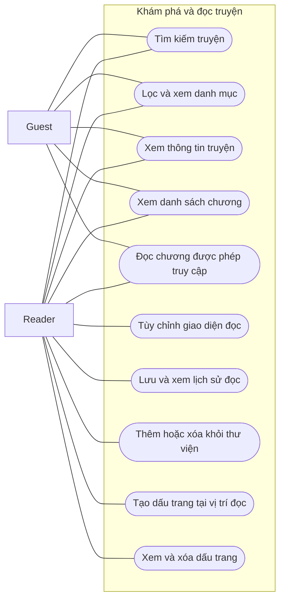
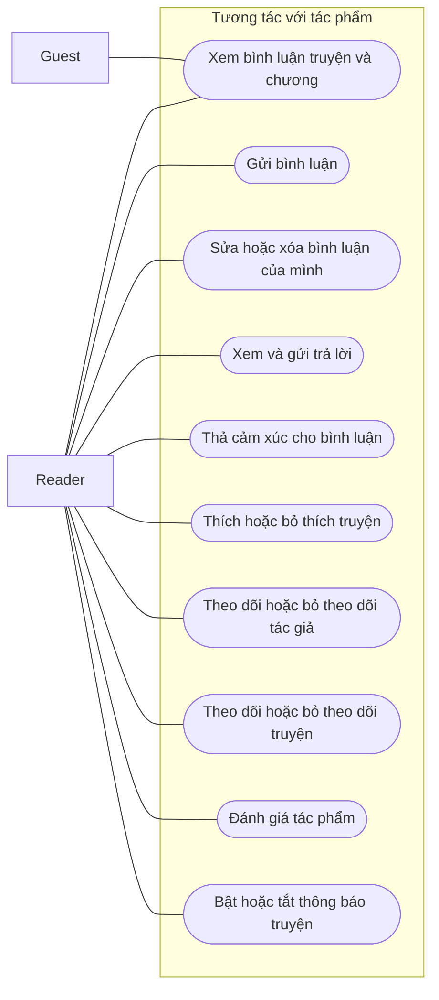
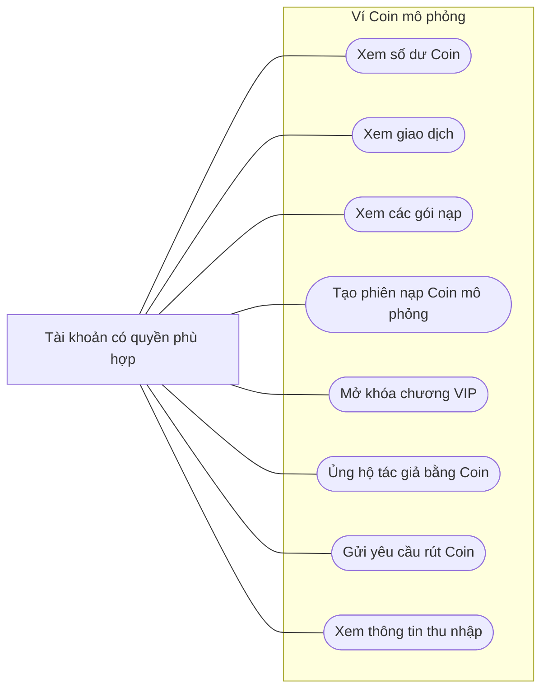

# Chương 3 – Use Case độc giả

> Tách từ [báo cáo Chương 3](../BAO_CAO_CHUONG_3.md). Các sơ đồ bám theo mã nguồn nhánh `main`.

#### a) Khám phá, đọc và lưu tiến độ

*Hình 3.3. Use Case khám phá, đọc và lưu tiến độ.*

Các thao tác được đối chiếu với reading.routes.ts trên nhánh main. Độc giả đã đăng nhập có thể lưu tiến độ, thư viện và dấu trang, trong khi khách truy cập chỉ dùng các chức năng công khai theo quyền đọc. Lưu lịch sử đọc không phải một Use Case bắt buộc xảy ra mỗi khi mở chương.

#### b) Bình luận và tương tác cộng đồng

*Hình 3.4. Use Case tương tác cộng đồng.*

Các chức năng được đối chiếu với comments.routes.ts, social.routes.ts và novel-engagement.routes.ts. Theo dõi tác giả và theo dõi tác phẩm là hai mục tiêu riêng, tương ứng với hai loại đối tượng. Sửa và xóa bình luận phụ thuộc quyền sở hữu và chính sách hệ thống.

#### c) Ví Coin và quyền truy cập VIP

*Hình 3.5. Use Case ví Coin mô phỏng và mở khóa chương.*

Hình mô tả các thao tác có endpoint trong wallet.routes.ts, không khẳng định tất cả vai trò được phép sử dụng mọi thao tác. Webhook báo nạp thành công là cơ chế tích hợp mô phỏng, không phải Use Case do độc giả trực tiếp kích hoạt. Không xem Coin như giải pháp thanh toán thương mại thực.

