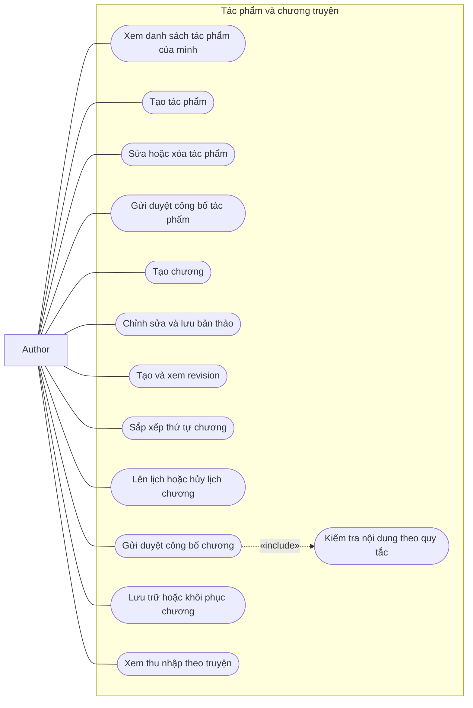
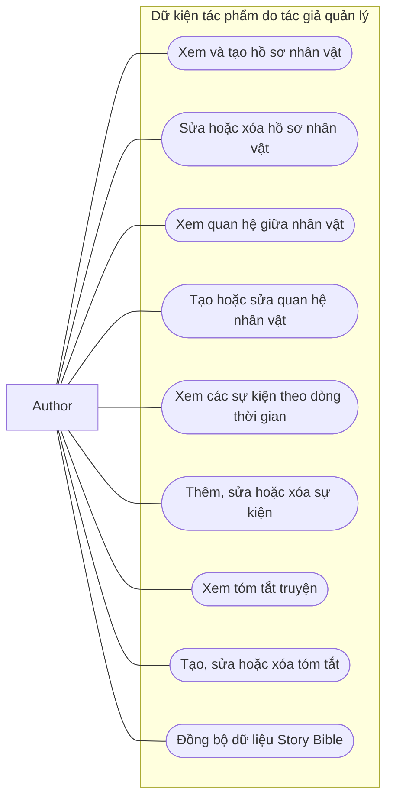

# Chương 3 – Use Case tác giả

> Tách từ [báo cáo Chương 3](../BAO_CAO_CHUONG_3.md). Các sơ đồ bám theo mã nguồn nhánh `main`.

#### a) Quản lý tác phẩm, chương và vòng đời công bố

*Hình 3.6. Use Case quản lý truyện và chương của tác giả.*

Căn cứ chính là novels.routes.ts, chapters.routes.ts và chapters.service.ts. Phần Kiểm tra nội dung theo quy tắc được biểu diễn bằng quan hệ «include» từ Gửi duyệt công bố chương, vì đây là bước xử lý bắt buộc trong luồng submitChapterPublish. Quyền sở hữu và trạng thái bản thảo là điều kiện trước, không phải Use Case mở rộng Đăng nhập.

#### b) Quản lý ngữ cảnh truyện thủ công

*Hình 3.7. Use Case tác giả quản lý hồ sơ nhân vật và dòng thời gian.*

Các chức năng được đối chiếu với story-context.routes.ts. Đây là phân hệ quản lý thông tin do tác giả nhập trực tiếp và có thể vận hành độc lập với mô hình LLM. Tách phân hệ này khỏi AI là cần thiết để làm rõ trách nhiệm và nguồn dữ liệu chính thức của tác phẩm.

