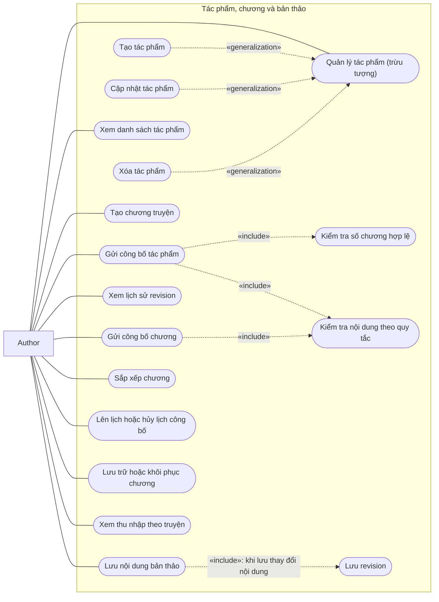
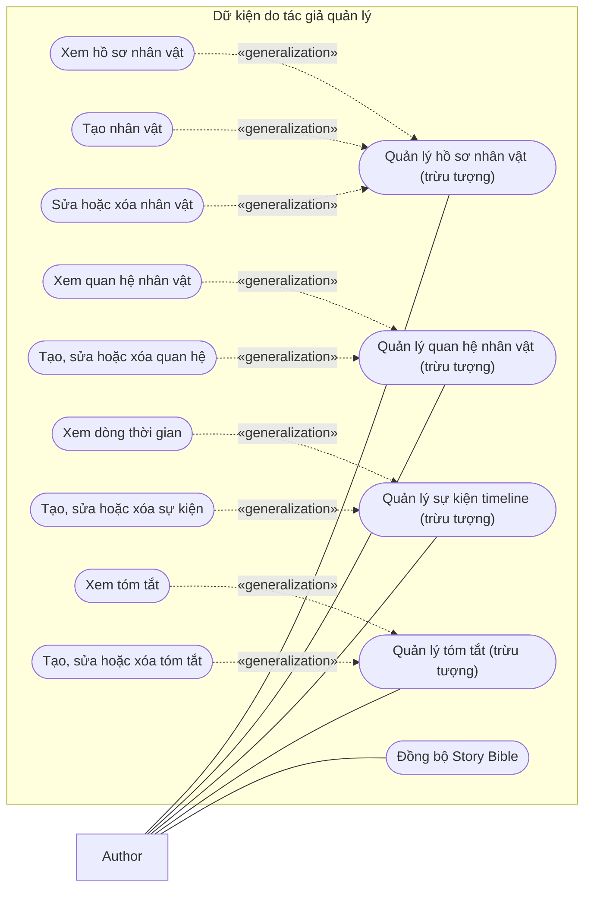

# Chương 3 – Use Case Tác giả

> Tách từ [bản báo cáo Chương 3](../BAO_CAO_CHUONG_3.md). Các quan hệ được xác định theo mã nguồn nhánh `main`; sơ đồ Mermaid là biểu diễn gần đúng ký pháp UML.

#### a) Quản lý tác phẩm, chương và vòng đời công bố

*Hình 3.6. Use Case tác giả với phân cấp tác phẩm và các bước công bố bắt buộc.*

**Phân cấp:** Tạo, sửa và xóa tác phẩm là các biến thể của nhóm quản lý tác phẩm. **«include» được kiểm chứng:** Gửi công bố *tác phẩm* bắt buộc kiểm tra số chương hợp lệ và kiểm tra nội dung; gửi công bố *chương* bắt buộc kiểm tra nội dung theo quy tắc. Trong `chapters.service.ts`, lưu thay đổi nội dung gọi chức năng snapshot revision; quan hệ từ Lưu nội dung bản thảo tới Lưu revision áp dụng cho **lưu thay đổi nội dung** (không áp dụng cho chỉ thay đổi giá/metadata). **Điều kiện tiên quyết, không phải «include»:** Tạo chương cần truyện đã tồn tại; gửi công bố truyện cần tối thiểu hai chương hợp lệ. Lên lịch chương là thao tác riêng, không phải bước luôn xảy ra khi xuất bản.

#### b) Quản lý ngữ cảnh tác phẩm thủ công

*Hình 3.7. Use Case quản lý ngữ cảnh thủ công với các ca sử dụng trừu tượng.*

**Phân cấp rõ ràng:** Bốn nhánh độc lập quản lý nhân vật, quan hệ, timeline và tóm tắt; mỗi nhánh có các thao tác chuyên biệt. Các nhánh cùng liên quan đến một truyện nhưng **không** phải bước bắt buộc của nhau. Chẳng hạn, tạo hồ sơ nhân vật không tự động bao gồm tạo sự kiện timeline. Đồng bộ Story Bible là thao tác riêng, không giả định mọi thay đổi hồ sơ tự động gọi đồng bộ. Nguồn: `story-context.routes.ts`.

