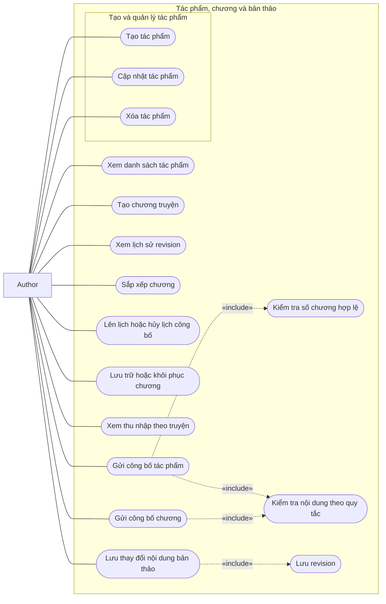
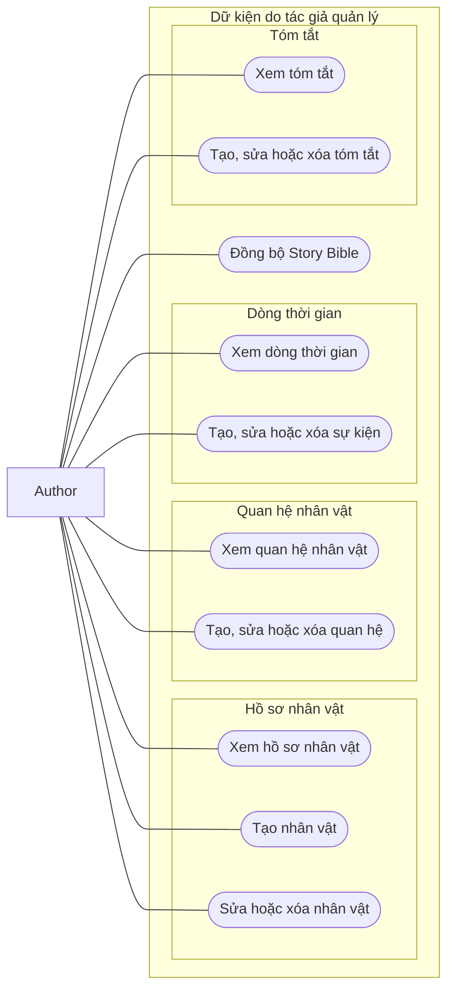

# Chương 3 – Use Case tác giả

> Trích từ [Chương 3](../BAO_CAO_CHUONG_3.md); nguồn đối chiếu: `main`. Chỉ dùng mũi tên «include» và «extend». Đường liền là liên kết tác nhân; khung là nhóm chức năng.

### 3.2.4. Use Case của tác giả

#### a) Quản lý tác phẩm, chương và vòng đời công bố

*Hình 3.6. Use Case quản lý tác phẩm và kiểm tra công bố.*

**«include»:** Gửi công bố tác phẩm phải kiểm tra số chương hợp lệ và nội dung; gửi công bố chương phải kiểm tra nội dung. Lưu thay đổi **nội dung** bản thảo gọi bước lưu revision, không đồng nhất với sửa riêng thông tin giá. **Điều kiện trước:** Tạo chương cần có tác phẩm đã tồn tại, không dùng «include» đến Tạo tác phẩm. Nguồn: `novels.service.ts`, `chapters.service.ts`.

#### b) Quản lý ngữ cảnh tác phẩm thủ công

*Hình 3.7. Use Case quản lý dữ kiện và ngữ cảnh truyện.*

Quản lý nhân vật, quan hệ, timeline và tóm tắt được chia thành những nhóm thao tác để người đọc nhận diện phạm vi. **Không thêm «include» hoặc «extend» thiếu căn cứ:** tạo nhân vật không bắt buộc tạo sự kiện, đồng bộ Story Bible là hành động riêng. Các thao tác liên quan đến cùng một truyện không vì thế mà tạo thành quan hệ Use Case. Nguồn: `story-context.routes.ts`.

