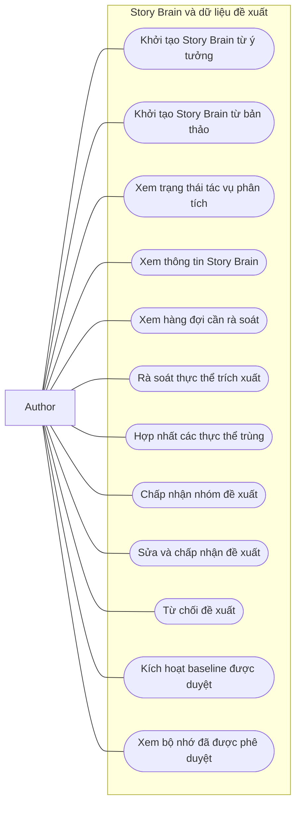
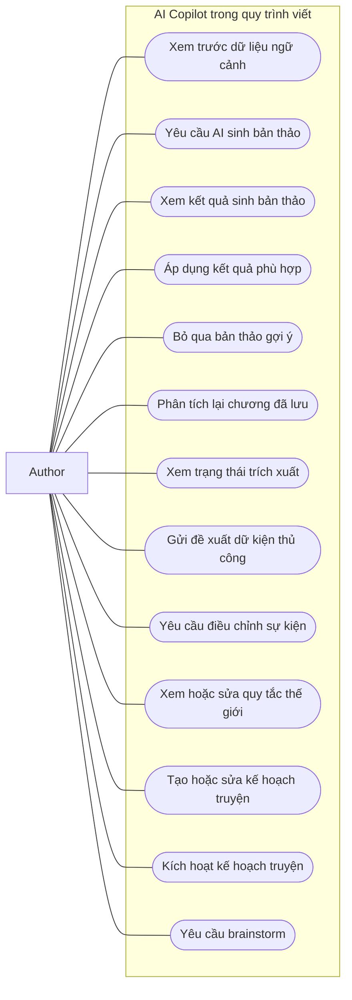

# Chương 3 – Use Case AI Writing Copilot

> Tách từ [báo cáo Chương 3](../BAO_CAO_CHUONG_3.md). Các sơ đồ bám theo mã nguồn nhánh `main`.

#### a) Khởi tạo Story Brain và phê duyệt dữ kiện

*Hình 3.8. Use Case khởi tạo Story Brain và duyệt đề xuất.*

Các endpoint bootstrap, job, review queue, entity reviews, merge, proposal decision, baseline activation và approved memory hiện diện trong ai-gateway.routes.ts và ai-service/api/narrative_routes.py. Chúng chứng minh phạm vi API, không thay thế cho đánh giá độ chính xác hay tỷ lệ hoàn thành job ở Chương 4.

#### b) AI hỗ trợ viết và quản lý kế hoạch

*Hình 3.9. Use Case AI hỗ trợ sáng tác và cập nhật ngữ cảnh.*

Đối chiếu với ai-gateway.routes.ts, ai-service/application/writing_service.py và các API kế hoạch, tái phân tích. Áp dụng kết quả và bỏ qua kết quả là hai lựa chọn của tác giả; không nối quan hệ «extend» chỉ để sơ đồ nhiều đường. Kết quả LLM không tự động trở thành nội dung chính thức.

