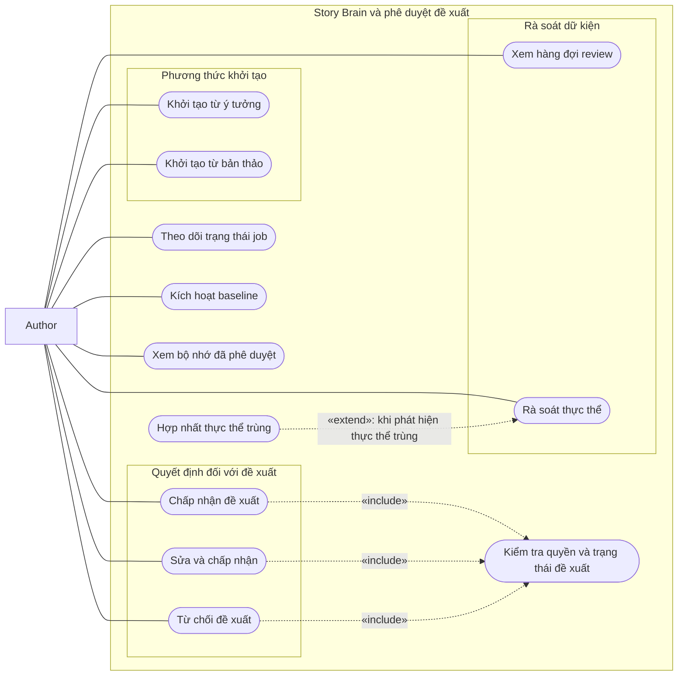
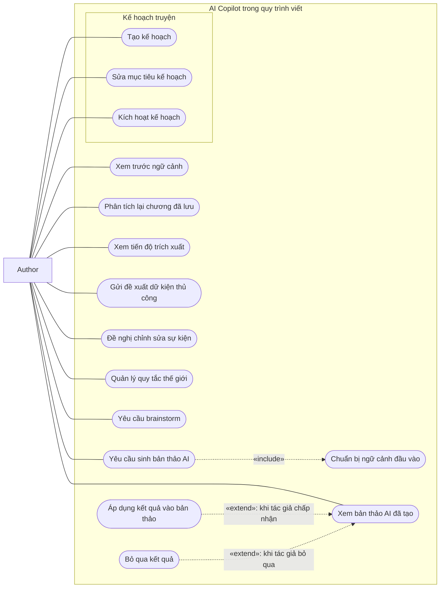

# Chương 3 – Use Case AI Copilot

> Trích từ [Chương 3](../BAO_CAO_CHUONG_3.md); nguồn đối chiếu: `main`. Chỉ dùng mũi tên «include» và «extend». Đường liền là liên kết tác nhân; khung là nhóm chức năng.

### 3.2.5. Use Case hỗ trợ sáng tác bằng AI

#### a) Khởi tạo Story Brain và phê duyệt dữ kiện

*Hình 3.8. Use Case khởi tạo Story Brain và quyết định đề xuất.*

**«extend»:** Hợp nhất thực thể có thể phát sinh khi tác giả rà soát và phát hiện thực thể trùng. **«include»:** Các thao tác chấp nhận, sửa–chấp nhận hoặc từ chối đều kiểm tra quyền và trạng thái đề xuất. Việc kiểm tra `brain_version` đặc thù cho nhánh chấp nhận và một số quyết định nhóm, không phải mọi lần từ chối. Khởi tạo Story Brain từ ý tưởng/bản thảo là hai thao tác khởi động độc lập. Nguồn: `ai-gateway.routes.ts`, `narrative_service.py`.

#### b) AI hỗ trợ viết và quản lý kế hoạch

*Hình 3.9. Use Case AI Copilot và kế hoạch viết.*

**«include»:** Yêu cầu AI sinh nội dung phải chuẩn bị ngữ cảnh đầu vào. **«extend»:** Sau khi xem bản thảo AI, tác giả có thể áp dụng hoặc bỏ qua theo lựa chọn. Xem trước ngữ cảnh bằng giao diện là tính năng tùy chọn chứ không phải thao tác bắt buộc mỗi lần sinh. Các thao tác tạo/sửa/kích hoạt kế hoạch được nhóm để dễ đọc nhưng không gán quan hệ không được mã nguồn hỗ trợ. Nguồn: `ai-gateway.routes.ts`, `writing_service.py`.

