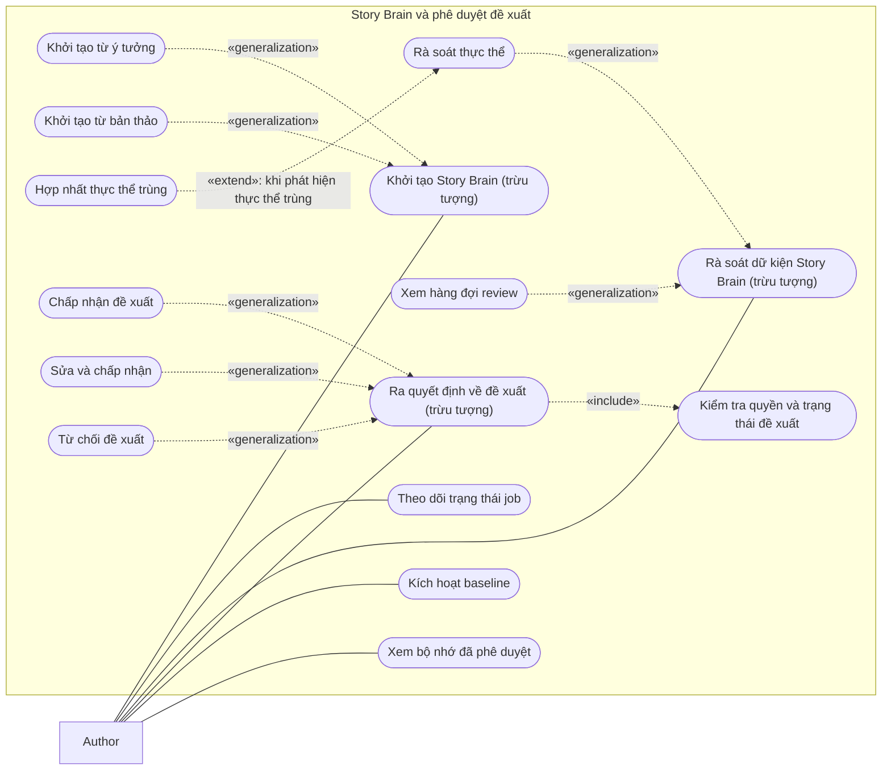
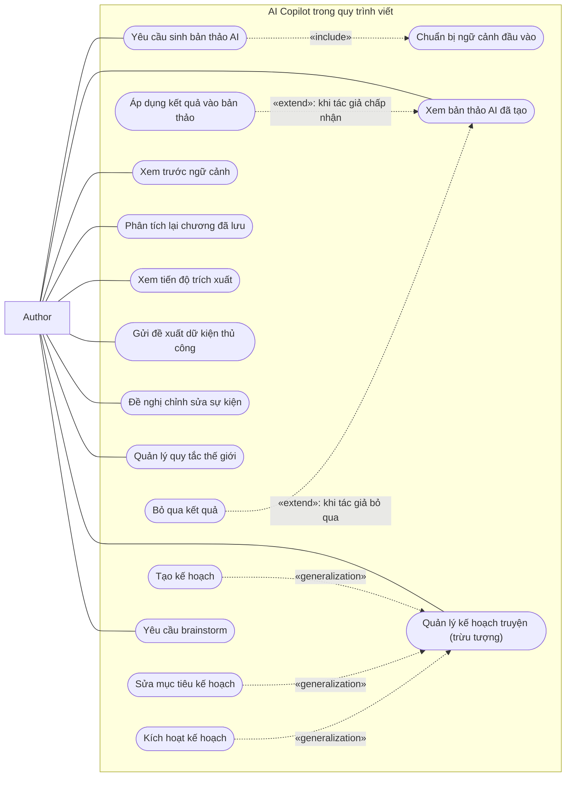

# Chương 3 – Use Case AI Writing Copilot

> Tách từ [bản báo cáo Chương 3](../BAO_CAO_CHUONG_3.md). Các quan hệ được xác định theo mã nguồn nhánh `main`; sơ đồ Mermaid là biểu diễn gần đúng ký pháp UML.

#### a) Khởi tạo Story Brain và phê duyệt dữ kiện

*Hình 3.8. Use Case Story Brain với các biến thể khởi tạo, rà soát và quyết định.*

**Phân cấp:** Khởi tạo từ ý tưởng và từ bản thảo là hai biến thể của cùng mục tiêu tạo Story Brain. Chấp nhận, chỉnh sửa–chấp nhận và từ chối là các biến thể quyết định về đề xuất, không phải ba thao tác bắt buộc trong một lần review. Cả ba nhánh đều được kiểm tra quyền và trạng thái đề xuất; kiểm tra **brain version** là yêu cầu riêng trên nhánh chấp nhận (và một số quyết định nhóm), không áp dụng như bước bắt buộc của mọi lần từ chối. **«extend»:** Hợp nhất thực thể chỉ xuất hiện trong quá trình rà soát thực thể khi phát hiện trùng danh tính. **Điều kiện tiên quyết:** Kích hoạt baseline cần kết quả chuẩn bị/rà soát phù hợp; không «include» thao tác khởi tạo mỗi lần kích hoạt. Căn cứ: `ai-gateway.routes.ts`, `narrative_service.py`.

#### b) AI hỗ trợ viết và quản lý kế hoạch

*Hình 3.9. Use Case AI Copilot với ngữ cảnh bắt buộc và các lựa chọn hậu sinh.*

**«include»:** Yêu cầu AI viết cần bước chuẩn bị ngữ cảnh đầu vào từ tác phẩm/văn bản hiện hành, ngay cả khi bộ nhớ semantic tùy cấu hình chưa được bật. **«extend»:** Sau khi xem bản thảo sinh, tác giả có thể áp dụng hoặc bỏ qua; hai hành động này chỉ phát sinh theo quyết định của tác giả. **«generalization»:** Tạo, sửa và kích hoạt là các thao tác chuyên biệt đối với kế hoạch truyện. **Không «include»:** Xem trước ngữ cảnh là tùy chọn của tác giả, không phải thao tác giao diện bắt buộc trước mỗi yêu cầu sinh. Kích hoạt kế hoạch cần một kế hoạch hợp lệ đã tồn tại. Nguồn: `ai-gateway.routes.ts`, `writing_service.py`.

