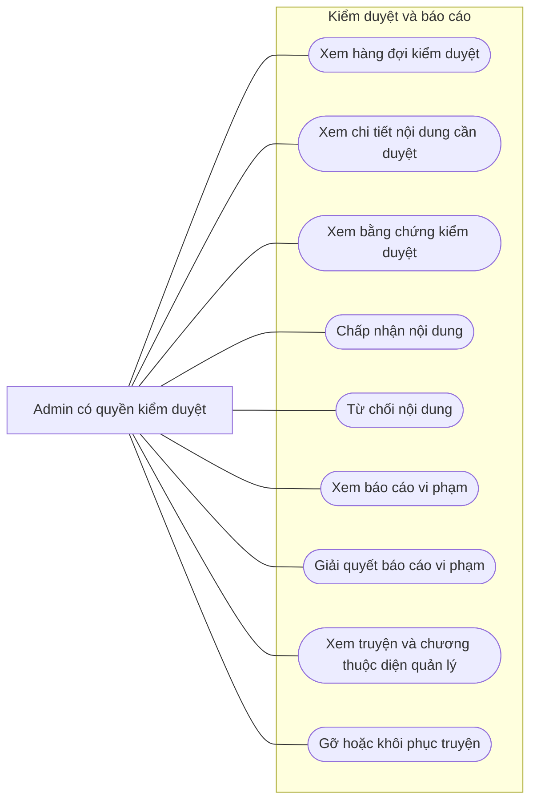
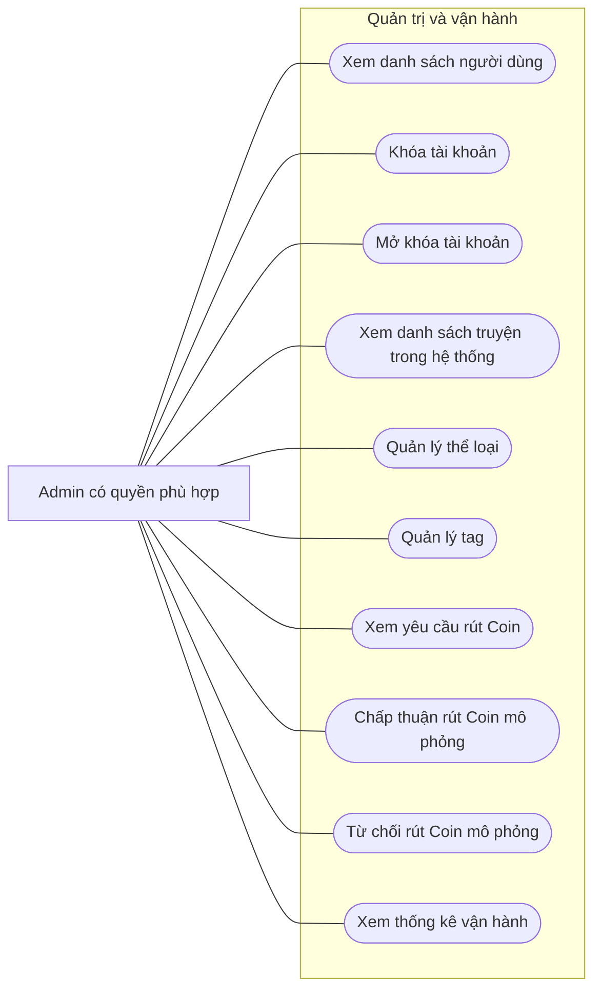

# Chương 3 – Use Case quản trị

> Tách từ [báo cáo Chương 3](../BAO_CAO_CHUONG_3.md). Các sơ đồ bám theo mã nguồn nhánh `main`.

#### a) Kiểm duyệt và xử lý nội dung

*Hình 3.10. Use Case kiểm duyệt và xử lý vi phạm.*

Căn cứ là content-control.routes.ts và các route truyện/chương của admin. Kiểm tra theo quy tắc hoặc báo cáo người dùng có thể tạo yêu cầu review; quyết định phê duyệt hoặc từ chối do quản trị viên có quyền thực hiện, không phải cơ chế LLM tự động kiểm duyệt.

#### b) Quản trị người dùng, danh mục và Coin

*Hình 3.11. Use Case quản trị vận hành Ephurin.*

Đối chiếu với admin.routes.ts. Các quyền thao tác được backend phân theo loại nghiệp vụ như users, finance và audit. Vì vậy sơ đồ ghi Admin có quyền phù hợp, không khẳng định một tài khoản quản trị bất kỳ đều sở hữu toàn bộ quyền.

