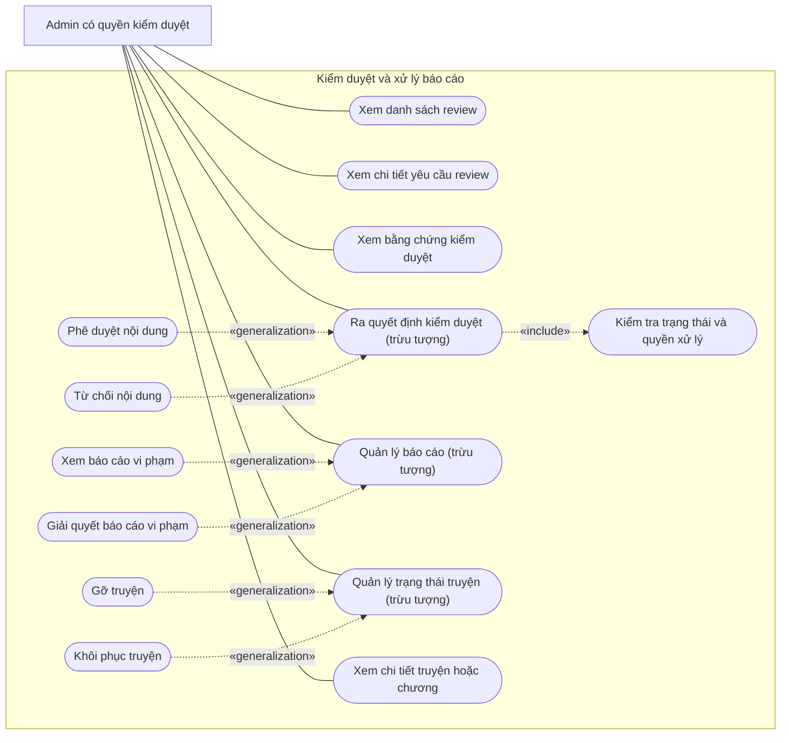
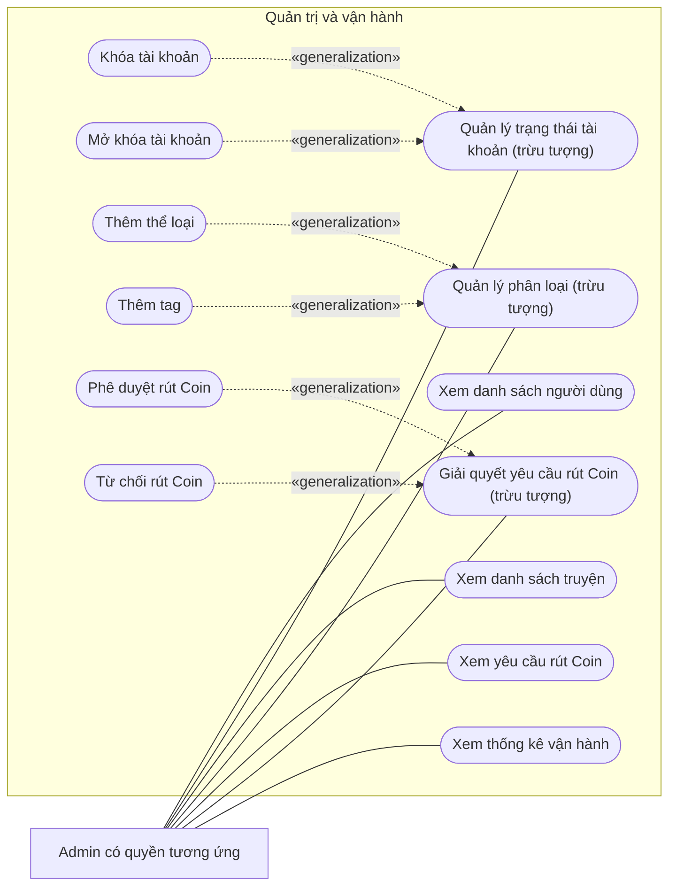

# Chương 3 – Use Case Quản trị viên

> Tách từ [bản báo cáo Chương 3](../BAO_CAO_CHUONG_3.md). Các quan hệ được xác định theo mã nguồn nhánh `main`; sơ đồ Mermaid là biểu diễn gần đúng ký pháp UML.

#### a) Kiểm duyệt và xử lý nội dung

*Hình 3.10. Use Case kiểm duyệt với quyết định chấp nhận hoặc từ chối.*

**Phân cấp quyết định:** Phê duyệt và từ chối là hai biến thể loại trừ của mục tiêu giải quyết review; **không** dùng «include» bởi một lần xử lý không thực hiện cả hai. Backend luôn kiểm tra quyền, trạng thái review và điều kiện hợp lệ trước khi ghi quyết định, nên mô hình hóa phần kiểm tra chung bằng «include». Xem hàng đợi/chi tiết hỗ trợ thao tác UI, nhưng không được áp thành «include» bắt buộc khi một API xử lý có thể nhận trực tiếp ID review. Nguồn: `content-control.service.ts`, `admin.service.ts`.

#### b) Quản trị tài khoản, phân loại và Coin

*Hình 3.11. Use Case quản trị với các biến thể khóa, mở khóa và duyệt yêu cầu rút Coin.*

**Phân cấp:** Khóa/mở khóa tài khoản là các biến thể thay đổi trạng thái; thêm thể loại/tag là hai hình thức cập nhật danh mục; chấp thuận/từ chối rút Coin là hai kết quả lựa chọn của nghiệp vụ duyệt rút. **Điều kiện tiên quyết:** Mở khóa chỉ có nghĩa với tài khoản đang bị khóa; xử lý yêu cầu rút cần yêu cầu đang chờ và quyền finance. Xem danh sách không phải là một bước «include» của thao tác thay đổi trạng thái, vì API có thể được gọi khi đã biết ID. Nguồn: `admin.routes.ts`, `admin.service.ts`.

