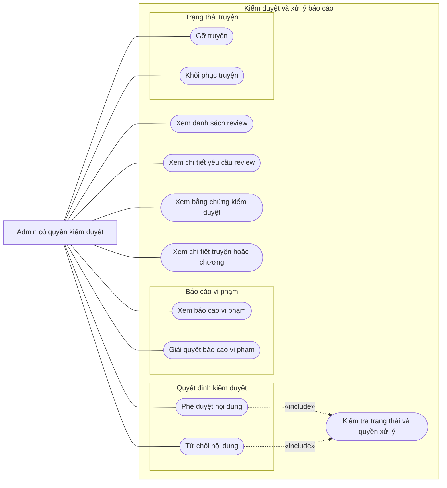
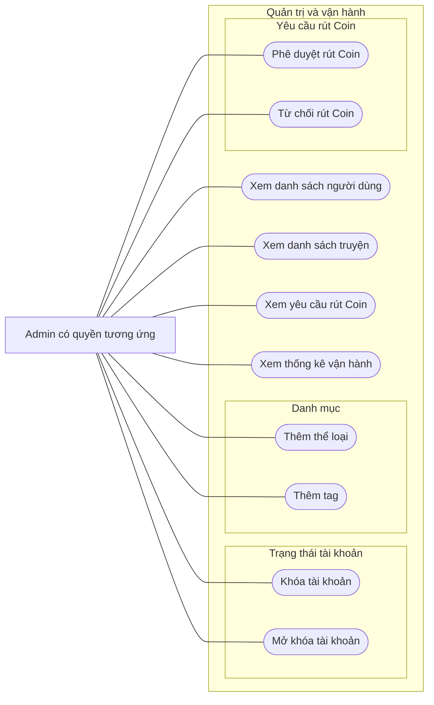

# Chương 3 – Use Case quản trị viên

> Trích từ [Chương 3](../BAO_CAO_CHUONG_3.md); nguồn đối chiếu: `main`. Chỉ dùng mũi tên «include» và «extend». Đường liền là liên kết tác nhân; khung là nhóm chức năng.

### 3.2.6. Use Case của quản trị viên

#### a) Kiểm duyệt và xử lý nội dung

*Hình 3.10. Use Case kiểm duyệt và xử lý báo cáo.*

**«include»:** Khi phê duyệt hoặc từ chối nội dung, backend luôn kiểm tra quyền và trạng thái yêu cầu kiểm duyệt. **Không nối hai quyết định với nhau:** một lần xử lý chỉ chọn nhánh phù hợp. Xem danh sách hay chi tiết hỗ trợ điều hướng trên UI, nhưng không phải bước API bắt buộc khi đã có review ID. Nguồn: `content-control.service.ts`, `admin.service.ts`.

#### b) Quản trị tài khoản, phân loại và Coin

*Hình 3.11. Use Case quản trị tài khoản, phân loại và Coin.*

Khóa và mở khóa tài khoản, thêm thể loại/tag, phê duyệt hoặc từ chối rút Coin được chia thành những nhóm nghiệp vụ. **Không tự thêm «include»/«extend»** giữa những lựa chọn thay thế. Trạng thái tài khoản, quyền admin, yêu cầu rút đang chờ là các điều kiện tiên quyết được backend kiểm tra. Nguồn: `admin.routes.ts`, `admin.service.ts`.

