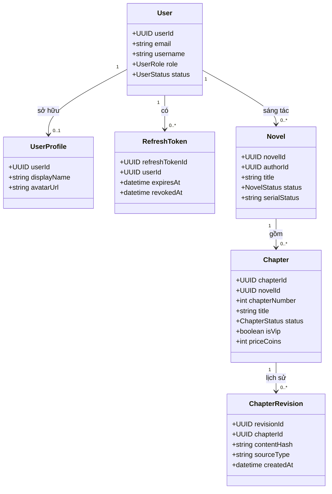
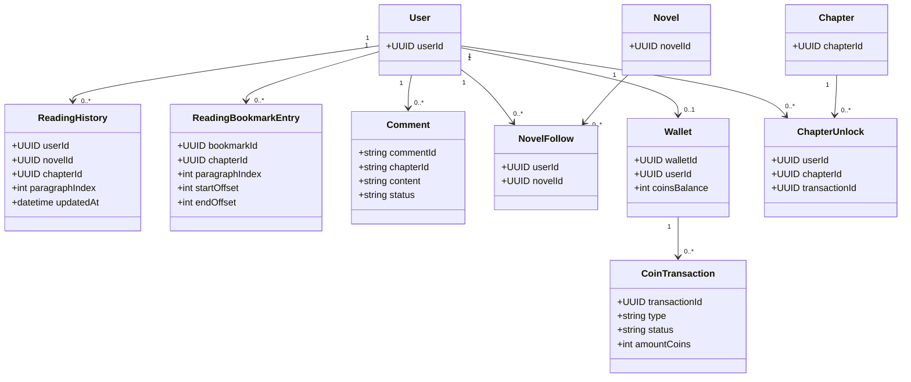
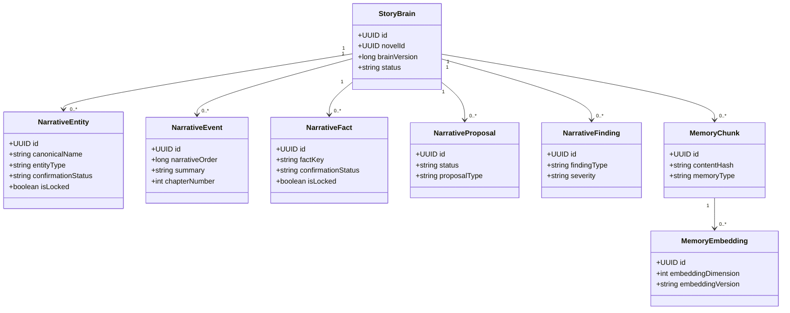

# Chương 3 – Biểu đồ lớp

> **Ghi chú kiểm tra:** Các sơ đồ được tách từ [Chương 3](../BAO_CAO_CHUONG_3.md) để xem Mermaid theo nhóm, giảm tải cho trình xem GitHub. Nguồn đối chiếu nghiệp vụ là mã nguồn nhánh `main`; vị trí lưu này chỉ là nhánh tài liệu.

## 3.3.1. Biểu đồ lớp tài khoản và tác phẩm

*Hình 3.7. Biểu đồ lớp tài khoản, tác phẩm và phiên bản chương.*

## 3.3.2. Biểu đồ lớp đọc truyện, tương tác và ví

*Hình 3.8. Biểu đồ lớp đọc truyện, tương tác và giao dịch Coin.*

## 3.3.3. Biểu đồ lớp quản lý ngữ cảnh và AI

*Hình 3.9. Biểu đồ lớp miền ngữ cảnh truyện và AI.*

