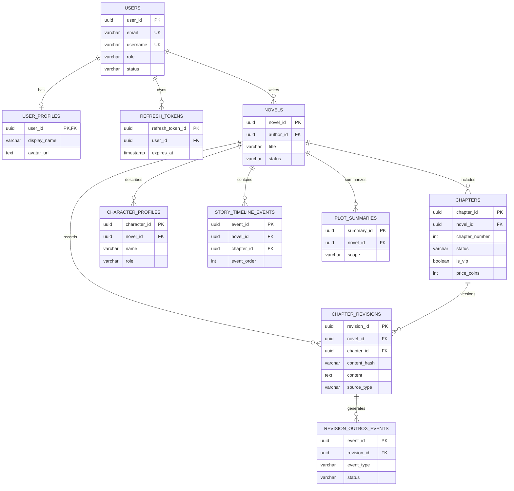
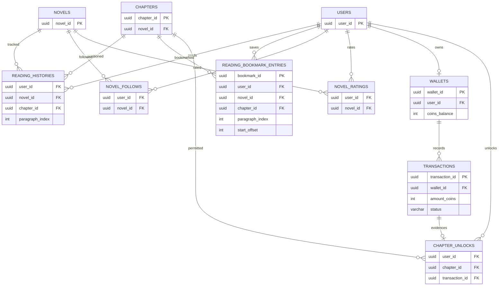
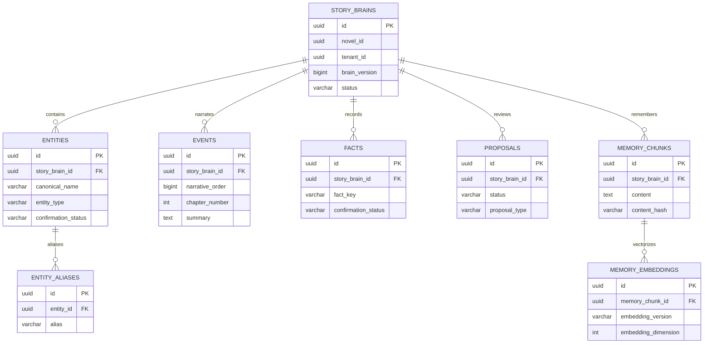

# Chương 3 – Sơ đồ ERD

> **Ghi chú kiểm tra:** Các sơ đồ được tách từ [Chương 3](../BAO_CAO_CHUONG_3.md) để xem Mermaid theo nhóm, giảm tải cho trình xem GitHub. Nguồn đối chiếu nghiệp vụ là mã nguồn nhánh `main`; vị trí lưu này chỉ là nhánh tài liệu.

## 3.4.2. ERD nhóm tài khoản và xuất bản

*Hình 3.10. ERD nhóm tài khoản, truyện, chương và ngữ cảnh do tác giả quản lý.*

## 3.4.3. ERD đọc truyện, tương tác và ví Coin

*Hình 3.11. ERD nhóm đọc truyện, theo dõi, đánh giá và ví Coin.*

## 3.4.4. ERD dữ liệu Narrative Memory

*Hình 3.12. ERD tổng quan của schema Narrative Memory.*

