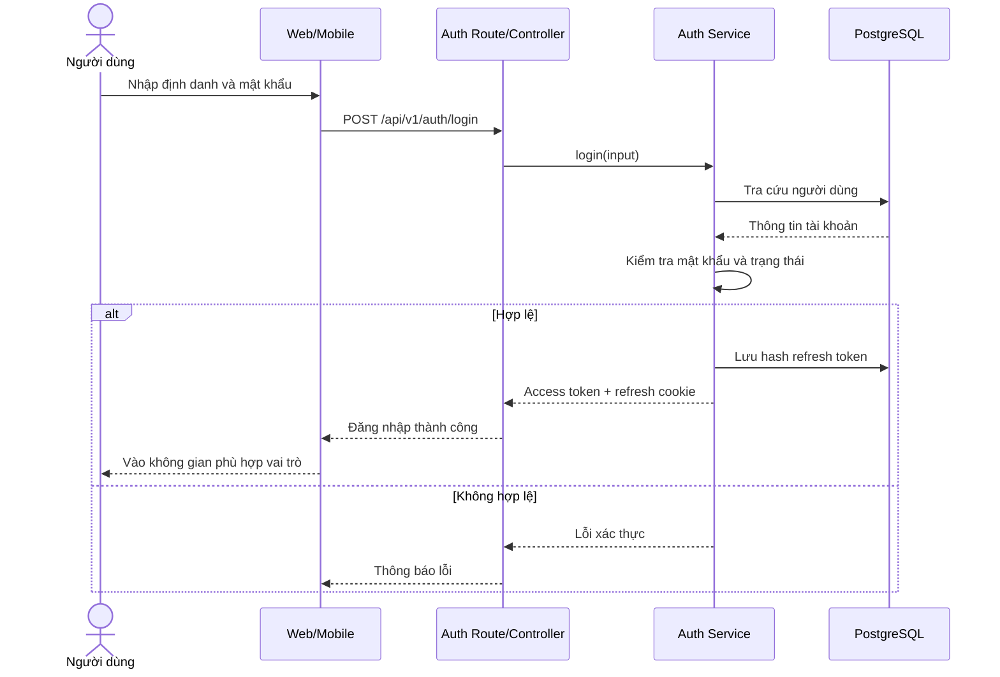
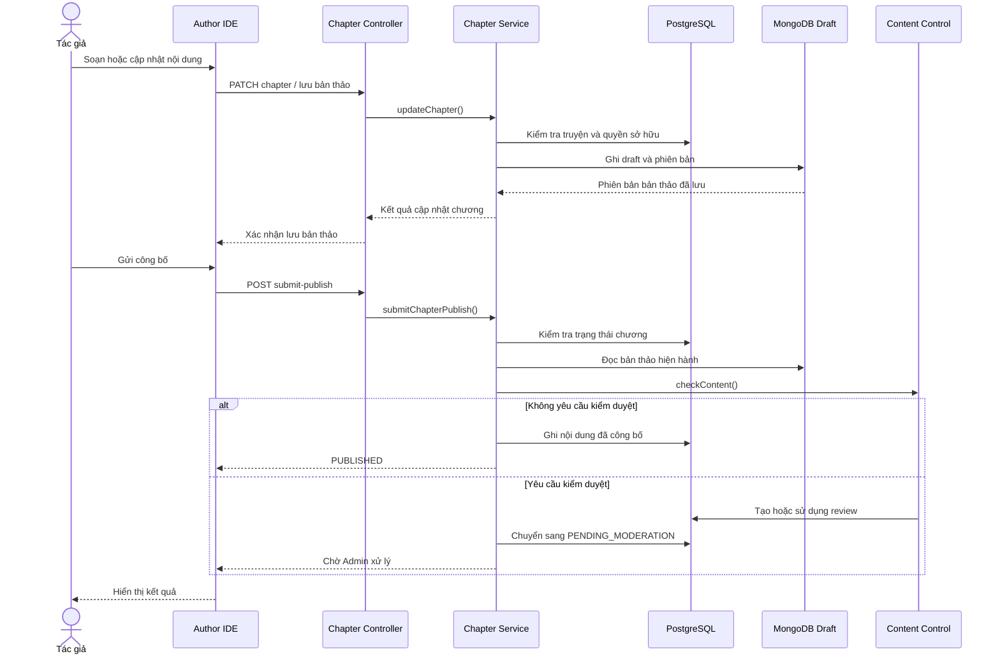
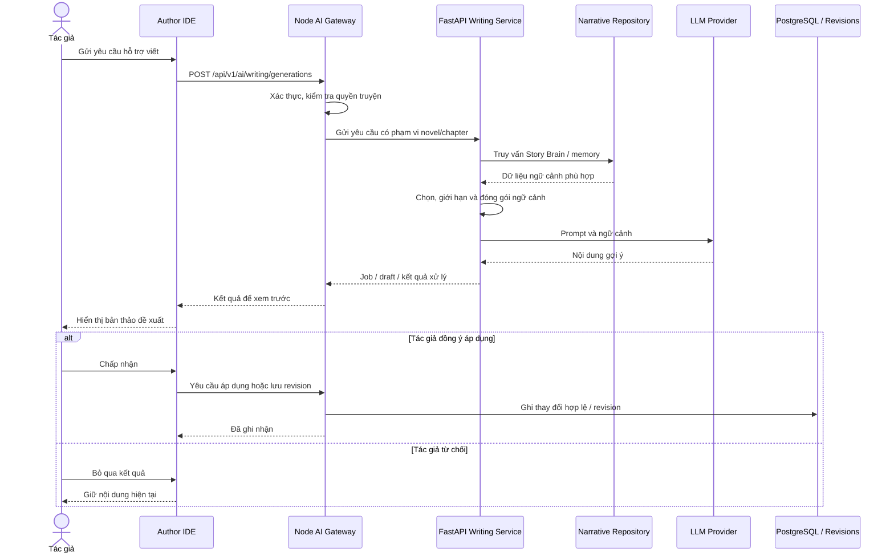
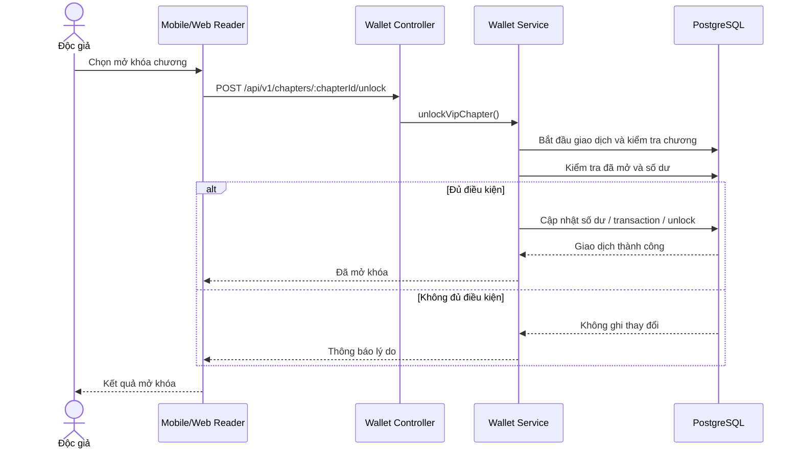
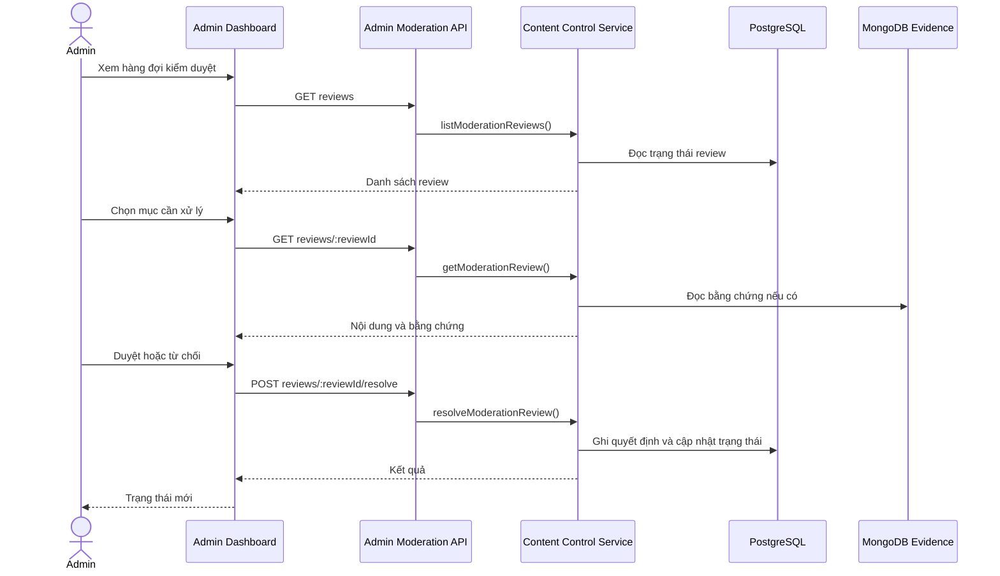

# Chương 3 – Biểu đồ tuần tự

> **Ghi chú kiểm tra:** Các sơ đồ được tách từ [Chương 3](../BAO_CAO_CHUONG_3.md) để xem Mermaid theo nhóm, giảm tải cho trình xem GitHub. Nguồn đối chiếu nghiệp vụ là mã nguồn nhánh `main`; vị trí lưu này chỉ là nhánh tài liệu.

## 3.5.1. Đăng nhập

*Hình 3.13. Sơ đồ tuần tự đăng nhập.*

## 3.5.2. Tạo, lưu và gửi công bố chương

*Hình 3.14. Sơ đồ tuần tự lưu bản thảo và gửi công bố chương.*

## 3.5.3. AI sinh gợi ý và tác giả phê duyệt

*Hình 3.15. Sơ đồ tuần tự AI hỗ trợ sáng tác.*

## 3.5.4. Mở khóa chương VIP

*Hình 3.16. Sơ đồ tuần tự mở khóa chương bằng Coin mô phỏng.*

## 3.5.5. Quản trị viên xử lý kiểm duyệt

*Hình 3.17. Sơ đồ tuần tự xử lý kiểm duyệt nội dung.*

