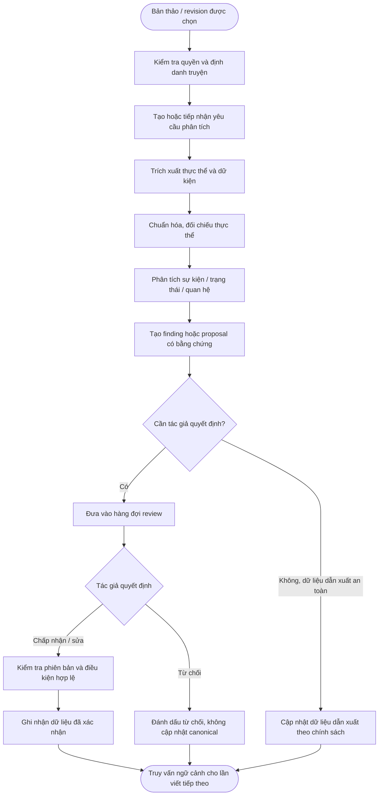
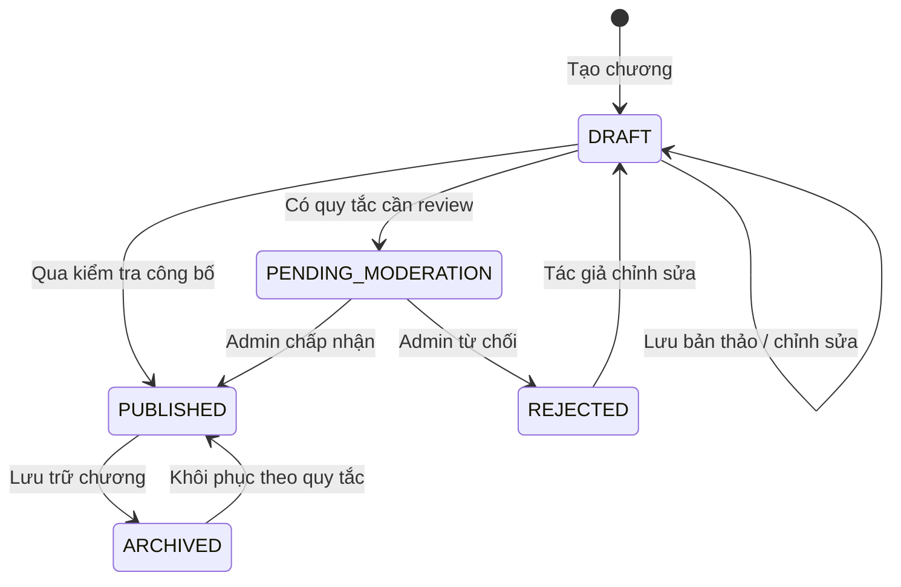
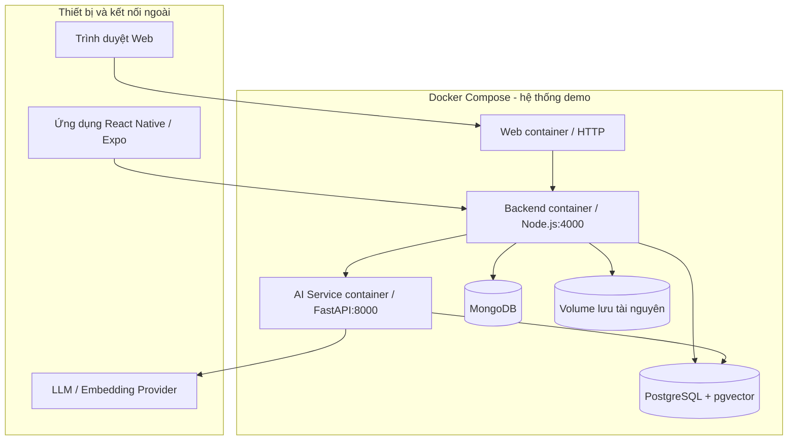

# Chương 3 – Hoạt động, trạng thái và triển khai

> **Ghi chú kiểm tra:** Các sơ đồ được tách từ [Chương 3](../BAO_CAO_CHUONG_3.md) để xem Mermaid theo nhóm, giảm tải cho trình xem GitHub. Nguồn đối chiếu nghiệp vụ là mã nguồn nhánh `main`; vị trí lưu này chỉ là nhánh tài liệu.

## 3.6.1. Quy trình AI phân tích bản thảo và quản lý đề xuất

*Hình 3.18. Activity Diagram của quy trình phân tích và phê duyệt ngữ cảnh AI.*

## 3.6.2. Vòng đời chương truyện

*Hình 3.19. State Machine thể hiện các trạng thái chính của chương truyện.*

## 3.6.3. Mô hình triển khai ứng dụng

*Hình 3.20. Sơ đồ triển khai hệ thống theo Docker Compose trên nhánh `main`.*

