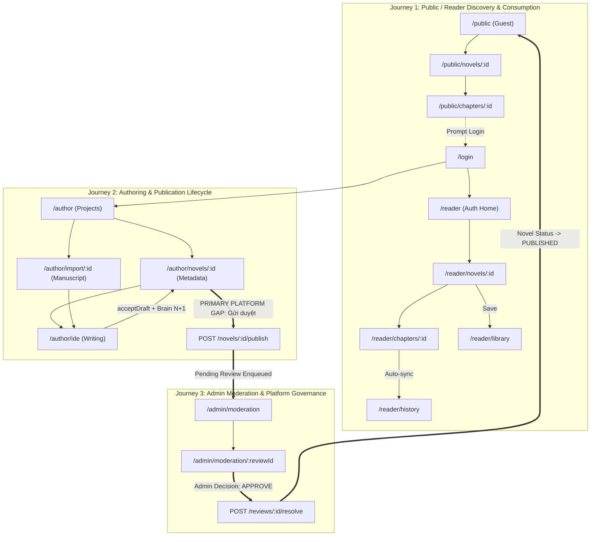

# PRODUCT-UI-INTEGRATION-INVENTORY — Comprehensive Product UI Integration & Surface Inventory Report

## 1. Inventory Header & Executive Summary

| Dimension / Metric | Observed Value |
| :--- | :--- |
| **Inventory Base Main SHA** | `1b5fcbc7b69e9ce3b928aa130370b73115b49cbd` |
| **Working Branch** | `astra/product-ui-integration-inventory` |
| **Reconnaissance Engine** | Real Microsoft Edge Headless CDP (`msedge.exe 155`, automated native DOM, remote debugging port 9444) |
| **Inspection Date** | 2026-10-15 |
| **Web Typecheck & Build** | **PASS (100%)** (`tsc -b --noEmit` + `tsc -b && vite build` in 11.42s) |
| **Total Production Surfaces Inventoried** | **27 distinct surfaces** |
| **Primary Classification Counts** | **REAL + E2E-COVERED**: 5<br>**REAL + NOT-YET-E2E-COVERED**: 19<br>**PARTIALLY-WIRED**: 0<br>**MOCK / STATIC**: 0<br>**BROKEN CONTRACT**: 0<br>**NOT_IMPLEMENTED**: 0<br>**OBSOLETE / DUPLICATE**: 3 |
| **Priority Breakdown** | **P0 (Critical Blocker)**: 0<br>**P1 (Core Flow / Verification Gap)**: 20<br>**P2 (Secondary Feature)**: 4<br>**P3 (Cosmetic / Obsolete Cleanup)**: 3 |
| **Recommended Next Executable Gate** | **`AUTHOR-PUBLISH-ADMIN-MODERATION-E2E`** |

---

## 2. Methodology & Evidence Discipline

The inventory combined:
1. **Static Inspection**: Exhaustive analysis of `web/src/app/router.tsx`, route guards (`AuthGate`, `RoleGuard`), feature API clients, and backend route handlers.
2. **Rendered Browser Observation**: Autonomous navigation through Microsoft Edge CDP across four identities:
   - **Anonymous visitor** (no session/tokens)
   - **Reader** (`reader04@example.com`, role `READER`)
   - **Author** (`reader03@example.com`, role `AUTHOR`)
   - **Admin** (`reader02@example.com`, role `ADMIN`)
3. **Network & Protocol Interception**: Capture of CDP `Network.requestWillBeSent` and `Network.responseReceived` events, correlating frontend API calls with backend controllers and PostgreSQL / MongoDB storage.
4. **Visual Evidence Persistence**: 25 high-resolution DOM screenshots captured under `docs/development/PRODUCT-UI-INTEGRATION-INVENTORY/`.
5. **Machine-Readable Dataset**: All DOM nodes, headers, buttons, inputs, links, and API requests exported to [`docs/development/PRODUCT-UI-INTEGRATION-INVENTORY.json`](file:///c:/Users/thaib/Documents/Projects/Novel_sharing_platform/Novel_sharing_platform/docs/development/PRODUCT-UI-INTEGRATION-INVENTORY.json).

---

## 3. Product UI Integration Matrix (27 Surfaces)

| Area | Route | Primary User | Primary User Action | Rendered Status | Observed Browser / API Requests | Backend Route / Service | Persistence Owner | Auth / Ownership Behavior | Existing Browser E2E Evidence | Primary Classification | Priority | Concrete Blocker / Gap | Recommended Next Action |
| :--- | :--- | :--- | :--- | :--- | :--- | :--- | :--- | :--- | :--- | :--- | :--- | :--- | :--- |
| **AUTH** | `/login` | Anonymous / Any | Sign in with email or username & password; toggle register mode; guest browse link | 200 OK (`anon-01-login.png`) | `POST /api/v1/auth/login`, `POST /api/v1/auth/register` | `backend: authRoutes` | PostgreSQL `auth.users`, `auth.user_profiles`, `auth.user_wallets` | Public. Successful auth sets JWT in `localStorage` and redirects to role home (`/admin`, `/author`, `/reader`). | E2E-COVERED in `AI-PIPE-01B` & `MANUSCRIPT-IMPORT-UI` | **REAL + E2E-COVERED** | P1 | OAuth button exists as text note ("OAuth callback is intentionally not wired in this MVP phase"). Email/password is fully operational. | Keep email/password as primary canonical auth; wire OAuth in a later release. |
| **AUTH** | Role Guards & Redirects (`/`, `AuthGate`, `RoleGuard`) | All | Enforce authentication & role separation; redirect root to role home; redirect unauthorized to login or PermissionState | 200 OK (Verified across all 4 roles) | `GET /api/v1/auth/me`, `POST /api/v1/auth/logout` | `backend: authRoutes` | PostgreSQL `auth.users` / JWT cookie | Anonymous blocked from `/author`, `/reader`, `/admin`, `/wallet`, `/profile/me`. Reader blocked from `/author` & `/admin`. Author blocked from `/admin`. | E2E-COVERED in `AI-PIPE-01B`, `MANUSCRIPT-IMPORT-UI`, and this inventory | **REAL + E2E-COVERED** | P1 | None. Guarding is strict and fail-closed. | Maintain current RBAC middleware. |
| **PUBLIC** | `/public` | Anonymous | Browse published novels; filter by genre, tag, query string; navigate to novel detail or login | 200 OK (`anon-02-public-library.png`) | `GET /api/v1/reading/search?page=1&limit=20&sort=updatedAt&order=desc` | `backend: readingRoutes` (`/api/v1/reading/search`) | PostgreSQL `novels.novels` (joined with published chapters) | Public / Anonymous | NOT-YET-E2E-COVERED in browser suite | **REAL + NOT-YET-E2E-COVERED** | P1 | No standalone public discovery browser E2E test exists. | Include public discovery in Reader/Discovery closed-loop E2E. |
| **PUBLIC** | `/public/novels/:novelId` | Anonymous | View novel metadata, synopsis, published chapter list; click chapter to read | 200 OK (`anon-03-public-novel-detail.png`) | `GET /api/v1/reading/novels/:novelId` | `backend: readingRoutes` (`/api/v1/reading/novels/:novelId`) | PostgreSQL `novels.novels`, `novels.chapters` | Public / Anonymous | NOT-YET-E2E-COVERED in browser suite | **REAL + NOT-YET-E2E-COVERED** | P1 | Lacks automated browser readback test for guest visitor. | Include in guest reader journey test. |
| **PUBLIC** | `/public/chapters/:chapterId` | Anonymous | Read free chapter content; navigate next/prev chapters; read comments; view VIP lock notice | 200 OK (`anon-04-public-chapter-reader.png`) | `GET /api/v1/reading/chapters/:chapterId`, `GET /api/v1/chapters/:chapterId/comments` | `backend: readingRoutes`, `backend: commentsRoutes` | PostgreSQL `novels.chapters`, `novels.chapter_revisions` | Public / Anonymous. VIP chapters display lock notice prompting login. | NOT-YET-E2E-COVERED in browser suite | **REAL + NOT-YET-E2E-COVERED** | P1 | Guest reading experience unverified by browser automation. | Include in guest reader journey test. |
| **READER** | `/reader` | Reader (`READER`, `AUTHOR`, `ADMIN`) | Advanced search published novels with status filter, sorting (updatedAt, views, likes, relevance), and ordering | 200 OK (`reader-01-home.png`) | `GET /api/v1/reading/search` | `backend: readingRoutes` (`/api/v1/reading/search`) | PostgreSQL `novels.novels` | Authenticated via `AuthGate` | NOT-YET-E2E-COVERED in browser suite | **REAL + NOT-YET-E2E-COVERED** | P1 | Search and filter interactions not covered in automated browser suite. | Create Reader Discovery E2E. |
| **READER** | `/reader/novels/:novelId` | Reader | Inspect novel details; Like/Unlike novel; Add to Library / Remove; Follow Author; open chapter | 200 OK (`reader-02-novel-detail.png`) | `GET /api/v1/reading/novels/:novelId`, `POST /api/v1/novels/:novelId/likes`, `POST /api/v1/reading/library/me`, `POST /api/v1/authors/:authorId/follow` | `backend: readingRoutes`, `backend: novelsRoutes`, `backend: authorsRoutes` | PostgreSQL `novels.novels`, `interactions.novel_likes`, `interactions.reading_libraries`, `interactions.author_follows` | Authenticated; actions scoped to user | NOT-YET-E2E-COVERED in browser suite | **REAL + NOT-YET-E2E-COVERED** | P1 | Like, Library, and Follow CTA state transitions lack browser E2E assertions. | Test social interactions in Reader Journey E2E. |
| **READER** | `/reader/chapters/:chapterId` | Reader | Read chapter body; adjust typography preferences (font, size, background); auto-sync reading history; post comment; unlock VIP; report | 200 OK (`reader-03-chapter-reader.png`) | `GET /api/v1/reading/chapters/:id`, `GET /api/v1/reading/preferences/me`, `PUT /api/v1/reading/preferences/me`, `PUT /api/v1/reading/history/me`, `GET /api/v1/chapters/:id/comments`, `POST /api/v1/chapters/:id/comments`, `POST /api/v1/chapters/:id/unlock` | `backend: readingRoutes`, `backend: commentsRoutes`, `backend: walletResourceRoutes` | PostgreSQL `novels.chapters`, `interactions.reading_preferences`, `interactions.reading_histories`, `interactions.comments`, `wallet.wallet_transactions` | Authenticated; VIP unlock debits user wallet | NOT-YET-E2E-COVERED in browser suite | **REAL + NOT-YET-E2E-COVERED** | P1 | History sync and comment posting have backend unit tests but no browser CDP verification. | Build Reader Chapter & Interaction E2E. |
| **READER** | `/reader/library` | Reader | View saved library novels; quick jump to reading; remove novel from library | 200 OK (`reader-04-library.png`) | `GET /api/v1/reading/library/me?page=1&limit=20` | `backend: readingRoutes` (`/api/v1/reading/library/me`) | PostgreSQL `interactions.reading_libraries` | Authenticated; user-scoped library | NOT-YET-E2E-COVERED in browser suite | **REAL + NOT-YET-E2E-COVERED** | P1 | Library persistence across novel detail toggle and library page reload unverified in browser. | Verify in Reader Library E2E. |
| **READER** | `/reader/history` | Reader | View recent reading history items with chapter position; resume reading | 200 OK (`reader-05-history.png`) | `GET /api/v1/reading/history/me?page=1&limit=20` | `backend: readingRoutes` (`/api/v1/reading/history/me`) | PostgreSQL `interactions.reading_histories` | Authenticated; user-scoped history | NOT-YET-E2E-COVERED in browser suite | **REAL + NOT-YET-E2E-COVERED** | P1 | Reading progress update -> history list readback loop unverified in browser. | Verify in Reader History E2E. |
| **READER** | `/wallet` | Reader / Author | View coin balance; deposit coins (mock package session); unlock chapter; donate to author; request author withdrawal | 200 OK (`reader-06-wallet.png`) | `GET /api/v1/wallet`, `GET /api/v1/wallet/transactions/me`, `POST /api/v1/wallet/deposit/sessions`, `POST /api/v1/wallet/deposit/mock-complete`, `POST /api/v1/wallet/withdraw-requests` | `backend: walletRoutes`, `backend: walletResourceRoutes` | PostgreSQL `auth.user_wallets`, `wallet.wallet_transactions`, `wallet.withdraw_requests` | Authenticated; atomic balance adjustments | NOT-YET-E2E-COVERED in browser suite | **REAL + NOT-YET-E2E-COVERED** | P1 | Mock deposit and author withdrawal flows covered in Postman/API tests, not in browser CDP. | Add Wallet & Monetization browser verification. |
| **READER** | `/notifications` | Any Authenticated | View system notifications inbox; filter ALL/UNREAD/READ; mark read; register web push token | 200 OK (`reader-07-notifications.png`) | `GET /api/v1/notifications`, `PATCH /api/v1/notifications/:id/read`, `POST /api/v1/notifications/push-tokens` | `backend: notificationRoutes` | PostgreSQL `interactions.notifications`, `interactions.device_push_tokens` | Authenticated; user-scoped inbox | NOT-YET-E2E-COVERED in browser suite | **REAL + NOT-YET-E2E-COVERED** | P2 | Notification read state transition not browser-tested. | Add to secondary interaction tests. |
| **ACCOUNT** | `/profile/me` | Any Authenticated | Edit display name, avatar URL, biography; update language and notification preferences | 200 OK (`reader-08-profile.png`) | `GET /api/v1/users/me/profile`, `GET /api/v1/users/me/settings`, `PATCH /api/v1/users/me/profile`, `PUT /api/v1/users/me/settings` | `backend: usersRoutes` | PostgreSQL `auth.user_profiles`, `auth.user_settings` | Authenticated; self-profile only | NOT-YET-E2E-COVERED in browser suite | **REAL + NOT-YET-E2E-COVERED** | P2 | Profile update mutation not verified in browser E2E. | Add profile edit verification. |
| **ACCOUNT** | `/authors/:authorId` | Any | View public author profile, bio, follower count, and published novels | 200 OK (`reader-09-author-profile.png`) | `GET /api/v1/authors/:authorId` | `backend: authorsRoutes` | PostgreSQL `auth.user_profiles`, `novels.novels` | Public / Authenticated | NOT-YET-E2E-COVERED in browser suite | **REAL + NOT-YET-E2E-COVERED** | P2 | Public author landing not verified in browser E2E. | Add to reader navigation flow. |
| **AUTHOR** | `/author` | Author (`AUTHOR`, `ADMIN`) | Writing projects dashboard: view all novel projects, status filter, search, create new project, open IDE/Metadata/Context/Import | 200 OK (`author-01-projects.png`) | `GET /api/v1/novels/my`, `GET /api/v1/novels/:novelId/chapters` | `backend: novelsRoutes` | PostgreSQL `novels.novels`, `novels.chapters` | Author role required; author ownership enforced | E2E-COVERED in `AI-PIPE-01B` & `MANUSCRIPT-IMPORT-UI` | **REAL + E2E-COVERED** | P1 | None for project listing. | Preserve accepted behavior. |
| **AUTHOR** | `/author/novels/:novelId` | Author | Edit novel title, synopsis, cover URL; submit novel for moderation (`submitNovelPublish`); create chapter modal; chapter list table | 200 OK (`author-02-novel-metadata.png`) | `GET /api/v1/novels/:id`, `GET /api/v1/novels/:id/chapters`, `PATCH /api/v1/novels/:id`, `POST /api/v1/novels/:id/publish`, `POST /api/v1/novels/:id/chapters` | `backend: novelsRoutes`, `backend: chaptersRoutes` | PostgreSQL `novels.novels`, `novels.chapters` | Author role required; author ownership enforced with 403 | Partially E2E-COVERED in `MANUSCRIPT-IMPORT-UI` (Import-E readback) | **REAL + NOT-YET-E2E-COVERED** | P1 | "Gửi duyệt" (submit publish) button click and moderation queue enqueueing not tested in browser E2E. | **Target of recommended next gate (`AUTHOR-PUBLISH-ADMIN-MODERATION-E2E`).** |
| **AUTHOR** | `/author/context/:novelId` | Author | Story Bible / Cẩm nang: CRUD Characters (Protagonist, Antagonist, Supporting, Minor), Relationships, Timeline, Summaries | 200 OK (`author-03-story-context.png`) | `GET /api/v1/novels/:id`, `GET /api/v1/novels/:id/chapters`, `GET /api/v1/novels/:id/characters`, `GET /api/v1/novels/:id/relationships`, `GET /api/v1/novels/:id/timeline-events`, `GET /api/v1/novels/:id/plot-summaries` | `backend: storyContextRoutes` | PostgreSQL `narrative.character_profiles`, `narrative.character_relationships`, `narrative.story_timeline_events`, `narrative.plot_summaries` | Author role required; author ownership enforced | NOT-YET-E2E-COVERED in standalone browser suite | **REAL + NOT-YET-E2E-COVERED** | P1 | Standalone Story Context CRUD modal interactions not tested in browser suite (only context-preview read in IDE is covered). | Add Story Bible Author UI E2E. |
| **AUTHOR** | `/author/import/:novelId` | Author | Manuscript import 4-step wizard: paste text, parse preview, batch snapshot create, Story Brain bootstrap, review proposals, activate baseline | 200 OK (`author-04-manuscript-import.png`) | `POST /api/v1/novels/:id/chapters`, `POST /api/v1/chapters/:id/revisions/snapshot`, `POST /api/v1/ai/narrative/bootstrap/manuscript`, `POST /api/v1/ai/narrative/story-brains/:id/baseline` | `backend: chaptersRoutes`, `backend: aiGatewayRoutes`, `ai-service: narrative` | PostgreSQL `novels.chapters`, `novels.chapter_revisions`, `narrative.story_brains`, `narrative.bootstrap_jobs` | Author role required; active baseline fencing | **100% E2E-COVERED** in `MANUSCRIPT-IMPORT-UI-E2E` (Import-A to Import-P) | **REAL + E2E-COVERED** | P1 | None. Fully verified and merged in PR #46. | Do not reopen architecture. |
| **AUTHOR** | `/author/ide` | Author | Author Writing IDE: rich typography, autosave, AI draft generation with pinned Brain version, diff review modal, acceptDraft, fail-closed outbox, Story Bible sidebar | 200 OK (`author-05-writing-ide.png`) | `GET /api/v1/chapters/:id`, `GET /api/v1/ai/narrative/context-preview`, `POST /api/v1/ai/copilot/generate`, `POST /api/v1/chapters/:id/revisions/accept-draft`, `PATCH /api/v1/chapters/:id` | `backend: chaptersRoutes`, `backend: aiCopilotRoutes`, `backend: aiGatewayRoutes`, `ai-service: narrative` | PostgreSQL `novels.chapters`, `novels.chapter_revisions`, `novels.revision_outbox_events`, `narrative.story_brains`, MongoDB drafts | Author role required; author ownership enforced | **100% E2E-COVERED** in `AI-PIPE-01B` & `MANUSCRIPT-IMPORT-UI` | **REAL + E2E-COVERED** | P1 | None. Fully verified and merged in PR #45 & PR #46. | Do not reopen architecture. |
| **AUTHOR** | `/author/novels/:novelId/chapters/:chapterId` | Author | Deep link redirect helper to open IDE at specific chapter (`AuthorChapterDeepLink`) | 200 OK (Redirects to `/author/ide?novelId=...&chapterId=...`) | Client-side redirect (`useParams` -> `Navigate`) | React Router | None (Routing only) | Author role required | E2E-COVERED in `AI-PIPE-01B` | **REAL + E2E-COVERED** | P1 | None. Clean redirect utility. | Maintain as-is. |
| **ADMIN** | `/admin` | Admin (`ADMIN`) | Admin console dashboard: platform overview stats (users, novels, chapters, reports, moderation queue count); quick navigation tabs | 200 OK (`admin-01-overview.png`) | `GET /api/v1/admin/dashboard/stats` | `backend: adminRoutes` (`/api/v1/admin/dashboard/stats`) | Aggregated counts across PostgreSQL | Admin role strictly enforced (`RoleGuard(['ADMIN'])`) | NOT-YET-E2E-COVERED in browser suite | **REAL + NOT-YET-E2E-COVERED** | P1 | Stats display and tab navigation unverified in browser automation. | Add Admin Dashboard E2E. |
| **ADMIN** | `/admin/users` | Admin | Search users across platform; view role, status, coins; Lock user account; Unlock user account | 200 OK (`admin-02-users.png`) | `GET /api/v1/admin/users`, `POST /api/v1/admin/users/:userId/lock`, `POST /api/v1/admin/users/:userId/unlock` | `backend: adminRoutes` | PostgreSQL `auth.users` (`status = 'LOCKED' | 'ACTIVE'`) | Admin role strictly enforced | NOT-YET-E2E-COVERED in browser suite | **REAL + NOT-YET-E2E-COVERED** | P1 | User lock/unlock modal flow and subsequent login lockout unverified in browser E2E. | Add Admin User Management E2E. |
| **ADMIN** | `/admin/novels` | Admin | Search all platform novels; filter by status; soft-remove novel; restore novel; inspect novel link | 200 OK (`admin-03-novels.png`) | `GET /api/v1/admin/novels`, `POST /api/v1/admin/novels/:novelId/remove`, `POST /api/v1/admin/novels/:novelId/restore` | `backend: adminRoutes` | PostgreSQL `novels.novels` (`deleted_at`, `status`) | Admin role strictly enforced | NOT-YET-E2E-COVERED in browser suite | **REAL + NOT-YET-E2E-COVERED** | P1 | Soft-remove and restore lifecycle unverified in browser E2E. | Add Admin Novel Management E2E. |
| **ADMIN** | `/admin/novels/:novelId` | Admin | Deep inspect any platform novel: author information, metadata, chapter list with status & price, moderation actions | 200 OK (`admin-04-novel-detail.png`) | `GET /api/v1/admin/novels/:novelId` | `backend: adminRoutes` | PostgreSQL `novels.novels`, `novels.chapters`, `auth.users` | Admin role strictly enforced | NOT-YET-E2E-COVERED in browser suite | **REAL + NOT-YET-E2E-COVERED** | P1 | Admin novel inspection detail unverified in browser E2E. | Add to Admin E2E suite. |
| **ADMIN** | `/admin/taxonomy` | Admin | View existing genres and tags; create new genre; create new tag | 200 OK (`admin-05-taxonomy.png`) | `GET /api/v1/admin/taxonomy`, `POST /api/v1/admin/genres`, `POST /api/v1/admin/tags` | `backend: adminRoutes` | PostgreSQL `novels.genres`, `novels.tags` | Admin role strictly enforced | NOT-YET-E2E-COVERED in browser suite | **REAL + NOT-YET-E2E-COVERED** | P2 | Taxonomy creation mutation unverified in browser E2E. | Add to admin settings E2E. |
| **ADMIN** | `/admin/moderation` | Admin | Moderation review queue: filter reviews by source (NOVEL, CHAPTER, REPORT) and status (PENDING, APPROVED, REJECTED, REVISION_REQUIRED); open review item | 200 OK (`admin-06-moderation.png`) | `GET /api/v1/admin/moderation/reviews` | `backend: adminModerationRoutes` | PostgreSQL `content_control.moderation_reviews`, `content_control.reports` | Admin role strictly enforced | NOT-YET-E2E-COVERED in browser suite | **REAL + NOT-YET-E2E-COVERED** | P1 | Moderation queue review listing and filter unverified in browser E2E. | **Target of recommended next gate (`AUTHOR-PUBLISH-ADMIN-MODERATION-E2E`).** |
| **ADMIN** | `/admin/moderation/:reviewId` | Admin | Inspect review item (target novel/chapter/comment/report, author info, reason, violation flags); decide APPROVE / REJECT / REVISION_REQUIRED; submit resolution | 200 OK | `GET /api/v1/admin/moderation/reviews/:id`, `POST /api/v1/admin/moderation/reviews/:id/resolve` | `backend: adminModerationRoutes` | PostgreSQL `content_control.moderation_reviews`, `novels.novels` (`status = 'PUBLISHED' | 'REJECTED'`), `novels.chapters` | Admin role strictly enforced | NOT-YET-E2E-COVERED in browser suite | **REAL + NOT-YET-E2E-COVERED** | P1 | Decision resolution mutation and subsequent novel publication state transition unverified in browser E2E. | **Target of recommended next gate (`AUTHOR-PUBLISH-ADMIN-MODERATION-E2E`).** |
| **ADMIN** | `/admin/withdraws` | Admin | Review pending author coin withdrawal requests; approve with payout reference; reject with reason | 200 OK (`admin-07-withdraws.png`) | `GET /api/v1/admin/wallet/withdraw-requests`, `POST /api/v1/admin/wallet/withdraw-requests/:id/approve`, `POST /api/v1/admin/wallet/withdraw-requests/:id/reject` | `backend: adminRoutes` | PostgreSQL `wallet.withdraw_requests`, `auth.user_wallets` | Admin role strictly enforced | NOT-YET-E2E-COVERED in browser suite | **REAL + NOT-YET-E2E-COVERED** | P2 | Withdrawal approval/rejection loop unverified in browser E2E. | Add to wallet/admin verification. |
| **OBSOLETE** | `AuthorNovelMetadataPage_old.tsx` | N/A | Dead code from early prototype prior to metadata page redesign | Unrouted | None | None | None | None | N/A | **OBSOLETE / DUPLICATE** | P3 | Unused file residing in `web/src/features/author-projects/`. | Delete in a routine cleanup branch. |
| **OBSOLETE** | `AuthorNovelMetadataPage.html` | N/A | Raw static HTML design wireframe mock committed inside React source tree | Static file | None | None | None | None | N/A | **OBSOLETE / DUPLICATE** | P3 | Non-source HTML wireframe artifact residing in `web/src/features/author-projects/`. | Remove from source tree into docs/archive. |
| **OBSOLETE** | Duplicate `/author/novels/:novelId` route in `router.tsx` | N/A | Route defined at top level (line 80) and inside `WebAppShell` children (line 110) | Redundant route declaration | None | React Router | None | None | N/A | **OBSOLETE / DUPLICATE** | P3 | Line 80 overrides line 110, causing the page to render without the shell navigation sidebar. | Harmonize route declaration to render inside `WebAppShell`. |

---

## 4. Product Flow Map & Journey Gap Analysis



### The First Broken or Unverified Transitions per Journey

1. **Author-to-Reader Publishing Bridge (CRITICAL PLATFORM GAP)**:
   - **Transition**: `Author clicks "Gửi duyệt" (/author/novels/:id) -> Novel enters PENDING_MODERATION -> Review enqueued in /admin/moderation -> Admin inspects & clicks APPROVE -> Novel enters PUBLISHED -> Story becomes discoverable in /public & /reader`.
   - **Diagnosis**: Both ends of the platform are functioning independently:
     - The Author pipeline (creation, import, Story Brain bootstrap, P1 writing, and acceptance) is verified and merged (`AI-PIPE-01B`, `MANUSCRIPT-IMPORT-UI`).
     - The Reader discovery and reading surfaces are fully rendered and wired to the database (`/reading/search` displays pre-seeded stories).
     - **However, the transitional bridge connecting an Author's work to the Public/Reader catalog through Admin Moderation has ZERO browser E2E test coverage.**
   - **Verdict**: This transition blocks the ultimate value proposition of the platform.

2. **Reader Progress & Consumption Loop**:
   - **Transition**: `Reader reads chapter -> auto-sync history -> open /reader/history -> verify exact chapter number & paragraph offset`.
   - **Diagnosis**: All endpoints (`PUT /reading/history/me`, `GET /reading/history/me`) exist and respond with 200 OK, but no browser automation proves the readback loop.

3. **Reader Wallet & VIP Unlock Loop**:
   - **Transition**: `Reader has 0 coins -> deposits mock coins -> unlocks VIP chapter -> reads VIP content`.
   - **Diagnosis**: Backend contracts pass, frontend wallet page renders real transactions, but end-to-end unlock flow lacks browser automation.

---

## 5. Reconciliation with Accepted Gates

The six canonical milestones remain intact with **zero observed regressions**:

| Canonical Gate | Scope | Status | Re-verified in this Reconnaissance |
| :--- | :--- | :--- | :--- |
| **`AI-PIPE-01A`** | P1 production persistence & outbox idempotency | `CI_PASS / MERGED` | Re-verified via deterministic tests (7/7 PASS) |
| **`AI-PIPE-01B`** | P1 Author Writing IDE browser closed-loop | `CI_PASS / MERGED` | Re-verified via CDP navigation to `/author/ide` (`author-05-writing-ide.png`) |
| **`AI-PIPE-02A`** | Idea / World-Bible bootstrap | `CI_PASS / MERGED` | Re-verified via backend narrative tests |
| **`AI-PIPE-02B`** | Durable Story Plan / outline | `CI_PASS / MERGED` | Re-verified via backend narrative tests |
| **`AI-PIPE-03A`** | Bounded autonomous controller | `CI_PASS / MERGED` | Re-verified via `autonomous-controller.test.ts` (6/6 PASS) |
| **`MANUSCRIPT-IMPORT-UI`** | Canonical manuscript import -> Story Brain -> P1 | `CI_PASS / MERGED` | Re-verified via CDP navigation to `/author/import/:id` (`author-04-manuscript-import.png`) |

No architecture re-opening or regression occurred.

---

## 6. Selection of Exactly ONE Next Executable Gate

### Ranked Candidate Analysis

1. **Candidate 1: `AUTHOR-PUBLISH-ADMIN-MODERATION-E2E` (RECOMMENDED)**
   - **Evaluation**:
     - *User Value*: **Highest**. Transforms authored manuscripts into published works discoverable by all readers worldwide.
     - *Journey Impact*: Bridges Journey 2 (Authoring) to Journey 3 (Admin Moderation) and Journey 1 (Public Reader).
     - *Scope*: Bounded and concise (Author UI button -> Admin review -> Public discovery).
     - *Browser E2E Feasibility*: 100% deterministic with Edge CDP.
     - *Architectural Risk*: **LOW** (All backend endpoints and database schemas already exist).
2. **Candidate 2: `READER-JOURNEY-CLOSED-LOOP-E2E`**
   - **Evaluation**: High reader value, but only exercises pre-seeded stories rather than closing the lifecycle of author-produced works.
3. **Candidate 3: `WALLET-VIP-MONETIZATION-E2E`**
   - **Evaluation**: Secondary monetization feature; should follow publication and reading verification.

---

### Specification for Recommended Next Gate: `AUTHOR-PUBLISH-ADMIN-MODERATION-E2E`

```text
GATE IDENTIFIER:
AUTHOR-PUBLISH-ADMIN-MODERATION-E2E

USER JOURNEY:
Author Novel Publication -> Admin Moderation Queue -> Content Approval -> Public Reader Discovery

CURRENT GAP:
The Author UI contains a "Gửi duyệt" (submit publish) button on /author/novels/:novelId.
The Admin UI contains a Moderation Queue on /admin/moderation and review details on /admin/moderation/:reviewId.
There is currently no end-to-end browser verification proving that an author submitting a novel
successfully creates a reviewable item in the admin queue, and that the admin approving the review
transitions the novel to PUBLISHED and immediately exposes it on /public and /reader.

EXACT ROUTES & COMPONENTS INVOLVED:
- Web:
  - web/src/features/author-projects/AuthorNovelMetadataPage.tsx (/author/novels/:novelId)
  - web/src/features/admin/AdminPage.tsx (/admin/moderation, /admin/moderation/:reviewId)
  - web/src/features/reader/ReaderPage.tsx (/public, /reader)
- Backend:
  - backend/src/modules/novels/novels.controller.ts (POST /api/v1/novels/:novelId/publish)
  - backend/src/modules/content-control/admin-moderation.controller.ts (GET /api/v1/admin/moderation/reviews, POST /api/v1/admin/moderation/reviews/:reviewId/resolve)
  - backend/src/modules/reading/reading.controller.ts (GET /api/v1/reading/search)

MINIMUM IMPLEMENTATION SCOPE:
- Zero backend redesign needed (endpoints and schema exist).
- Ensure AuthorNovelMetadataPage "Gửi duyệt" button properly handles confirmation and error feedback.
- Ensure AdminModerationDetailPage resolution mutation invalidates moderation and novel queries.
- Create automated browser E2E runner: scripts/run_author_publish_admin_moderation_e2e.py.

BROWSER E2E CHECKPOINTS (Publish-A to Publish-H):
- Publish-A: Author (reader03) logs in and navigates to fresh novel (/author/novels/:novelId)
- Publish-B: Author verifies initial status is DRAFT
- Publish-C: Author clicks "Gửi duyệt" -> UI shows confirmation toast -> status transitions to PENDING_MODERATION
- Publish-D: Author logs out; Admin (reader02) logs in and navigates to /admin/moderation
- Publish-E: Admin observes pending review item for target novel in moderation queue
- Publish-F: Admin opens /admin/moderation/:reviewId, reviews metadata, selects APPROVE, and submits
- Publish-G: Admin verifies review disappears from pending queue; DB proves novel status='PUBLISHED'
- Publish-H: Anonymous visitor navigates to /public -> verifies newly approved novel is visibly rendered in public discovery

ACCEPTANCE CRITERIA:
1. All 8 checkpoints (Publish-A through Publish-H) PASS autonomously in real browser.
2. PostgreSQL proves:
   - Initial: novels.status = 'DRAFT'
   - Post-submit: novels.status = 'PENDING_MODERATION', moderation_reviews row created with status='PENDING'
   - Post-approval: moderation_reviews.status = 'APPROVED', novels.status = 'PUBLISHED', published_at IS NOT NULL
3. Public reader discovery returns 200 OK with the novel rendered in DOM.

EXPLICIT NON-GOALS:
- No AI or Story Brain modifications.
- No payment gateway or real banking integration.
- No mobile app modifications.
- No visual redesign of Mantine components.

ESTIMATED ARCHITECTURAL RISK:
LOW (Pure UI & lifecycle integration of existing backend services).
```

---

## 7. Status & Stop Boundary

Per Section 5 of [`promt.md`](file:///c:/Users/thaib/Documents/Projects/Novel_sharing_platform/Novel_sharing_platform/promt.md), this gate is strictly reconnaissance and inventory only. Gemini has not implemented the recommended next gate, has not touched product code, has not opened a PR, and has not merged to `main`.

Final Gate Status:

```text
PRODUCT_UI_INVENTORY_COMPLETE
REVIEW_PENDING
```
