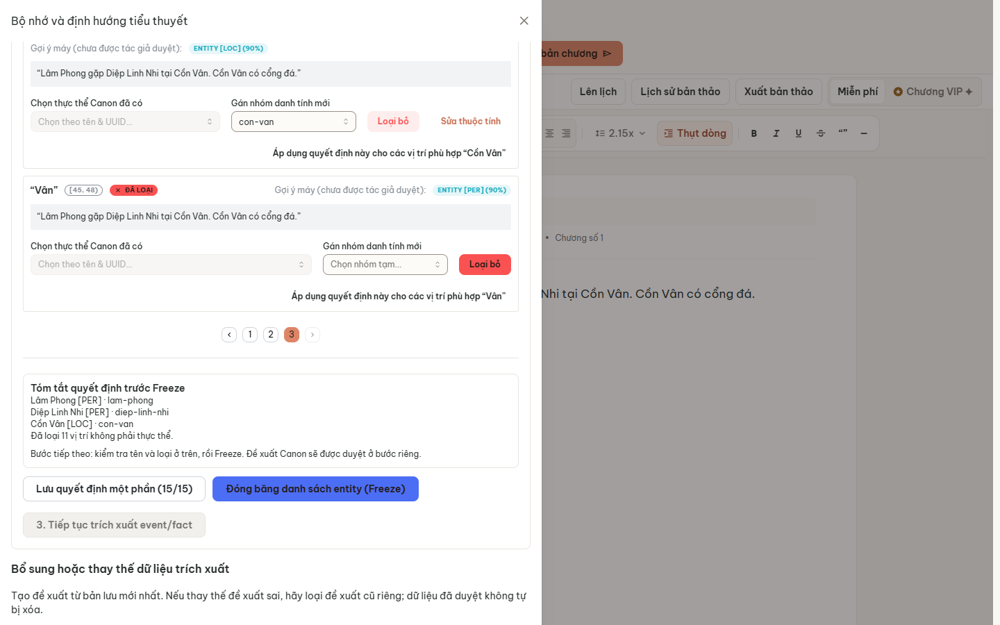
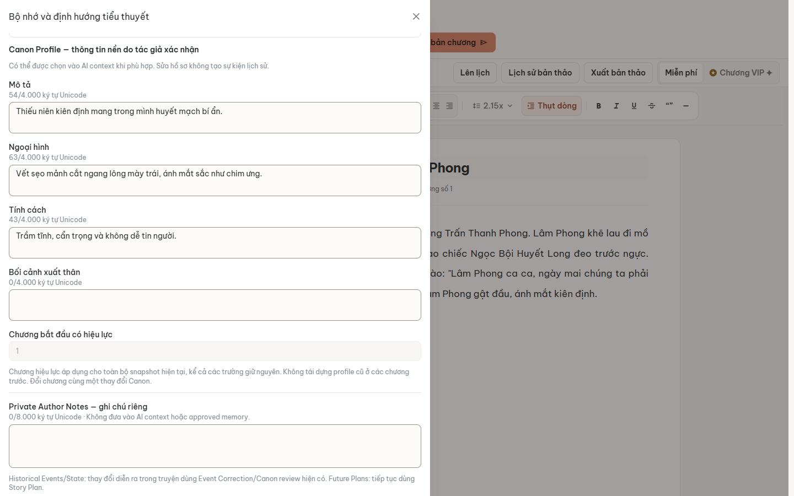
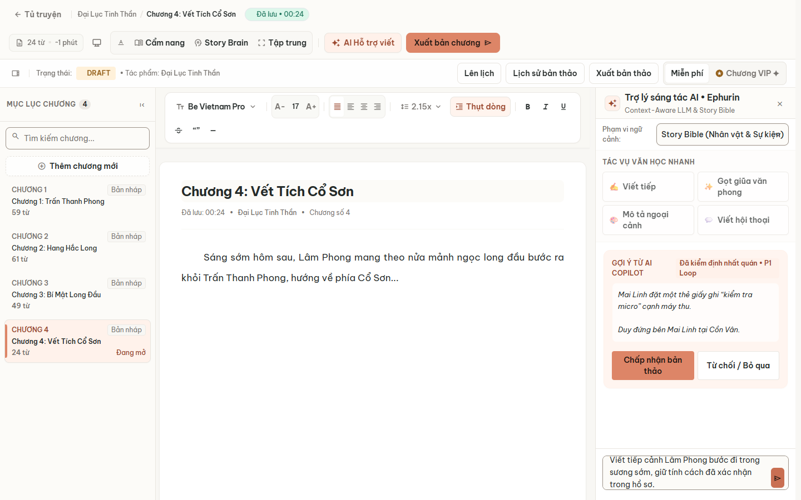

# P1-DEMO-POSTMERGE-79 acceptance

**Verdict: P1_DEMO_POSTMERGE_79_ACCEPTANCE_PASS — scoped offline acceptance.**

Ngày kiểm thử: 30/10/2026 (Asia/Saigon; raw command timestamps dùng UTC). Các required gates đạt với flag true, fake providers và source đã khóa. Không phải production/live-model acceptance hoặc chứng nhận toàn bộ UX. Không phát hiện product defect mới trong các gate bắt buộc; không sửa app để làm test xanh.

## 1. Source provenance

- Integration lock/tested source: `6cbff8829d731704a0e8301fedaa2b1f38dd14c1`.
- Source tree: `3137e2d5ec2596664547ab7feb21ca2c63656d45`.
- Merge parents: `e8f44dfbad7950b5a6b6835ec239ba45b4fb7e6f`, `9b997c9c0623e21e594c24847389db78c7baec84`.
- Merge tree equals reviewed PR #79 head tree exactly; PR #79 head is an ancestor. No production-source divergence introduced by the merge.
- QA branch: `codex/p1-demo-postmerge-79`, based directly on the lock. Only reports, evidence and QA-only readback utilities are added.
- Frontend built freshly from this checkout with API base `/api/v1`. No cached dist was copied. Dependencies reused from matching existing locked installs, without package installation or lockfile changes.
- Actual running backend/AI representative source hashes, production subtree hashes, compiled asset digest/count and argv source-before/after records are included. This is not a full container SBOM claim.
- Final fetch after stack cleanup still resolved integration to the locked SHA. No main/integration branch write, merge or deploy.

| Integrated change | Integration merge SHA |
|---|---|
| PR #75 AX-01 | `033da85ba6690c04362120cbfce3055826bec763` |
| PR #76 AX-02 | `9646b147eca1aacb9a12db00ee11e99923c71e97` |
| PR #77 provenance timestamp | `993493704308b53332ab2cd404097a5d6736c531` |
| PR #78 profile-audit timestamp | `e8f44dfbad7950b5a6b6835ec239ba45b4fb7e6f` |
| PR #79 checkpoint/F01 | `6cbff8829d731704a0e8301fedaa2b1f38dd14c1` |

[Source/build provenance](evidence/p1-demo-postmerge-79/source-build-provenance.json). Evidence commit is separate from tested source; resolve it with `git log -1 --format=%H -- docs/development/integration/p1-author/P1_DEMO_POSTMERGE_79_ACCEPTANCE.md`.

## 2. Runtime and schema: PASS

Owned project `codex-p1-final-9a053a2830`: separate PostgreSQL/pgvector, MongoDB, Backend, AI Service, budget gateway and fake upstream. Compiled frontend served through the real Gateway proxy during browser tests.

Actual container env readback:

- `ENTITY_CANDIDATE_VERIFICATION_ENABLED=true` throughout acceptance. Application default false was asserted separately, not selected or switched to.
- `LLM_PROVIDER=openai` is the local protocol adapter, base URL `http://budget-gateway:18090/v1`; fallback disabled.
- Runtime embeddings none and semantic retrieval false. Focused backend tests use deterministic fake embeddings/capture transport.
- **20 received HTTP requests** in the owned fake-provider ledger; known private note absent from all captured prompts. In-process deterministic test captures are not counted as fake HTTP requests. **Zero live LLM/embedding calls.**

Fresh actual migration chain: backend migrations exit 0; AI Alembic upgrade exit 0, head exactly `0016_entity_profile_audit_timestamp`.

| Schema assertion | Readback |
|---|---|
| Mapped existence | 22 SQLAlchemy tables / 291 columns; nothing missing |
| All mapped nullability | No mismatch |
| revision_provenances.created_at | NOT NULL; default now() |
| entity_profile_audits.created_at | NOT NULL; default now() |
| Alembic version column | Width 35 supports actual revision identifier |
| Initial disposable DB counts | Both timestamp tables had 0 rows / 0 NULLs before fixture writes |

No claim about production NULL counts or global defaults/index/constraint equivalence. Target defaults checked only for the two repaired timestamp columns. Historical NULL-data matrix from schema-repair tasks was not rerun wholesale.

[Schema readback](evidence/p1-demo-postmerge-79/schema-readback.json), [runtime/provider proof](evidence/p1-demo-postmerge-79/runtime-provider-readback.json).

## 3. Commands and actual exits

All application tests use locked source 6cbff88. Private configs/outputs stay outside the checkout. Commands below are from QA root unless cwd specified. Complete argv/cwd/source/exit metadata is linked.

| Command | Exit / observed result |
|---|---|
| `python scripts/p1_final_acceptance.py provision --output ..\p1-postmerge-79-private`, then bridge-config/db-up/up/runtime-proof | 0 for completed stages |
| Driver web-build: `npm.cmd run typecheck`, cwd web | 0 |
| Driver web-build: `npm.cmd run build`, cwd web, API base /api/v1 | 0; inherited directive/chunk-size warnings |
| `npm.cmd --prefix web run test:p1-hitl` | 0; unit 25/25, legacy browser 12/12, focused browser 9/9 (Node parent counts included) |
| `npm.cmd --prefix web run test:entity-profile` | 0; unit/contracts 3/3, browser 17/17 |
| `python <private>/verify_schema.py` | 0; readonly live schema assertions |
| `npm.cmd --prefix web run test:p1-checkpoint-real` | 0; all six production-stack steps PASS |
| `node --test <reviewed-qa>/web/tests/p1-ax-integrated-acceptance.browser.test.mjs` | 0; seven scenarios PASS, supplementary homonym scenario PARTIAL_PASS as explained below |
| `node <private>/ui-writing-check.mjs` final attempt | 0; natural UI writing → exact job/hash/provider binding |
| `python -m pytest -o addopts= -q -ra tests/test_entity_profiles.py tests/test_entity_profile_remediation.py`, cwd ai-service | 0; 48 passed, 2 initially skipped |
| `python -m pytest -o addopts= -q -ra tests/test_entity_profiles.py::test_additive_upgrade_and_rollback_preserve_existing_identity` | 0; 1 passed on a separate disposable migrated DB |
| Driver cleanup-owned | 0; no remaining owned containers, volumes retained |

The two initial Python skips were the unsupported SQLite real-row-lock variant and a migration test requiring another database. The migration test was subsequently run and passed with that separate DB. Real PostgreSQL concurrency coverage ran and passed; the SQLite lock variant is not represented as a lock test PASS. No test was edited, skipped or weakened by this QA branch.

Focused backend/migration databases were separate from the acceptance DB and dropped by exact generated names after completion. Backend runs set AX01_TEST_DATABASE_URL; the migration-only rerun sets AX01_MIGRATION_DATABASE_URL to its own new database. DATABASE_URL/TEST_DATABASE_URL and EXPECTED_TEST_DB_NAME point only at those owned databases. No credential values are published. Flag true was also retained in those test environments; live keys blanked and providers fake.

[Frontend commands](evidence/p1-demo-postmerge-79/frontend-test-commands.json), [real-stack commands](evidence/p1-demo-postmerge-79/real-test-commands.json), [backend commands](evidence/p1-demo-postmerge-79/profile-domain-commands.json), [migration command](evidence/p1-demo-postmerge-79/profile-migration-command.json), [driver ledger](evidence/p1-demo-postmerge-79/commands-and-exits.jsonl).

## 4. Checkpoint / F01 / HITL: PASS

Novel `0c771657-3c24-4dc4-b9dc-0f207a8319df`, run `22a17087-5525-4c49-92d1-40eacb12cf39`.

Public API fixture creates author/novel/chapter. UI performs manuscript bootstrap, group/type edits, quote entry, bulk cancel/confirm, pagination, partial save/full reload, stale-write recovery, Freeze, separate atomic Canon approval and activation. No SQL fixture writes in this checkpoint smoke.

- 15 candidates; explicit author grouping yields three identities.
- Cồn Vân machine LOC remains a suggestion until author decision; explicit PER → LOC edit proves author choice reaches Save/Freeze.
- Exact Cồn Vân bulk IDs: `e9e97db1820ed3bf823d0e69`, `b530a172152bf81d226138f0`.
- Cancel leaves server decisions unchanged. Confirm changes only eligible targets.
- Different authored identity/status quote pairs survive bulk, pagination, Save, full reload, Freeze payload, PG reviewed_decisions and review_submitted_decisions.
- Gateway quote hashes equal PG/assertion proof. Source/target pairs remain distinct.
- Two SPA tabs generate an actual backend 409; local draft retained, server unchanged, then deliberate version-correct save preserves the other tab's decision. Responses were held for synchronization, not fabricated.
- Freeze expected_version 4; machine decisions/candidate projection/immutable revision unchanged. Frozen occurrence and HITL proposal spans match source revision/hash/offsets.
- Approved memory still empty immediately after Freeze. Separate HITL approval required; no automatic Canon approval.

| Confirmed entity | Type | PG UUID (preserved from Freeze) |
|---|---|---|
| Lâm Phong | PER | `afbfa16d-c752-44d7-9bcf-a8602d5aa8f5` |
| Diệp Linh Nhi | PER | `2ed7bcba-f602-48ce-ab48-a4c2b60ed102` |
| Cồn Vân | LOC | `b958a267-38a4-4046-a140-6b2dd331a2ae` |

[Checkpoint proof](evidence/p1-demo-postmerge-79/checkpoint-ux-checkpoint-proof.json), [Gateway hashes](evidence/p1-demo-postmerge-79/checkpoint-gateway-hashes.json), [steps](evidence/p1-demo-postmerge-79/checkpoint-browser-steps.json).

## 5. Editable Codex / private notes / generation: PASS

Reviewed external QA harness source `0e001e396cfc6745c0efc8595922da9ae389a6f4`, with existing source-root/sanitizer adapters, ran outside the production checkout. File hashes are recorded; no harness or app edits were required for Codex suite.

Codex novel `18348a4c-40ba-4b87-aa0c-706568f879ba` is separate from the checkpoint fixture. This is not claimed as one continuous fresh-account manual journey.

- UI selects confirmed Lâm Phong UUID, edits description/appearance/personality and cutoff 1, saves through Gateway, reloads and reads back exact fields.
- PG author_profile/description/profile_version and durable audit checked; Canon edit increments Brain version.
- Note-only UI save persists private note, increments profile version, leaves Brain/events/facts unchanged and excludes note from approved memory.
- Real browser-session profile CAS 409 retains draft and prior save; same-key replay creates no duplicate mutation/audit.
- Cross-author production auth denied both directions (403), anonymous 401, reader 403, missing idempotency key and oversize 422.
- Cutoff 9 exclusion / 10 inclusion checked through production repository; moving cutoff creates no historical event/fact.
- Direct Gateway generation job `555d9654-ee23-589d-96cb-1a46d5fd8543` completed. Captured fake prompt context hash recomputed to the persisted job hash; ContextBudgetPacker recorded; updated profile included, unrelated profiles/private notes excluded.

Supplementary AX-E2E-04 is **PARTIAL_PASS**, not an end-user homonym capability claim: manual author-entity API rejects duplicate canonical names with 422. UUID profile isolation therefore used a clearly labeled SYNTHETIC_DB_FIXTURE. This known boundary is outside the required checkpoint flow and was not silently fixed.

[Codex scenario results](evidence/p1-demo-postmerge-79/codex-acceptance-results.json), [Codex steps](evidence/p1-demo-postmerge-79/codex-browser-steps.json).

### Additional normal UI generation

A fresh browser login opened the Codex fixture's chapter 4, selected Story Bible scope, entered a natural Lâm Phong continuation instruction and clicked the real send button. No injected correlation marker or separate Context Preview button click. The UI's normal internal version lookup was not bypassed.

- UI job: `31c2fba1-26fb-5f97-85a9-e6d928fa71f2`.
- Fake request SHA-256: `e808501f3d570fcdace1a2e674ae1b3ddc85def2054e7c3a89b5ff40db9b7edf`.
- Recomputed and persisted context hash: `7c6126fd161a6a56cd34b448e3a8c2b9755f7ee86f74ec9370f1195d5bfe3b63`.
- DB-approved appearance/personality present; actual nonempty private note absent.
- Fake output rejected through UI; Brain version unchanged. Canned names differed from the manuscript; no prose-quality claim or acceptance/insertion of that draft.

The QA-only UI utility requires P1_SOURCE_ROOT, P1_ACCEPTANCE_CONFIG, a fresh P1_EVIDENCE_DIR, P1_CODEX_RESULTS and QA_PASSWORD supplied privately. It reads the existing disposable author fixture and never extracts/injects browser tokens.

[UI generation proof](evidence/p1-demo-postmerge-79/ui-writing-2-ui-writing-proof.json), [exact UI command](evidence/p1-demo-postmerge-79/ui-writing-command-2.json).

## 6. Failed setup attempts, limitations and manual actions

No product defect was confirmed in the required gates. No production source change was made.

- First web-build invocation raced provisioning before private config existed; driver refused with missing project. Rerun after provisioning succeeded. This was a harness dependency error.
- First extra UI-generation helper used accessible-name lookup for an icon button whose localized label is a title; no POST was sent. Corrected QA-only locator to getByTitle and awaited editor hydration/click-response together; final attempt passed. No application patch.
- QA is automated desktop browser operation. Fresh registration/novel/chapter UI onboarding was not repeated manually on this SHA; setup used public API fixtures. Prior manual runbook evidence is distinguished from current UI evidence.
- Presenter must manually rehearse login/setup and identity review before the demo. No naïve-user study, mobile/a11y certification, live-model quality, production data or deployment acceptance.
- Only flag true and Story Bible UI selection used; default-false bootstrap and other scope behavior NOT_RUN here.
- Unsaved checkpoint draft survives polling/Refresh/pagination; full browser reload was verified after Save. No claim that F5 preserves unsaved edits.
- In-flight cancel, accepting/inserting the canned draft, publishing/scheduling, post-Freeze identity/type correction and full historical NULL-data migration matrix not rerun.
- Full global schema equivalence not asserted; checks are scoped above.
- Existing fake output/consistency badge is not semantic quality proof. Avoid displaying private note contents during presentation.

[Runbook V2](P1_DEMO_REHEARSAL_RUNBOOK_V2.md) marks current UI/API/prior/manual evidence separately. Demo hosting/URL must be supplied by the operator; QA server is intentionally stopped after acceptance.

## 7. Hygiene, recovery and handoff

Only allowlisted metadata, quote hashes, fictional public Canon and visually inspected screenshots are committed. No credentials, private-note value, raw HTTP/SQL snapshots, raw prompts or trace ZIPs. Targeted hygiene with negative controls covers new reports/evidence; results included. Generic QA-only schema/UI utilities contain no credentials and require outside-repo config/environment.

The owned stack is stopped, private volumes retained. Regression DBs were dropped separately. No shared resources, main or integration branch modified. Repeat with a new owned project and fresh private output paths; never point QA at production. If a future migration or privacy/persistence assertion fails, preserve evidence and stop for review, without app fixes on this QA branch.

No rollback is needed for application code. Do not downgrade shared schemas or reset history as cleanup. Draft QA PR only; stop for GPT-6 independent review.
