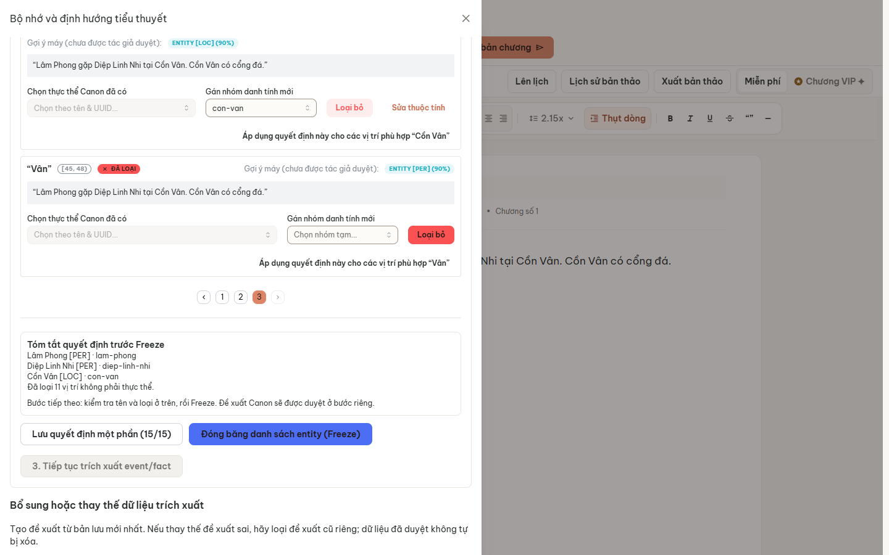

# P1-DEMO-UX-01 — Entity identity checkpoint

**Verdict: P1_DEMO_UX_01_READY_FOR_REVIEW**

Ngày kiểm thử: 29/10/2026 (Asia/Saigon). Sửa frontend checkpoint và regression tests; không đổi Backend, AI Service, migrations, API DTO, Canon authority hay pipeline.

## Source lock và phạm vi

- Base: `integration/p1-demo-20261109@e8f44dfbad7950b5a6b6835ec239ba45b4fb7e6f`.
- Branch: `codex/p1-demo-ux-01`.
- Production frontend fix: `9786b493147a9581f929bcfc026862d4dfc35330`.
- Source/test HEAD kiểm thử cuối: `75b9c5c1d9561d8fc6e6f8b0e6d65a9bcc5f2f8d`. Commit thứ hai chỉ sửa teardown của browser test. Tree và build provenance: [source-build-provenance.json](evidence/p1-demo-ux-01/source-build-provenance.json).
- Typecheck/build chạy ở 9786b49; `web/src` giống hệt ở 75b9c5c. HITL và real-stack tests cuối chạy ở 75b9c5c, exit 0.
- Báo cáo và evidence nằm trong commit riêng sau source/test. SHA evidence xác định bằng `git log -1 --format=%H -- docs/development/integration/p1-author/P1_DEMO_UX_01_REVIEW.md`.
- Đã đọc acceptance/runbook từ QA branch `codex/p1-demo-final-01-qa@157bcf064c6944ccdf2be5d9b730a8f8bc7eb030`; không merge QA branch vào runtime source.

Files source/test thay đổi:

| File | Mục đích |
|---|---|
| `web/src/features/ai-copilot/EntityExtractionReview.tsx` | Giữ type/draft, bulk an toàn, conflict đầy đủ và checkpoint clarity |
| `web/tests/p1-entity-checkpoint-ux.browser.test.mjs` | Mounted React browser regressions, API boundary được mock có chủ đích |
| `web/tests/p1-entity-checkpoint-real.browser.test.mjs` | Compiled production SPA → real Gateway → PostgreSQL, fake extraction, HITL riêng |
| `web/package.json` | Thêm focused test vào `test:p1-hitl`; thêm lệnh real-stack opt-in cần config riêng |

`author-memory-api.ts` được audit nhưng không đổi. Constructors, scoped provisional key, UUID selection, expected_version và backend validation giữ nguyên.

## RED trước khi sửa

Component ở base có blob `609f7c3…`; SHA đầy đủ và command nằm trong [red-provenance.json](evidence/p1-demo-ux-01/red-provenance.json). Chạy browser thật với component chưa sửa; test file mới là thay đổi duy nhất cần để tái hiện.

[RED log](evidence/p1-demo-ux-01/red-browser-authorized.txt), exit 1: bốn assertion thất bại trong năm subcases ban đầu; isolation case PASS. Suite sau đó được mở rộng thành bảy subcases.

1. Machine gợi ý LOC, tác giả gán nhóm mới và lưu: payload thực tế PER, kỳ vọng LOC.
2. Tác giả chọn LOC ở form thuộc tính rồi lưu checkpoint: payload vẫn PER khi chưa bấm nút commit thuộc tính riêng.
3. Bulk confirm tác động cả `loc-other` đã gắn Canon UUID khác; kỳ vọng chỉ `loc-1`, `loc-2`.
4. Không có cảnh báo ở case server update. RED case này chịu ảnh hưởng của lỗi default type, nên không được coi là một reproduction độc lập hoàn toàn của type-only conflict. Source inspection xác nhận comparator cũ không so sánh type/name/status/quotes; GREEN regression kiểm tra type-only conflict trên draft LOC đúng.

Nested dirty-state update là rủi ro consistency quan sát được trong code, không có tuyên bố rằng đã tái hiện riêng một lỗi scheduler React. Nó được loại bỏ cùng thuật toán bulk mới.

## Thay đổi và lý do

### A — Type và bản nháp

Giá trị hiển thị ưu tiên quyết định tác giả, sau đó gợi ý machine, cuối cùng fallback PER. Gợi ý máy được ghi rõ là chưa được tác giả duyệt; không được tự chuyển vào choices/Canon.

Các trường thuộc tính provisional dùng trực tiếp checkpoint draft. Chọn LOC cập nhật draft ngay; không còn buffer riêng có thể bị bỏ qua khi lưu checkpoint, phân trang hoặc đóng phần chi tiết. UI giải thích phải Lưu một phần hoặc Freeze để lưu lên server. Không có request tự approve từ thay đổi dropdown.

Save/Freeze lấy cùng choices map. Browser regression chứng minh machine PER vẫn có thể được tác giả đổi thành LOC, đi qua phân trang, save/reload và giữ LOC. Real-stack chứng minh selected LOC đi tới Gateway, Frozen UUID và PostgreSQL Canon sau HITL riêng.

### B — Bulk và conflict

- Tính target/update map một lần; cập nhật choices và dirty IDs bằng các updater thuần, không gọi setter bên trong setter khác.
- Vẫn cần mở xác nhận rồi bấm xác nhận. Cancel không đổi decisions.
- Chỉ áp dụng cho cùng surface theo chính sách case-insensitive hiện có, đang unresolved hoặc đã chọn cùng identity.
- Giữ nguyên các quyết định khác UUID/nhóm và các quyết định loại bỏ khác ý định bulk. Người dùng phải sửa từng vị trí nếu muốn đổi một identity đã chọn khác.
- Xác nhận hiển thị số lượng và offsets sẽ tác động. Label không còn hứa áp dụng vô điều kiện cho mọi vị trí.
- Conflict comparator kiểm tra toàn bộ trường tác giả chỉnh, gồm type/name/status/quotes. Dirty draft được giữ qua polling/Refresh/409; chỉ xóa dirty marker cho decision được server xác nhận và vẫn trùng bản đã gửi.
- Cùng UUID/nhóm có tên/type/status không nhất quán được hiển thị trong summary và chặn Freeze; không tự hòa trộn identity hay nới backend validation.
- Novel/run key tiếp tục cách ly state. Candidate IDs không được dùng như identity toàn cục.

Các test dùng mock cùng tên/different ID được ghi rõ là kiểm chứng component, không phải claim rằng API tạo Canon trùng tên đã được mở rộng.

### C — Checkpoint clarity

Phân biệt duyệt danh tính với duyệt đề xuất Canon; hiển thị số vị trí chưa quyết định và bước tiếp theo. Hướng dẫn group key là khóa kỹ thuật ASCII, không phải tên hiển thị tiếng Việt. Summary trước Freeze liệt kê tên/type/identity key hoặc UUID, tổng số vị trí loại, và nhắc rằng Canon được duyệt ở bước riêng.

## Tests và exit codes

| Command / môi trường | Source | Exit / kết quả |
|---|---|---|
| `node --test tests/p1-entity-checkpoint-ux.browser.test.mjs`, cwd web, component base | e8f44df | 1 — RED có chủ đích, 4/5 subcases thất bại |
| `npm.cmd --prefix web run test:p1-hitl` | 75b9c5c | 0 — unit 25/25; legacy mounted browser 12/12 (kể cả parent); focused browser 8/8 (7 subcases + parent); không skip |
| `npm.cmd run typecheck`, cwd web, qua driver web-build | 9786b49 | 0 |
| `npm.cmd run build`, cwd web, `VITE_API_BASE_URL=/api/v1` qua driver | 9786b49 | 0 — production dist mới; warnings chunk/directive có sẵn |
| `npm.cmd --prefix web run test:p1-checkpoint-real` với private config/evidence dir | 75b9c5c | 0 — 6 bước thực tế PASS |
| Driver provision → bridge-config → db-up → up | frontend đang phát triển, backend/AI bằng base | 0 sau khi engine sẵn sàng |
| Backend `npm.cmd run db:migrate`; AI `python -m alembic upgrade head` | backend/AI không đổi | 0; actual Alembic head 0016 |
| Driver `cleanup-owned` | 75b9c5c + evidence untracked | 0; không còn container của project; giữ volumes |

Exact argv/cwd/SHA/exit: [HITL command](evidence/p1-demo-ux-01/verify-hitl-command.json), [real command](evidence/p1-demo-ux-01/verify-real-command.json), [driver ledger](evidence/p1-demo-ux-01/commands-and-exits.jsonl). Logs nằm cùng evidence directory.

Driver chạy từ root: `python scripts/p1_final_acceptance.py <stage> --output ..\p1-demo-ux-01-private`. Real test cần `P1_ACCEPTANCE_CONFIG=<private-stack.json>`, `P1_EVIDENCE_DIR=<new outside-repo directory>`, `PYTHONUTF8=1`. Helper từ source phục vụ compiled dist và proxy Gateway thật; không mock production API responses. Không chạy real test với shared/production DB.

## Real browser / Gateway / DB

Owned project `codex-p1-final-952b786311`; PostgreSQL, MongoDB, Backend, AI Service và fake upstream riêng. [Runtime readback](evidence/p1-demo-ux-01/runtime-readback.json): flag **true**, local budget-gateway LLM URL, fallback disabled, embeddings none, semantic retrieval false. Không đổi cờ để làm test xanh.

Fixture chỉ dùng public API đăng ký/onboarding/tạo novel/chapter. Bootstrap manuscript được bấm qua UI để tạo immutable revision và lưu normal job handle. Toàn bộ gán nhóm/type, bulk, partial save, Freeze, Canon approval và activation đi qua compiled production UI. Không SQL fixture writes.

Các bước và readback:

1. Nội dung có Lâm Phong, Diệp Linh Nhi, Cồn Vân lặp hai lần. Checkpoint có 15 candidates; machine gợi ý LOC cho hai full-name Cồn Vân; reviewed_decisions ban đầu rỗng.
2. Tạo ba khóa nhóm, gán full names. Tác giả thực sự mở loại thực thể, chọn PER rồi LOC để xác nhận override hoạt động. Cancel bulk: server decisions vẫn rỗng, occurrence thứ hai vẫn unresolved.
3. Explicit confirm bulk: đúng hai candidate IDs `e9e97db1820ed3bf823d0e69`, `b530a172152bf81d226138f0`; save partial, full page reload và nhận lại nhóm/type đúng.
4. Hai tab SPA cùng author/context có query state riêng. Giữ GET response ở tab A, tab B lưu trước; A gửi expected_version cũ nhận 409, draft còn nguyên, server readback không đổi. Nhả GET, lấy version mới, người dùng lưu lại có chủ đích và giữ cả quyết định của B. Không tạo fake 409 response.
5. Quyết định rõ các vị trí còn lại, xem summary ba identity; Freeze gửi đủ 15 decisions với expected_version 4, hai Cồn Vân đều LOC. Approved memory vẫn chưa có entity ngay sau Freeze.
6. Continue tạo ba entity proposals cùng dependency group; kiểm tra payload trước khi bấm atomic approval, rồi activation qua UI. Reload, đối chiếu memory API và PostgreSQL: UUID từ Freeze giữ nguyên, type/status confirmed đúng.

Final novel `58c7e625-6d3b-44b5-8ada-1f693ee2005c`; run `5faefab7-e1ce-4993-ab96-e006e93f9d29`.

| Canon name | Type | PostgreSQL UUID |
|---|---|---|
| Lâm Phong | PER | `9a3012a4-9618-41bf-96ba-b325d7934e78` |
| Diệp Linh Nhi | PER | `4ce6f1a4-9824-4b58-9482-2174f6e86411` |
| Cồn Vân | LOC | `6fe290bb-88b0-449e-9973-d92e158f263a` |

[Proof/readback](evidence/p1-demo-ux-01/ux-checkpoint-proof.json), [allowlisted Gateway requests](evidence/p1-demo-ux-01/gateway-decision-requests.json), [browser steps](evidence/p1-demo-ux-01/browser-steps.json). Final browser errors: rỗng. Không dựa riêng vào screenshot.

Fake-volume ledger ghi 24 received requests cho toàn bộ các lần thử của task, không chỉ lần PASS cuối. Chỉ xuất metadata/hashes, không raw prompt. **Zero live LLM/embedding calls.** Không có writing-generation quality test trong scope này.

## Các lần thử thất bại và sửa harness

Không che các exit 1 trước kết quả cuối:

- Lần browser sandbox ban đầu không launch được Edge; chạy browser test được cấp quyền sau đó mới cho RED sản phẩm thật.
- Docker engine ban đầu tắt; provision thất bại trước khi có project. Khởi động Docker Desktop, provision mới thành công. Không sửa app hay shared databases.
- Real attempt 1: build thủ công thiếu API base của stack; login không tới Gateway. Dùng driver hiện có build lại với /api/v1.
- Attempt 2: harness so sánh innerText lowercase v3 với badge có CSS uppercase. Response thật đã có version 3; sửa locator dùng DOM text như existing tests.
- Attempt 3: API-initiated bootstrap không tạo local job handle cho UI activation. Đổi fixture thành bootstrap bằng UI; không inject localStorage hoặc đổi runtime logic.
- Attempt 4: toàn bộ hành trình PASS, exit 0.
- Verification đầu ở source 9786b49: assertions và PG proof hoàn tất, nhưng exit 1 do route teardown race. Test-only commit 75b9c5c dùng `unrouteAll({ behavior: 'wait' })`, không `ignoreErrors`; final rerun exit 0. Không bỏ assertion/CAS.
- Một số probe/read commands và test-selector scaffolding được chỉnh trong quá trình xây harness; không phải migration/runtime defect. Probe Alembic được sửa về `public.alembic_version`.

Các TAP logs thất bại liên quan nằm dưới tên `attempt-*`; giữ nguyên evidence cũ của các task trước.

## Demo và giới hạn còn lại

Đường demo ngắn: gán khóa nhóm ASCII → kiểm tra type hiển thị → chọn LOC nếu cần → xác nhận bulk theo count/offsets → lưu một phần → reload kiểm tra → duyệt phần còn lại → xem summary → Freeze → duyệt Canon riêng.

- Chỉ dirty draft trong checkpoint được giữ qua polling/Refresh và phân trang; full browser reload được kiểm chứng sau Save. Không bổ sung một persistent local draft store, không claim F5 giữ edits chưa lưu.
- Bulk cố ý giữ khác identity/rejection; nếu muốn đổi quyết định đó phải làm từng occurrence. Same-name UUID protection được browser component test; không claim hỗ trợ mới cho API tạo Canon homonym.
- Real smoke là automated browser desktop, không phải một naïve-human usability study. Đăng ký/novel/chapter là API fixture, không claim đã tổng duyệt UI onboarding lần nữa.
- Không rerun toàn bộ tám-scenario acceptance suite, live/paid provider, mobile/a11y hoặc production acceptance. Cờ false không được kiểm thử trong task này.
- Fake extractor vẫn tạo nhiều span và có thể gợi ý sai; author review vẫn bắt buộc. Không nâng confidence thành Canon authority.
- Không thay đổi phần hiển thị job/activation ở IDE ngoài component; bootstrap API ở một phiên khác không được giả lập thành bootstrap UI hiện tại.

## Hygiene, recovery và bàn giao

Chỉ commit allowlisted requests, hashes, fictional Canon fields và screenshot đã xem trực tiếp. Credentials, raw traces, raw auth responses và private stack config ở ngoài checkout. Chạy scanner có negative controls trên evidence mới và report trước push; kết quả nằm trong `secret-hygiene.json`.

Stack task đã dừng, volumes riêng giữ lại. Không stop Docker daemon hay resources của agent khác. Không có migration mới hoặc data repair; rollback code bằng PR revert có review, không reset hard hay rewrite history. Dirty edits nên Save partial trước khi đóng/reload trình duyệt.

Push branch riêng, mở **Draft PR** vào integration để independent review. Không merge, deploy, thay main hoặc đưa P2/P3 vào PR.
