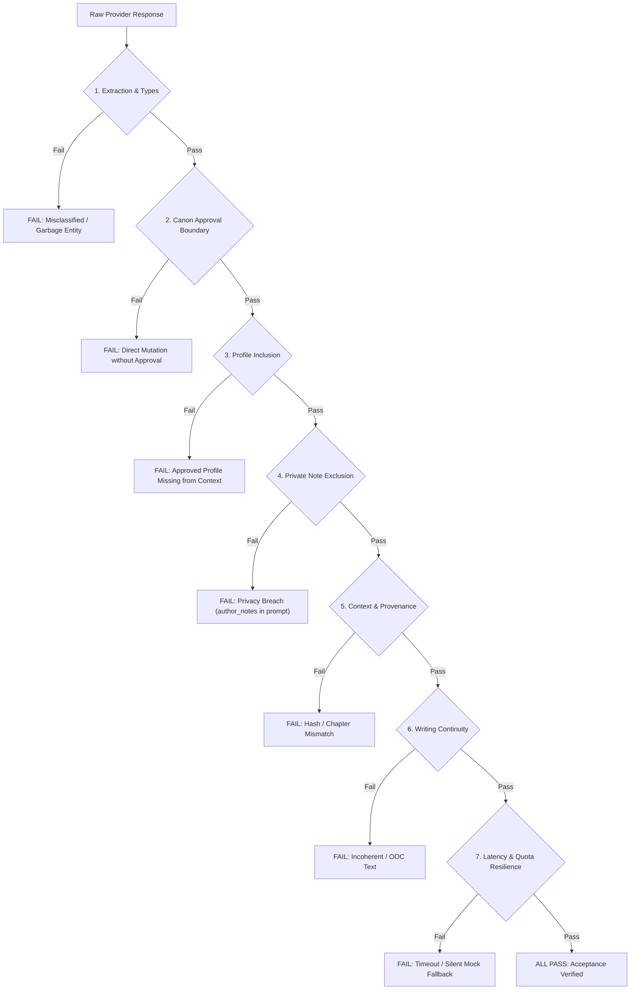

# P1-LIVE-AI-PREFLIGHT-01: Zero-Call Provider Readiness Audit

**Document Reference:** `docs/development/integration/p1-author/P1_LIVE_AI_PREFLIGHT_01.md`  
**Repository:** `Ephurin/Novel_sharing_platform`  
**Source Baseline:** `integration/p1-demo-20261109@6cbff8829d731704a0e8301fedaa2b1f38dd14c1`  
**Working Branch:** `gemini/p1-live-ai-preflight-01`  
**Audit Date:** 2026-10-30  
**Audit Scope:** AI-Service Provider Adapter, Model Topology, Env Contracts, Fallback Mechanics, Context Token Budget, HITL Checkpoint Lifecycles, and Acceptance Design.  
**Provider Invocation Status:** **ZERO CALLS (0 generative/handshake calls executed).**

---

## Executive Summary & Final Verdict

| Checkpoint Element | Current State | Audit Finding |
|---|---|---|
| **Intended Writing Model** | Gemini 3.5 Flash Lite | Model identifier `gemini-3.5-flash-lite` is default in settings; marked **`UNVERIFIED`** pending authorized live handshake. |
| **Intended Fallback Model** | Gemini 3.1 Flash Lite | Identifier `gemini-3.1-flash-lite` supported via env; **NO automatic intra-Gemini code fallback**. |
| **Forbidden Models** | Gemini 2.5 / 1.5 / 2.0 | **`DISQUALIFIED`**; zero references permitted in active configuration. |
| **Silent Mock Fallback** | `LLM_LOCAL_FALLBACK` | Defaults to `"true"` in code (`core/llm_service.py`); **MUST be set to `"false"`** in env to prevent silent mock substitution. |
| **Key Quota Envelope** | 15 RPM / 250K TPM / 500 RPD | **CONFIRMED BY OPERATOR**; requires inter-request pacing $\ge 4.5\text{s}$ ($\le 12\text{ RPM}$) to prevent burst 429s. |
| **Call Budget Gateway** | Context Token Budget | Present (`ContextBudgetPacker` 12k–24k); external provider spending gateway is absent and must be bounded by harness. |
| **HITL Checkpoint** | `ENTITY_CANDIDATE_VERIFICATION_ENABLED` | Fully integrated two-phase CAS checkpoint; enforces source quotes, author review, and freeze before extraction. |
| **Private Note Isolation** | `EntityProfilePatch` & `approved_profile()` | Verified by code audit: `author_notes` is excluded from prompt context at the domain and repository layers. |

### Final Preflight Verdict

```
P1_LIVE_AI_PREFLIGHT_NEEDS_CHANGES
```

**Verdict Rationale:**
1. **Unverified Model Access:** Per audit rule, because no external cloud handshake was permitted during preflight, `gemini-3.5-flash-lite` and `gemini-3.1-flash-lite` must remain marked `UNVERIFIED` until authorized live credential verification.
2. **Missing Automatic Intra-Provider Fallback:** `LLMService._gemini_model_candidates` in `ai-service/core/llm_service.py` evaluates only `[self.model]`. Automatic failover from Gemini 3.5 to Gemini 3.1 is not implemented in Python runtime code; switching requires manual operator intervention via `LLM_MODEL=gemini-3.1-flash-lite`.
3. **Silent Local Fallback Risk:** `core/llm_service.py` line 324 defaults `LLM_LOCAL_FALLBACK` to `"true"`. For live acceptance, the environment configuration must explicitly enforce `LLM_LOCAL_FALLBACK="false"` so that provider errors (e.g. 429 quota exhaustion or network dropouts) fail closed instead of silently generating canned Vietnamese phrases.
4. **Budget Authorization Pending:** Live execution is strictly stopped awaiting explicit call-budget authorization from the repository owner.

---

## 1. Provider and Model Verification

### 1.1 Provider Adapters in Codebase

The platform contains two distinct Python AI adapters and one Node.js Copilot provider adapter:

| Component | File Path | Protocol / SDK | Role in Architecture |
|---|---|---|---|
| **`LLMService`** *(Production)* | `ai-service/core/llm_service.py` | Official `google-genai` SDK (`from google import genai`) | Production workhorse for `EntityPipeline`, `EventSummarizer`, `StateTransitionProposals`, `ProseFacts`, and `WritingService`. |
| **`LLMClient`** *(Legacy / Utility)* | `ai-service/core/llm_client.py` | Direct REST (`urllib.request`) to Google Generative Language v1beta | Legacy caller mounted only at utility endpoint `POST /llm/generate` and unit tests. Not used by Author P1 IDE. |
| **`Node Copilot Provider`** | `backend/src/modules/ai-copilot/llm-provider.ts` | Fetch to Google Gemini OpenAI-compatible endpoint (`/v1beta/openai`) | Node-layer AI Copilot completions and `/models` health checking. |

#### Detailed Audit of `LLMService`:
- **SDK & Initialization:** `LLMService._call_gemini()` imports `from google import genai` and instantiates `genai.Client(api_key=self.api_key)`.
- **Model Normalization:** `_normalize_model()` ensures any model string without a `"models/"` prefix is prefixed with `"models/"` (e.g., `gemini-3.5-flash-lite` becomes `models/gemini-3.5-flash-lite`). The Google GenAI SDK accepts both raw and prefixed strings.
- **Generation Method:** Calls `client.models.generate_content(model=model_name, contents=merged_prompt, config={"temperature": self.temperature, "max_output_tokens": self.max_tokens})`.

### 1.2 Model Identifiers and Topology

| Friendly Name | Standard API Model ID | Codebase Resource String | Provider Status | Code Compatibility |
|---|---|---|---|---|
| **Gemini 3.5 Flash Lite** | `gemini-3.5-flash-lite` | `models/gemini-3.5-flash-lite` | **`UNVERIFIED`** | Fully compatible without code modifications. Default in `core/settings.py:68`. |
| **Gemini 3.1 Flash Lite** | `gemini-3.1-flash-lite` | `models/gemini-3.1-flash-lite` | **`UNVERIFIED`** | Compatible via `LLM_MODEL=gemini-3.1-flash-lite`. **No automatic fallback in code.** |
| **Gemini 2.5 (All variants)** | `gemini-2.5-*` | N/A | **`DISQUALIFIED`** | Forbidden by project governance. |
| **Gemini 1.5 / 2.0 Legacy** | `gemini-1.5-*`, `gemini-2.0-*` | N/A | **`DISQUALIFIED`** | Deprecated / unapproved for this milestone. |

> [!IMPORTANT]
> **Provider Status Justification (`UNVERIFIED`):** Under strict preflight instructions, zero generative and zero network calls were made to external Google APIs. Even listing models via `GET https://generativelanguage.googleapis.com/v1beta/models` requires active credential transmission. Therefore, per task requirements, all external model identifiers are formally classified as `UNVERIFIED`, not `AVAILABLE`.

### 1.3 Fallback Mechanics Audit

1. **Intra-Gemini Model Fallback (Gemini 3.5 $\to$ Gemini 3.1):**
   - Source: `ai-service/core/llm_service.py` lines 251–263:
     ```python
     def _gemini_model_candidates(self) -> list[str]:
         # Do not silently switch to retired or unapproved models. Operators may
         # explicitly select gemini-3.1-flash-lite via LLM_MODEL if needed.
         candidates = [self.model]
         ...
         return result
     ```
   - **Finding:** The model candidate iterator contains *only* the single configured `self.model`. If `gemini-3.5-flash-lite` is unavailable or returns an error, the code raises `LLMServiceError` immediately after checking `candidates`. It does not fall back to `gemini-3.1-flash-lite`.
   - **Remediation Needed:** Operators requiring Gemini 3.1 must explicitly supply `LLM_MODEL=gemini-3.1-flash-lite` in the container environment.

2. **Cross-Provider Fallback:**
   - Source: `ai-service/core/llm_service.py` lines 201–213:
     Cross-provider fallback is constrained to OpenAI and requires explicit configuration: `LLM_FALLBACK_PROVIDER=openai` and `OPENAI_API_KEY`.
   - **Finding:** With `LLM_FALLBACK_PROVIDER=""`, cross-provider fallback is inactive, preventing accidental leaks or charges to third-party providers.

3. **Silent Mock Fallback (`LLM_LOCAL_FALLBACK`):**
   - Source: `ai-service/core/llm_service.py` lines 324–326 and 507–512:
     ```python
     @staticmethod
     def _local_fallback_enabled() -> bool:
         value = (os.getenv("LLM_LOCAL_FALLBACK", "true") or "true").strip().lower()
         return value not in {"0", "false", "no", "off"}
     ```
   - **Finding:** If an external LLM call fails (timeout, 429 quota, authentication failure), `generate_writing_draft` catches the exception and returns:
     `"Đoạn văn tự động bổ sung dựa trên hướng dẫn: ..."`
   - **CRITICAL REQUIREMENT FOR LIVE ACCEPTANCE:** `LLM_LOCAL_FALLBACK="false"` must be set in the live environment. Without this flag, live acceptance could silently pass on synthetic fallback strings without ever hitting the real Gemini provider.

### 1.4 Budget Gateway & Quota Handling Audit

1. **In-Process Context Token Budget (`ContextBudgetPacker`):**
   - Source: `ai-service/application/context_budget.py` and `ai-service/application/context_routing.py`.
   - Default budget: 12,000 tokens (configurable via tiers up to 24,000 tokens).
   - Invariant: When prompt tokens exceed capacity, low-priority narrative events are trimmed first.
   - Fail-Closed: If protected entities and world rules exceed the maximum tier, `ContextBudgetRouter` raises `ContextRoutingUnresolvedError`, failing closed with `CONTEXT_SCOPE_EXCEEDS_MAX_TIER`.
2. **Financial Spending / Call-Rate Gateway:**
   - **Finding:** There is no software middleware or token bucket in the repository that enforces dollar limits or request caps on outbound Google API calls.
   - **Implication:** The execution harness must impose strict, hard request boundaries and timeout caps before initiating live calls.

---

## 2. Configuration Isolation

To ensure complete isolation between offline CI testing and live acceptance without altering demo integration defaults, the configuration contracts are defined as follows:

### 2.1 Configuration Isolation Matrix

| Configuration Variable | Offline Testing | Live Acceptance | Demo Override (`docker-compose.flash-lite-demo.yml`) |
|---|---|---|---|
| `LLM_PROVIDER` | `fake` | `gemini` | `gemini` |
| `LLM_MODEL` | `fake-p4-model` | `gemini-3.5-flash-lite` | `${DEMO_LLM_MODEL:-gemini-3.5-flash-lite}` |
| `GEMINI_API_KEY` | *(empty / dummy)* | *(Valid key in untracked `.env.local`)* | `${GEMINI_API_KEY:?}` |
| `LLM_FALLBACK_PROVIDER` | `""` | `""` | `""` |
| `LLM_LOCAL_FALLBACK` | `false` | `false` *(FAIL-CLOSED)* | `false` |
| `LLM_TIMEOUT_SECONDS` | `5` | `30` | `30` |
| `CONTEXT_ROUTING_POLICY` | `legacy-v1` | `legacy-v1` | `legacy-v1` |
| `ENTITY_CANDIDATE_VERIFICATION_ENABLED` | `false` or `true` *(test-dependent)* | `true` *(Author Checkpoint active)* | `false` *(demo default)* |
| `EMBEDDING_PROVIDER` | `fake` or `none` | `none` *(or `fake` to isolate from 3.5)* | `none` |
| `SERVICE_AUTH_DISABLED` | `false` | `false` | `false` |
| Outbound Network Egress | Blocked / None | Allowed only to `generativelanguage.googleapis.com` | Allowed |

### 2.2 Implications of `ENTITY_CANDIDATE_VERIFICATION_ENABLED=true`

Enabling candidate verification activates the authoritative Human-in-the-Loop (HITL) author checkpoint:

```
[Manuscript Revision]
        │
        ▼
[Chunked Discovery] ────────► EntityPipeline.run() per chunk (~1200 chars)
        │
        ▼
[Candidate Inventory] ──────► Deduplicates surfaces across source
        │
        ▼
[Batch Verification] ───────► EntityDecisionBatch (up to 24 candidates/batch, bounded repair)
        │
        ▼
[Checkpoint Status: waiting_entity_review]  <─── STOPS HERE FOR HUMAN REVIEW
        │
   (Author UI: Edits, Groups, Approvals / Rejections)
        │
        ▼
[POST /{novel_id}/entity-reviews/{run_id}/continue]
        │
        ├─► [hitl_event_extraction] ──────► Bounded to ReviewedInventory entities
        ├─► [prose_fact_extraction] ──────► Atomic facts with exact source quotes
        └─► [hitl_state_extraction] ──────► State transitions per verified event
```

#### Key Invariants & Implications:
1. **Asynchronous Checkpoint Gate:** `POST /revisions/{id}/analyses` does *not* immediately generate proposals. It stores an `entity_candidate_audit` in PostgreSQL with status `waiting_entity_review` and returns empty proposals. Downstream event and fact extraction are paused until the author explicitly submits decisions.
2. **Strict Verification Partitioning:** Candidates classified as `not_entity` or `unresolved` have their canonical names, entity types, and life statuses scrubbed to empty/null. Only approved `entity` records enter `ReviewedInventory`.
3. **Optimistic Locking Guard:** Any background change to `brain_version` or `guidance_version` while review is pending triggers an `OptimisticLockError`, ensuring stale approvals never pollute Canon.

---

## 3. Call-Budget Forecast (Vietnamese Fantasy Workflow)

### 3.1 Target Workflow Topology

The evaluation scenario is a small Vietnamese fantasy story segment (~2,000 Unicode characters / ~500 words):
- Chapter 1: Introduction of Lý Tiêu Dao arriving at Tiên Linh Đảo and meeting Triệu Linh Nhi.
- Chapter 2: Author next-chapter writing request at the lotus pond.

### 3.2 Granular Provider Call Breakdown

| Workflow Step | Endpoint / Internal Operation | Input Sizing | Output Sizing | Base Calls | Max Retries | Total Bounded Calls |
|---|---|---|---|:---:|:---:|:---:|
| **1. Manuscript Bootstrap** | `POST /v1/story-brains/bootstrap/from-manuscript` | Metadata | Job ID | 0 | 0 | **0** *(pure DB)* |
| **2. Chunked Entity Discovery** | `EntityPipeline.run()` (2 chunks of ~1000 chars) | ~600 tokens/chunk | ~150 tokens/chunk | 2 | 0 | **2** |
| **3. Entity Verification** | `call_structured('entity_candidate_verification')` | ~1,200 tokens | ~350 tokens | 1 | 1 *(repair loop)* | **2** |
| **4. Author Review (HITL)** | `POST /entity-reviews/{run_id}/review` | N/A | Status | 0 | 0 | **0** *(human UI)* |
| **5. Narrative Event Extraction** | `call_structured('hitl_event_extraction')` | ~1,800 tokens | ~250 tokens | 1 | 0 | **1** |
| **6. Prose Fact Extraction** | `call_structured('prose_fact_extraction')` | ~1,800 tokens | ~200 tokens | 1 | 0 | **1** |
| **7. Grounding Quote Repair** | `resolve_grounded_quote()` *(if quote misaligned)* | ~800 tokens | ~50 tokens | 0 | 1 | **1** |
| **8. State Transition Proposals** | `call_structured('hitl_state_extraction')` (2 events) | ~700 tokens/event | ~150 tokens/event | 2 | 0 | **2** |
| **9. Canon Approval & Profile Edit** | `POST /proposals/{id}/accept`, `PATCH /profile` | N/A | Canon updated | 0 | 0 | **0** *(pure DB)* |
| **10. Writing Draft Generation** | `WritingService.generate_writing_draft()` | ~2,500 tokens | ~400 tokens | 1 | 0 | **1** |
| **11. Deterministic Validation** | `WritingService._validate_draft()` | N/A | Validations | 0 | 0 | **0** *(pure regex)* |
| **12. Reserve Operational Retry** | Any single failed request retry | Varies | Varies | 0 | 1 | **1** |
| **TOTALS** | | | | **8** | **3** | **11** |

### 3.3 Proposed Bounded Budget Ceiling

> [!NOTE]
> This budget is a strict technical proposal for pre-acceptance safety. It does **not** constitute spending authorization.

- **Maximum Total Provider Requests:** **15 calls** (Hard ceiling).
- **Maximum Output Tokens per Call:** **512 tokens** (Enforced by `LLMService.max_tokens`).
- **Estimated Total Input Tokens:** ~18,000 to 25,000 tokens.
- **Estimated Total Output Tokens:** ~2,500 to 4,500 tokens.
- **Estimated Financial Cost:** Under **$0.01 USD** at current Gemini 3.5 Flash Lite rates.
- **Proposed Financial Spending Ceiling:** **$0.50 USD** (safety margin).
- **Request Timeout:** **30 seconds** (`LLM_TIMEOUT_SECONDS=30`).
- **Fail-Closed Policy:** On HTTP 429 (Quota Exceeded) or network failure with `LLM_LOCAL_FALLBACK=false`, the job immediately transitions to `status="failed"` with code `QUOTA_EXCEEDED` or `PROVIDER_ERROR`. No infinite retries or fake text generation.

### 3.4 Confirmed Key Quota Baseline & Rate-Pacing Strategy

The operator has confirmed the exact key quota parameters for the live testing account:
- **Rate Limit (RPM):** **15 Requests Per Minute (RPM)**
- **Token Throughput (TPM):** **250,000 Tokens Per Minute (250K TPM)**
- **Daily Request Allowance (RPD):** **500 Requests Per Day (RPD)**

#### Analysis Against Workflow Forecast:
1. **RPM Headroom & Burst Pacing Risk:**
   - The small Vietnamese fantasy workflow requires **8 base requests** (up to **11 requests** including bounded verification repair, quote repair, and one operational retry).
   - If executed in rapid unpaced succession ($< 30\text{s}$), 8–11 calls will exceed 15 RPM, triggering HTTP 429 `RESOURCE_EXHAUSTED`.
   - **Mitigation / Pacing Invariant:** The acceptance test driver MUST enforce an explicit inter-request sleep delay of $\ge 4.5\text{ seconds}$ between sequential calls. This caps peak request rate at $\le 12\text{ RPM}$, providing a 20% safety margin below the 15 RPM threshold.
   - Total workflow elapsed execution time with 4.5s pacing: approximately $50\text{--}60\text{ seconds}$.
2. **TPM Headroom:**
   - The entire workflow consumes ~20,000 to 30,000 total tokens (input + output).
   - Under the 250,000 TPM ceiling, this represents only **8.0% to 12.0%** of minute token capacity. TPM is well within safe operating margins.
3. **RPD Headroom:**
   - A complete acceptance run consumes at most 11 calls, which represents **2.2%** of the 500 RPD daily allowance per key.
   - A single key supports up to **45 complete acceptance runs per day**, provided runs are spaced and do not loop on failure.
   - The fail-closed policy ensures that any unexpected failure aborts immediately without burning remaining daily quota.

---

## 4. Acceptance Design & Evaluation Fixture

### 4.1 Evaluation Fixture Specification

```yaml
Novel Metadata:
  novel_id: "e4a7b1c2-3d4e-5f60-7a8b-9c0d1e2f3a4b"
  title: "Tiên Kiếm Kỳ Duyên"
  genre: "Xianxia / Fantasy"

Entities:
  - name: "Lý Tiêu Dao"
    type: "PER"
    role: "Protagonist"
  - name: "Triệu Linh Nhi"
    type: "PER"
    role: "Nuwa Descendant"
  - name: "Tiên Linh Đảo"
    type: "LOC"
    role: "Sacred Mist Island"

Narrative Source Text (Chapter 1): |
  Chương 1: Tiên Đảo Duyên Khởi.
  Gió biển thổi qua mạn thuyền nhỏ, Lý Tiêu Dao một thân áo bào lam nhạt đứng ở mũi thuyền, ánh mắt nhìn về phía Tiên Linh Đảo ẩn hiện trong làn sương mù dày đặc. Hắn nắm chặt chuôi kiếm gỗ sau lưng, quyết tâm tìm được tiên dược để cứu thẩm thẩm đang lâm trọng bệnh.
  Vừa bước chân lên bờ cát Tiên Linh Đảo, một mùi hương hoa sen thanh khiết thoảng qua. Bên cạnh hồ sen thanh tĩnh, một thiếu nữ tuyệt mỹ xuất hiện. Đó chính là Triệu Linh Nhi. Thấy người lạ đột nhập, Linh Nhi ban đầu kinh ngạc nhưng nhận ra ánh mắt chính trực của Tiêu Dao. Sau khi nghe đầu đuôi câu chuyện, Linh Nhi mỉm cười gật đầu và trao cho hắn một viên Tử Liên Đan.

Canon Character Profile (Lý Tiêu Dao):
  description: "Thiếu niên nghĩa hiệp Dư Hàng trấn, đệ tử tương lai của phái Thục Sơn."
  appearance: "Áo bào lam nhạt, mang kiếm gỗ sau lưng, dáng người thanh thoát, ánh mắt sáng ngời cương trực."
  personality: "Chính trực, trượng nghĩa, hoạt bát, hiếu thuận."
  background: "Mồ côi cha mẹ từ nhỏ, sống cùng thẩm thẩm tại khách điếm Dư Hàng."
  effective_from_chapter: 1

Private Author Note (STRICT EXCLUSION):
  author_notes: |
    [BẢO MẬT TÁC GIẢ] Lý Tiêu Dao sau khi rời đảo sẽ bị bái nguyệt giáo đồ lừa uống Vong Ưu Tán, hoàn toàn mất sạch ký ức về Tiên Linh Đảo và lời hứa với Triệu Linh Nhi. Chi tiết này tuyệt đối không được để lộ trong ngữ cảnh viết đoạn 1 và 2.

Next-Chapter Writing Request (Chapter 2):
  instruction: "Viết tiếp cảnh Lý Tiêu Dao nhận Tử Liên Đan từ tay Triệu Linh Nhi bên bờ hồ sen, Linh Nhi căn dặn Tiêu Dao cách vượt qua cạm bẫy sương mù để rời đảo an toàn."
  selection:
    cursor: 785
    start: 785
    end: 785
  operation: "continue"
```

### 4.2 Independent Pass / Fail Criteria



#### Criterion 1: Extraction Accuracy and False Entity Rejection
- **PASS:**
  - `Lý Tiêu Dao` and `Triệu Linh Nhi` extracted with entity type `PER`.
  - `Tiên Linh Đảo` extracted with entity type `LOC`.
  - Sentence-initial words and common nouns (e.g. "Chương", "Gió", "Thuyền", "Tử Liên Đan" as item) are not falsely promoted to characters.
- **FAIL:** `Tiên Linh Đảo` labeled as `PER`, `Lý Tiêu Dao` labeled as `LOC`, or common phrases ("Thẩm thẩm", "Mũi thuyền") extracted as named characters.

#### Criterion 2: Canon Approval Boundaries
- **PASS:** Extracted candidates remain in `status="waiting_entity_review"`. Story Brain entities and state transitions are not created in PostgreSQL until explicit author approval (`review_entities` followed by `continue_review`).
- **FAIL:** Entities or events appear in `story_brains` or active memory prior to author review submission.

#### Criterion 3: Profile Inclusion in Writing Context
- **PASS:** `ContextBudgetPacker.prompt_context` sent to Gemini contains `Lý Tiêu Dao`'s approved profile fields: `description`, `appearance`, `personality`, and `background`. `WritingGenerationJob.context_summary.profile_entity_ids` includes the entity UUID.
- **FAIL:** Profile fields are missing from prompt context despite `effective_from_chapter <= 2`.

#### Criterion 4: Private-Note Exclusion (Zero Information Leak)
- **PASS:** The secret string `[BẢO MẬT TÁC GIẢ]` and `Vong Ưu Tán` do NOT appear in:
  1. The previewed context package (`WritingContextPackage`).
  2. The prompt JSON payload sent to `LLMService`.
  3. The generated draft text returned by Gemini.
- **FAIL:** Any substring of `author_notes` leaks into the generation prompt or generated prose.

#### Criterion 5: Context and Provenance Consistency
- **PASS:** `chapter_number=2`, `expected_brain_version` matches active Story Brain, and `context_hash` in `WritingGenerationJob` exactly reproduces the SHA-256 digest of the assembled context.
- **FAIL:** Brain version mismatch ignored, or selection offsets out of range.

#### Criterion 6: Writing Quality and Continuity (Objective Correctness)
- **PASS:**
  - Vietnamese prose is grammatically coherent and contextually faithful to Chapter 1.
  - Correctly refers to `Lý Tiêu Dao`, `Triệu Linh Nhi`, and `Tử Liên Đan`.
  - Does not invent contradictory facts (e.g., claiming Linh Nhi attacked Tiêu Dao or that they are in a desert).
- **FAIL:** Output contains hallucinated nonsensical text, language switching (e.g. English responses), or severe continuity contradictions.

#### Criterion 7: Provider Latency, Errors, and Quota Handling
- **PASS:**
  - End-to-end generation latency is $\le 30\text{s}$.
  - If a 429 Rate Limit occurs, system returns HTTP 503 / 429 with explicit code `QUOTA_EXCEEDED` and does NOT return fake canned text.
- **FAIL:** System hangs beyond 30s, crashes with unhandled exception, or falls back to synthetic dummy text while claiming live success.

---

## 5. Safety Requirements & Risk Register

### 5.1 Safety Principles Enforced During Audit
- [x] **Zero Generative Provider Calls:** No network requests made to `generativelanguage.googleapis.com` or OpenAI.
- [x] **Zero Credential Exposure:** No API keys read, logged, printed, or committed.
- [x] **Zero Repository Contamination:** Working exclusively in isolated branch `gemini/p1-live-ai-preflight-01`; no changes staged on `main` or `integration/p1-demo-20261109`.
- [x] **No Runtime Hackery:** No temporary bypasses or mock patches applied to production code.

### 5.2 Risk Register

| Risk ID | Severity | Likelihood | Risk Description | Mitigation Strategy |
|---|---|---|---|---|
| **R-01** | **CRITICAL** | High | `LLM_LOCAL_FALLBACK="true"` silently masks provider failure by generating canned fallback prose. | Live environment contract MUST explicitly set `LLM_LOCAL_FALLBACK="false"`. |
| **R-02** | **HIGH** | Medium | Key quota: 15 RPM, 250K TPM, 500 RPD. Burst execution of 8–11 calls within <30s risks tripping 15 RPM limit. | Enforce sequential execution with an explicit inter-request sleep delay of $\ge 4.5\text{s}$ ($\le 12\text{ RPM}$). Hard request cap $\le 15$ calls. Fail closed on 429. |
| **R-03** | **HIGH** | Medium | `gemini-3.5-flash-lite` model ID not accessible on active Google Cloud project. | Operator can override `LLM_MODEL=gemini-3.1-flash-lite` without code modifications. |
| **R-04** | **MEDIUM** | Low | Verbatim source quote grounding fails due to LLM punctuation normalization. | `resolve_grounded_quote()` applies whitespace-tolerant regex before attempting bounded LLM repair. |
| **R-05** | **LOW** | Low | Secret author notes leak into AI prompt context. | Verified by domain test: `approved_profile()` strictly filters `author_notes` out of LLM payloads. |

---

## 6. Executable Acceptance Plan (Post-Authorization Runbook)

Once formal call-budget and key authorization are granted, the operator executes the live acceptance test using the following bounded sequence:

```powershell
# 1. Prepare untracked environment file with authorized key (NEVER COMMIT)
# File: .env.acceptance.local
LLM_ENABLED=true
LLM_PROVIDER=gemini
LLM_MODEL=gemini-3.5-flash-lite
GEMINI_API_KEY=<AUTHORIZED_OPERATOR_KEY>
LLM_FALLBACK_PROVIDER=
LLM_LOCAL_FALLBACK=false
LLM_TIMEOUT_SECONDS=30
CONTEXT_ROUTING_POLICY=legacy-v1
ENTITY_CANDIDATE_VERIFICATION_ENABLED=true
SERVICE_AUTH_DISABLED=false

# 2. Run static configuration assertion (0 cloud calls)
python -c "import os; from dotenv import load_dotenv; load_dotenv('.env.acceptance.local'); from core.settings import Settings; s = Settings.from_env(); assert s.llm_provider == 'gemini'; assert s.llm_model == 'gemini-3.5-flash-lite'; assert s.entity_candidate_verification_enabled is True; print('Configuration preflight OK')"

# 3. Acceptance Execution Invariant (Once spending is authorized):
# - Rate-Pacing: Enforce >= 4.5s sleep between consecutive provider requests (caps at <= 12 RPM < 15 RPM).
# - Hard Ceiling: Stop immediately if call count reaches 15 or on HTTP 429.
# - Fail-Closed: Assert LLM_LOCAL_FALLBACK == 'false'.
```

---

## Preflight Verification Sign-Off

- **Audited by:** Gemini 3.8 Flash (Autonomous Agent)
- **Audit Methodology:** Full Codebase Static Analysis, AST & Dependency Trace, Schema Inspection, Zero Cloud Calls.
- **Next Milestone:** Request operator budget authorization ($\le 15$ calls, $\le \$0.50$ ceiling) and credential verification before initiating live acceptance.

